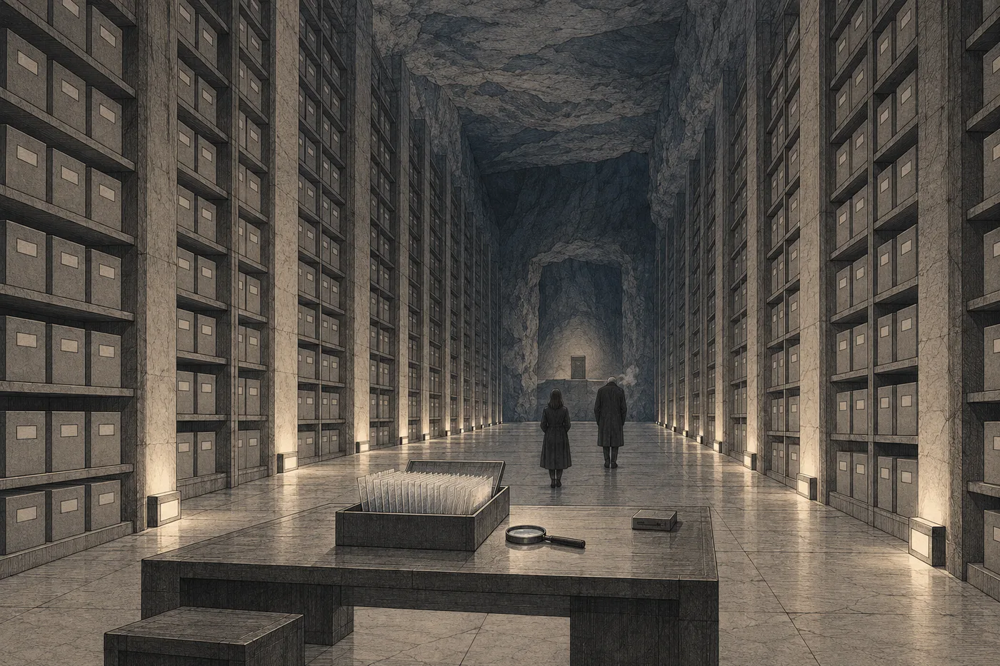

# 5. Archiv

Odpověď přišla v šest ráno a měla čtyři řádky.

*Fyzický přístup ke spisu povolen. Spis se nevydává, nekopíruje a není v síti. Přijeďte osobně; měsíční linka z Lumy v 9:10. Vezměte si teplé oblečení. T. Hals.*

Nara si ji přečetla vleže, ještě než se rozsvítilo. Pak si ji přečetla znovu, kvůli poslední větě. Za dvacet let dostala od úřadů tisíce odpovědí a žádná jí neradila, co si má obléct.

Teplé oblečení neměla. Nikdy ho nepotřebovala. Na Orse bylo všude stejně, v bytě, v kanceláři, v soudní síni i na Dolním náměstí, a kdo chtěl jinou teplotu, řekl si o ni a dostal ji. Nara otevřela skříň a dívala se do ní. Nakonec si oblékla dvě košile přes sebe a cítila se hloupě.

Lumi jí napsala, že zruší dopolední schůzky a odpoledne taky. Pak připsala: *Teplé oblečení?* Nara odpověděla, že neví.

*

Na Lumě přestoupila na měsíční linku. Byla to první loď za dlouhou dobu, která se netočila.

Nara to poznala hned, jak se odpoutala od nástupiště. Tělo ztratilo váhu a nenašlo ji nikde jinde. Žaludek se jí zvedl k hrudní kosti a tam zůstal. Pásy ji držely v sedadle, ale ruce jí samy vyplouvaly z klína. Síť jí nabídla zklidnění proti nevolnosti. Nara odmítla a pak si uvědomila, že jedno zklidnění už má, a nevěděla, jestli by se dvě sčítala.

Linka letěla dvě hodiny. Většinu té doby měla Nara zavřené oči.

Když je otevřela, byl v průzoru měsíc. Nebyl kulatý. Byl to šedý svah, který zaplnil celý průzor a pomalu se k nim zvedal, a na něm terasy. Dlouhé, rovné stupně, jeden pod druhým, vylámané do kamene, jako by někdo do svahu vytesal schodiště pro někoho velmi velkého. Na nejnižší terase stály stroje a nehýbaly se.

*Lom Severní terasa,* napsala síť. *Těžba stavebního kameniva pro prstenec Halm. Vedlejší produkt: dekorativní drť.*

Nara se dívala na terasy, dokud nezmizely pod okrajem průzoru. Šedý kámen. Stejný odstín, jaký měl ten na jejím stole. Ilan ho tehdy přinesl ze školy v dlani a nechtěl ho dát z ruky ani u večeře.

*

Na měsíci se nic netočilo.

Věděla, že na měsících a planetách drží člověka u země něco jiného než rotace. Učila se to ve škole stejně jako každý a pak na to čtyřicet let nepomyslela. Teď vystoupila z linky do příletové haly a udělala první krok. Noha se jí odlepila od podlahy snadno, jako by jí někdo pomáhal, a pak se dlouho vracela dolů.

Byla lehká. To čekala. Nečekala, že *dolů* bude jinde.

Na Orse bylo dolů ven, od osy. Podlaha se pod nohama nepatrně zakřivovala nahoru, na obě strany, a kdo hodil míček, viděl, jak mu uhne. Člověk to necítil, protože to cítil celý život. Tady bylo dolů pod ní. Rovně, přímo, pořád stejně. Otočila hlavou a svět se otočil s ní, přesně a hned. Nic neplavalo. Nic se nezpozdilo.

Stála uprostřed haly a točila hlavou, doleva a doprava, jako dítě. Poprvé v životě stála na něčem, co se netočilo, a bylo jí z toho zle víc než v Sedmé loděnici.

Muž u výdeje zavazadel se na ni díval. Neřekl nic. Asi to tu viděl každý den.

*

Vchod do hlubokého úložiště byl nízká budova na okraji haly. Za ní nebylo nic, jen výtah.

Výtah jel dolů jedenáct minut. Nara to věděla přesně, protože se celou dobu dívala na řádek, kam síť napsala *Hloubka: 340 m* a potom *Hloubka: 680 m* a pak už jen *Spojení: omezené.* Čísla se obnovovala pomaleji a pomaleji. Kolem dvanácti set metrů se přestala obnovovat úplně. Zůstal jen čas a odpočet. *Do odletu: 41 dní.* Ten se ukládal v ní, ne v síti, a nebylo mu potřeba nic odjinud.

Pak se dveře otevřely a do kabiny vtekla zima.

Byla to zima, jakou Nara neznala. Nebyla to studená místnost ani studená voda. Byla to zima, která neodcházela. Vešla jí do rukávů, pod obě košile, a usadila se jí na kůži, a když Nara vydechla, viděla vlastní dech. Zastavila se a dívala se na něj. Bílý obláček, který se rozplynul.

„Vy jste si teplé oblečení nevzala,“ řekl někdo.

*

Tomen Hals byl vysoký a tak hubený, že se zdálo, že ho drží pohromadě jen kabát. Byl shrbený tím způsobem, jakým se shrbí lidé, kteří celý život chodí nízkými chodbami. Hlavu měl holou až na bílé chmýří nad ušima. Na rukou měl rukavice z tenké šedé látky a nesundal si je, ani když jí podával kabát.

Kabát visel na háčku vedle výtahu. Na háčku visely ještě tři další.

„Nechávají mi je tu návštěvy,“ řekl. „Ty, které mi nevěřily.“

Nara si kabát oblékla. Byl jí velký a voněl prachem a něčím kovovým. Hals čekal, až si ho zapne, a teprve potom se otočil a vykročil. Šel pomalu, protože měl čas, a ona za ním šla pomalu, protože se pořád učila, kde je dolů.

Chodba byla vylámaná ve skále. Nebyla obložená ani natřená, jen ohlazená, a stěny měly barvu teras z lomu. Ve výšce hlavy na nich byly štítky. Hals se jich cestou dotýkal. Ne všech, jen některých, prsty v rukavici, lehce, jako se zdraví známý na chodbě.

„Tady dole je síť pomalá,“ řekl, aniž se otočil. „Zvyknete si. Nebo ne. Někdo si nezvykne.“

„Kdo si nezvykne?“

„Většina.“ Zastavil se u štítku, dotkl se ho a šel dál. „Lidi z úřadů sem jezdí jednou. Ptají se, proč nemůžu poslat kopii. Řeknu jim, že kopie je v síti. A že tady je originál pro den, kdy síť nebude.“

„Takový den nebude.“

„To se mi říká taky.“ Hals se pousmál, poprvé, a jen koutkem. „Archiv nepočítá s tím, co bude. Počítá s tím, co se může stát.“

*

Oddíl historických spisů byla dlouhá síň s nízkým stropem a regály až ke stropu. V regálech stály schránky, šedé, hranaté, všechny stejné. Na každé byl štítek. Světlo bylo slabé a teplé a přicházelo odněkud zespodu, od podlahy, takže stíny šly nahoru.

„Terra,“ řekl Hals. „Od tohoto regálu.“ Ukázal rukou podél síně. „Po tamten.“

Nara se podívala, kam ukazuje. Bylo to daleko.

„Kolik schránek?“

„Dvě stě jedenáct. Bez přílohy.“

Vytáhl z regálu první schránku, položil ji na stůl uprostřed síně a otevřel ji. Uvnitř byly listy. Tenké, průsvitné, šedavé, uložené na hraně v drážkách, jeden vedle druhého, jako zuby v hřebenu. Hals jeden vytáhl, dvěma prsty za roh, a položil ho před ni na tmavou podložku.

Na listu bylo písmo. Vyleptané do hmoty tak drobně, že vypadalo jako šedý prach. Nara se na ně podívala a pak udělala to, co dělala celý život, když bylo písmo malé: vzadu za očima, kde se dají věci přiblížit, sáhla po něm.

Nic se nestalo.

Zkusila to znovu. List ležel na podložce a byl pořád stejně daleko a písmo bylo pořád prach. Teprve potom si uvědomila, že list není v síti. Síť neměla co přiblížit. Měla jen to, co viděly její oči, a ty víc neviděly.

Hals jí mlčky podal lupu. Kulaté sklo v kovovém kroužku na rukojeti.

Nara ji vzala. Nikdy předtím lupu v ruce neměla. Chvíli nevěděla, jak daleko ji má držet. Pak jí písmo pod sklem najednou vyskočilo vstříc, ostré, velké, s každou čárkou na svém místě, a ona se lekla tak, že lupu málem upustila.

Hals se nesmál. Asi to tu viděl taky.

*

Byl to zápis z hlavního jednání. Stará úřední řeč, slovesa na konci. Síť pod ním pomalu, se zpožděním, skládala překlad, řádek po řádku, jako by ho přinášela z velké dálky. Nara ho stáhla dolů a četla originál.

Hlavní jednání trvalo devět dní. Nara to nevěděla. Nevěděl to nikdo, koho znala; ve škole se učili rozsudek, ne proces. Devět dní jednání o útoku, při kterém zemřely tisíce lidí. Před soudem stálo čtyřicet obžalovaných. Ostatní, víc než dvacet tři tisíc lidí, soud odsoudil písemně, v oddělených řízeních, podle seznamů.

Čtyřicet lidí v síni. Dvacet tři tisíc na seznamech.

Nara se opřela o stůl. Pod lupou ležela věta, kterou předseda tehdejšího senátu řekl první den: *Soud projedná čin. O příslušnosti k hnutí rozhodne podle záznamů.* Za devět set let se změnila řeč, ale ne tahle věta. Nara ji znala. Stála i v hromadném rozsudku nad Ilanem, skoro doslova, na straně čtyři.

Četla dál. Pomalu, list po listu, a Hals jí listy podával a odebíral, aniž by se ptal, a ukládal je zpátky do drážek, každý na své místo.

Svědci. Technici, správci habitatů, lékaři. Kolik lidí zemřelo, ve kterých patrech, v jakém pořadí selhávaly okruhy. Nara to četla a cítila, jak jí ruka s lupou chladne. Ne zimou. Nebo i zimou. V jednom zápisu svědčila žena ze správy vodního okruhu, která přežila, protože byla na směně v uzavřené strojovně. Popisovala, jak volala do bytu a byt neodpovídal. Soud ji nechal mluvit dlouho. Zápis to zaznamenal celé, každé slovo. Na konci její výpovědi stálo: *Svědkyně požádala o přestávku. Přestávka povolena.*

Nara list položila a chvíli se na něj nedívala.

Pak přišel oddíl, který zápis nazýval *Provedení činu*. Soud v něm shrnoval, čím a jak byl útok proveden. Odvolával se na technické záznamy a na znalce. A na jedno přiznání. Jediné, které v celém zápisu hlavního jednání stálo se jménem.

*Jak plyne z přiznání obžalovaného Erena, technika údržby distribučních sítí. Přiznání podepsáno.*

Nara se u toho jména zastavila. Nevěděla proč. Bylo to krátké jméno, obyčejné, takových byly v seznamech tisíce. Ale bylo jediné. Čtyřicet obžalovaných, devět dní, a soud se v oddílu o tom, jak se to stalo, opřel o jednoho technika údržby.

„Přiznání,“ řekla. „Jsou tady?“

„Všechna,“ řekl Hals. „Je jich hodně.“

*

Bylo jich hodně. Zabírala osmdesát schránek.

Hals je neotvíral postupně. Otevřel jednu, náhodnou, z prostředka řady, a pak další, ze vzdáleného konce, a pak třetí, a nechal Naru, ať si vybírá. Každý list jedno přiznání. Záhlaví: jméno, zařazení, kategorie. Pod tím text. Pod textem jedna ze čtyř formulí.

Nara četla první. Pak druhé. Pak sáhla do jiné schránky a četla třetí.

*Hlásil jsem se k hnutí Otevřená mysl. Věděl jsem o jeho záměrech. Účastnil jsem se schůzek, na nichž se o nich mluvilo. Nesu svůj díl odpovědnosti za čin, který hnutí spáchalo.*

Bylo to stejné. Slovo od slova. Jméno se měnilo, zařazení se měnilo, a u žen se měnil tvar slovesa. Text zůstával. Nara vzala čtvrtý list, pak pátý, a v každém stálo totéž, jen jednou bylo *schůzek* nahrazeno *setkání*, jako by se písař spletl nebo se mu chtělo změnit aspoň jedno slovo.

U podporovatelů byl text kratší. Tři věty místo čtyř. *Věděl jsem* tam zůstalo.

Za dvacet let Nara přečetla stovky přiznání. Lidé se přiznávají různě. Jeden začne od konce, druhý od toho, co ho nejvíc tíží, třetí od počasí. Každý má svoje slova, i když mu je napíše advokát, protože advokát je píše podle něj. Tisíce lidí si nevzpomenou stejnými slovy. Tisíce lidí dostanou jeden text a potvrdí ho.

„Kolik jich je podepsaných?“ zeptala se.

Hals se podíval na štítek nad schránkami, kde bylo něco vyleptáno menším písmem. „Podepsaných jedenáct tisíc tři sta. Nepodepsaných tři tisíce pět set. Odmítnutých…“ Naklonil se. „Dvě stě šest.“

„Dvě stě šest.“

„A nevyžadovaných osm tisíc devět set. Ti tady nejsou. Ti nemají list. Jen řádek v seznamu.“

Dvě stě šest lidí z dvaceti čtyř tisíc dostalo text, nahlas řeklo do záznamu, že ho odmítá, a stejně odletělo. Nara si to číslo zapamatovala. Nemusela. Síť by si ho zapamatovala za ni, kdyby tu nějaká byla.

„Chci vidět jeho přiznání,“ řekla. „Toho technika.“

Hals nemusel hledat. Šel podél regálu, dotkl se jednoho štítku, pak druhého, a u třetího se zastavil a vytáhl schránku. Prsty v rukavici přejel po hranách listů a jeden vytáhl. Nara se ani nezeptala, jak to ví. Byl tu čtyřicet šest let.

*Eren. Technik údržby distribučních sítí. Člen.*

Text byl stejný. Čtyři věty. *Hlásil jsem se. Věděl jsem. Účastnil jsem se. Nesu svůj díl.* Ani jedno slovo nebylo jeho. Pod textem stálo *Přiznání podepsáno* a pod tím drobný znak totožnosti, kterým se tehdy podepisovalo, stejně jako dnes, kývnutím někde vzadu za očima.

Nara se na ten list dívala dlouho. Soud v zápisu napsal, že z tohoto přiznání plyne, jak byl čin proveden. Z přiznání, ve kterém o tom, jak byl čin proveden, nestálo nic. Jen to, co stálo u tisíců dalších.

Pod hlavním textem byl ještě jeden řádek, menší, s odkazem. Nara ho pod lupou nepřečetla celý, jen začátek: *viz*. Dál byl list poškrábaný.

„Ten odkaz,“ řekla.

Hals se naklonil. „Na technické záznamy,“ řekl. „Nebo na přílohu k přiznání. Takhle se značilo obojí.“ Narovnal se. „Technické záznamy jsou v tamté řadě. Čtyřicet dva schránek. Přeju vám hodně štěstí.“

*

Technickým záznamům nerozuměla.

Otevřela dvě schránky a v obou byly listy hustě popsané řádky, které nebyly řečí. Čas, značka, čísla. Čas, značka, čísla. Občas mezi nimi slovo, a slova byla krátká a stále stejná. *Potlačeno. Potlačeno. Potlačeno.* Nara četla jeden list od začátku do konce a nevěděla, co čte. Věděla jen, že každý řádek je o vteřinu pozdější než ten před ním a že je jich stovky.

Na jednom listu stálo v záhlaví *Provozní deník, uzel čtvrtého prstence*, a pod tím zase čas, značka, čísla.

Potřebovala by někoho, kdo to umí číst. Ne archiváře, ani advokáta. Někoho, kdo četl provozní deníky celý život a ví, co znamená, když se v nich hodinu nic neděje. Zapsala si to do poznámek, a když síť poznámku neuložila, protože nemohla, opakovala si to v duchu, jako se opakují čísla dveří.

Uložila list zpátky do drážky. Ruce měla studené a prsty jí nechtěly poslouchat.

„Teď to, kvůli čemu jste přišla,“ řekl Hals.

*

Příloha nebyla v řadě. Stála zvlášť, v nice na konci síně, kde světlo od podlahy sláblo. Byla menší než ostatní schránky, užší a tmavší, a byla zalitá. Ne zamčená, zalitá. Spáry mezi víkem a tělem schránky vyplňovala hmota, která kdysi tekla a pak ztvrdla, a ve hmotě byly otištěny dvě pečeti.

Jednu Nara znala ze soudních listin. Pečeť Spolkového soudu, váhy v kruhu. Druhá byla osm oblouků z jednoho bodu, každý trochu jinak zakřivený.

Na víku byl štítek. Nara se k němu sklonila s lupou.

*Příloha k rozsudku Terra. Zapečetěno z bezpečnostních důvodů. Přístup: senát Spolkového soudu na základě usnesení.*

Pod tím obsah. Čtyři řádky.

*Část I: průzkumné listy, 340.*
*Část II: listiny, 12.*
*Část III: opis, 9.*
*Část IV: listina, 1.*

A pod obsahem úplně dole ještě jedno pole. Bylo vyleptané jinak, hrubší čárou, jako by ho schránka psala sama. Možná ho opravdu psala sama.

*Uloženo:* a za tím datum ve starém počtu, devět set let staré.
*Otevřeno: 0.*

Nara se narovnala.

„Síť mi řekla, že údaj o zpřístupnění není k dispozici,“ řekla.

„Síť to neví,“ řekl Hals. „Nikdo se jí na to nikdy nezeptal. Schránka to ví.“ Dotkl se rukavicí okraje niky, ne schránky. „Nula. Od uložení. Za čtyřicet šest let, co tu jsem, se na ni nikdo nezeptal. Ani úřad, ani soud. Vy jste první.“

„Nula,“ opakovala Nara.

Soud viděl a zapsal: skutková zjištění o vhodnosti místa výkonu jsou obsažena v příloze. A příloha nebyla nikdy otevřena. Ani tehdy? Ani soudem, který rozsudek psal? Nara se na to číslo dívala a nevěřila mu, a věřila mu, a obojí najednou.

„Co je průzkumný list?“ zeptala se.

„List Koloniálního úřadu. Záznam z průzkumu světa.“ Hals mluvil pomalu, jako by si vybavoval něco, co dlouho nepotřeboval. „Mají jiný formát než listiny. Obraz a text vedle sebe a značení, které dnes nikdo nepoužívá. Úřad je kdysi pořizoval ke každému světu, který zkoumal. Většinou prázdné světy. Kámen, led, nic.“ Odmlčel se. „Dnes je umí číst už jen jeden člověk. Pokud ještě žije. Hadra Mel. Vedla u úřadu archiv průzkumů, když jsem sem nastoupil. Učila mě, jak se s nimi zachází. Musí jí být přes devadesát.“

„Žije?“

„Před rokem žila. Poslala mi pozdrav k výročí nástupu. Ona si taková data pamatuje.“ Hals se znovu pousmál, koutkem. „Bydlí na Lumě. Nebo bydlela.“

Nara si zapamatovala jméno. Opakovala si ho v duchu dvakrát. Hadra Mel. Luma.

*

Na cestě zpátky k výtahu se Hals zastavil u regálu, kde nic nebylo. Jen prázdná místa po schránkách, které někdo odnesl nebo které nikdy nepřinesl.

„Zeptám se vás na něco,“ řekla Nara.

„Ptejte se.“

„Proč mi to ukazujete?“

Hals se na ni podíval. Měl světlé oči, vodnaté, jak je mívají staří lidé, a díval se přímo na ni, ne kousek vedle. Tady dole se na nikoho nedíval kousek vedle. Neměl na co.

„Požádala jste,“ řekl. „Podle předpisu.“

„To není odpověď.“

„Je to odpověď, kterou dám úřadu, kdyby se ptal.“ Hals sundal jednu rukavici a zase si ji natáhl, pomalu, prst po prstu. „A tady je ta druhá. Archiv nemá názor. Já taky ne, mám ho jen na předpisy. Ale archiv, ve kterém je něco, co nikdy nikdo nečetl, není archiv. Je to sklad.“ Odmlčel se. „Já jsem nechtěl být skladník.“

„Může vás to stát místo.“

„Může.“ Hals se podíval podél regálů, do tmy, kde světlo od podlahy nedosáhlo. „Je mi sedmdesát jedna. Bydlím o dvě patra výš, ve stejné skále. Kdyby mě odsud vzali, nevím, kde bych byl.“ Řekl to věcně, jako údaj ze štítku. „Tak se snažím, aby mě odsud nevzali. A zároveň dělám, co mám dělat. Většinou to jde obojí.“

„A když ne?“

Hals neodpověděl. Došli k výtahu. Pomohl jí z kabátu a pověsil ho na háček vedle ostatních tří.

„Na přílohu potřebujete usnesení senátu,“ řekl. „Já ji neotevřu. Ani kdybyste mě prosila. Ani kdyby mě prosil soud bez usnesení.“

„Já vím.“

„Já vím, že víte. Říkám to kvůli sobě.“

*

Výtah jel nahoru jedenáct minut. Kolem sedmi set metrů pod povrchem se v koutku vědomí pohnul první řádek a potom se tam nahrnulo všechno najednou. Nara stála v kabině a nechala to přes sebe přejít. Zprávy od Lumi. Termíny. Dotaz komory, zda vyjádření odeslala, ačkoli ho odeslala včera. Tři Davenovy hovory, odložené, a jeden vzkaz bez textu, jen *Volal jsem.*

A připomínka. *Zítra 9:00–9:40: Sedmá loděnice, návštěva. Rezervováno.*

Nara ji nechala svítit.

V příletové hale si sedla na lavici u průzoru, ze kterého byly vidět terasy lomu, a otevřela prázdné podání. Psala rychle, protože to měla v hlavě celou cestu nahoru, a nechtěla, aby se jí to cestou rozpadlo. Ruce jí pořád byly studené. V hale bylo teplo, ale nepomáhalo to.

*Žádost navrhovatelky o zpřístupnění spisu prvního procesu ve věci Terra v celém rozsahu, včetně přílohy k rozsudku zapečetěné z bezpečnostních důvodů.*

Pod to zdůvodnění. Jedna strana. Rozsudek sám odkazuje skutková zjištění o vhodnosti místa výkonu do přílohy. Přiměřenost trestu na nich stojí. Senát nemůže posoudit, zda je výkon trestu podle Terry dnes slučitelný s ústavou, aniž zná zjištění, o která se trest opírá. Rozsudek sám přístup senátu předvídá. A pak jedna věta, kterou napsala, smazala a napsala znovu:

*Podle záznamu na schránce nebyla příloha od svého uložení nikdy otevřena.*

Nechala ji tam. Byl to fakt. Fakty se nemažou.

Podepsala. *Doručeno. Senát předsedkyně O. Tann. Odpůrce vyrozuměn.*

Odpůrce vyrozuměn. Teď to věděla i Sabe Ardaine. Možná to věděla už v době, kdy Nara jela výtahem nahoru, protože podání podle Terry šla automaticky k bezpečnostnímu posouzení a posuzovatel byl stejný jako odpůrce. Nara na to myslela a nic necítila. Bylo to tak dobře.

*

Na zpáteční lince už měla oči otevřené.

Když loď odrazila od měsíce a tělo zase ztratilo váhu, Nara udělala něco, na co dole neměla síť. Otevřela veřejnou přílohu Terry, seznam odsouzených po oblastech, a zadala jméno.

Síť jich našla jedenáct. Eren bylo obyčejné jméno. Nara zúžila hledání na zařazení a zůstal jeden řádek.

*Oblast 6. Modul 4. Eren, technik údržby distribučních sítí. Přiznání podepsáno. Doprovod: Maela, Tio (dcera, 6).*

Oblast šest. Nara se podívala do záhlaví oblasti. Sedm modulů. Přes tři tisíce lidí. Čtvrtý byl nejmenší, tři sta dvanáct. Pak se podívala zpátky na řádek.

Doprovod. Tak to tehdy psali. Kdo letěl s odsouzeným, aniž byl sám odsouzen jako člen nebo podporovatel. Osoby ve společné domácnosti, usoudila. Přiznání nevyžadováno. Dcera, šest let.

Když bylo Ilanovi šest, sedával jí při čtení na klíně. Pamatovala si to bez záznamu. Pamatovala si, jak těžký byl a jak se jí opíral hlavou o bradu, a že měl vlasy, které voněly mýdlem z dětské koupelny.

Zavřela seznam.

Průzorem byl vidět měsíc, jak se zmenšuje. Terasy lomu už nebyly poznat. Jen šedý kotouč a na něm světlejší skvrna. Někde pod ní, dvanáct set metrů v kameni, stála v nice úzká tmavá schránka, kterou za devět set let nikdo neotevřel, a vedle ní Tomen Hals zhasínal světlo od podlahy, aby se zbytečně nesvítilo.

*Do odletu: 41 dní.*

Ilan by teď měl na provázku třicet šest uzlíků. Zítra ráno uváže třicátý sedmý. Nara si to spočítala sama, bez sítě, jen aby věděla, že to umí.
