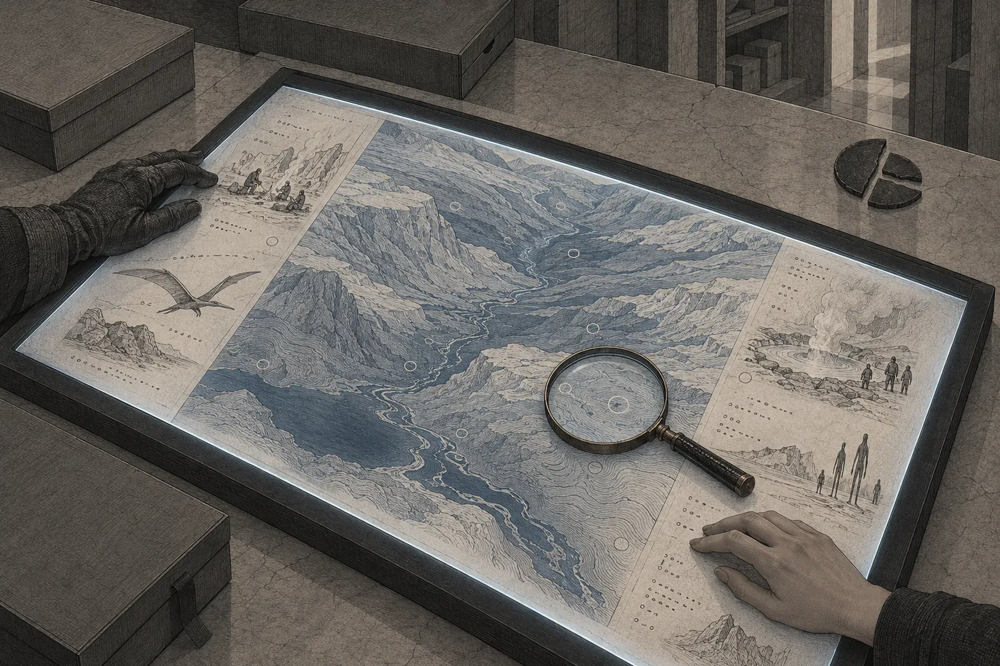

# 7. Průzkum

Na měsíční lince si Ardaine sedla vedle ní.

Volných míst bylo dost. Senát seděl vepředu, Tann u průzoru a oba soudci za ní, a za nimi byly tři prázdné řady. Ardaine prošla kolem všech a sedla si na sedadlo vedle Nary, jako by to bylo její místo. Připoutala se. Když loď odrazila od Lumy a tělo ztratilo váhu, Ardaine si ruce položila na kolena a držela je tam. Nara viděla, jak se jí prsty lehce zvedají, a jak je pokaždé zase přitiskne dolů.

„Byla jste tam už,“ řekla Ardaine.

„Před šesti dny.“

„Já ještě ne.“ Ardaine se dívala před sebe, na opěradlo sedadla. „Úřad má kopii skoro všeho, co kdy vydal. Tohle ne.“

Nara mlčela. Nevěděla, jestli je to přiznání, nebo argument. U Ardaine to mohlo být obojí.

„Víte, proč jsem souhlasila s paní Mel?“ zeptala se Ardaine po chvíli.

„Řekla jste, že je vaše.“

„Řekla jsem to, protože to je pravda.“ Ardaine konečně otočila hlavu a podívala se na ni tím pohledem, který nikam neuhýbal. „Souhlasila jsem, protože paní Mel neřekne nic, co v listech není. Ani pro vás, ani pro mě. Takových lidí moc není, paní advokátko. Já si jich vážím.“

„A kdyby v listech bylo něco, co vám uškodí?“

„Pak mi to uškodí,“ řekla Ardaine. „Ale nebude to lež.“

Pak se znovu dívala před sebe a mlčela až do přistání. Nara si všimla, že ruce už nedrží. Leží jí na kolenou samy, lehce nadzvednuté, a Ardaine to nechává být.

*

Hadra Mel přijela pozdější linkou a výtahem dolů jako poslední. Jako jediná se v kabině neopírala.

Byla drobná. Menší než Ardaine, menší než kdokoli, koho Nara znala, a tak lehká, že se zdálo, že ji měsíc ani nedrží. Bílé vlasy měla ostříhané nakrátko, nakřivo, jako by si je stříhala sama a nedívala se při tom do zrcadla. Na sobě měla kabát, svůj, ne z háčku. Dlouhý, tmavý, s velkými kapsami.

Hals jí podal ruku a ona ji přijala. Vystoupila z kabiny, udělala dva kroky a zastavila se.

„Tady mě nebolí kolena,“ řekla. „Měla jsem se sem odstěhovat před třiceti lety. Tomene, proč jsi mi to neřekl?“

„Říkal jsem vám to, paní Mel.“

„Tak jsem neposlouchala.“ Podívala se na ostatní. Na Tann a oba soudce, na Ardaine, na Naru. Dívala se na každého zvlášť, chvíli, jako by si je zapisovala. „Vy jste ta advokátka.“

„Ano.“

„Psala jste mi slušně.“ Mel kývla, jako by to bylo něco, co se počítá. „Pojďme. Ve tři odpoledne usínám. To se nedá nic dělat.“

*

Hals postavil k nice se schránkou stůl a k němu sedm židlí. Jedna měla opěradlo. Na stůl položil prosvětlovací desku, plochou a tmavou, kterou Nara nikdy předtím neviděla, a vedle ní lupy, tři. A ještě jeden přístroj, malý, šedý, s okénkem, který postavil na kraj stolu a zapnul.

„Zapisovač úložiště,“ řekl. „Zapisuje do spisu pod pečetí. Nikam jinam.“

Pak vzal nástroj podobný dlátu a začal odlamovat hmotu ze spár schránky.

Šlo to pomalu. Hmota byla tvrdá a křehká zároveň a odlupovala se v šupinách, které padaly na podlahu tak pomalu, že je Nara stačila sledovat celou cestu dolů. Pečeť soudu, váhy v kruhu, praskla napříč. Vedle ní se osm oblouků úřadu rozpadlo na tři kusy. Tann stála s rukama za zády a dívala se, jak Hals pracuje. Ardaine seděla. Mladší soudce si olízl rty.

Když byla poslední spára volná, Hals zvedl víko.

Na štítku, v poli, které psala schránka sama, se nula změnila v jedničku. Nara to viděla, protože se dívala právě tam. Nikdo jiný se tam nedíval.

A pak, v koutku vědomí, řádek.

*Záznam přerušen: čtení pod pečetí.*

Nic jiného se nestalo. Síň byla stejná, světlo od podlahy stejné, zima stejná. Nara se rozhlédla, jako by čekala, že se něco změní na stěnách. Nezměnilo se nic. Jen věděla, že od této chvíle nic z toho, co uvidí, nebude mít uložené jinde než v sobě.

Zkusila si zapamatovat první věc, kterou uviděla. Hals vytahuje první list. Hrana listu je jiná než u listů spisu, má na sobě drobný zářez. Zapamatovala si zářez. Opakovala si ho.

Bylo to jako chodit po tmě a počítat kroky.

*

„Nejdřív formát,“ řekla Mel. „Jinak to nebudete umět číst a budete číst to, co si myslíte.“

Seděla na židli s opěradlem a před sebou měla první list na prosvětlovací desce. Deska se pod ním rozsvítila zespodu a list ožil. Nebyl šedý. Byl barevný, celý, a Nara poprvé pochopila, proč je průsvitný. Obraz byl ve hmotě a čekal na světlo.

„Každý průzkumný list má tři části,“ řekla Mel. „Vlevo obraz. Vpravo text, ve dvou sloupcích. Nahoře záhlaví: svět, oblast, sekvence, čas. Čas je v počtu lodi. Na náš počet ho nepřevádějte, stejně by to nesedělo.“

Zvedla ruku, prst nad textem, ale nedotkla se ho.

„Levý sloupec je *viděno*. Co zachytil přístroj nebo co viděl průzkumník vlastníma očima. Pravý sloupec je *usouzeno*. Co si o tom průzkumník myslel.“ Odmlčela se. „Pravému sloupci se nevěří. Nevěřilo se mu ani tehdy. Proto ho psali zvlášť. Kdo četl průzkum, četl nejdřív levý sloupec, celý, od začátku do konce. Pravý až potom, jestli vůbec.“

„Proč ho tedy psali?“ zeptal se mladší soudce.

Mel se na něj podívala.

„Protože průzkumník je člověk, pane soudce. Něco si myslí, ať chce, nebo nechce. Je lepší, když to napíše vedle, než když mu to vteče do levého sloupce.“

Pak ukázala na okraj listu, kde byly drobné značky. Krátká čára na začátku řádku, za ní tečky ve skupinách. Jedna, dvě, tři, čtyři. Nikdy víc.

„Počty,“ řekla. „Takhle se tehdy počítalo v průzkumu. Krátká čára říká, že tu začíná řádek. Tečky jsou jednotky, nejvýš čtyři. Čárky vyšší řády. Nečtěte to po desítkách, nejde to.“ Pousmála se. „Mě to učili dva roky. Vám to přečtu.“

*

Zapisovač úložiště tiše pracoval. Nara slyšela jeho zvuk, slabé předení, a pak ho přestala slyšet.

Mel začala od začátku. Od svého začátku, ne od začátku schránky.

„Tenhle průzkum je starší než proces,“ řekla. „O kolik, to vám přesně neřeknu. O hodně. Úřad tehdy posílal lodě k mnoha světům. Lodě letěly dlouho, posádky spaly, na místě se probudily a zkoumaly. Pak poslaly listy domů. Listy šly taky dlouho, ale rychleji než lodě.“

„Vrátily se ty lodě?“ zeptala se Nara.

„To v listech není.“ Mel to řekla bez lítosti, jako údaj. „Listy se vrátily.“

Pak odložila první list a na desku položila druhý.

Byl to obraz světa.

Celého. Ze vzdálenosti, z jaké ho Nara nikdy neviděla, protože ho nikdo neviděl. Koule. Modrá, tak jak ji kreslily děti, a hnědá a zelená na místech, kde to děti nekreslily. A bílá. Nara nevěděla, že tam bude bílá. Bílé bylo hodně. Celý jeden okraj koule, nahoře, byl bílý a hrubý, jako by ho někdo pokryl solí, a přes modrou se táhly bílé pruhy a víry, tenké a měkké, které nepatřily k zemi ani k vodě. Bílou na dětských obrazech nikdo nekreslil. Nikdo nevěděl, že tam je.

Nara se dívala.

*Podívej se, jestli je odtamtud vidět planeta. Celá.*

Viděla ji. Celou. Ne z měsíce, ne z průzoru. Z listu, který devět set let ležel v zalité schránce a který nesměla nikomu popsat. Ani jemu. Zvlášť ne jemu.

„Bílá nahoře je led a sníh,“ řekla Mel. „Ty pruhy jsou mraky. Voda ve vzduchu.“ Odmlčela se. „Průzkumníci tehdy zapsali, že je chladno. Že led sahá daleko na jih. V levém sloupci, pane soudce.“

Tann se dívala na kouli dlouho. Nara si všimla, že poprvé za celé dopoledne vytáhla ruce zpoza zad.

*

Pak krajiny.

Mel je pokládala na desku jednu po druhé a Nara se v nich nejdřív nevyznala. Nevěděla, kam se dívat. Na listech nebyl strop. Nikde. Obraz začínal dole zemí a nahoře nekončil ničím, jen modrou, která byla světlejší, čím výš šla, a nedalo se poznat, kde přestává. Nara hledala okraj. Oko ho hledalo samo, jako hledá stěnu v cizí místnosti, a nenacházelo ho.

Zelené plochy. Mel řekla *les*. Byly to rostliny, ale ne takové, jaké rostly v zahradách na Orse v řádcích pod světlem. Tyhle byly vyšší než patro domu a stály tak hustě, že mezi nimi nebylo vidět zem. Nikdo je nesázel. Nikdo se o ně nestaral. Voda, která tekla korytem dolů po svahu, sama, bez čerpadla, a nikdo ji nečistil. Hory. Šedé a bílé, tak vysoké, že Nara nevěděla, jak velké jsou, protože nebylo s čím je srovnat.

Na jednom listu stál v popředí strom a na jeho větvi seděl pták. Malý, tmavý, s otevřeným zobákem. Nara ho viděla poprvé v životě a díval se do přístroje.

„Krajiny jsou zajímavé jen pro geology,“ řekla Mel. „Ale musela jsem vám je ukázat. Bez nich nepochopíte vzdálenosti.“

Položila na desku mapu.

*

Mapa byla velká a rozdělená na pole. Pole byla očíslovaná. Nara napočítala dvacet tři.

„Oblasti průzkumu,“ řekla Mel. „Loď jich zkoumala dvacet tři. Na různých pevninách, v různé výšce, u vody i daleko od ní.“ Ukázala na osm polí, která měla vedle čísla ještě jedno, menší. „A tohle je připsané. Jinou rukou. Později.“

Nara se sklonila s lupou. U osmi polí stálo vedle průzkumného čísla číslo druhé. Jedna až osm. Hrubší čarou, jiným tvarem znaků.

„Oblasti výkonu,“ řekla Tann.

Byla to první věc, kterou za celou dobu řekla. Mel se k ní otočila.

„To nevím, paní předsedkyně. Vím, že je to připsané. Kdo to připsal a proč, to v listu není.“ Pak, po chvíli: „Ale je jich osm.“

Nikdo nic neřekl. Ardaine se dívala na mapu a nepohnula se.

Nara se podívala na okraj mapy. Na jedné pevnině, daleko od všech dvaceti tří polí, byla oblast ohraničená jinou čarou. Přerušovanou. Uvnitř žádné číslo. Jen značka, kterou Nara neznala, a vedle ní krátký text.

„Co je tohle?“

Mel si list přitáhla blíž a sklonila se k němu tak nízko, že se skoro dotýkala nosem.

„*Nepřistávat. Podle záznamů patronů.*“ Narovnala se. „Ta značka není průzkumníků. Je převzatá. Takové jsou v průzkumech výjimečně, na místech, o kterých úřad něco věděl dřív, než tam loď přiletěla.“

„Z čeho to věděl?“

„Ze záznamů patronů. Tak se tomu říkalo. Staré záznamy, které úřad zdědil. Já jsem je nikdy neviděla. Nikdo z archivu průzkumů je neviděl.“ Mel pokrčila rameny. „Víc o té značce nevím. Kdybych věděla, řekla bych vám to.“

Nara si zapamatovala přerušovanou čáru. Neměla ji kam uložit. Uložila ji do sebe, vedle zářezu na hraně listu a vedle bílé na severu.

*

Pak kroužky.

Na mapách jednotlivých oblastí byly kroužky. Malé, světlé, rozeseté po listu, někde hustě, jinde jen jeden dva. Každý kroužek měl číslo a každé číslo odkazovalo na další list.

„Vyznačené skupiny,“ řekla Mel. „Všechno, co se pohybuje a není to jen zvíře, má v průzkumu kroužek. Tak zněl předpis.“ Odmlčela se. „Na prázdných světech kroužky nejsou. Za čtyřicet let jsem jich viděla pár. Vždycky se nakonec ukázalo, že je to zvíře. Nebo chyba přístroje.“

Položila na desku první list skupiny.

Lidé.

Nara to poznala dřív, než si přečetla levý sloupec. Postavy lidského tvaru u ohně, malé, z výšky. Kolem nich kůže na tyčích. Někdo stál, někdo seděl, jeden nesl na zádech dítě. Levý sloupec: *Skupiny lidského tvaru. Oheň. Nástroje z kamene. Oděv z kůží. Počet ve skupině dvacet až čtyřicet. Rozptýleně, ve všech oblastech.*

Pravý sloupec měl jedno slovo. *Lidé.* A za ním znaménko, které Mel přečetla jako otazník.

„Proč otazník?“ zeptala se Nara.

„Nevím,“ řekla Mel. „Možná nevěděl, jestli to smí napsat. Možná nevěděl, jestli to tak je. V pravém sloupci se otazníky píšou často.“

Nara se dívala na dítě na zádech. Kolébka lidstva. Neobydlený svět. Na prvním listu skupin seděli u ohně lidé, a průzkumník za nimi napsal otazník, a pak to někdo uložil do schránky a zalil.

Ještě nevěděla, co si o tom myslet. Věděla jen, že to bude muset říct nahlas, jednou, někde, a že teď to říct nesmí.

*

„Teď ti, kvůli kterým tady sedíme,“ řekla Mel.

Položila na desku list a Nara se nejdřív lekla, protože si myslela, že je to stroj. Něco, co letí. Dlouhé tenké tělo a z něj na obě strany široké plochy, napjaté jako fólie na rámu. Pak uviděla, že plochy jsou z kůže, že mají žíly, že se ohýbají. Že tělo má hlavu a ta hlava je otočená k přístroji.

*Létající plaz. Rozpětí přibližně dvě až tři výšky člověka. Membránová křídla. Hnízdí jednotlivě, v převisech skal. Loví. Počet v oblasti nízký.*

„To není ještě to,“ řekla Mel. „Dívejte se dál.“

Další list byl hnízdo. Obraz zevnitř převisu, z boku, s ostrým světlem přístroje, které vrhalo stíny. Hladká podlaha. A na ní předměty. Lesklé. Žlutá zrna, malá jako nehet. Průhledné kameny, některé jako sklo, jiné s bílým povlakem. Tmavé oblé valouny. Ležely v řadách. Ne na hromadě, ne tam, kam spadly. V řadách, s mezerami, a řady měly různou délku. A vedle nich, ve skále podlahy i na stěně nad nimi, rýhy. Tři vedle sebe, rovnoběžné, jako po prstech. Skupiny rýh, některé hlubší, jiné mělké, skoro setřené.

Levý sloupec: *V hnízdě lesklé předměty v řadách. Kov, krystaly, valouny. Rýhy ve skále, tři rovnoběžné, opakované ve skupinách. Uspořádání pravidelné.*

A pod tím, menším písmem, ještě jeden řádek.

*Druhá návštěva, po přeletu člunu: uspořádání změněno. Přidána řada.*

Nara si ten řádek přečetla dvakrát. Pak se podívala do pravého sloupce.

*Signalizace?*

Otazník.

„Je tam pohyblivý záznam,“ řekla Mel. „Ukážu vám ho. Tomene.“

Hals položil na desku list, který byl rozdělený na malá políčka, desítky, v řadách, jako okna v průčelí. Nara se sklonila s lupou. V každém políčku stejný převis, stejná hladká podlaha. V prvním je prázdný. Ve druhém do něj zboku vstupuje křídlo. Ve třetím plaz stojí na podlaze, křídla složená podél těla, a v tlamě něco drží. Ve čtvrtém se sklání. V pátém leží na konci jedné z řad nové žluté zrno. V šestém plaz zvedá hlavu.

V sedmém se dívá nahoru. Ven z převisu. Tam, odkud se dívá přístroj.

V osmém přejíždí drápem po skále a za drápem zůstávají tři světlé čáry.

Nara se narovnala. Lupu držela v ruce a ruka se jí třásla. Nevěděla, jestli zimou.

Pak se třes zastavil. Ne proto, že by přestala cítit to, co cítila. Proto, že to někdo ztlumil. Nara poznala ten plynulý pokles, jako když ventilace přejde na noční režim, a poprvé za dvanáct dní ho nenáviděla. Záznam byl přerušený. Zklidnění ne. Síť si nesměla pamatovat, co tu viděla, ale otupit to směla.

Plaz v sedmém políčku se díval nahoru a ona se na něj dívala klidně. Tak klidně, jak se na to nikdo dívat neměl.

Ardaine natáhla ruku a požádala o lupu. Nara jí ji podala. Ardaine se sklonila nad políčky a prošla je jedno po druhém, pomalu, od prvního do osmého. Pak se vrátila na začátek a prošla je znovu. Pak lupu položila na stůl a sepjala ruce.

Nara nepoznala, jestli to vidí poprvé.

*

„Malí podzemní lidé,“ řekla Mel.

Obraz ze šera, ze vchodu do skály. Postavy u vody, ze které stoupala pára. Lidského tvaru, ale široké a těžké, s krátkými silnými pažemi a velkými hlavami. Jedna z postav se otáčela k přístroji a oči měla světlé a přimhouřené, jako by ji i to šero bolelo.

*Postavy lidského tvaru, malé, široké. Výška přibližně po prsa člověku. Žijí v podzemí, u teplé vody. Na povrch vycházejí za šera. Nástroje z kamene a kosti. V chodbách vytesané stupně. Oheň v podzemí.*

Pravý sloupec: *Rozumní.*

Bez otazníku.

„Vysocí,“ řekla Mel a položila další list.

Les, soumrak, kmeny. Mezi kmeny postavy, které nejdřív vypadaly jako stíny kmenů. Vysoké, úzké, s pažemi, které byly na lidský tvar příliš dlouhé. Stály a dívaly se nahoru. Na přístroj.

*Postavy lidského tvaru, vysoké, úzké. Paže dlouhé. Les, hory. Pohyb za soumraku a v noci; na přímém světle se nezdržují. Při přeletu člunu neutíkají. Sledují člun. Jedna postava zvedla ruku.*

Pravý sloupec: *Rozumní. Pozorují nás.*

Nara se na tu větu dívala a nemohla od ní odtrhnout oči. *Pozorují nás.* Průzkumník to napsal do sloupce, kterému se nevěří. Napsal to stejně.

„Noční,“ řekla Mel.

Na listu skoro nic nebylo. Tma, kameny, a na okraji obrazu postava, napůl mimo. Střední výšky, lidského tvaru. Obličej se nedal rozeznat.

*Postavy lidského tvaru, střední. Zaznamenány jen v noci. Ve dne nezaznamenány. Obydlí nenalezena. Při přiblížení mizí.*

Pravý sloupec byl prázdný.

„Nic si o nich nemyslel,“ řekla Mel. „Nebo si myslel moc a nechtěl to napsat. Obojí se stává.“

Pak ještě jeden list, poslední ze skupin. Obraz byl rozmazaný, jako by se přístroj pohnul. Něco velkého na otevřené pláni, za pohybu. Nara se na to dívala a nedokázala říct, kolik to má končetin.

*Tvar neurčen.*

„Tohle nevěděl ani v levém sloupci,“ řekla Mel. „To je poctivé. To se cení.“

*

Ve dvě hodiny požádala Mel o přestávku.

Neřekla proč. Seděla na židli s opěradlem, ruce v klíně, a když Hals podal další list, nevzala si ho. Řekla jen: „Chvíli,“ a pak: „Prosím o přestávku.“

Hals se podíval na Tann a Tann kývla. Zapisovač úložiště předl dál. Nara věděla, co zapíše, protože to už jednou četla, v zápisu z hlavního jednání, kde svědčila žena ze správy vodního okruhu. *Svědkyně požádala o přestávku. Přestávka povolena.*

Mel seděla se zavřenýma očima. Pak je otevřela a podívala se na Naru.

„Čtyřicet jedna let jsem vedla archiv průzkumů,“ řekla. Mluvila tiše, ne k senátu. „V katalogu byl jeden svět, který neměl listy. Jen číslo, jméno a poznámku *uloženo u soudu*. Čtyřicet jedna let jsem se dívala na to prázdné místo. Myslela jsem si, že je tam kámen a led, jako všude. Že to zapečetili kvůli něčemu jinému.“ Odmlčela se. „Kvůli lidem. Kvůli tomu, kam je vezli.“

„A teď?“

„Teď nevím, co si myslet.“ Mel se pousmála, unaveně. „Ale to patří do pravého sloupce. A já jsem tady kvůli levému.“

*

Po přestávce se ptala Ardaine. Krátce, jako všechno.

„Paní Mel. Ukazují průzkumné listy, že tyto populace jsou rozumné?“

„Levý sloupec ukazuje, co viděli,“ řekla Mel. „Rozumné je slovo z pravého sloupce.“

„Děkuji.“

Ardaine se posadila. Víc se neptala. Nemusela. Nara pochopila, co udělala: vzala všechno, co dnes viděli, a nechala to stát v levém sloupci. Postavy. Hnízda. Řady. Rýhy. A rozumné zůstalo napravo, mezi otazníky, kde se mu nevěří.

Nara vstala.

„Paní Mel. Kolik průzkumů jste za život přečetla?“

„Asi čtyři sta. Možná víc. Některé několikrát.“

„V kolika z nich bylo v pravém sloupci u vyznačené skupiny slovo *rozumní*?“

Mel se na ni dívala. Dlouho. Nara viděla, že rozumí, proč se ptá, a že na tom nezáleží, protože odpověď je taková, jaká je.

„V žádném,“ řekla Mel. „Až v tomhle.“

„Děkuji.“

Tann se naklonila dopředu.

„Paní Mel. Je možné, že se průzkumníci mýlili?“

„Průzkumníci se mýlí pořád, paní předsedkyně. Proto mají dva sloupce.“ Mel si upravila kabát na kolenou. „V levém se nemýlí. Tam je jen to, co tam bylo. Jestli to bylo rozumné, nevím. Ale bylo to tam.“

*

Na konci dne položila Mel na desku ještě jeden list. Mapu oblasti, kterou průzkum vedl pod číslem čtrnáct. U čísla stála hrubší čarou připsaná *6*.

Údolí. Svahy, bílé skály, potok. Na jednom místě pára nad vodou. Tři kroužky: u páry, na terase nad ní, na protějším hřebeni. Pod mapou řádek.

*Nejbližší vyznačená skupina od navrženého místa: …* a za tím počet, tečky a čárky.

„Kolik?“ zeptala se Nara.

Mel to přečetla, pomalu, a převedla to.

„Dnes byste řekla necelý den chůze.“

Nara se dívala na páru nad vodou a na kroužek u ní. Oblast šest. Sedm modulů. Modul čtyři, tři sta dvanáct lidí. Technik údržby distribučních sítí, a s ním Maela a Tio, šest let.

*Navržené místo.* Někdo ho navrhl. Navrhl ho s touhle mapou na stole, s kroužky, s levým i pravým sloupcem, s necelým dnem chůze. A pak napsal do rozsudku, že se má za to.

Nara si sedla. Tann se na ni podívala. Nara jí pohled vrátila a nic neřekla.

Má se za to, že Země je neobydlený svět.

Nebyla to domněnka. Domněnka je, když se neví. Tohle se vědělo. Vědělo se to do posledního kroužku, do tří rýh ve skále, do jedné zvednuté ruky mezi stromy. Kdo to napsal, nepředpokládal nic. Kdo to napsal, lhal, a lhal tak opatrně, aby to nikdo nemohl nazvat lží.

*

Cestou nahoru se v koutku vědomí rozsvítilo *Záznam obnoven*, a pak všechno ostatní.

Nara stála v kabině vedle Mel, která spala opřená o Halsovu paži, a zkoušela si vybavit první list. Kouli. Bílou na severu.

Šlo to. Ale ne celé. Viděla bílou a viděla modrou a viděla víry mraků, ale nevěděla, kolik jich bylo a jak byly natočené. Kdyby to měla v záznamu, pustila by si to a spočítala je. Takhle měla jen to, co jí zůstalo. Bylo to méně, než si myslela. A bylo to její.

Zkusila si vybavit plaza v sedmém políčku, jak se dívá nahoru. To šlo celé.

V příletové hale si sedla na lavici u průzoru, kde seděla před šesti dny. Terasy lomu byly ve stínu. Otevřela vzkaz pro Sedmou loděnici, dvacet slov, ústně přes personál. Za dvacet let advokacie napsala tisíce podání a žádné jí netrvalo tak dlouho.

Nesměla nic. Nesměla napsat *viděla jsem*. Nesměla napsat *je to tam celé*. Nesměla napsat *bílá*. Mohla napsat jen to, co by napsala, kdyby nikdy nebyla dole.

*Kam jsi dal ten obraz Země ze svého pokoje? Chtěla bych ho vidět. Máma.*

Čtrnáct slov. Přečetla si je, a pak ještě jednou, jako by v nich mohlo být něco, co tam nedala. Nebylo. Odeslala je.

*Do odletu: 35 dní.*
