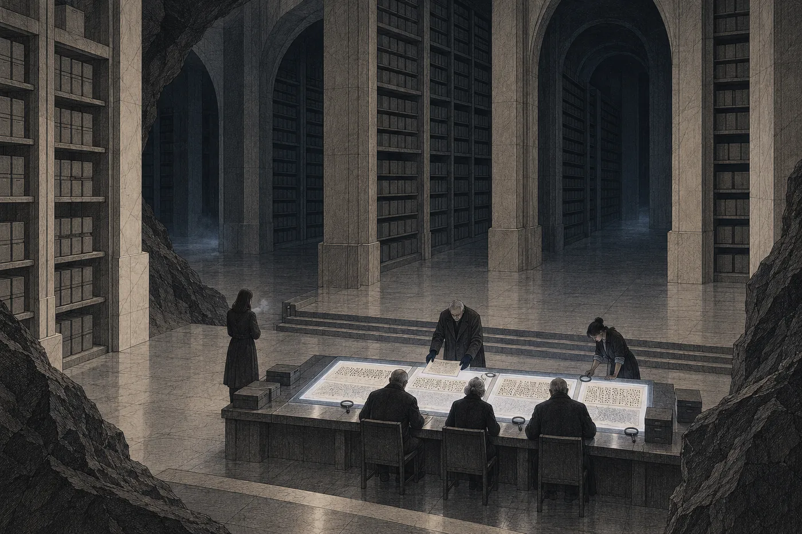

# 9. Kontaminant

Senát hledal čtenáře dva dny.

Patnáctého dne ráno přišlo usnesení, tři řádky, a Nara ho četla v kuchyni nad studeným čajem. Senát se dotázal spolkového archivu, archivu Koloniálního úřadu a obou univerzit prstence. Odpověď byla všude stejná. Zápisový systém patronů se nečte. Čtenář není znám. Poslední záznam o člověku, který ho uměl, je starší než rozsudek Terra.

*Senát přistoupí ke čtení části III v rozsahu, v jakém je čitelná.*

V rozsahu, v jakém je čitelná. Nara si tu větu přečetla dvakrát. Tann ji napsala tak, aby se nedala vyložit jako slib.

*Do odletu: 32 dní.*

*

Předchozí večer za ní přišel Asko.

Nepřišel do kanceláře. Přišel k ní domů, poprvé za dvanáct let, a stál ve dveřích s rukama v kapsách, jako by si nebyl jistý, jestli ho dveře pustí. Pustily. Ani jemu nikdy přístup nezrušila.

„Nebudu se ptát,“ řekl, když si sedl.

„Děkuju.“

„Budu se ptát na něco jiného.“ Asko si sundal kabát a složil ho na kolena, pečlivě, jako to dělal na semináři. Bylo mu sedmdesát čtyři a ruce se mu trochu třásly, víc než loni. „Komora mi psala. Ne kvůli tobě. Kvůli mně. Jestli vím, co děláš. Jestli ti radím.“

„A co jsi jim odpověděl?“

„Že ti radím celý život a že jsi mě neposlechla ani jednou.“ Asko se nepousmál. „Což je pravda. Ptali se, jestli víš něco, co nesmíš říct. Řekl jsem, že to nevím. Což je taky pravda.“

Nara mlčela. Seděla naproti němu v kuchyni a mezi nimi stál čaj, který ani jeden nepil.

Bylo to horší, než čekala. Lumi se neptala, protože jí to Nara zakázala. Daven se neptal, protože ho to nezajímalo. Asko se neptal, protože věděl, že nesmí. A ze všech tří bylo jeho mlčení nejtěžší, protože ona věděla, co by mu chtěla říct. *Měl jsi pravdu. Ty dvě slabiky. Někdo je tam dal schválně.* Čtyřicet let psal o něčem, co nikdo nečetl, a teď to četla ona a nesměla mu to říct.

„Jednu věc ti říct můžu,“ řekla.

Asko čekal.

„Senát se ptá univerzit po čtenáři. To je ve veřejném rejstříku. Víc ti neřeknu.“

Asko se na ni dlouho díval. Pak kývl, pomalu, jako by si to ukládal na místo, které už pro to měl připravené.

„Překlad je výklad,“ řekl. „Vždycky. Kdo překládá, rozhoduje, co text znamená, dřív než ho přečte soud.“ Vzal hrnek a zase ho položil. „U mých dvou slabik to aspoň bylo vidět. Stály tam a nikdo je nepřekládal. Horší je, když se překládá všechno a nikdo neví, kde se rozhodovalo.“

„Co mám dělat?“

„Nevím, co tam je.“ Asko vstal a začal si oblékat kabát. Šlo mu to pomalu. „Ale vím, co bys dělat neměla. Neměla bys za toho překladatele rozhodovat znovu. I kdyby rozhodl špatně.“

U dveří se otočil.

„A Naro. Tady tě nechytí. Pravomoc je jinde. Tady tě může chytit jen to, že budeš chtít víc, než máš.“

Odešel. Nara stála ve dveřích a dívala se, jak jde chodbou, pomalu, s rukou u stěny, kde ji měl vždycky. Prý se tak naučil chodit jako kluk, když se na Orse po opravě seřizovala rotace.

*

Na lince z Lumy tentokrát seděla Ardaine vpředu, u soudců. Nara byla ráda. Celou cestu se dívala z průzoru na měsíc, který rostl, a v hlavě si opakovala, co už věděla. Statut. Článek pátý. *Protokol, jehož opis je připojen, je součástí statutu.* Dnes bude číst tu část, kvůli které statut existoval.

Dole bylo stejně zima jako minule. Hals jí podal kabát z háčku, ten s odřeným límcem, a ona si ho vzala bez řečí. Kabát už ji znal. Rukávy měla vyhrnuté z minula.

Zapisovač úložiště. Prosvětlovací deska. Lupy.

*Záznam přerušen: čtení pod pečetí.*

Nara si zvykala. To bylo na tom nejhorší.

*

Část III měla devět listů. Každý byl rozdělený vodorovnou čarou na dvě poloviny.

Horní polovina nebyla řeč. Byly to znaky, jaké Nara viděla ve statutu u seznamu populací: krátké čáry, tečky a čárky ve skupinách a mezi nimi tvary, které neznala. Tady jich bylo víc. Celé řádky. Celé plochy. Některé řádky končily uprostřed listu, jako by písař přestal, protože neměl z čeho opisovat dál. Na třetím listu byla prázdná místa, ohraničená tečkovanou čarou, a v nich jen slovo *chybí*.

Dolní polovina byla psaná starou úřední řečí Konfederace, stejnou, jakou Nara četla předevčírem. Hals řekl, co to je, dřív, než se zeptala.

„Překlad. Pořídil ho překladatelský odbor úřadu, když opis přejímali.“ Ukázal na záhlaví dolní poloviny, kde stál znak, který Nara neznala. „To je znak odboru. Jméno překladatele tam není.“

„Podle čeho překládal?“

Hals ukázal na okraj. Drobné poznámky, číslované, odkazy. *Podle slovníku úřadu, řádek…* a číslo.

„Podle slovníku. Úřad měl slovník znaků patronů, sestavený ze záznamů, které zdědil. Ten slovník tu nemáme.“ Odmlčel se. „V rejstříku je veden jako ztracený.“

Nara se podívala na Tann. Tann se dívala na list.

„Senát čte překlad,“ řekla. „Originál bere na vědomí. Zapisovači: senát nemá čtenáře originálu.“

Zapisovač předl.

*

Nara četla.

Překlad byl úřední a suchý. Byl to text, který se nesnažil být krásný, a tím věrohodnější se zdál. *Protokol. Pro svět, jenž je kolébkou lidského druhu. Pro ty, kdo na něm zůstávají.* Pak mezera. Pak *chybí*. Pak článek, který nebyl očíslovaný jako články statutu, ale začínal krátkou čarou, jako řádky v průzkumu.

*Kontaminant se nešíří za hranici, která je vyznačena.*

Nara se zastavila u prvního slova.

Kontaminant. Znala ho ze správy vodního okruhu, z technických norem, ze sporů o příděl, které vedla dvacet let. Kontaminant je to, co se dostane do vody a nemá tam být. Měří se. Hlásí se. Odstraňuje se. Celý prstenec Halm byl postavený na tom, že se kontaminant nikam nedostane.

U slova byla poznámka. Číslo jedna, drobné, na okraji.

*Znak přeložen podle slovníku úřadu. Slovník uvádí jediný význam.*

Četla dál.

*Kontaminant se drží v místě, kde vznikl. Hranice se nepřekračuje ani s ním, ani bez něj. Kdo hranici překročí, vrací se.*

*Kontaminant se…* a pak sloveso, u kterého stála poznámka dvě. *Sloveso nejasné. Slovník uvádí „hlídá“, „opatruje“. Přeloženo „izoluje“, podle smyslu.*

Podle smyslu. Nara si ta dvě slova zopakovala, a protože je neměla kam zapsat, ohnula pod stolem jeden prst.

Překladatel měl před sebou sloveso, které slovník překládal jako *opatruje*. A protože podmětem byl kontaminant, napsal *izoluje*. Kontaminant se neopatruje. To by bylo nesmyslné. Překladatel tedy smysl dodal.

Nara znala ten pohyb. Dělala ho sama, celý život, když četla zákony psané špatně. Když slovo nesedělo k větě, opravila slovo. Věta byla starší a silnější než jedno slovo.

Jenže tady stála proti sobě dvě slova a nic jí neřeklo, které z nich opravit.

*

Na čtvrtém listu byla věta, u které se zastavil i Hals.

*Kontaminant se neničí.*

Poznámka tři. *Smysl nejasný. Snad: neničí se mimo vyznačené místo, kde by se šířil. Přeloženo doslova.*

Doslova. Tady překladatel smysl nedodal. Napsal, co stálo, a pod tím se omluvil.

Nara se dívala na tři slova a cítila, jak se jí pod nimi něco posouvá. Kontaminant, který se nesmí zničit. Který se drží v místě, kde vznikl. Který se hlídá, nebo opatruje, nebo izoluje. Kolem něhož je hranice, kterou nesmí překročit ani ten, kdo ho nese.

Nevěděla, co to je. Věděla jen, že ve vodním okruhu by s kontaminantem takhle nikdo nezacházel.

Pátý list byl skoro prázdný. *Chybí. Chybí.* Jeden řádek uprostřed. *Kdo na světě zůstává, odpovídá za…* a pak tečkovaná čára.

Šestý list. *Kontaminant se nemnoží bez…* Poznámka čtyři: *Konec věty v opisu chybí.*

Sedmý list mluvil o hranici. Kde je. Řádky s počty, které Nara neuměla číst, a k nim v překladu jen *(údaje polohy, nepřeloženo)*. Nara si vzpomněla na přerušovanou čáru na mapě průzkumu. *Nepřistávat. Podle záznamů patronů.* Nevěděla, jestli je to tatáž hranice. V listech to nestálo. Uložila si tu otázku vedle ostatních a ohnula další prst.

Osmý a devátý list byly technické. Překladatel na nich skoro rezignoval. *Nepřeloženo. Slovník neuvádí.* A úplně dole, na posledním řádku devátého listu, ještě jedna jeho poznámka, větší než ostatní, jako by ji psal na konci dne.

*Opis je neúplný. Překlad je pracovní. Doporučuje se ověřit, až bude k dispozici úplné znění.*

Úplné znění nebylo k dispozici nikdy. Nara to věděla, protože to věděl Hals, a Hals to věděl, protože v rejstříku nic takového nebylo. Doporučení stálo na listu devět set let. Nikdo ho nesplnil, protože nikdo neotevřel schránku.

*

Ardaine požádala o slovo, když Hals ukládal devátý list.

Nara to čekala. Celé dopoledne na to myslela. Ne na to, co Ardaine řekne. Na to, že to bude dobré.

„Odpůrce upozorňuje,“ řekla Ardaine, „že navrhovatelka staví doplnění návrhu na statutu. Statut v článku pátém prohlašuje protokol za svou součást. Senát slyšel, co protokol obsahuje.“

Odmlčela se. Ruce měla sepjaté na stole.

„Protokol nemluví o ochraně populací před lidmi. Mluví o kontaminantu. O jeho udržení v místě. O hranici, kterou nesmí překročit ani ten, kdo se k němu dostane. *Kdo hranici překročí, vrací se.*“ Zvedla oči k Tann. „Statut tedy nelze číst bez protokolu. A s protokolem jde o karanténu. O ochranu Konfederace před světem, ne o ochranu světa před Konfederací.“

Mladší soudce se pohnul. Starší ne.

„Odsouzení na ten svět vstoupili a nevrátili se,“ řekla Ardaine. „Nikdo z nich se vrátit nemůže. Rozsudek Terra karanténu neporušil. Splnil ji.“

V síni bylo ticho. Zapisovač předl a Nara slyšela, jak zapisuje.

Bylo to dobré. Bylo to lepší, než čekala. Ardaine nezačala tvrdit nic, co v listech nebylo. Vzala slovo, které tam stálo, a dovedla ho tam, kam vedlo.

„Paní advokátko,“ řekla Tann.

Nara vstala. Ruce měla studené a nechala je v rukávech kabátu.

Věděla, co by mohla říct. Mohla říct, že kontaminant se neničí, a zeptat se, jaký kontaminant se nesmí zničit. Mohla říct, že sloveso znamená *opatruje*, že to stojí v poznámce dvě, a z toho postavit výklad. Mohla říct, že protokol mluví o těch, kdo na světě zůstávají, a že *odpovídají za*. Mohla z devíti neúplných listů a čtyř poznámek mrtvého překladatele složit protokol, který by chránil plaza v sedmém políčku. Uměla to. Dělala to celý život s horšími texty.

A Ardaine by se jí zeptala na jedinou věc: podle čeho.

Podle slovníku, který se ztratil? Podle písma, které nikdo nečte? Podle toho, že by to tak potřebovala?

„Navrhovatelka nemá jiný překlad,“ řekla Nara.

Ardaine se na ni podívala.

„Nemá ani znalce. Senát se o žádného nemohl opřít, protože žádný není.“ Nara mluvila pomalu. Každé slovo musela nejdřív najít, protože neměla nic rozepsaného. „Navrhovatelka proto nenabízí vlastní výklad protokolu. Výklad, který by nemohla doložit, by nebyl argument. Byl by to pravý sloupec.“

Tann zvedla oči. Ardaine ne.

„Navrhovatelka upozorňuje na tři věci,“ řekla Nara. „Za prvé: překladatel sám uvedl, že překlad je pracovní, opis neúplný a výsledek je třeba ověřit. Ověření nikdy neproběhlo. Za druhé: u klíčového slova slovník podle překladatele uvádí jediný význam, ale u slovesa, které se k němu váže, uvádí *hlídá* a *opatruje*. Překladatel zvolil *izoluje* podle smyslu, tedy podle slova *kontaminant*. U věty *kontaminant se neničí* smysl nenašel a přeložil doslova.“ Odmlčela se. „Za třetí: výklad odpůrce stojí celý na jednom slově, jehož překlad je nejistý. Navrhovatelka netvrdí, že je chybný. Tvrdí, že nikdo neví, jestli je správný.“

„A statut?“ zeptala se Tann.

„Statut je čitelný. Psala ho Konfederace, ve své řeči. Článek druhý chrání populace. Článek čtvrtý zakazuje zásah do nich. Článek třetí zakazuje vysazovat osoby. Ty články nejsou přeložené. Znějí tak, jak je Shromáždění napsalo.“ Nara se nadechla. „Odpůrce chce, aby se jasný text vykládal podle textu nejasného. Navrhovatelka žádá opak.“

Posadila se. Ruce se jí třásly. Tentokrát ji síť nechala být, nebo to nestihla. Třes přešel sám.

Ardaine chvíli mlčela.

„Odpůrce trvá na svém výkladu,“ řekla pak. „A bere na vědomí, že navrhovatelka jiný nemá.“

„Senát bere na vědomí obojí,“ řekla Tann.

*

O přestávce stála Nara u regálu, kde stála minule, a dívala se do tmy.

Bylo jí zle. Ne z gravitace, na tu si zvykla. Bylo jí zle z věty, kterou řekla. *Navrhovatelka nemá jiný překlad.* Řekla ji přesně a byla pravdivá. A ležela teď ve spisu pod pečetí jako přiznání.

Prohrála. Ne celé řízení, ale tenhle bod. Ardaine měla slovo a Nara neměla nic. Jen pochybnost a poznámky mrtvého člověka, který před devíti sty lety seděl nad listem a nevěděl, co znamená sloveso.

Hals k ní přišel s hrnkem. V hrnku bylo něco teplého, co nevonělo jako čaj.

„Mohla jste to vyložit,“ řekl. Nebyla to výčitka.

„Mohla.“

„Proč jste to neudělala?“

Nara se napila. Bylo to hořké a teplé a ruce se o hrnek ohřály dřív než ústa.

„Protože by to bylo stejné,“ řekla. „Jako tehdy. Někdo měl před sebou slovo, kterému nerozuměl, a napsal *podle smyslu*. Smysl si vzal z toho, co už si myslel.“ Podívala se na Halse. „Kdybych to udělala já, jen by to byl jiný smysl.“

Hals si sundal rukavici a zase si ji natáhl.

„Paní Mel by řekla, že jste četla levý sloupec.“

„Paní Mel by řekla, že levý sloupec je tady skoro prázdný.“

Hals se nepatrně usmál.

„To by řekla taky.“

*

Odpoledne nadiktovala do zapisovače poznámku. Krátkou. Napsala ji v hlavě třikrát, než ji vyslovila, protože věděla, že bude ve spisu dlouho. Možná déle než všechno ostatní.

*Poznámka navrhovatelky k části III.*

*Klíčový pojem opisu protokolu je v překladu Koloniálního úřadu vyjádřen slovem „kontaminant“. Překlad pořídil úřad podle vlastního slovníku, který je dnes ztracen. Originál nikdo nečte. Překladatel sám označil překlad za pracovní a doporučil ověření podle úplného znění, které není k dispozici.*

*Navrhovatelka nenavrhuje jiný překlad. Upozorňuje, že překlad tohoto slova je nejistý a že ani jeho výklad, ani výklad protokolu jako celku se proto nesmí stát podkladem rozhodnutí, dokud ho nelze ověřit.*

*Navrhovatelka žádá, aby tato poznámka zůstala připojena k části III v každé podobě spisu.*

Zastavila se u poslední věty. *V každé podobě spisu.* Nevěděla, proč ji tam dala. Spis měl jednu podobu, zapečetěnou, dvanáct set metrů pod povrchem. Ale archiv počítal s tím, co se může stát. Tak to řekl Hals, šestý den, cestou od výtahu. A ona si to zapamatovala tehdy ještě se záznamem.

Hals vypnul zapisovač.

„V každé podobě,“ řekl.

„Ano.“

Neptal se, co tím myslí. Nara by mu to nedokázala říct.

*

Ve výtahu nahoru stála Ardaine vedle ní. Senát jel napřed.

„Byla jste poctivá,“ řekla Ardaine. Dívala se na dveře.

„Byla jsem bez argumentu.“

„To nebývá totéž. Většina lidí by si nějaký vymyslela. Vy jste to věděla. Já taky.“

„Váš výklad stojí na jednom slově.“

„Ano.“ Ardaine to řekla klidně. „Ale to slovo tam je. Vaše tam není.“

Nara mlčela. Ardaine měla pravdu, a protože měla pravdu, nebylo na to co odpovědět.

V půli cesty se rozsvítilo *Záznam obnoven*. Nara cítila, jak se jí do hlavy vrací den: Lumi, čtyři zprávy; komora, jedna; Daven, dvakrát. A hned pod tím, než si stačila cokoli otevřít, slovo, které si celé odpoledne opakovala a které jí teď síť sama nabídla.

*Kontaminant: látka nebo organismus, jehož přítomnost v prostředí je nežádoucí. Viz též: izolace, sanace, karanténa.*

Sanace. To slovo dole v listech nestálo. Síť ho přidala sama, ochotně, jako se přidává k hledání to, co hledají jiní.

Nara řádek zavřela.

Ardaine vystoupila první. U dveří se otočila.

„Zbývají vám technické záznamy, slyšela jsem.“

„Čtyřicet dva schránek.“

„Ano.“ Ardaine kývla. „Až budete hotová i s nimi.“

Nedořekla to. Nemusela. Nara si pamatovala, co řekla minule. *Až budete mít přečtené všechno, ozvu se vám.*

V příletové hale si Nara sedla na svou lavici u průzoru. Terasy lomu byly osvětlené. Pracovala tam noční směna a z té dálky se lidé u strojů nedali rozeznat od strojů.

Ilanovi nenapsala nic. Jeho *Proč?* leželo v síti třetí den. Dnes by mu mohla napsat ještě méně než předevčírem.
