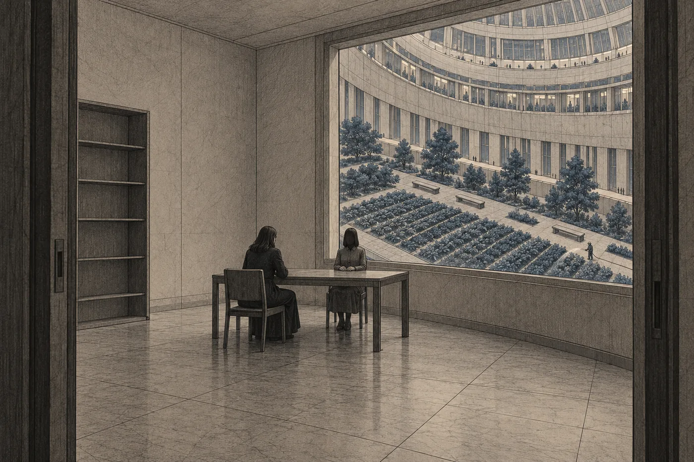

# 12. Nabídka

Kancelář Koloniálního úřadu na Orse byla ve třetím patře budovy, kterou Nara dvacet let míjela cestou do soudu a nikdy si jí nevšimla.

Nebylo čeho. Dveře jako všechny dveře, chodba jako všechny chodby. Jen nad recepcí, na stěně, znak osmi oblouků z jednoho bodu, velký, světlý, zapuštěný do hmoty stěny. Nara se na něj podívala, když vešla. Znala ho celý život. Teď ho poprvé viděla jako mapu.

Recepční ji nepotřeboval. Dveře ji poznaly a pustily ji dál. Někdo jí to připravil.

*Do odletu: 24 dní.*

*

Ardaine měla malou kancelář. Menší než Nařina. Stůl, dvě židle, police s ničím. Okno do dvora, stejného dvora, jaký byl za každým oknem na Orse, se zahradou v řádcích a lavičkami. Na stole nic. Žádný předmět, žádný obraz, nic, podle čeho by se dalo poznat, kdo tu sedí.

Ardaine vstala, když Nara vešla. Nepodala jí ruku a ukázala na židli.

„Děkuji, že jste přišla.“

„Napsala jste mi.“

„Napsala.“ Ardaine si sedla. Položila ruce na stůl, dlaněmi dolů, vedle sebe. „Váš záznam běží. Můj taky. Nevadí mi to. Nic z toho, co řeknu, nebudu chtít vzít zpátky.“

Nara si sedla. Židle byla tvrdá a nízká. Nara si všimla, že sedí o kousek níž než Ardaine a že to Ardaine nejspíš nezařídila úmyslně. Nebo ano. U Ardaine se to nedalo poznat.

„Máte přečtené všechno,“ řekla Ardaine.

„Ano.“

„Já taky.“ Ardaine se dívala přímo, tím pohledem, který Nara znala z jednací síně. „Průzkum, statut, protokol, stanovisko. Technické záznamy. Doložku. Hlášení sítě, které jste včera dala do veřejné části a které má dnes ráno čtyřicet tisíc ohlasů.“

„Nevěděla jsem to číslo.“

„Síť vám ho filtruje. Mně ne.“ Ardaine to řekla bez úsměvu. „Teď víme obě totéž. Řekla jsem vám, že s tím se dá jednat.“

*

Nabídku řekla celou najednou. Bez úvodu, bez vysvětlování, jako se čte výrok.

„Koloniální úřad je připraven rozhodnout o žádosti pana Davena Vesse o výjimku z výkonu trestu pro nezletilého. Kladně. Jako nezletilý s výjimečnými okolnostmi bude Ilan Vess vyjmut z druhého transportu. O výjimce bude rozhodnuto do dvou dnů od vaší odpovědi a bude konečná.“

Nara neřekla nic.

„Podmínkou je, že zúžíte svůj návrh,“ řekla Ardaine. „Na procesní vady hromadného řízení. Ustanovený obhájce šest dní předem. Písemné řízení bez jednání u čtyř set jedné osoby. Doručení vyvěšením odpojeným, kteří ho nemohli přečíst. To všechno je dobré a úřad se tomu nebude bránit víc, než musí.“ Odmlčela se. „Vezmete zpět ústavní důvody. Vezmete zpět doplnění o vědomém porušení ochrany. Vezmete zpět odstavec o Erenovi.“

„A příloha.“

„Příloha zůstane pod pečetí. Úřad nebude navrhovat, aby se zápis z jednání zveřejnil. Vy také ne.“ Ardaine se nepohnula. „Zúžený návrh přílohu nepotřebuje. Senát nebude mít důvod rozhodovat o veřejném zápisu, protože nebude o čem. Tehdy, ne dnes, řekla předsedkyně. Pokud zúžíte návrh, žádné tehdy nebude.“

Nara se dívala na její ruce na stole. Ležely klidně. Nehýbaly se.

„Odpověď potřebuji do tří dnů,“ řekla Ardaine. „Do konce dvacátého šestého dne. Pak nabídka padá.“

*

Nara nejdřív myslela jako advokátka. Bylo to rychlejší než všechno ostatní a bylo to bezpečnější.

„Výjimku můžete udělit jen na žádost,“ řekla. „Žádost je přerušena, protože můj návrh je předběžnou otázkou. Oddíl o výjimkách, čtvrtý odstavec.“

„Zúžený návrh předběžnou otázkou nebude. Netýká se precedentu. Týká se jednoho řízení. Úřad o tom rozhodne sám, podle téhož odstavce. Mám to rozhodnutí připravené.“

„Ilan o výjimku nežádal.“

„Žádal jeho otec. U nezletilého se souhlas odsouzeného nevyžaduje.“

„On ji nebude chtít.“

Ardaine na chvíli zaváhala. Bylo to tak krátké, že by to síť nezapsala. Nara to viděla.

„To je mezi vámi,“ řekla Ardaine. „Úřad rozhoduje podle žádosti. Ne podle toho, co si odsouzený přeje.“

Nara slyšela, co to znamená. Ilan by byl vyjmut, i kdyby nechtěl. Poprvé v životě by o něm rozhodli tak, jak si to vždycky přála, a bylo by to přesně to, co jí celý život vyčítal.

„A těch čtyři sta jedna?“

„Dostanou, co procesní vady dají.“ Ardaine to řekla věcně. „Pokud senát uzná, že řízení bylo vadné, zruší rozsudek a nařídí nové. Nové řízení bude trvat. Roky. Transport mezitím odletí. Výkon se procesními vadami nezastavuje, víte to.“

„Takže nové řízení proběhne bez nich.“

„Proběhne v jejich nepřítomnosti. Pokud dopadne dobře, budou na Zemi nevinní.“

Nara si všimla, že Ardaine řekla *na Zemi*. Ne *tam*. Ne *v místě výkonu*. Na Zemi. Řekla to, jako by to bylo místo, kde se dá být nevinný.

„A šest tisíc dalších?“

„Tam se nic nezmění,“ řekla Ardaine. „Nezměnilo by se ani jinak.“

*

Pak Nara přestala myslet jako advokátka. Nepoznala, kdy přesně. Zjistila to až podle toho, že mlčí a nedokáže začít další větu.

Ilan.

Ne jako žadatel. Ne jako jedna ze čtyř set jedné osoby. Ilan v Sedmé loděnici, hubený, s provázkem na zápěstí. Ilan, který se ptal, jestli se při hibernaci něco zdá. Který se zasmál, když se ho zeptala, jaké to je, když se nic netočí. Který chtěl, aby se podívala, jestli je odtamtud vidět planeta. Celá.

Ilan, který by zůstal. Který by vyšel ze Sedmé loděnice v šedém a ona by stála za dveřmi. Nevěděla, jestli by se na ni podíval. Nevěděla, jestli by s ní mluvil. Ale byl by tady. Každý den by mohla vědět, že je tady.

Nara cítila, jak se jí do toho tlačí zklidnění. Pomalý pokles, jako ventilace na noční režim. Tentokrát ho nenáviděla hned.

„Proč?“ zeptala se.

Ardaine se na ni dívala.

„Proč to nabízíte?“ řekla Nara. „Vyhráváte. Asko Venn mi to napsal čtvrtý den. Senát nemá pravomoc zastavit výkon z důvodů, které nejsou důvody výkonu. Tady mě chytíte. Víte to stejně dobře jako já.“

„Vím.“

„Tak proč?“

Ardaine chvíli mlčela. Pak sundala ruce ze stolu a položila si je do klína. Nara je už neviděla.

„Protože vyhrát nestačí,“ řekla Ardaine. „Senát transport nezastaví. Ale pokud o přílohu povedete spor až do konce, předsedkyně ji pustí ven. Já ji znám. Tak, ne jinak. Bude to rozhodnutí v mezích pravomoci, přesně jak řekla, a bude to pravda. Pak to bude vědět každý. Že *má se za to* bylo objednané. Že úřad věděl. Že na tom světě jsou ti, kdo tam byli dřív.“

„A to vám vadí.“

„Mně ne.“ Ardaine to řekla tiše. „Já to vím. Vím to od třináctého dne. Vím to každé ráno, když se probudím.“ Odmlčela se. „Vadí mi, co se stane potom. Transport odletí tak jako tak. Šest tisíc lidí poletí na svět, o kterém budou všichni vědět, že je obydlený, že na něj nesmí a že je tam úřad posílá znovu. Kdo příště dostane přiznání k podpisu, bude vědět, co podepisuje. Kdo zůstane, bude vědět, za co. A pak přijde třetí transport. Musí přijít, protože precedent platí, a nikdo ho nezruší, protože ho nemůže zrušit tento soud. Jen Shromáždění. A Shromáždění bude jednat veřejně, jak to stojí ve statutu, o světě, na který úřad už poslal necelých dvacet čtyři tisíc lidí a teď posílá dalších šest tisíc.“

Nara poslouchala.

„Pravda tomu nepomůže,“ řekla Ardaine. „Pravda ve spisu, se kterou nikdo nemůže nic udělat, je jen další pečeť. Jen bude větší.“

„To je bezpečnostní důvod.“

„Ano,“ řekla Ardaine. „Jsem zástupkyně Koloniálního úřadu. Jiné důvody nemám.“

Řekla to přímo. Nara poznala, že to není výmluva. Byla to definice.

*

„Paní Vess.“

Ardaine ji tak oslovila poprvé. Ne *paní advokátko*.

„Ano.“

„Nabídla jsem vám to, co jste mohla přijmout.“ Ardaine se nepohnula. „Nenabídla jsem vám, abyste vzala návrh zpět. Nenabídla jsem vám nic, za co byste se musela stydět před komorou. Procesní vady jsou skutečné. Vyhrajete je. Ilan zůstane. Vy budete mít precedent ve vlastním spisu, že hromadné řízení podle Terry bylo vadné. Příští advokát na to může stavět.“ Odmlčela se. „Vybrala jsem nabídku, kterou byste mohla přijmout. To není laskavost. To je řemeslo.“

Nara si vzpomněla na sebe a Lumi před třemi dny v kanceláři. *Dobré řemeslo. Kdybych to dostala na stůl od koncipientky, řekla bych, že je to elegantní.*

„Je to dobré řemeslo,“ řekla.

„Děkuji.“

„Pan Daven,“ řekla Nara. „Jeho žádost se může obnovit i jinak. Do třicátého šestého dne, pokud vezmu návrh zpět celý.“

„Ano. Ta cesta vám zůstane, i když moji nabídku odmítnete.“ Ardaine se lehce naklonila dopředu. „Ale ta vám nic nezaručí. Úřad o obnovené žádosti rozhodne volně. Já vám dnes nemohu říct jak. A pak byste vzala zpět všechno, včetně procesních vad. Nezbylo by nic. Ani pro těch čtyři sta jedna.“

„Kdežto vy mi zaručujete.“

„Já vám zaručuji.“

Nara se dívala z okna. Ve dvoře, mezi řádky rostlin, chodil zahradník s hadicí. Pomalu, od řádku k řádku. Voda z hadice tekla tam, kam ji namířil.

„Proč tři dny?“ zeptala se.

„Protože úřad potřebuje rozhodnout o výjimce dřív, než začne ukládání. Hibernační lůžka se přidělují čtyřicátý den. Po přidělení je to složitější.“ Ardaine se odmlčela. „A protože kdybych vám dala deset dní, přišla byste na něco, co já nevidím. Takhle máte jen to, co máte.“

Nara se skoro usmála. Skoro.

„To je upřímné.“

„Řekla jsem vám, že nic z toho nechci vzít zpátky.“

*

Nara vstala.

Neřekla ano. Neřekla ne. Neřekla, že si to promyslí, protože to bylo jasné a Ardaine by to slovo nepotřebovala slyšet.

„Děkuji,“ řekla.

Ardaine vstala taky. U dveří se zastavila, jako tehdy u výtahu.

„Paní Vess,“ řekla. „Ten odstavec o Erenovi.“

„Ano?“

„Četla jsem ho včera třikrát.“ Ardaine se dívala na dveře, ne na ni. „Je to nejlepší věc, kterou jste v tomhle řízení napsala. Kdybyste ho vzala zpátky, bylo by mi líto.“

Pak otevřela dveře a nechala ji odejít.

*

Nara šla pěšky.

Ne do kanceláře. Ne domů. Šla po spodní chodbě Orsy, po které chodila celý život, a nevěděla kam, dokud nebyla na Dolním náměstí.

Bylo prázdné. Bylo poledne, lidé byli v práci, a náměstí bylo jen náměstí. Kamenná dlažba, oblouk Orsy nad ním, světlo, které se v tuhle hodinu dělalo, aby vypadalo jako denní. Nikde žádné šedé čtverečky za ušima. Nikde bílé provázky. Nikde čtyři sta lidí, kteří mlčí.

Stoupla si na místo, kde tehdy stála. Poznala ho podle toho, že tu dlaždici měla v záznamu, celou, i s prasklinou v rohu. Ilan seděl o dva kroky dál. Řekl *sedni si* a ona udělala krok doleva.

Nara se podívala na místo, kde seděl.

Kdyby přijala, mohla by sem přijít s ním. Za rok. Za deset let. Nevěděla, jestli by chtěl. Nevěděla, jestli by s ní šel kamkoli. Ale mohla by se ho zeptat. Za deset let by se ho mohla zeptat na cokoli. I na obraz Země. I na to, proč ho vyhodil.

A tajná příloha by ležela dvanáct set metrů pod povrchem měsíce, v nice, s polem na víku, kde už nestála nula. Plaz v sedmém políčku by se díval nahoru. Lidé u ohně by seděli s dítětem na zádech. Na listu by stálo *úplné oddělení není možné* a *ztráty mezi původními populacemi neodhadnuty* a pod tím *U. Sarr*, a nikdo by to nečetl dalších devět set let. Třetí transport by odletěl, jak řekla Ardaine. A čtvrtý.

A Ilan by tady byl.

Nara zjistila, že stojí na náměstí a v duchu počítá. Ne dny. Lidi. Jeden. A čtyři sta. A šest tisíc. A dvacet čtyři tisíc před nimi. A ti, kdo tam byli dřív, které úřad neodhadl. Čísla nešla k sobě. Nedala se sečíst ani porovnat. Byla jako tečky a čárky v průzkumu. *Nečtěte to po desítkách,* říkala Mel.

Síť jí ukázala čas. Pak Davena. Třetí hovor dnes.

Nara ho nepřijala.

*

Lumi na ni čekala ve dveřích kanceláře. Viděla jí to na obličeji dřív, než Nara promluvila.

„Co chtěla?“

Nara si sedla. Řekla jí to. Nabídku celou, slovo od slova, jak to měla v záznamu. Proč ji Ardaine dělá, to ne. Lumi poslouchala, a když Nara skončila, dlouho mlčela.

„Co uděláte?“ zeptala se pak.

„Nevím.“

Lumi kývla. Neptala se dál. Nara ji za to měla ráda víc, než by kdy řekla.

„Mám na to tři dny,“ řekla Nara.

„A pan Daven?“

„Neví to.“

„Řeknete mu to?“

Nara se podívala na řádek sítě. Daven. Čtyři hovory. Vzkaz: *Volal jsem. Ozvi se. Prosím.*

„Nejdřív to musím říct Ilanovi,“ řekla.

„Proč nejdřív jemu?“

„Protože je to jeho život.“ Nara slyšela, jak to zní, a věděla, že je to pravda a že je to taky útěk. „A protože kdybych to řekla napřed Davenovi, rozhodl by za něj. Tak jako já.“

Lumi chvíli mlčela.

„Návštěvy v Sedmé loděnici jsou do čtyřicátého prvního dne,“ řekla pak. „Rezervaci na zítra vám zařídím.“

„Ano.“

„Jen…“ Lumi se zarazila. „Jen nevím, jestli mu to můžete říct celé. Kvůli pečeti. Nesmíte mu říct, co je v příloze.“

„Ne,“ řekla Nara. „Smím mu říct, co je v nabídce. Ne, proč by ji neměl chtít.“

*

Večer seděla v Ilanově pokoji.

Seděla tam pátý den, když odešel Daven, a od té doby tam nebyla. Pokoj byl stejný. Postel ustlaná, stůl prázdný, na stěně světlejší obdélník po obrazu Země, který Ilan vyhodil, když odcházel. Proč, to nevěděla. Teď by se ho na to mohla zeptat. Za tři dny možná už ne.

Nara se dívala na prázdný obdélník.

Na obraze byla modrá a zelená. Bílá ne. Kdo ho kreslil, nevěděl o ledu na severu, ani o lidech u ohně. Byl to obraz prázdného světa a ten svět prázdný nebyl. Ilan ho vyhodil. Možná proto, že mu přišel jako lež. Možná proto, že nechtěl, aby mu něco připomínalo, kam ho jednou můžou poslat. Možná proto, že ho přestal vidět, jako se přestanou vidět věci na stěně. Nevěděla.

V koutku vědomí jí běžely dva řádky. Jeden znala od prvního dne.

*Do odletu: 24 dní.*

Druhý tam síť dala sama, dopoledne, když Nara z kanceláře úřadu odcházela. Nara ho nežádala. Síť si ho odvodila ze záznamu, protože v něm byla lhůta, a lhůty síť hlídala ochotně.

*Do odpovědi: 3 dny.*

Nara se dívala na ta dvě čísla pod sebou. Na velké a malé. Jedno počítalo k odletu, druhé k tomu, jestli Ilan poletí.

Neodpověděla nikomu. Ani Davenovi, ani Ardaine, ani sobě.
