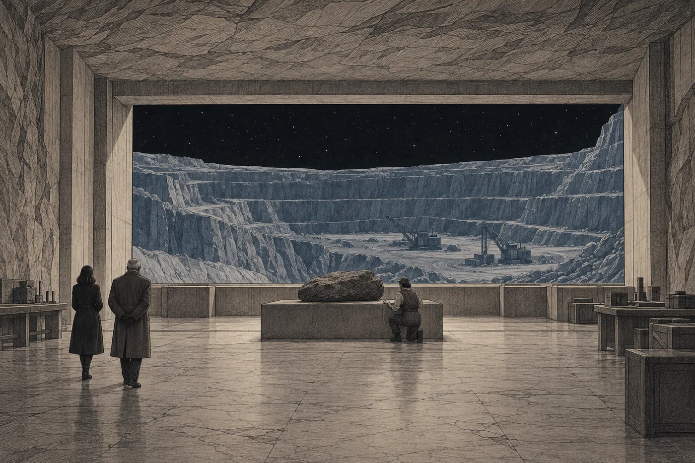

# 19. Pomalá sonda

Měsíční linka z Lumy se netočila a Naře bylo zle hned od startu.

Nebylo to horší než poprvé. Bylo to stejné, jen to teď znala. Žaludek se jí zvedl, když se ztratila váha, a hlava hledala, kde je dole, a žádné dole nebylo. Nara zavřela oči a držela se opěradel. Za průzorem rostl šedý kotouč.

*Do odletu: 5 dní.*

Dnes ráno je stříhali. Nara to věděla, protože to stálo v návštěvním řádu, který si přečetla celý. *Druhý den před uložením: hygienická příprava.* Hygienická příprava. Vlasy, nehty, všechno, co není tělo. Ilan teď sedí někde v Sedmé loděnici s holou hlavou a dotýká se jí dlaní, tam, kde ještě včera byly vlasy přes uši. Nebo nesedí. Nebo stojí ve frontě. Nara nevěděla, jak to vypadá. Nikdy to neviděla.

Sáhla do kapsy. Provázek tam byl, stočený, měkký. Nechala na něm prsty celou cestu.

*

Hals na ni nečekal u výtahu do úložiště. Čekal v příletové hale, v rukavicích, se dvěma kabáty přes ruku.

„Dnes nepojedeme dolů,“ řekl. „Aspoň ne hned.“ Podal jí kabát s odřeným límcem. „Ale oblečte si ho. Tam, kde pracuje ona, se netopí o moc víc.“

Vedl ji chodbou, kterou Nara neznala. Nevedla dolů. Vedla do strany, podél vnějšího okraje příletové haly, kolem skladů a kolem dveří s nápisy, které Naře síť ani nenabídla přeložit, protože to byla jen čísla. Chodba byla vylámaná ve skále jako ty v úložišti a měla tutéž barvu. Barvu teras z lomu.

„Kdo je to?“ zeptala se Nara.

„Riv. Inženýrka.“ Hals šel pomalu, jako vždycky, a prsty v rukavici se cestou dotýkal stěny. „Před sedmi lety přišla do úložiště a zeptala se mě, co vydrží deset tisíc let. Řekl jsem jí: listy a kámen. Pak se zeptala, co vydrží sto tisíc.“

„A co jste řekl?“

„Že nevím.“ Hals se zastavil u širokých dveří na konci chodby. „Řekla, že jsem první, kdo jí to řekl. Od té doby se mi občas ozve.“

Dveře se otevřely.

*

Za nimi byla hala. Nízká, široká, vylámaná přímo do svahu, a na protější stěně měla průzor, tak velký, jaký Nara na měsíci ještě neviděla. Za ním byl lom. Terasy, jedna pod druhou, šedé a rovné, a nad nimi černo s ostrými hvězdami. Stroje na nejnižší terase stály stejně nehybně jako tehdy z linky.

Uprostřed haly stál na podstavci kámen.

Nara se na něj dívala a chvíli nevěděla, proč se dívá zrovna na něj. Byl tmavě šedý, hrbolatý, delší než široký, se zaoblenými hranami. Kdyby ležel venku na terase, nevšimla by si ho. Byl menší, než čekala. Byl menší než lůžko. Jedna z těch dlouhých úzkých beden, které nakládací rameno zasouvalo do lodi, by ho pojala celý a ještě by zbylo místo.

„To je ona,“ řekl Hals.

Za podstavcem se něco pohnulo. Vstala odtamtud žena, která tam klečela s rukou v otvoru na spodní straně kamene. Byla malá a široká v ramenou, s tmavými vlasy staženými pod čepicí, v pracovní kombinéze s rukávy vyhrnutými nad lokty. Ruce měla velké. Utřela si je do stehen a podívala se Naře na ruce, ne do obličeje. Teprve potom do obličeje.

„Vy jste ta advokátka,“ řekla.

„Nara Vess.“

„Riv.“ Ruku nepodala. Ukázala bradou na kámen. „Tomen říkal, že něco potřebujete poslat. A že nevíte co.“

„Vím co,“ řekla Nara. „Nevím, jestli to jde.“

„Všechno jde,“ řekla Riv. „Jenom ne všechno doletí.“

*

Mluvila rychle. Nara si toho všimla hned, protože všichni ostatní, kdo s ní poslední dny mluvili, mluvili pomalu. Riv říkala věci tak, jak je viděla, po jedné, a když jí došlo, že Nara nerozumí, nevysvětlovala. Řekla to znovu jinými slovy, kratšími.

Program pomalých průzkumných sond skončil před šesti lety. Nikdo ho nezrušil. Jen mu přestali dávat peníze, rok po roce méně, až nezbylo nic. Sondy létaly k sousedním hvězdám, malé a pomalé, a měly mluvit. Posílat domů, co uvidí.

„Postavila jsem jich devět,“ řekla Riv. „Odletěly dvě. Ty dvě letí pořád a pořád posílají. Jenže na druhé straně už nikdo neposlouchá. Přijímací stanici vypnuli dřív, než doletěly.“ Pokrčila rameny. „Mluví do prázdna. Nevědí to.“

„A tahle?“

„Tahle je poslední z těch, co zbyly. Ostatní rozebrali. Tahle je odepsaná a má se rozebrat taky.“ Riv položila dlaň na hrbolatý povrch kamene, jako se pokládá ruka na rameno někomu, koho člověk zná dlouho. „Rozebrat je dražší než vyhodit. Odepsané nosiče se proto vyhazují ven. Pryč ze soustavy, kde nikomu nepřekážejí. Dráhu schvaluje dopravní správa a nikdo se na ni nedívá, protože ven nikdo nelétá.“

Nara se podívala na Halse. Hals se díval na kámen.

„Uvnitř nic není,“ řekla Riv. „Vysílač jsem vyndala. Zdroj jsem vyndala. Přístroje jsem vyndala. Všechno, co potřebuje energii, je pryč. Nechala jsem jen místo, kde měl být zkušební archiv. Program kdysi chtěl vědět, jestli se dají poslat listy. Tak tam je místo na listy.“

„Proč jste vyndala vysílač?“

Riv se na ni podívala, jako by se Nara zeptala, proč voda vytéká ze sklenice s dírou.

„Protože nevydrží,“ řekla. „Nic, co potřebuje proud, nevydrží tak dlouho. Záření, prach, zima. Za tisíc let je vysílač kus kovu. Za deset tisíc let je kus kovu, který překáží. Kámen vydrží. Listy vydrží, když jsou v kameni.“ Poklepala na povrch. „Tohle je drť z lomu. Slisovaná. Nic lepšího na stínění nemáme, a nic to nestojí. Tamhle se jí vyrábí tolik, že ji prodávají dětem jako suvenýr.“

Nara se na kámen dívala. Šedý. Ten odstín znala. Takový kámen jí ležel na stole v kanceláři, velký jako vejce, obroušený v bubnu. Ilan ho přinesl ze školy, když mu bylo osm, a řekl, že je ze Země.

Nebyl. Byl odtud, z lomu za průzorem.

„Kam s ním můžete?“ zeptala se.

„Ven je všude,“ řekla Riv. „Ven si vyberu já.“

*

„Kolik to trvá?“ zeptala se Nara.

„Dlouho.“

„Kolik?“

Riv se na ni chvíli dívala. Pak si sedla na okraj podstavce, takže měla hlavu níž než Nara, a dívala se na ni zespodu.

„Desítky tisíc let,“ řekla. „Kdo vám řekne přesně, lže. Nebo počítá s věcmi, o kterých nic neví. Dostane jeden tah na začátku a pak už letí sama. Nic ji nezrychlí. Nic ji nepřibrzdí, dokud nedorazí.“

„A když dorazí?“

„Na konci brzdí. Na to tam něco nechám, jen na to, a pak už nic.“ Riv si všimla Nařina pohledu. „Jak, to vám můžu vysvětlit. Ale je to moje práce, ne vaše. Vy byste tomu musela věřit, protože bych vám to řekla já, ne protože byste tomu rozuměla.“

„Věřím.“

„To šlo rychle.“

„Vy jste řekla, že nevíte přesně, kolik to trvá,“ řekla Nara. „To mi stačí.“

Riv se na ni podívala jinak. Krátce. Pak kývla.

„Až tam doletí, bude to kámen,“ řekla. „Kámen s listy uvnitř. Nic nevyšle. Nic nezapne. Sama se neprobudí, protože nemá čím. Kdo ji chce číst, musí vědět, že tam je co číst. A musí jí dát energii zvenku. Jinak je to balvan mezi balvany.“

„Takže ji nikdo nenajde.“

„Možná ne.“ Riv vstala. „Já stavím věci, které vydrží. Najít je musí někdo jiný.“

*

Nara obešla podstavec. Pomalu, jak se to na měsíci naučila, aby se hlava stačila otočit. Kámen měl na spodní straně otvor, ten, ve kterém měla Riv ruku. Byl malý. Do něj se vejde všechno, co Nara za těch čtyřicet dva dní udělala. Pokud se vejde.

Pak se zastavila a podívala se na ně oba.

„Musím vám něco říct,“ řekla. „Jako advokátka.“

„Nejste naše advokátka,“ řekl Hals.

„Ne. Kdybych byla, řekla bych vám, ať to neděláte.“ Nara položila ruce na okraj podstavce. Třásly se a ona je tam nechala. „Zákon o výkonu trestu zakazuje styk s odsouzenými po dobu výkonu. A trest je vyhnanství bez přístupu k technologii. Tohle je technologie. Poletí tam, kam letí loď. Tam, kde se trest vykonává.“

„Je to kámen,“ řekla Riv.

„Tvrdila bych to. Tvrdila bych, že pasivní archiv, který se nedá přečíst bez energie zvenku, není přístup k technologii. Že odsouzení ho nemohou použít, protože nemají čím. A že doletí za desítky tisíc let, kdy už žádný odsouzený naživu nebude a nebude na kom trest vykonávat.“ Odmlčela se. „Tvrdila bych to dobře. A prohrála bych.“

Nikdo neodpověděl.

„Kdyby se na to přišlo před startem,“ řekla Nara, „bylo by to řízení pro zásah do výkonu trestu. Ne přestupek. Trestní řízení. U vás, paní Riv, k tomu použití odepsaného majetku státu. U vás, pane Halsi, vynesení majetku archivu z úložiště.“ Podívala se na Halse. „A přijdete o místo. Tím začnou.“

Hals se díval na kámen. Ruce v rukavicích měl spojené za zády.

„Moje jméno je na návrhu, na každé straně,“ řekla Nara. „Kdyby se na to přišlo, budu první. Ale vás to neochrání. Neochrání vás nic.“

Riv se zasmála. Krátce, nosem, a Nara si vzpomněla na Ilana.

„Vy jste divná advokátka,“ řekla Riv. „Přijdete něco chtít a nejdřív mi vysvětlíte, proč vám to nemám dát.“

„Ano.“

„Proč?“

Nara se na ni podívala.

„Protože jsem to tak udělala se synem,“ řekla. „Řekla jsem mu všechno, co jsem směla, a nechala jsem ho, ať se rozhodne sám. Pak jsem se stejně rozhodla za něj. Tady za vás rozhodovat nebudu.“

Riv chvíli mlčela. Pak si utřela ruce do stehen, i když je měla čisté.

„Postavila jsem devět,“ řekla. „Dvě mluví do prázdna a nevědí to. Tahle aspoň nebude předstírat, že mluví.“ Položila dlaň zpátky na kámen. „Já to udělám. Ne kvůli vám. Kvůli ní. Nechci, aby ji rozebrali.“

Hals pořád mlčel.

„Pane Halsi,“ řekla Nara.

„Pojedeme dolů,“ řekl Hals. „Tam vám odpovím.“

*

Cestou dolů síť slábla jako tehdy a nejdéle vydržel odpočet, *Do odletu: 5 dní.*

Dole byla zima. Hals rozsvítil světlo od podlahy a vedl ji mezi regály k oddílu historických spisů. Ne k nice se zalitou schránkou. K jinému stolu, v zadní části, kde Nara nikdy nebyla. Stál na něm přístroj, dlouhý a nízký, se skleněným víkem. Pod víkem ležel list. Průsvitná destička, stejná jako ty, které Nara četla lupou.

„Lept,“ řekl Hals. „Na něm se dělají listy. Jen tady. Nikde jinde v prstenci. Všechno, co je v tomhle úložišti, prošlo tímhle leptem.“ Dotkl se skleněného víka prsty v rukavici. „Riv mi poslala, kolik se vejde. Dvě stě listů, když se leptá nahusto. Tak nahusto, že se to lupou číst nedá. Bude to potřebovat přístroj.“

„A spis?“

„Spočítal jsem to v noci.“ Hals vytáhl ze zásuvky stolu tabulku, popsanou drobným písmem. Rukou. Nara se na to písmo dívala a chvíli jí trvalo, než pochopila, co vidí. „Všech čtrnáct položek. Návrh, výpis, veřejná Terra celá, i se seznamem. Vyjádření odpůrce. Žádost o zpřístupnění. Usnesení. Výpověď paní Mel. Rekonstrukce paní Pell. Přiznání s doložkou a opatřením. Hlášení sítě. Doplnění, obě. Dvanáctka: obsah přílohy, jak jste ho přednesla, s vaší poznámkou. Zápis z jednání, celý. Rozsudek.“ Prst v rukavici sjel po řádcích. „Sto devadesát devět listů.“

„Zbývá jeden.“

„Zbývá jeden.“

Nara se dívala na jeho tabulku. Na řádky psané rukou, nerovné, s tečkami.

„Vy píšete rukou,“ řekla.

„Štítky jsem psal rukou čtyřicet let. Než přišly schránky, které si píšou samy.“ Hals tabulku položil. „Tady dole síť nedosáhne. Když chcete něco poznamenat, musíte rukou.“

*

Pak si sedl.

Nara ho nikdy neviděla sedět. Při všech těch návštěvách stál, šel, dotýkal se štítků. Teď si sedl na židli u leptu, s rukama v rukavicích na kolenou, a díval se na ni.

„Slíbil jsem vám odpověď,“ řekl. „Napřed vám ale něco nabídnu.“

Nara čekala.

„Mám klíč,“ řekl Hals. „Ke schránce. Pečeť je pořád pečeť, ale správce smí otevřít, když to nařídí soud. A soud to nařídil. Usnesení devátého dne, nikdo ho nezrušil. Čtení se smí, kolikrát účastník chce, za přítomnosti správce.“ Odmlčel se. „Opisy ne. To vím. Ale kdo by se díval, co dělám s listem, když ho mám vytažený? Na desce se dá udělat opis čehokoli. Za hodinu.“

„Pane Halsi.“

„Nechte mě to doříct.“ Hals sundal jednu rukavici a zase si ji natáhl, prst po prstu. „Místo zápisu z jednání bych mohl dát opisy listů. Originály. Ne to, co jste o nich řekla nahlas. To, co v nich stojí. Obrazy z průzkumu. Hnízdo, lidi u ohně, tu zvednutou ruku. Stanovisko i s tím *Založeno*, tou rukou, jak tam je.“ Podíval se na ni. „Kdo to jednou najde, nebude muset věřit vám. Uvidí to sám.“

Nara mlčela.

Myslela na to. V noci, v kuchyni, s horkou vodou, kterou nepila. Myslela na to od chvíle, kdy Hals v prázdné síni řekl *Kdybyste něco potřebovala z úložiště, víte, kde jsem.* Věděla, že to nabídne. Věděla to, ještě než to věděl on.

„Ne,“ řekla. „A to usnesení skončilo s řízením. Vy to víte.“

Hals se nepohnul.

„Na listech je poloha,“ řekla Nara. „Mapa průzkumu, oblasti, místa přistání. Senát ji z veřejného zápisu vyjmul a já jsem slíbila, že ji nepřednesu. Nepřednesla jsem ji ani synovi.“

„Tam, kam to letí, poloha nikoho neohrozí.“

„Možná ne. Nevím, kdo to bude číst. Vy taky ne.“ Nara se nadechla. „A to druhé. Třicátého sedmého dne jsem před senátem tvrdila, že pečeť chrání listiny a že o zápisu rozhoduje senát. Na tom stojí všechno, co se pak stalo. Že nic z toho, co je v zápisu, nebylo ukradené. Že se to řeklo nahlas, před soudem, a soud řekl, že se to smí.“

„A kdo to najde, to bude vědět?“

„Bude to mít napsané. U dvanáctky. *Zapsáno do veřejného záznamu.*“ Nara se dívala na skleněné víko. „Kdybyste tam dal listy, budou tam dvě věci. To, co se řeklo nahlas. A to, co jste vzal ze schránky, kterou jste měl hlídat. Kdo to najde, nebude vědět, které z toho je spis a které krádež. Možná to bude jedno. Mně ne.“

Dlouho bylo ticho. Pára jim oběma stoupala od úst ke světlu.

„Ať to, co najdou, je to, co se řeklo nahlas,“ řekla Nara.

Hals se díval na své ruce.

„Já vím,“ řekl potom. „Myslel jsem si, že to řeknete.“ Pomalu se zvedl. „Chtěl jsem to slyšet od vás. Já bych to sám neodmítl. Nevím, jestli bych to udělal. Ale neodmítl bych to.“

„Nabídl jste mi to.“

„Nabídl.“ Hals se skoro usmál. „Za čtyřicet šest let tady jsem nikdy nikomu nic nenabídl. Jen jsem vydával. Je to jiný pocit.“

*

„A co s tou otázkou?“ zeptala se Nara po chvíli. „Ze síně.“

Hals se na ni podíval, jako by nevěděl, o čem mluví. Pak si vzpomněl.

„Který z těch dvou je originál,“ řekl.

„Ano.“

Hals šel k regálu. Dotkl se štítku, jednoho, druhého, jak to dělal vždycky. Pak se zastavil.

„Ten dole, ve schránce, je originál listin,“ řekl. „Ten nahoře, v síti, je originál toho, co se o nich řeklo. Celý život jsem hlídal originál pro den, kdy síť nebude.“ Otočil se k ní. „Tenhle bude originál pro den, kdy nebude ani úložiště. Ani měsíc, ani prstenec. Ani nikdo, kdo ví, co to je.“

„Tři,“ řekla Nara.

„Tři.“ Hals kývl. „Tak to mám o jeden víc, než jsem čekal.“

Vrátil se ke stolu a položil ruku v rukavici na skleněné víko.

„Udělám to,“ řekl. „Opis veřejného spisu. Celý, sto devadesát devět listů. To smí udělat kdokoli. Jen to nikdo nedělá na archivní listy a nikdo je nevynáší nahoru.“ Odmlčel se. „A na každý dám znak správce. *Opis souhlasí. T. Hals.*“

„To nedělejte.“

„Musím.“

„Je to váš podpis. Na každém listu. Kdyby se na to přišlo…“

„Bez podpisu je to kámen s písmem,“ řekl Hals. „S podpisem je to opis. Kdo to najde, ať ví, že to někdo porovnal. Řádek po řádku. A že za to ručí.“ Podíval se na ni. „Vy jste dala jméno pod návrh. Já ho dám pod opis. Je to stejné řemeslo.“

Nara mlčela. Pak kývla.

„Čtyři dny,“ řekl Hals. „Čtyřicátý pátý den budou hotové. Riv je chce čtyřicátý osmý. Pak to zalévá.“

„A ten jeden list?“

Hals se na ni podíval.

„Ten je váš,“ řekl. „Riv to říkala hned. Když se vejde spis, zbude jeden list. Ať si ho advokátka vezme pro sebe.“

*

Nahoru jela sama. Hals zůstal dole, u leptu. Když se výtah zavíral, viděla ho, jak si sedá na židli a sundává rukavice. Obě. Poprvé.

Síť se vracela po řádcích, jak výtah stoupal. Nejdřív čas. Pak stav kyvadel na Orse. Pak zprávy. Pokuta pořádkové služby za včerejšek, s upozorněním. Zpráva od Lumi: *Komora ví o vašem včerejším odpojení. Arel to přidal jako třetí bod. Mám to připravit?* A zpráva od Davena. Jedna věta.

*Byl jsem tam ještě jednou, v hale. Už ho ostříhali. Prý mu to sluší. D.*

Nara stála ve výtahu a četla to znovu a znovu, dokud výtah nezastavil.

*

V příletové hale se vrátila k Riv. Nevěděla proč. Linka jí odjížděla za hodinu.

Riv seděla na podlaze vedle podstavce a měla v ruce desku s nákresem. Když Nara vešla, nevstala.

„Tomen to udělá,“ řekla.

„Ano.“

„Já věděla, že jo. Jen jsem nevěděla, jestli mu to dovolíte.“ Riv odložila desku. „Tak mi řekněte, kam. Přesně. Kam letí ta loď.“

„To nevím přesně. Vím jen, ke které hvězdě.“

„To stačí. Zbytek spočítám já.“ Riv vstala. „Okno ven mám padesátý den. Čtyřicátý osmý zalévám. Do té doby mi dejte všechno, co tam má být. Nic potom. Potom už nic.“

Nara se dívala na kámen. Na hrbolatý šedý povrch, slisovanou drť z lomu.

„Ten list,“ řekla. „Tomen mi řekl, že zbývá jeden.“

„Zbývá.“

„Proč jste ho nechala mně?“

Riv se na ni podívala a pak na kámen.

„Protože to celé posíláte někomu,“ řekla. „Spis je pro kohokoli. Ale vy nejste kdokoli. Nikdo neposílá kámen na konec světa kvůli spisu.“ Pokrčila rameny. „Jeden list, oboustranně. Vejde se na něj víc, než si myslíte. A míň, než budete chtít.“

*

V lince zpátky seděla u průzoru a dívala se, jak se měsíc zmenšuje.

Terasy lomu splynuly se šedí. Pak i světlejší skvrna, pod níž leželo úložiště. Někde tam dole sedí Hals bez rukavic u leptu a dívá se na první list. Někde vedle, v hale s velkým průzorem, stojí kámen menší než lůžko a čeká, až se do něj vloží všechno, co Nara udělala.

Vyndala z kapsy provázek a položila ho na koleno. Sedmdesát jedna uzlíků.

Jeden list, oboustranně.

Nara nevěděla, co na něj napíše. Věděla jen, komu. A věděla, že to nebude číst ten, komu to napíše.

Za šest set let se Ilan probudí. Za desítky tisíc let doletí kámen. Mezitím bude Ilan mrtvý tak dlouho, že na tom už nebude záležet. Jeho děti taky. A jejich děti. Kdo kámen najde, pokud ho vůbec někdo najde, bude někdo, koho Nara nezná a nemůže znát. Bude mluvit řečí, kterou neslyšela. Bude to číst podle slovníku, který si udělá sám. A bude se mýlit u slov, která pro ni budou nejdůležitější.

Možná to bude někdo z jeho krve. Možná ne. Možná to bude Konfederace sama, za dlouho, až se tam vrátí a nebude vědět, proč tam kdysi poslala lidi. Nara nevěděla, které z toho je horší.

*Do odletu: 5 dní.*

Pod tím: *Přejete si připomenout termín jednání komory?*

Nepřála. Zavřela to. Sevřela provázek v dlani a dívala se do tmy za průzorem, kde nebylo nic, kam by se dalo jít, a kam za osm dní poletí kámen.
