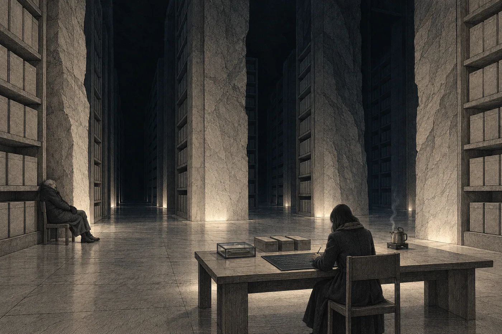

# 20. Dopis

Doma to nešlo napsat.

Nara to zkusila čtyřicátého třetího dne večer, v kuchyni, a pak znovu v noci v Ilanově pokoji, pod prázdným obdélníkem po obraze. Síť jí otevřela prázdný list ochotně, jak otevírala všechno. Nahoře stálo *Adresát:* a Nara tam napsala *Ilan*. Síť to doplnila: *Ilan Vess, 17 let. Stav: výkon trestu. Doručení: nelze.* Nara to smazala a napsala jen *Ilane*.

Pod tím menším písmem: *Přejete si použít vzor? Dopis na rozloučenou, dopis blízké osobě, poslední vůle.*

Nepřála. Napsala první větu. Síť jí nabídla jiný slovosled, plynulejší. U druhé věty jí nabídla slovo, které bylo přesnější. U třetí se zeptala, jestli si přeje text ohodnotit z hlediska citového dopadu na příjemce. Nara se na tu otázku dívala dlouho. Pak dopis smazala celý a seděla v tmavém pokoji.

Všechno, co tady napíše, si síť přečte dřív než kdokoli jiný. Posoudí to. Uloží to. Bude to vědět dřív, než to bude vědět ona.

*Do odletu: 4 dny.*

Ještě v noci napsala Halsovi: *Mohla bych psát dole?*

Odpověď přišla ráno. *Ano. Desku připravím. Umíte psát rukou? T. H.*

*Ne.*

*Naučíte se. Máte pět dní.*

*

Čtyřicátého čtvrtého dne ji to Hals učil.

Seděli u stolu s leptem, v zadní části úložiště, kde světlo svítilo od podlahy a pára stoupala od úst. Hals přinesl dvě psací desky, tmavé a hladké, velké jako dvě dlaně, a k nim tenké rydlo. Ukázal jí, jak se drží. Ukázal jí, jak se deska vyhladí, když se člověk splete: přejede se po ní hranou dlaně a písmo zmizí.

„Mizí to,“ řekla Nara.

„Skoro. Proti světlu je to vidět. A mizí to, jen dokud to nedám na lept. Pak už ne.“

Znaky znala. Četla je celý život, každý den, v síti i na listech. Psát je bylo něco jiného. Ruka nevěděla, kde začít, a když začala, nevěděla, kam jít. Rydlo jí ujíždělo. Čáry, které měly být rovné, se vlnily, a ty, které se měly zahnout, se zahnuly pozdě. A ruce se jí třásly. Na desce to bylo vidět víc než kde jindy. Každý znak měl v sobě chvění, jako by ho psal někdo na lince při startu.

Hals se díval a nic neříkal. Když Nara vyhladila desku popáté, položil vedle ní svou tabulku s výpočtem listů. Jeho písmo bylo malé, nakloněné a nerovné. Taky se třáslo, trochu. Nara si toho všimla až teď.

„Vám se taky třesou,“ řekla.

„Sedmdesát jedna let,“ řekl Hals. „A zima.“ Ukázal na její znaky. „To je jedno. Kdo to bude číst, pozná, že to psala ruka. To je všechno, co má poznat.“

Večer uměla napsat celý řádek tak, aby se dal přečíst. Hals vzal desku, prohlédl si ji proti světlu a kývl.

„Zítra,“ řekl. „Listy pro spis budou hotové v poledne. Pak je lept volný.“

*

Čtyřicátého pátého dne večer sjela znovu dolů a tentokrát zůstala.

Hals jí připravil místo u leptu. Židli s opěradlem, tu, kterou nosil Hadře Mel. Kabát s odřeným límcem. Konvici horké vody na ohřívací desce, která byla jediným teplým místem v celém oddílu. A na stole velkou psací desku, větší než ty dvě, na kterých se učila, vyhlazenou do lesku. Vedle leptu stály v řadě tři úzké schránky. V nich leželo sto devadesát devět listů. Na hraně každého z nich, Nara to věděla, i když to neviděla, stál malý znak správce. *Opis souhlasí. T. Hals.*

„Zůstanu tady,“ řekl Hals. „Kdybyste něco potřebovala.“

„Nemusíte.“

„Já vím.“ Sedl si na druhou židli, kousek od světla, a zapnul si kabát až ke krku. „Spím tu často. Nahoře je hluk.“

Síť tady dole nebyla. Zůstal jen odpočet, šedý, malý, nehybný, jako vždycky, nejodolnější řádek ze všech. *Do odletu: 2 dny.* Nic jiného. Nikdo jí nic nenabízel. Nikdo se jí neptal. Nara seděla nad deskou s rydlem v ruce a poprvé v životě psala něco, co nikdo nečetl dřív než ona.

Ventilace tu nebyla. Nebo byla, ale neměla žádný tón. Ticho tady bylo jiné než v kuchyni. Neslo se od skály.

Nara napsala první řádek.

*

*Ilane,*

*tohle nebudeš číst ty. Než to doletí, budeš dávno mrtvý. Píšu to přesto tobě. A těm, kdo budou po tobě.*

*Nevím, kdo jste. Nevím, jakou řečí mluvíte. Kdo to bude překládat, ať píše slova, jaká tu stojí. Ne to, co si o nich myslí. Píšu krátce, aby se v tom dalo méně splést.*

*Jmenuji se Nara Vess. Jsem advokátka. Jsem matka Ilana Vesse, který odletěl druhým transportem. Snažila jsem se, aby neodletěl. Nepovedlo se to.*

*Všechno ostatní v tomhle kameni je spis. Spis je pravdivý. Tenhle list do spisu nepatří.*

*

Dál to šlo pomalu.

Psala větu a pak se na ni dívala. Pak ji vyhladila hranou dlaně a psala znovu. Bez sítě nevěděla, jestli je věta dobrá. Neměla nic, co by jí nabídlo lepší slovo. Měla jen tu větu, chvějící se, na tmavé desce, a musela se rozhodnout sama, jestli tam zůstane.

Myslela na překladatele, který kdysi přeložil *izoluje* místo *opatruje*. Podle smyslu. Měl slovník, který se ztratil, a doporučil ověření, které nikdy nikdo neudělal. Kdo bude číst tenhle list, nebude mít ani ten slovník. Bude mít jen její znaky a vlastní odhad, co znamenají. Psala proto tak, jak psala Ardaine. Jedna myšlenka, tečka. Slova, která se dají přeložit jen jedním způsobem. Kde to nešlo, vyhladila desku a hledala jinak.

Několikrát se zastavila úplně.

Jednou u věty o náměstí. Napsala ji, vyhladila, napsala znovu a nechala ji. Jednou u věty o tom, co mu zapnula, když mu bylo patnáct. Tu napsala hned napoprvé a pak dlouho seděla a nedívala se na ni.

A jednou u té věty. Té, kterou si nesla celou cestu do Sedmé loděnice a pak ji neřekla, protože by po něm něco chtěla. Tady po něm nechtěla nic. Tady nemohl odpovědět, nemohl kývnout, nemohl si ji odnést. Nara ji napsala. Vyhladila ji. Seděla. Pak ji napsala podruhé, pomaleji, a nechala ji stát.

Hals spal. Hlavu měl opřenou o regál a ruce v rukavicích složené na kabátě. Dýchal tiše. Pára mu stoupala od úst a mizela ve tmě nad světlem.

O půlnoci se odpočet změnil. Jedinkrát za celou noc se něco pohnulo samo.

*Do odletu: 1 den.*

Nara se na to podívala a psala dál.

*

Ruka ji bolela. Prsty ztuhly zimou a rydlo v nich klouzalo. Několikrát si je ohřála o konvici a jednou si nalila vodu, oběma rukama, a vypila ji celou.

Psala o věcech, které nikdy nikomu neřekla. Některé z nich nevěděla, dokud je nenapsala. Na desce to bylo jinak než v hlavě. V hlavě se dalo všechno ještě obhájit. Na desce to stálo. Rovně, nebo křivě, ale stálo.

Nevěděla, kolik je hodin. Neměla se koho zeptat. Hals spal a odpočet ukazoval jen dny.

Pak se Hals pohnul. Otevřel oči, chvíli se díval do tmy a pak se narovnal, bez spěchu, jako člověk, kterého neprobudil zvuk, ale zvyk. Podíval se na víko schránky vedle sebe. Na malém poli, kam schránka zapisovala počet otevření, svítil i čas.

„Šest,“ řekl.

Nara zvedla hlavu.

Jediný řádek sítě, který sem dolů dosáhl, se změnil.

*Druhý transport: odlet proveden.*

Stál tam chvíli. Šedý, malý, přesný. Nara se na něj dívala a nemohla od něj odtrhnout oči. Pak řádek zhasl.

Nic nepřišlo místo něj. Žádné číslo, žádné *menším písmem*. Čtyřicet šest dní jí v koutku vědomí svítilo, kolik zbývá. Teď nezbývalo nic a síť neměla co ukázat. Nara zůstala v tichu, které bylo úplné. Nebylo to odpojení. Nebyl to přestupek. Jen už nebylo co počítat.

Seděla s rydlem v ruce a dívala se tam, kde řádek býval.

Ilan teď ležel v lodi. Mezi šesti tisíci dvanácti, v pořadí, které neznala, možná vedle Kesi, možná ne. S holou hlavou, bez provázku. Spal, nebo nespal. Zdálo se mu něco, nebo ne. Loď se teď pohnula a on o tom nevěděl. Nikdo z nich o tom nevěděl. Šest tisíc dvanáct lidí odletělo a ani jeden z nich to neviděl.

Ani ona.

Čtyřicet šest dní jí síť říkala, kolik zbývá. Prvního dne jí to řekla dřív než rozsudek, ochotně a předem, aby jí uklidila den. Teď jí řekla i tohle a uklízet už nebylo co.

Nara sáhla do kapsy kabátu. Provázek tam byl. Vytáhla ho a položila na desku, přes rozepsanou větu. Sedmdesát jedna uzlíků. On počítal nahoru, ona dolů. Teď nepočítal nikdo. Jeho čísla skončila v hale, její v šest ráno dvanáct set metrů pod povrchem měsíce, a mezi nimi nezůstalo nic, co by se dalo sečíst.

Ruce se jí třásly. Nechala je.

Myslela na náměstí. Na kus šedé podlahy, přesně tak velký, aby se na něj vešel jeden dospělý člověk. Na krok doleva, ke sloupu. Kdyby si tehdy sedla, možná by teď ležela v té lodi taky, o kus dál, v pořadí, které by neznala. Možná ne. Nevěděla to a nikdy se to nedozví. Věděla jen, že tehdy ustoupila a že teď sedí.

Hals se na ni nedíval. Vstal, dolil do konvice vodu a postavil ji zpátky na ohřívací desku. Pak se vrátil na svou židli a sedl si.

„Nemusíte mluvit,“ řekl. „Já tu jenom sedím.“

Nara kývla. Pak se podívala na desku před sebou. Byla do půlky popsaná a věta, u které přestala, byla rozepsaná. Nevěděla, jak měla pokračovat. Vyhladila ji a napsala ji znovu, jinak.

*

Dopsala to někdy dopoledne. Nevěděla kdy.

Poslední odstavce psala pomalu, každý znak zvlášť, aby se nechvěl víc, než musel.

*Nevím, jestli vám to pomůže. Nevím, jestli to někdo najde. Spor jsem prohrála. Posílám spis, protože je pravdivý. A protože tam, kam letěl můj syn, ho nikdo jiný nemá.*

*Naučila mě to žena, která četla průzkumné listy. Vlevo se píše, co se vidělo. Vpravo, co si o tom kdo myslel. Pravému sloupci se nevěří. Ani tady. Tenhle list je celý pravý sloupec.*

*Na náměstí jsi mi udělal místo. Ustoupila jsem. Je to v záznamu. Tohle v záznamu není.*

*Máma.*

Pak seděla a dívala se na to.

Bylo to křivé. Znaky se chvěly, některé víc, jiné méně, podle toho, jak byla zima a jak dlouho už psala. Uprostřed desky, kde vyhlazovala nejčastěji, byl povrch o něco matnější. Kdo to bude číst, pozná, že tady se psalo a mazalo a psalo znovu. Pozná, že to psala ruka.

Pod poslední slovo nepsala jméno ani titul. Jméno stálo nahoře. Tady stačilo to jedno slovo, kterým podepisovala vzkazy přes personál. Dvacet slov, a na to poslední jí místo vždycky zbylo.

Podala desku Halsovi.

Hals ji vzal do rukou v rukavicích a podržel ji proti světlu. Díval se na ni dlouho. Nara viděla, že nečte. Jen se díval, jak je to napsané.

„Na lept to dám zítra,“ řekl. „Lept vezme desku celou, jak je, i s tím, co jste smazala. Oboustranně se to vejde.“

„Do spisu to nepatří.“

„Ne.“ Hals desku opatrně položil na skleněné víko leptu. „Dám ten list za spis. Zvlášť. S vlastním uzávěrem. Kdo bude číst spis, nemusí číst tohle. A kdo bude chtít tohle, pozná, že to není spis.“

„Bez znaku správce.“

Hals se na ni podíval.

„Bez znaku,“ řekl. „Tohle neporovnám s ničím.“

*

Nahoře se síť vrátila celá najednou.

Nejdřív čas: 11:20. Pak, bez odpočtu, holý řádek, který tam ráno nebyl: *Druhý transport: odlet proveden v 6:00. Na palubě 6 012 osob. Dráha potvrzena.*

Pod tím zprávy. Mnoho zpráv. Nara je nečetla. Otevřela jen jednu, od Davena. Přišla v 6:04.

*Je na dráze. Letí přesně. D.*

Nara stála v příletové hale s kabátem přes ruku, který zapomněla vrátit, a četla těch pět slov. Daven to viděl. Seděl v sále, kde hučí stroje, a díval se, jak se čára, kterou nakreslil někdo jiný, stává čárou, po které něco letí. Viděl to dřív než kdokoli. A napsal jí jediné, co o tom věděl jistě.

Odpověděla mu. *Děkuju. N.* Odeslala to a vzkaz odešel hned, bez posuzování.

Pak udělala věc, kterou neudělala za celou dobu. Otevřela seznam.

Druhý seznam, ten z veřejného výpisu. Šest tisíc dvanáct jmen. Nahoře stálo *Volná jména: 0.* Nara hledala. Nemusela dlouho.

*Vess, Ilan, 17. Vzato: uživatel z habitatu Keta. Poznámka: žádná.*

Nikdo, koho znala. Někdo z Kety, kde lidé mluví, jako by zpívali. Vzal si jeho jméno a nic k němu nenapsal.

Nara to zavřela a šla na linku.

*

Kesiina matka bydlela na Orse, v dolních patrech, kde se chodby nikdy nerozsvěcovaly naplno. Nara jí poslala zprávu z linky. Odpověď přišla za dvě hodiny, jedno slovo: *Přijďte.*

Byla mladší, než Nara čekala. Drobná, s vlasy staženými dozadu jako Kesi. Otevřela dveře a nepustila Naru dál. Stály na prahu, každá na jedné straně.

„Jste matka toho kluka,“ řekla žena. „Co seděl vedle ní.“

„Ano.“

„Já jsem za ní nebyla.“ Řekla to hned, dřív, než se Nara stačila nadechnout. „Ani jednou. Bála jsem se, že by mi to zapsali. Mám ještě mladší. Bála jsem se.“

„Já vím.“

„Nevíte.“ Žena se dívala kousek vedle, tak, jak se dívají lidé, kteří si něco ověřují. Pak přestala a podívala se přímo. „Proč jste přišla?“

„Ilan mě poslal,“ řekla Nara. „Chtěl, abyste věděla, že Kesi jedla. Že spala. Že se nebála.“

Žena stála na prahu a nehýbala se. Pak se jí něco stalo s ústy. Nebyl to pláč. Bylo to, jako by se nadechla do místa, kde nebyl vzduch.

„Bála se,“ řekla. „Kesi se bojí všeho. Bojí se tmy. Bála se, když šla na to náměstí, a šla.“

Nara mlčela.

„Váš muž žádal o výjimku,“ řekla žena. „Pro vašeho. Bylo to vyvěšené, zamítnutí se vyvěšují. Že je nezletilý a že otec podal žádost. Za Kesi nikdo nic nepodal. Já jsem nevěděla, že se to dá.“ Odmlčela se. „Proč to nevyšlo? U vás?“

Nara se na ni dívala.

Věděla, co by řekla v síni. Věděla, co by řekla klientce. A věděla, co Ilanovi slíbila v malé místnosti, kde nebyl žádný záznam. *A nic jinýho.*

„Lhůta uplynula,“ řekla.

Byla to pravda. Byla to přesná a úplná věta z listiny, kterou dostal Daven minutu po půlnoci třicátého sedmého dne. Nebyla to celá pravda a Nara to věděla, když ji říkala.

Žena kývla.

„Tak to nevyšlo nikomu,“ řekla.

„Nikomu.“

Žena se dívala na Naru ještě chvíli. Pak řekla *děkuju* a zavřela dveře. Nara stála v šeré chodbě dolních pater a slyšela za dveřmi dětský hlas, který se na něco ptal, a ženin hlas, který neodpovídal.

*

Čtyřicátého sedmého dne zasedla kárná sekce profesní komory.

Malá místnost, tři členové, Matis Arel uprostřed. Tři body: střet zájmů, přerušení spojení dvacátého pátého dne, přerušení spojení čtyřicátého prvního dne. Arel je přečetl a zeptal se, jestli se Nara chce vyjádřit.

„Ke střetu zájmů ano,“ řekla Nara. „Byla jsem osobou dotčenou. Senát to výslovně uvedl ve výroku. Advokátka, která je osobou dotčenou, nejedná za klienta. Jedná za sebe.“

„A k odpojení?“

„K odpojení nic. Odpojila jsem se. Dvakrát.“

Arel se na ni podíval přes stůl. Tak, jak se dívá člověk, který čte ze sítě a zároveň se snaží nečíst.

„Proč?“

„Poprvé jsem chtěla slyšet ticho. Podruhé jsem nechtěla záznam.“

*Nemůžeš se bránit tím, co víš,* řekl jí Arel před třemi týdny. Teď ji nechal mluvit a nic na to neřekl.

Rozhodnutí přišlo odpoledne. V bodě prvním se řízení zastavuje s odkazem na výrok rozsudku. K bodům druhému a třetímu pozastavení oprávnění k výkonu advokacie na jeden rok. Nara si to přečetla a podepsala doručení tím drobným kývnutím vzadu za očima, které podepisovalo všechno.

Lumi jí napsala večer. *Rok. Spis s vodním okruhem převezmu, jestli dovolíte. Za rok vám ho vrátím.* Nara odepsala, že do roka bude vyřízený. Lumi odpověděla, že nebude. Měla pravdu.

*

Čtyřicátého osmého dne Riv kámen zalila.

Nara u toho byla. Hals přivezl schránky z úložiště a Riv vložila listy do otvoru ve spodní straně kamene jeden po druhém, rukama v tenkých rukavicích, které jí půjčil Hals. Sto devadesát devět. Pak poslední, ten s vlastním uzávěrem, zvlášť, za ostatní. Nara se na něj dívala. Byl stejně průsvitný jako ostatní a z dálky se od nich nelišil ničím.

Riv otvor uzavřela. Šedou hmotou, stejnou drtí z lomu, kterou rozetřela stěrkou a uhladila dlaní. Za hodinu ztvrdla. Kámen byl celý, hrbolatý, šedý, bez otvoru, bez spáry. Nedalo se poznat, kde býval otvor.

„Hotovo,“ řekla Riv.

Hals stál u podstavce s rukama za zády a díval se na to místo.

„Otevřeno: nula,“ řekl tiše.

Riv se na něj podívala a nepochopila. Nara ano.

*

Padesátého dne ve čtyři ráno stála Nara v hale s velkým průzorem.

Riv seděla u řídicího stolu pod průzorem a nemluvila. Hals stál vedle Nary. Za průzorem ležel lom, terasy jedna pod druhou, šedé ve světle, které nepřicházelo odnikud, a nad nimi černo. Na nejnižší terase, mezi nehybnými stroji, vedla dlouhá rovná dráha, kterou Nara dřív nikdy neviděla, protože nevěděla, že se na ni má dívat. Na jejím konci ležel kámen. Z té dálky byl menší než nehet.

„Nic neuvidíte,“ řekla Riv, aniž se otočila. „Jen to, že tam nebude.“

„Já vím.“

„Lidi to nevědí. Čekají oheň.“

Nara se dívala. Kámen ležel na konci dráhy a nehýbal se. Pak se pohnul. Nebylo to rychlé. Spíš to vypadalo, jako by se dráha pod ním na okamžik zkrátila. Kámen jel, po celé délce terasy, a pak už nejel, protože tam nebyl. Nad koncem dráhy nebylo nic. Žádný oheň. Žádné světlo. Jen černo s ostrými hvězdami, stejné jako předtím.

„Odešla,“ řekla Riv.

Seděla dál u stolu a dívala se na řádek, který Nara neviděla. Pak ho zavřela.

„Dráha je dobrá,“ řekla. „Odteď o ní nevíme nic. Nemá jak nám nic říct.“

Nikdo nic neřekl. Hals sundal jednu rukavici a zase ji natáhl.

Nara stála u průzoru. Čtyři dny. Před čtyřmi dny odletěla loď a nikdo z ní to neviděl. Dnes odletěl kámen a nebylo na co se dívat. Dvě věci odešly tam, kam se nedá jít, a ani jedna z nich nikdy nepošle zprávu, že dorazila.

*

Na lince zpátky si otevřela zprávy. Mezi nimi byla jedna od Davena. Přišla v 4:09, tři minuty po startu.

*Včera večer jsem schvaloval dráhu ven pro jeden odepsaný nosič z měsíce. Má stejný směr jako loď. Na nic jsem se neptal. D.*

Nara si to přečetla jednou. Pak ještě jednou, pomaleji, jako se čte věta v listině, která říká víc, než říká.

*Loď letí jinam,* řekl jí Daven pátého dne v její kuchyni. *Ale letí.*

Neodpověděla mu. Věděla, že odpověď nečeká. Věděla, že kdyby mu odpověděla, musel by vědět, na co se neptal.

Vyndala z kapsy provázek a položila si ho na koleno. Sedmdesát jedna uzlíků, šedých, měkkých. Za průzorem se zmenšoval měsíc a terasy lomu splývaly se šedí.

Nevěděla, jestli kámen doletí. Nevěděla, jestli ho někdy někdo najde, ani jestli bude vědět, že je co číst. Nevěděla, jestli ten někdo bude jeho krve, jakou řečí bude mluvit a co si pomyslí o křivých znacích na posledním listu. Nevěděla, jestli to někomu pomůže.

Věděla jen, co v kameni je. Řekla to nahlas a bylo to zapsáno. A za tím jeden list, který do spisu nepatří.

Nara mačkala provázek v dlani, uzlík po uzlíku, dokud linka nezačala brzdit.
