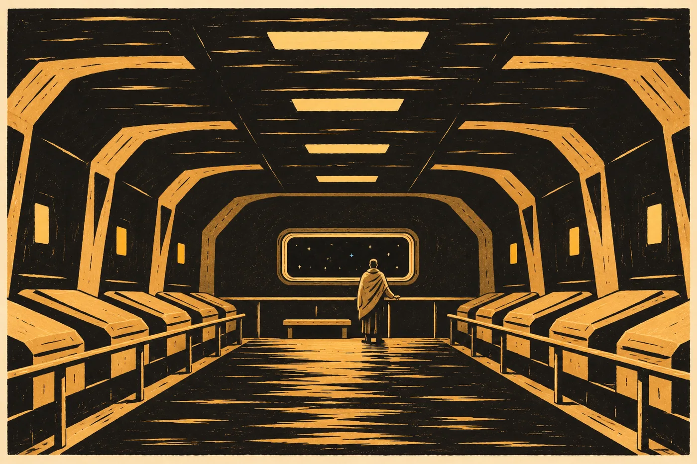

# Prolog. Probuzení

Ještě neotevřel oči, a už věděl, kolik je hodin.

*Lodní čas: 06:40.* Pod tím druhý řádek, který tam nikdy dřív nebyl: *Místní počet: 3. ledna 2035.* A pod ním drobněji, jak síť píše všechno, co nečeká na odpověď: *Probuzení řízené. Průběh v normě.*

Ivar Sende ležel a nechal ty řádky stát. Bylo to jako vejít po dlouhé směně do vlastní kajuty. Všechno je na svém místě, ještě než člověk rozsvítí. Síť se mu ozvala dřív, než si uvědomil, že by ji mohl hledat. Hledat ji nemusel nikdy. Byla tam vždycky, tak jako je v habitatu vždycky vzduch. Teprve teď, v té první chvíli, ho napadlo, že by to mohlo být jinak. Myšlenka hned odešla. Neměla se čeho chytit.

Poslední řádek, který si pamatoval, byl z haly na Iretu, z rána před uložením. *Hibernace zahájena. Delegát I. Sende, 40 let.* Hned pod ním teď stál tenhle. Mezi nimi nebylo nic. Ani šev.

Síť mu nabídla, že tu mezeru změří, a on souhlasil.

*Nepřítomnost: 548 let lodního času. V počtu domova 602 let.*

Bylo to číslo. Ležel a díval se na něj a čekal, jestli s ním něco udělá. Neudělalo. Síť mu ukázala proč: *Zklidnění: aktivní (probuzení). Vypnout?*

Nevypnul. Nebylo proč.

*

Lůžko ho zahřívalo celé hodiny, dřív než se probudil. Věděl to, protože to stálo v průběhu, a cítil to. Ruce měl teplé až do konečků prstů a v ústech jen slabou pachuť, kterou síť označila jako očekávanou. Když se pokusil polknout, šlo to. Když se pokusil pohnout prsty, pohnuly se, pomalu, jako by mezi příkazem a pohybem stála fronta.

Víko se odsunulo bez zvuku. Světlo nad ním bylo bílé a tlumené, takové, jakým se svítí v nemocničních úsecích, aby nikoho nebolely oči.

Nad lůžko se naklonila žena v šedozeleném. Mladá, s vlasy staženými dozadu. Síť mu ukázala, kdo je a odkdy slouží, dřív než promluvila, a tak se nepředstavila. Věděla, že to ví.

„Delegáte,“ řekla. „Slyšíte mě?“

„Slyším.“ Hlas mu zněl, jako by ho někdo vytáhl ze skříně, kde ležel moc dlouho. Zakašlal.

„To přejde. Za hodinu budete mluvit normálně. Posadíme vás.“

Posadili ho. Ona a lůžko spolu, lůžko zvedalo opěradlo a ona mu držela ramena. Hlava se mu na okamžik zatočila. Síť to zachytila a zatočení odeznělo dřív, než stačil zjistit, jestli se ho lekl.

Hala byla dlouhá a měla dvě řady lůžek. Většina byla zavřená, s tlumenými kontrolkami na víku. Kromě jeho lůžka byla otevřená ještě tři a u každého někdo stál. Nikdo nezvracel. Nikdo nekřičel. Kdosi o dvě lůžka dál se tiše smál, protože mu lékař řekl něco, co Sende neslyšel. Sende si pomyslel, že takhle se to má dělat. Že tohle je řád: probuzení, které se dá popsat jednou větou v průběhu, a ta věta zní *v normě*.

„Gravitace je osm desetin,“ řekla lékařka. „Jako na tréninku. Prvních pár dní ji budete cítit víc. Na Terře je celá. Do té doby máte čas.“

„Kolik?“

„Na oběžnou dráhu vstoupíme v dubnu. Pokud plachta vydrží brzdit, jak brzdí.“ Usmála se, jako by to byla stará lodní věta, kterou se tady všichni naučili. Možná byla. Ona tu byla vzhůru už dva roky. Síť mu to ukázala u jejího jména.

*

Brief čekal v řadě, jak měl. *Brief delegáta. Přehrát?*

Sende seděl na kraji lůžka v teplé dece a řekl ano.

Znal ho. Text schválila komise v posledním roce příprav a on u toho seděl, a polovinu vět by uměl odříkat. Přesto ho chtěl slyšet tady. Ne doma, v sále s lavicemi, kde se o každé čárce hlasovalo. Tady, kde už měl platit.

Hlas byl klidný, úřední, příjemný. Takovým hlasem mluví instituce, která nespěchá, protože ví, že tu bude i zítra.

*Výprava nástupnického řádu k chráněnému světu Terra. Důvod: nouzové hlášení stanoviště pozorovací sítě, přijaté před 623 lety počtu domova. Hlášení uvádí poškození dohledu. Jiné stanoviště sítě se neozývá.*

*Chráněný svět je obydlen. Obyvatelé užívají vlastní techniku a vysílají. Jejich jazyky jsou zpracovávány od začátku brzdění. Původ dnešních obyvatel je předmětem šetření. Archiv řádu uvádí, že svět byl v době výkonu trestu neobydlený.*

*Úkoly výpravy: zajistit bezpečnost lodi. Prověřit stav stanoviště. Obnovit karanténní správu v rozsahu, který odpovídá převzatému statutu.*

*Úkol delegáta pro právní přezkum: přezkoumat právní základ karanténní správy a podávat stanoviska vedoucí výpravy. Delegát odpovídá řádu.*

*Spojení s centrálou: jednosměrné. Doba odpovědi: nejméně 480 let.*

Sende si předposlední odstavec nechal přehrát ještě jednou. Ne proto, že by mu nerozuměl. Chtěl ta dvě slova slyšet znovu.

*Přezkoumat právní základ.*

V prvním návrhu briefu stálo *potvrdit*. Bezpečnostní složka komise tehdy tvrdila, že základ potvrdil už sám fakt, že řád převzal správu, a že výprava nemá letět šest set let proto, aby se cestou ptala. Sende tehdy mluvil čtyři minuty. Nebyl to jeho nejlepší výstup, měl suché rty a dvakrát se opakoval. Ale řekl jednu větu, kterou si pak komise zapsala do odůvodnění. *Moc, která se nedá přezkoumat, není správa. Je to jen moc.* Hlasovalo se a *potvrdit* se změnilo na *přezkoumat*.

Tak to má fungovat, myslel si tehdy. Myslel si to i teď, v dece, se slabýma rukama. Řád, který si sám uloží, že se má zeptat. Byla to nejlepší věc, kterou kdy viděl udělat instituci, a on u toho byl.

*

Pak brief pokračoval historickou částí. Tu Sende znal ze školy.

*Terra. Místo výkonu trestu vyhnanství podle rozsudku Terra. Vyhnanství bylo zavedeno jako humanitární alternativa trestu smrti. Odsouzení byli převezeni bez přístupu k technice.*

Ve škole k tomu ukazovali obraz. Zelený kraj pod modrou oblohou a v něm bílé tvary, které dosedají. Lidé vystupují v řadách. Pod obrazem stála věta, kterou se děti učily nazpaměť: *Každý dostává příležitost začít znovu.* Sende si ji pamatoval líp než vlastní adresu na Iretu.

Bez přístupu k technice. Snažil se to kdysi představit. Bylo mu tehdy devět a jednoho večera ležel v posteli a zkoušel, jaké by to bylo, kdyby řádky zmizely. Nešlo to. Nedokázal si představit tu díru, protože pokaždé, když na ni pomyslel, síť mu k té myšlence nabídla heslo, a heslo bylo něco, ne nic. Usnul nad výkladem o dějinách hibernační techniky.

A teď tam dole žilo osm miliard lidí. Měli rádio. Měli lodě, které létaly k jejich vlastnímu měsíci. Ve vysíláních mluvili tisíci jazyky. Na lodi se o tom mluvilo od začátku brzdění, nahlas a s hrdostí, jako by šlo o vlastní děti. *Naši to dokázali.* Šest set let spánku, a na konci se ukáže, že ten nejstarší humánní rozsudek v dějinách nebyl jen slib.

Sende tu větu neříkal. Byl právník. *Původ dnešních obyvatel je předmětem šetření.* Tak to stálo v briefu a tak to měl brát. Ale líbila se mu. Uvědomil si, že se mu líbí, a nechal to být.

*

*Zpráva uložená před odletem: 1. Odesílatel: Ena Sende. Přehrát?*

Matka. Nahrála ji večer před uložením, v kuchyni bytu na Iretu, s oknem do zahrad na protější straně osy. Věděl, co v ní bude. Dívala se do záznamu a snažila se nebrečet. Řekla mu, ať jí nezapomene napsat, a pak se tomu sama zasmála, protože dopis na Iret by šel dvě stě čtyřicet let a ona tou dobou bude dávno mrtvá. Mrtvá byla. Pět set let a víc.

Věděl to. Síť to věděla s ním, a tak to nebylo těžké vědět.

„Později,“ řekl nahlas, i když stačilo pomyslet.

Lékařka u vedlejšího lůžka se po něm ohlédla a vrátila se ke svému pacientovi.

*

„Chci to vidět,“ řekl.

Lékařka se zatvářila, že to čekala. „Průzor je na konci haly. Čtyřicet kroků. Síť vám bude hlásit každých deset.“

Hlásila. Šel podél zavřených lůžek, jednou rukou na zábradlí, a síť mu v rohu vědomí odečítala vzdálenost a tep. Nohy byly těžké. Osm desetin, opakoval si, a pod tím síť napsala, že Terra má o čtvrtinu víc. Nedalo se to představit, tak to nezkoušel. Bude to číslo, dokud to nebude váha.

Průzor byl ve stěně na konci haly. Nebyl velký, asi jako dveře kajuty položené naležato, a sklo bylo silné tak, že se v něm světlo z haly lámalo do zeleného okraje. Za ním byla tma a v ní hvězdy.

Ty znal. Ostré, nehybné, rozsypané po celé ploše. Takové je viděl z průzorů Iretu celé dětství. Nic se v nich nechvělo. Nic mezi nimi a ním nebylo.

A jedna z nich měla kolem sebe kroužek.

*Terra. Vzdálenost 1,9 astronomické jednotky. Chráněný svět.*

Sende se na kroužek díval dlouho. Byl tenký a světle modrý, jak síť kreslí cíle, a uprostřed něj ležel bod. Nic víc. O kus dál, slabší, druhý bod s menším kroužkem. *Měsíc Terry.*

Pak udělal věc, kterou nedělal často. Kroužek odmítl.

Zmizel. Okno bylo jen okno a v něm jen hvězdy. Sende hledal, kde ten bod byl, a chvíli ho nenacházel. Byl tam. Musel tam být. Jenže bez kroužku vypadal jako všechny ostatní, a ostatních bylo tolik. Pak ho našel. Trochu jasnější než sousední. A když se díval dost dlouho, i trochu jiný. Ne bílý. Modravý, jako studená voda v nádrži při údržbě, když se v ní zrcadlí servisní světla.

Tam dole se lidé narodili pod nebem. Celý život měli nad hlavou nic. Sende to věděl jako fakt z briefu, a teď, když se na ten bod díval bez kroužku, mu ten fakt na okamžik přestal stačit. Nepříjemně, slabě, jako když člověk v kabině ucítí průvan a neví odkud.

Síť to zachytila dřív než on. *Zklidnění: zesílit?*

„Ne,“ řekl. Nebylo to potřeba. Už to odeznělo. Nebo to odeznělo proto, že síť věděla, co dělá, ještě než se zeptala. Nevěděl to jistě a nepovažoval za důležité to vědět.

Vrátil kroužek na místo.

*Terra. 1,9 AU. Chráněný svět.*

Tak to bylo lepší. Tak věděl, kam se dívá.

Stál u průzoru, dokud mu síť nenapsala, že by si měl sednout. Pak si sedl na lavici pod oknem, v dece, kterou mu lékařka přinesla, a díval se na modrý bod v kroužku. Za pár měsíců na něm bude stát.

*Delegát I. Sende: probuzen. Stav: v normě.*

Ten řádek nechal svítit a vrátil se k němu ještě jednou.
