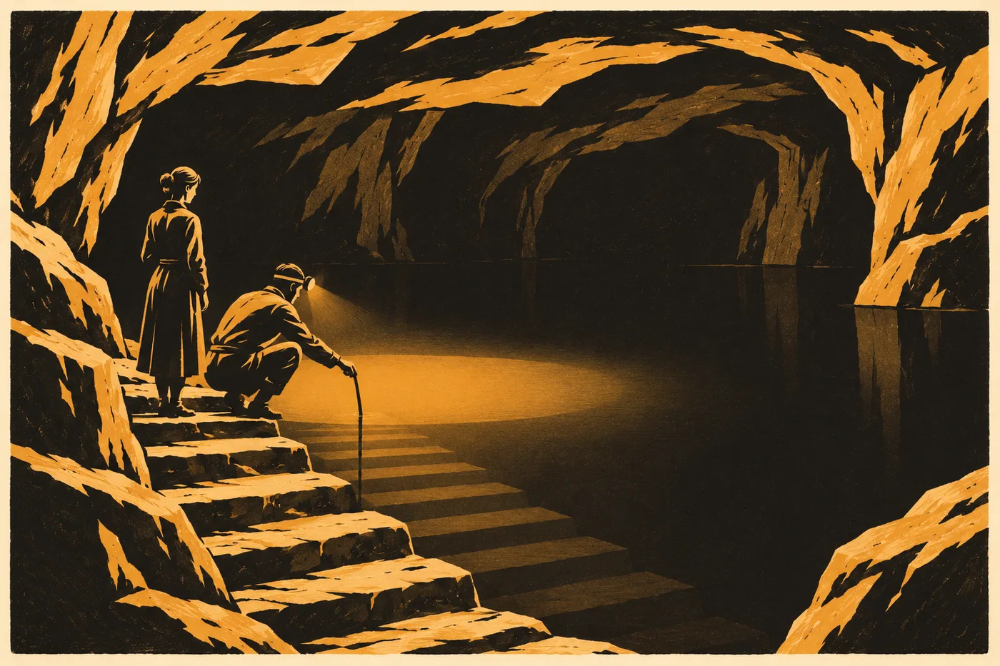

# 3. Hora

Na dvaatřicátém schodu stála voda.

Sael to věděla dřív, než k ní došla. Cítila ji ve vzduchu, který šel zdola. Byl těžký a teplý a voněl železem a ještě něčím ostřejším, co v hoře dřív nebývalo. Kyselé, jako když se v kamnech nechá vyhasnout mokré dřevo. Detektor pod límcem jednou pípl a zmlkl. Tadeáš před ní zastavil, posvítil dolů a světlo čelovky se rozlilo po hladině. Hladina se ani nepohnula.

„Minulou sobotu byla na třicátém třetím,“ řekl. „V zimě na pětatřicátém.“

„A teď?“

Tadeáš si dřepl a ponořil do vody tyč s čidlem. Na displeji naskočilo číslo. Sael ho četla přes jeho rameno. V šeru viděla číslice ostře, jen barvu displeje nepoznala. Pro ni byl šedý, jako všechno, co svítí málo.

„Padesát osm,“ řekl Tadeáš. „Na hladině. Dole víc.“

Pod vodou byly další schody. Sael je znala nohama, i když na ně pět let nestoupla. Dvanáct do dolní chodby. Pak chodba podél žlabu, pak skleník pod klenbou s lampami, ve kterém Ostří pěstovali zeleninu a byliny, a pod skleníkem strojovna. Tři kola ventilů u stropu, jedno vedle druhého. Dvě zavřená. Třetí otevřené, tak, jak ho Lada nechala té noci před pěti lety, protože kdyby ho zavřela, prasklo by to u skály.

Ten ventil byl pod vodou od zimy třicet. Nikdo se ho od té doby nedotkl. Nikdo nemohl.

„Pojďte,“ řekl Tadeáš. „Tady se nemá stát dlouho.“

*

Nahoře v archivu bylo ticho, jaké tam za Saelina života nebylo nikdy.

Police stály holé. Na prknech zůstaly světlejší obdélníky, kde ležely svazky, a ty obdélníky za pět let neztmavly, protože tu nebyl nikdo, kdo by zvířil prach. Truhla pod stolem byla prázdná. Kazeta pryč, rozdělená na listy rodin a rozvezená. Sael ty listy rozvážela celé léto a podzim třicet a pak ještě dvě zimy, protože některé rodiny nebyly k nalezení, a když se našly, nechtěly otevřít dveře. Poslední list předala v únoru třicet dva staré ženě v Annabergu. Žena ho vzala, aniž se na něj podívala, a řekla, že na to čekala čtyřicet let. Sael se jí nezeptala, jestli na list, nebo na to, až ho někdo přinese.

Kniha byla v Chebu, v deponátu, v archivu, kde Sael už nepracovala. Kdo se v ní narodil nebo zemřel, toho zapsal ten, koho si rodina vybrala, a podepsal se jménem. Sael ty zápisy četla jednou za rok, v den, který jí určila Šindelářová, ve studovně, s rukavicemi, jako každý jiný badatel. Poslední, co tam viděla, byla Klářina ruka. Latinkou, propiskou, s jedním písmenem obráceně. *Jonáš umí napsat svoje jméno. Taky obráceně. K. R.*

Vlhkoměr na stěně ukazoval sedmdesát jedna.

Sael si položila dlaň na stěnu za stolem, kde za kamenem byla skála.

Hřála. Víc než v roce třicet. Víc než kdy za těch sto čtyřicet let, co sem sahala. Už to nebylo jako kamna, do kterých se přikládá celý den. Bylo to, jako když se dlaň položí na bok koně, který dlouho běžel.

„Ukážu vám to,“ řekl Tadeáš.

*

Kamera byla u dubových vrat, nahoře na deseti schodech do spodní síně. Úřad ji tam dovolil dát před dvěma lety, s podmínkou, že se za vrata nesmí. Tadeáš za ně nechodil. Sael by to poznala. Ostří slyší skálu chodidly a lež je na nich vidět podle rukou. Na Tadeášovi odjakživa.

Na displeji notebooku byla spodní síň tak, jak ji kamera viděla. Šedá, rozostřená párou. Pára v ní teď stála pořád, ve dne i v noci. Vzadu teplá skála, hladká plocha velká jako vrata stodoly, a pod ní kamenná lavice. Na lavici už nikdo nesedal. Na zemi u lavice ležely dva stativy a smyčka, které tam Hana nechala v březnu třicet. Pět let je nikdo nezvedl.

„Dívejte se,“ řekl Tadeáš. „Za čtyři minuty.“

Sael se dívala. Čtyři minuty pro ni byly krátká doba. Pro Tadeáše dlouhá. Zatímco čekali, přešlápl dvakrát z nohy na nohu a jednou si sáhl na levou ruku. Jizva po opaření mu zůstala lesklá a světlejší, od zápěstí po loket. V zimě ho bolívala.

Pak se skála rozsvítila.

Ne tak jako v lednu třicet. Tehdy z ní stoupalo světlo jako z vody, ve které se něco hýbe, a ukazovalo obrazy. Teď bylo bledé a rovné, celou plochou naráz, bez obrazů. Trvalo to déle, než by Sael vydržela nedýchat. A pak skála pohasla, ne úplně, a v jejím středu zůstala skvrna velká jako dlaň a tloukla. Tři, dva, čtyři. Tři, dva, čtyři. Rychleji, než si Sael pamatovala.

„Jdou nad námi,“ řekl Tadeáš.

Neřekl kdo. Nemusel.

„Pan Kalina mi to spočítal,“ řekl. „Každý den dvakrát. Jednou ve dne a jednou v noci, pokaždé o kus jindy. Když jsou nad Chebskem, skála svítí. Když zajdou, zhasne. Na minutu přesně.“ Ťukl nehtem do displeje. „Dřív jsme nevěděli, komu svítí. Teď to víme.“

Sael se dívala na tu tlukoucí skvrnu v páře. Byla to Ostřina skála. Ostra ji ukázala mnichovi a mnich ji zapsal. Ostří u ní celé generace sedávali na lavici s dlaněmi na kameni. *Skála spí*, tak se to říkalo dětem, ještě Sael to tak říkali. A skála celou dobu na někoho čekala, a teď ten někdo přišel, a skála mu odpovídala dvakrát denně, na minutu přesně, a Ostřím nic.

„Svítila takhle i jim,“ řekla Sael. „Když přiletěli poprvé.“

„To nevíme.“

„Ne,“ řekla Sael. „Nevíme.“

*

Lada čekala nahoře ve světnici, u stolu, s brýlemi v kapse zástěry.

Bylo jí devadesát pět. Po schodech dolů už nechodila. Sebrala jí je zima třicet tři, ta dlouhá, kdy umřela Apolena. Apolena umřela v posteli ve statku, s dlaněmi na prkně postele, protože na kámen už nedosáhla. Řekla předtím, že prkno neposlouchá, ale že je aspoň ze stromu, který rostl na hoře. Pohřbili ji na hřbitově v Mlýnci, pod jménem, které měla v občance, vedle Václava. Na kříž jí Ostří nedali nic jiného než to jméno. Ale Sael tam o pohřbu viděla Kryštofa, jak si klekl a položil dlaň na hlínu a dlouho ji tam nechal.

„Padesát osm,“ řekla Lada, když Tadeáš vešel. Nebyla to otázka.

„Na hladině.“

„A schod?“

„Dvaatřicátý.“

Lada vytáhla brýle, nasadila si je a zapsala si to do sešitu, který měla před sebou. Byl to obyčejný školní sešit s modrou obálkou. Lada si ho koupila v Chebu v trafice, v roce třicet dva, když se Ostří vrátili do statku a do horního patra, a od té doby do něj každou sobotu psala dvě čísla. Teplotu a schod. Nic jiného. Ostří se pamatují bez papíru. Tohle si ale pamatovat nechci, řekla tehdy Lada. Chci to vidět.

„Za rok bude u archivu,“ řekla.

„Za dva,“ řekl Tadeáš.

„Za rok,“ řekla Lada. „Ty počítáš s tím, co bylo. Já počítám s tím, co bude.“ Zavřela sešit. „A pak se Ostří nebudou mít kam vrátit. Ani nahoru.“

Sael si sedla na lavici u kamen. Kamna byla studená. V květnu se ve světnici netopilo a stejně tu bylo teplo. Šlo zespodu, z hory, podlahou, jako kdysi do skleníku. Statek se hřál sám. Kdo sem přišel z Chebu, sundal si bundu ve dveřích.

„V sobotu přijedou,“ řekla Lada. „Ines a ti ostatní. Kvůli tomu dopisu.“

„Já vím.“

„Kvůli tobě.“

„Kvůli dopisu,“ řekla Sael.

Lada se na ni podívala přes brýle. Zespodu, jak se dívala celý život.

„Před pěti lety jsi jim tady řekla *ne teď*,“ řekla. „Ines si to pamatuje. Já taky.“

*

Dopis přišel na začátku května. Ne Saelin. Ten nebyl nikdy. Přišel z ministerstva zahraničí na kontaktní místo v Brně, k paní Hronkové, a Hronková ho poslala dál všem sítím, které s ní byly v kontaktu. Ke každé kopii připsala rukou jednu větu: *Posílám, jak jsem to dostala. Neodpovídám za vás. M. H.*

Byl krátký a zdvořilý. Vláda bude prvního června v Praze jednat s výpravou. Výprava žádá účast toho, kdo odpovídá za zařízení na Chebsku. Výprava se dále ptá, jak má ve slovníku pojmenovat populace v okolí zařízení. Vláda prosí o sdělení, zda dotčené komunity mají zástupce, s nímž by mohla jednat, a kdo to je.

Sael ho dostala od Ines. Do telefonu, vyfocený, s Hronkové větou dole. Pod tím Ines napsala: *Teď?*

Sael tu otázku znala. Dva týdny předtím jí přišla Hanina zpráva z vlaku. *Řekla jsem ne a ať se zeptají vás.* Sael tehdy odpověděla ještě týž večer, poprvé za pět let dřív než za den, a do odpovědi napsala *zatím*. Teď odepsala Ines.

*Sejděme se. Všichni, kdo mohou. Ve statku, se souhlasem Ostrých. Ať je to slyšet.*

*

Sešli se v sobotu devatenáctého května, po setmění.

Bylo jich méně než tehdy. Lorenz už nepřijel. Bylo mu přes osmdesát a od zimy třicet dva nechodil z bytu ve Vídni. Mluvil na obrazovce, kterou Tadeáš postavil na kraj stolu, a obrazovka mu dělala obličej menší, než byl. Radu sítí teď vedla Ines. Nechtěla to. Odhlasovali ji, když nebyla v místnosti, a když se vrátila, řekla jim, že to byla nejhorší věc, jakou jí kdy udělali, a ať to zapíšou. Ten večer přišla za Sael a řekla jí *ty*. Vést radu a vykat té, o které rada rozhoduje, jí prý připadalo jako lež. Sael to přijala dřív, než čekala.

Žena z Vratislavi přijela. Muž ze saských sídel přijel, šedivější, a tentokrát přivezl dceru, která mu řídila auto a celou dobu mlčela. Ostří seděli kolem stolu, devět, protože dva byli v Sasku u nemocné sestry. Lada v čele. Kryštof u okna. Tadeáš na konci stolu, s notebookem, který tentokrát otevřel.

Benedikt přišel po desáté, s Agnes. Bylo mu sto dvacet tři let a šel pomaleji, ale židli mimo světlo lampy si postavil sám. Kryštof se zvedl, že mu pomůže, a Benedikt ho zastavil rukou. Neřekl nic. Kryštof si zase sedl.

Javor nepřijel. Bylo mu sto šedesát pět a z kuchyně v Kozí uličce chodil jen k oknu. Když mu Sael ráno řekla, kam jede, chvíli se díval do dvora a pak řekl: *Ať tě zvolí. Ať to máš od nich. Od Rokyty jsi to měla jen od ní.*

Sael stála u dveří. Ostří ji pozvali ke stolu a ona si nesedla. Jako v dubnu třicet.

*

Ines přečetla dopis z ministerstva nahlas, celý, i s Hronkové větou, a položila ho na stůl.

„Musí jim někdo odpovědět,“ řekla. „Když neodpoví nikdo, odpoví za nás někdo jiný. Víme kdo.“

Nikdo se nezeptal. V Chebu byl na celý červen pronajatý sál.

„Navrhuji,“ řekla Ines, „aby rada sítí dala Sael mandát. Výslovně. Na čas. S tím, že ho můžeme odvolat.“ Ukázala ke dveřím, kde Sael stála. „Tak, jak to chtěla ona. Tady, v téhle světnici, v červenci třicet. Napsala jsem to podle toho.“

Vytáhla z kapsy bundy list papíru, přeložený napůl, a četla.

*Rada sítí uděluje Sael mandát zastupovat sítě, které o to požádají, při jednání s výpravou a se státy. Mandát se týká archivu a ochrany osob. Netýká se ničeho jiného.*

*Sael nesmí sdělit jméno ani místo žádné rodiny bez jejího výslovného souhlasu.*

*Sael nesmí nic podepsat, aniž se vrátí k radě. Co podepíše bez toho, neplatí.*

*Mandát trvá do konce jednání, nejdéle do konce roku. Kterákoli síť ho může za sebe odvolat. Většina sítí ho může odvolat celý.*

*Sael mluví za sítě, které ji pověřily. Ne za ostatní.*

Ines list položila na stůl vedle dopisu. Uhladila ho dlaní.

„To je všechno,“ řekla.

*

Žena z Vratislavi mluvila první. Pomalu, jako vždycky, a polsky zabarvenou češtinou.

„Moje síť to nepodepíše,“ řekla.

Ines kývla. Čekala to.

„Ne kvůli Sael,“ řekla žena. „Kvůli těm, kdo nechtějí, aby za ně mluvil kdokoli. Ani ona. Ani já.“ Podívala se ke dveřím. „Ta babička, které je sto patnáct a v občance pětaosmdesát. Ten kluk z banky. Je mu teď třicet osm a pořád nechodí na polední grilování. Zeptala jsem se jich. Řekli, že nechtějí být ve slovníku pod žádným slovem. Ani pod dobrým.“

„To je odpověď,“ řekla Sael. „Řeknu ji tak. Že síť z Vratislavi nikoho nepověřila. Že tam jsou lidé, kteří nechtějí jméno. A že to není mezera. Že je to jejich rozhodnutí.“

Žena chvíli mlčela.

„To smíš říct,“ řekla. „Jen to.“

*

Pak Lada.

Nevstala. Seděla v čele stolu s rukama na desce, malá a široká, a dívala se na Sael zespodu.

„Za Ostré nemluvíš,“ řekla. „Ať to slyší všichni. Ty jsi vysoká. My jsme malí. Hora je naše. Vy jste bydleli u nás. My u vás ne.“

„Ano.“

„Na tom slovníku,“ řekla Lada, „ať za nás nepíšou nic. Kdo se nás chce na něco zeptat, ať se zeptá nás.“ Otočila se k Tadeášovi. „Do Prahy pojede Tadeáš.“

Tadeáš zvedl hlavu od notebooku. Zrudl, jako rudl odjakživa, když ho někdo jmenoval.

„Já?“

„Ty. Ptají se, kdo odpovídá za zařízení. Nikdo neodpovídá. Ale ty mu rozumíš napůl, a to je víc, než mu rozumějí oni.“ Lada se odmlčela. „Řekneš jim, kolik má voda na hladině a na kterým je schodu. Nic jinýho. Na nic jinýho se tě ptát nemaj.“

„A když se zeptají?“

„Řekneš, ať se zeptají mě.“

Kryštof u okna se zasmál. Tiše, do vousů. Do té chvíle se ve světnici celý večer nikdo nezasmál.

*

Benedikt mluvil zpoza lampy. Suše a tiše, saskou němčinou, které rozuměli všichni.

„Za nás taky ne,“ řekl.

„Já vím,“ řekla Sael.

„Pošleme vlastního. Agnes.“ Agnes vedle něj sklopila hlavu, jako by to slyšela poprvé, a Sael poznala, že to slyší poprvé. „Ona chodí ve dne. Já už ne.“

Agnes se otočila nejdřív k němu, potom k Sael. Bylo jí kolem pětačtyřiceti, dvacet pět let pracovala jen na noční a ve tváři měla tu bledost, kterou mají lidé, co spí přes den. Nikdy nemluvila nahlas před tolika lidmi. Sael to viděla na jejích rukou.

„Já nevím, co mám říkat,“ řekla Agnes.

„Řekni, co ti řekneme,“ řekl Benedikt. „A co ti neřekneme, to neříkej.“ Chvíli počkal. „Ale ne sami. Sael. Ty budeš vedle ní.“

„Budu.“

„Ne za ni.“

„Ne za ni,“ řekla Sael.

*

Lorenz se ozval z obrazovky až nakonec. Obraz se mu zasekl, když začal mluvit, a jeho obličej zůstal chvíli stát s otevřenými ústy. Pak se zase rozběhl.

„Paní… Sael,“ řekl. Pět let a pořád to slovo hledal. „Já jsem tuhle radu vedl dvacet let tak, aby nic takového nebylo potřeba. Řekl jsem to před pěti lety. Zdržel jsem se.“

„Pamatuji si to.“

„Tentokrát se nezdržím.“ Lorenz se naklonil blíž ke kameře a jeho obličej se zvětšil a rozmazal. „Ne proto, že bych to chtěl. Protože to už není moje rada. Je to vaše. Vy všichni. A protože ten, kdo za nás bude mluvit, by to neměl chtít. Vy to nechcete. Vidím to. To je dobře.“

Sael nic neřekla.

„Ještě jedna věc,“ řekl Lorenz. „Ten pán z Mnichova. Ozval se mi v březnu. Mně, ne radě. Nabízel pomoc. Že má lidi, kteří vědí, jak mluvit s těmi nahoře. Že on jediný věděl, že přijdou.“ Lorenz se usmál, unaveně. „Řekl jsem mu, že už nic nevedu. Řekl mi, že to je škoda. Že se mnou se dobře spolupracovalo.“

V místnosti bylo ticho.

„Kdo ještě?“ zeptala se Ines.

Muž ze saských sídel zvedl ruku. Pak žena z Vratislavi. Pak, po chvíli, Agnes, a Benedikt vedle ní za lampou nezvedl nic, ale kývl.

„Všem,“ řekla Ines. „Psal všem. Stejně.“

*

Hlasovali jednou. Jen sítě. Ostří nehlasovali, protože to nebyla jejich věc, a Lada to řekla dřív, než se kdo stačil zeptat.

Ines pro. Muž ze saských sídel pro. Řekl, že by chtěl, aby v mandátu stálo i to, kdo smí číst, co Sael zapíše. Ines mu odpověděla, že Sael nezapisuje nic, a on řekl, že tím spíš. Lorenz pro. Síť z Bavorska, jejíž zástupce nepřijel a poslal hlas písemně Ines, pro. Síť z Vratislavi se nepřipojila a chtěla, aby bylo zapsané proč. Ines to zapsala.

Benediktova komunita mandát nedala. Poslala Agnes. To také Ines zapsala.

„Čtyři,“ řekla Ines. „Ze šesti, které tu jsou nebo poslaly hlas. Pátá nepověřuje nikoho. Šestá posílá vlastní.“ Obrátila se ke dveřím. „Sael.“

Sael nestála na světle. Stála tam, kde světlo lampy končilo a začínala tma u dveří, a viděla do ní líp než ostatní. Viděla Benediktovy ruce na kolenou. Viděla Agnes, jak si mne palec o palec. Viděla Kryštofa u okna a za ním, přes sklo, sad a pod sadem rokli a nad roklí páru, bílou, rovnou, vyšší než v kterémkoli roce, co ji znala.

Před pěti lety tady řekla *ne teď*. A *ani potom, pokud vás nezvolí. Výslovně. Na čas.* Teď ji zvolili. Výslovně. Na čas. S listem papíru, který Ines napsala podle jejích slov, a ty věty teď ležely na stole a byly jejich.

Myslela na Rokytu. Na tu zimu na konci šedesátých let, kdy jí Rokyta podala pero a řekla: *Piš, já už nevidím.* Nikdo to nehlasoval. Nikdo se nikoho nezeptal. Rokyta jí to dala, protože byla po ruce a měla dobré oči. A Sael pak šedesát let psala jménem, které jí nikdo nedal kromě jedné staré ženy, a rozhodovala za lidi, kteří nevěděli, že za ně někdo rozhoduje.

Tohle bylo jiné. Tohle měla od nich. A mohli jí to vzít.

„Přijímám,“ řekla.

Ines kývla. Sael nepoděkovala. Hlasování není dar.

„Do konce roku,“ řekla Ines. „Nejdéle.“

„Nejdéle,“ řekla Sael.

*

Pak se ptali na slovník.

Na to, co mají ve slovníku napsat. Ines četla z Hanina vzkazu, který jí Sael přeposlala. *Mají z vysílání to jedno slovo.* Všichni věděli které. Žena z Vratislavi řekla, že to slovo nesnáší. Muž ze saských sídel řekl, že jeho babička ho používala o sobě, s úsměvem, a že nikomu nedovolí, aby jí ho bral, když už se nemůže bránit. Benedikt řekl zpoza lampy, že jeho lidem se říká hůř a že se to nikdo nikdy nepřišel zeptat.

Neshodli se na ničem. Neshodli se ani na tom, jestli se mají shodnout.

Nakonec to řekla Sael. Ne jako mluvčí. Mandát se týkal archivu a ochrany osob, a tohle byla otázka, kterou jí dal dopis.

„Řeknu jim,“ řekla, „že za nás ve slovníku nemá stát nic. Že každý, kdo bude jednat, se představí sám. A že slovo pro ty, kdo jednat nebudou, nemá stát ve slovníku vůbec.“ Odmlčela se. „Ať je ten řádek prázdný. Hana ho tam nechala prázdný. Ať to tak zůstane.“

„Hana,“ řekla Lada od stolu. Nevzhlédla. „Ne paní Vrbová.“

„Hana,“ řekla Sael.

*

Do rána zůstali jen Ostří a Sael. Jako tenkrát. Lorenzova obrazovka zhasla po půlnoci, uprostřed věty, a Tadeáš ji už nezapnul. Ines odjela se ženou z Vratislavi, i když spolu celý večer nesouhlasily, protože žena z Vratislavi měla auto a Ines ne. Benedikt s Agnes odešli do lesa ve tři. Agnes se ve dveřích otočila a podívala se na Sael, jako by se chtěla na něco zeptat, a nezeptala se.

Sael stála s Ladou v sadu nad statkem. Bylo šero a pod nimi v rokli stála pára. V lese na druhé straně rokle, o dvě stě metrů dál, kde byly stany, svítil oheň. Někdo u něj zpíval. Slova sem nedolehla, jen nápěv, a Sael ho znala. Zpívali ho tam každý víkend od jara. O návratu.

„Čekaj na ně,“ řekla Lada. „Pět let.“

„Ano.“

„A oni přiletěli a o nich neví.“

Sael na to nic neřekla. Nevěděla to. Lada to nevěděla taky. Ale Lada to řekla tak, jak to Ostří říkají o věcech, které vědí chodidly.

Nad hřebenem na západě se mezi posledními hvězdami pohybovalo světlo. Pomalu a rovně. Sael ho viděla dřív než Lada. Lada ho uviděla, až když na ně Sael ukázala. Oči měla devadesát pět let staré.

„To jsou oni?“

„Ano.“

Lada se dívala. Ze sklepa, z otevřených dveří statku, z hloubky pod nimi, sem nedoléhalo nic. Ale Sael věděla, že dole, ve spodní síni, v páře, teď skála svítí. Bledě a celou plochou. A uprostřed tluče skvrna velká jako dlaň, tři, dva, čtyři. Pro ně. Pro to světlo nad hřebenem.

„Chtěj tam jít,“ řekla Lada. „To je jasný. Kdo se ptá, kdo odpovídá za zařízení, ten ho chce vidět.“

„Ano.“

„Ty s nima půjdeš.“

„Nevím.“

„Půjdeš,“ řekla Lada. „Máš to od rady. Archiv. Ten deník, co ta skála má. Pan Kalina o něm mluví s Tadeášem celý zimy.“ Odmlčela se. „A Tadeáš půjde s tebou. A já ne. Já už dolů nedojdu.“

Světlo zašlo za hřeben. Lada se za ním ještě chvíli dívala.

„Někdo tam bude muset jít,“ řekla. „Řekla jsem to před pěti lety. Řekla jsem *jednou*. Teď je to jednou.“

„Ano.“

„Zavřít ten ventil. Vylejt tu vodu. Aby se Ostří mohli vrátit.“ Otočila se a podívala se na Sael zespodu. „Ne do statku. Domů. Dolů. Do skleníku, k lampám, kde jsem se narodila. Pět let spím nad vlastní postelí a voda mi do ní teče.“

Sael mlčela. Myslela na čísla, která Lada každou sobotu psala do modrého sešitu. Myslela na dvaatřicátý schod. Na ventil, který pět let nikdo neviděl. Na Tadeášovo *za dva* a Ladino *za rok*. Na tlukoucí skvrnu, která svítila na minutu přesně a Ostřím nic.

Nevěděla, co ti nahoře s horou udělají, když tam přijdou. Nevěděla, jestli to bude to, co chce Lada. Nevěděla, jestli to vůbec někdo ví.

„Lado,“ řekla.

„Co?“

„Já tam s nimi půjdu. Ale nic neudělám bez vás. Nic. Ani ten ventil.“

„To vím,“ řekla Lada. „To jsi řekla Haně u pramene. Že už nebudeš rozhodovat za nikoho.“

„To jsem neřekla já. To řekla ona. Že mi to řekne nahlas.“

„Tak ať ti to řekne,“ řekla Lada. „A já ti to řeknu taky.“

Otočila se a šla ke statku, pomalu, po mokré trávě, a Sael zůstala v sadu sama.

Na východě se hřeben odděloval od nebe. Pára nad roklí začala šednout. U ohně v lese na druhé straně dozpívali a bylo ticho, jen voda šuměla v rokli, teplá, z hory, a pod sadem, pod statkem, pod čtyřiceti dvěma schody a pod jednatřiceti dalšími stála hladina a nehýbala se.

Sael se dívala na páru. Před pěti lety jí Lada řekla, že hora je sama. Teď sama nebyla. Měla někoho, komu svítila.

Sael si nebyla jistá, co je horší.
