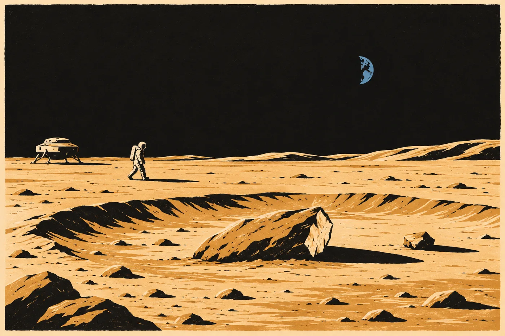

# 7. Sonda

Zpráva přišla v 17:12 a Hana ji četla ve stejné minutě jako všichni ostatní.

Dozvěděla se to až potom. Zmocněnec v kanceláři na Hradčanech, Kalina v Ondřejově, Hronková v Brně, Mexičané na velvyslanectví, Ines v Lipsku. Tadeáš na zídce u studny. Ve stejné minutě, ve stejném znění. Hana stála v kuchyni s hrnkem v ruce, telefon jí zabzučel na lince vedle varné konvice, a ona ho zvedla a četla.

*Objekt. Malý. Příchozí.*

Dočetla to do konce, položila hrnek a četla to znovu, od začátku, protože první čtení je vždycky pravý sloupec.

Kalina zavolal v 17:19.

„Viděla jste to.“

„Ano.“

„Ty souřadnice,“ řekl Kalina. Nemluvil pomalu jako obvykle. Mluvil rychle, jako člověk, který jde po chodbě a nemá si kam sednout. „Na Měsíc se přes pětadvacet let dívá americká sonda z oběžné dráhy. Fotí ho po kouscích. Všechno je veřejné, v archivu, kdokoli si to stáhne.“ Odmlčel se. „Jestli tam něco leží, je to na snímcích. Z doby, kdy o tom nikdo nevěděl.“

Hana chvíli mlčela a řekla to jediné, co ji v tu chvíli napadlo.

„Stáhněte to dřív, než se tam podívají oni.“

„Už stahuju,“ řekl Kalina.

*

Za dva dny jí poslal obrázek.

Šedá plocha. Prach, kamínky, mělké důlky. Ve středu malý kráter, mělký, velký asi jako obývák. Na jeho okraji tečka. Dva pixely, světlejší než okolí, a vedle nich protáhlý černý stín.

*Snímek z roku 2011. Rozlišení zhruba půl metru na pixel. Objekt asi metr dlouhý, stín odpovídá výšce kolem půl metru. Stejný objekt je na snímku z roku 2022, jiné osvětlení, stejné místo. Na obou je to balvan. Mezi tisíci jiných balvanů. Nikdo by si ho nevšiml. T. K.*

Hana se na ty dva pixely dívala dlouho.

Balvan. Ležel tam, když se ve Washingtonu rozhodovalo o rozpočtu sondy. Ležel tam, když se Hana v roce dvacet šest potápěla v cenotu u X'Kanlum a když posunula značku na měřítku. Ležel tam, když se v roce třicet probudila skála. A nikdo o něm nevěděl. Kromě skály. A ta to neměla komu říct.

Napsala Kalinovi: *Zveřejněte to. Dnes. S cestou k originálu v archivu a s datem stažení.*

*Už je to venku,* odpověděl Kalina. *Před hodinou. Nebyla jste první, koho to napadlo.*

Hana se usmála. Poprvé za několik dní.

*

Vlevo:

*18. 6. Objekt na snímcích lunární sondy z 2011 a 2022 (T. K.). Dva pixely a stín. Balvan mezi balvany. Zveřejněno před první fotkou výpravy.*

Vpravo:

*Ležel tam před námi. Je to jediná věc v celé té záležitosti, o které můžu s jistotou říct, že ji nikdo z nás nepřinesl.*

*

Jednání o vyzvednutí trvalo tři dny a Hana na něm skoro nemluvila.

Vyzvednout to uměla jen výprava. To byla jediná věc, na které se shodli všichni. Člun na letišti u Chebu byl stavěný na přistání a start z místa bez vzduchu a s malou tíží. Nikdo jiný na Zemi nic takového neměl připravené. Ne do konce srpna.

Zbytek byl spor.

Vysoká žena se jmenovala Hesk Varo. Že je to ta „H. Varo“ ze zprávy z 16. 6., věděla Hana od druhého dne. Krausová jí to napsala na lísteček a pod jméno připsala: *velí ozbrojené složce. Neví se, jak velké.* Hesk mluvila krátce a navrhovala jednoduchou věc. Objekt cizího technologického původu se vyzvedne a převeze na loď. Tam se prozkoumá v podmínkách, které výprava zná. Výsledek se oznámí.

„Oznámí,“ řekla Hronková.

„Ano.“

„Komu a kdy?“

Hesk se na ni podívala. Krátce, jako se dívala na všechno.

„Stranám jednání,“ řekla. „Až bude jasné, co to je.“

Po ní mluvila Mexičanka, pak Němec, pak zmocněnec, dlouho, opatrně, a Hana z toho poznala jen to, že vláda nechce, aby to skončilo na lodi, a zároveň nechce, aby to skončilo hádkou. Pak mluvil Sende a Hana ho poprvé slyšela s výpravou nesouhlasit nahlas.

„Výprava ten objekt nezná,“ řekl. „Nevíme, čí je. Víme jen, kde leží a jak dlouho. Ležel na místě, které není naše, a stanoviště, které ho zaznamenalo, leží na území, které není naše. Já bych ho na loď nevozil.“

Hesk neodpověděla.

Třetí den se dohodli. Hana si to zapsala vlevo, bod po bodu, protože věděla, že za měsíc si nikdo nebude pamatovat, co bylo dohodnuto, jen co se stalo.

*Člun výpravy. Na palubě dva pozorovatelé, které určí státy: astronautka evropské agentury a pozorovatel, kterého vyšle Mexiko.*

*Celý postup na Měsíci se přenáší veřejně, se zpožděním, které dává vzdálenost, a ne delším.*

*Objekt se dopraví na Zemi. Ne na loď.*

*Než na něj výprava použije jakýkoli svůj přístroj, změří ho pozemské laboratoře a výsledky se zveřejní.*

*Objekt je ve společné úschově. Pečetí ho tři státy a výprava. Nikdo ho neotevře sám.*

Hesk připojila odlišné stanovisko. Hana už věděla, že to dělá vždycky. Nemyslela si o ní kvůli tomu nic horšího. Myslela si, že je to jediný člověk na druhé straně stolu, který nechce, aby se na její nesouhlas zapomnělo.

*

Šestadvacátého června dopoledne podepsala Hana pečeť.

Byl to obyčejný list papíru. Pět institucí ve čtyřech zemích, každá s vlastní kopií a vlastním razítkem. Pod tím tabulka: co se zapečetilo, kdy a s jakým kontrolním součtem. Tomografie válce z roku dvacet šest: švýcarská neutronová a CT z kliniky. Hanina měření od roku třicet. Kalinovy záznamy. Snímky kodexu z chebského archivu, s podpisem Šindelářové. Data Sokolové. A na posledním řádku, zvlášť, s vlastní poznámkou:

*Glosy a varianty znaků z archivu rady sítí (opisy). Zapečetěno se souhlasem rady sítí ze dne 23. 6. 2035. Bez jmen a bez míst.*

Pod tou poznámkou byl podpis. *Sael.* Bez občanského jména.

Hana se na něj dívala. Podepsala se pod svůj řádek, sedla si a zjistila, že se jí trochu třesou ruce. Ne strachy. Bylo to jako po dlouhém měření, když člověk konečně položí přístroj.

Všechno, co jsme měli bez nich, je teď u pěti lidí, kteří se navzájem neznají.

Za tři hodiny to celé viselo na webu. Kontrolní součty, seznamy, kdo co drží. Hana ten odkaz poslala Sendemu, přes kontaktní adresu výpravy. Napsala k tomu jednu větu.

*Teď můžete.*

Odpověď přišla za čtyři minuty. Česky. Hana poznala, že ji psal sám, protože v ní byla chyba v čárce.

*Děkuji paní doktorko. Ten papír si zapíšu. I. S.*

*

Člun odstartoval v sobotu sedmého července ráno a Hana se na to dívala z Ondřejova.

Kalina ji pozval. Seděla v místnosti pod velkou anténou, kde se jinak poslouchalo Slunce, a na stěně visela obrazovka. Kalina tu sedával často sám. Říkal, že je to jediné místo v republice, kde mu nikdo nevolá, protože tu není signál.

Start nebyl vidět. Na obrazovce bylo jen letiště u Chebu z dálky, šedá plocha a na ní šedý tvar. Pak byla plocha prázdná. Hana nic neslyšela. Nic se nezvedlo do vzduchu, nic nezářilo. Kalina viděl 1. června záznam přistání a řekl tehdy, že člun tam prostě najednou byl. Teď tam prostě najednou nebyl.

„Tři dny,“ řekl Kalina. „Pak to tam bude.“

„Pozorovatelé?“

„V pořádku. Ta Němka prý brečela. Ne strachy. Říkala, že čekala celý život, že poletí, a teď letí v něčem, v čem neví, kde je nahoře.“

„To vám řekla?“

„To řekla do přenosu,“ řekl Kalina. „Slyšelo to osm set milionů lidí. Mexičan neřekl nic. Jen se díval z okna.“

*

Desátého července odpoledne byli na místě.

Přenos šel se zpožděním něco přes vteřinu. Hana to věděla, protože Kalina to řekl nahlas, a stejně to cítila. Všechno, co viděla, se už stalo. Kamery byly dvě. Jedna na člunu, jedna na skafandru astronautky. Na obou byla šedá plocha a černé nebe bez hvězd, protože tam byl den a světlo bylo moc ostré.

Kráter byl menší, než čekala. Hana si ho podle Kalinova snímku představovala jako obývák. Byla to spíš velká jáma, mělká, s okrajem zvednutým jen trochu. A na tom okraji ležel balvan.

Šedý, hrbolatý, delší než široký. Napůl v prachu. Jedna strana byla ulomená, ostrá hrana, která se od zbytku lišila barvou. Vedle, metr dál, ležel odlomený kus velký jako bochník chleba.

Hana se naklonila k obrazovce.

Tvrdý dopad. Poznala to, i když to nikdy neviděla na Měsíci, jen v lomech. Ten kráter neudělal on. Ten kráter tam byl a on do něj dopadl šikmo. Ulomil si hranu, odskočil a zůstal ležet na okraji. A pak tam čtyřicet tisíc let ležel a padal na něj prach. Pomalu, po zrnkách, jak tam padá všechno.

„Podívejte se na povrch,“ řekl Kalina.

Hana se dívala. Povrch byl jemně důlkovaný, matný, jako stará pemza. Mikrometeority. Na Měsíci není vzduch, který by je zastavil, a tak dopadají pořád. Za desítky tisíc let udělají z každého kamene tohle.

„Nevypadá to jako stroj,“ řekl Kalina.

„Ne,“ řekla Hana. „Vypadá to jako kámen.“

*

Astronautka k němu došla. Pomalu, v těch dlouhých poskocích, které Hana znala ze starých přenosů. Zastavila se nad ním. Kamera na její helmě se sklonila a Hana viděla její ruku v rukavici, jak se natahuje a nedotkne se.

Pak se ozval její hlas. Anglicky, s německým přízvukem, roztřesený.

„Je to kámen. Je to obyčejný kámen.“ Odmlčela se. „Ne. Počkejte.“

Kamera se přiblížila k ulomené hraně. Hana se k obrazovce naklonila tak blízko, že viděla pixely. Na lomu, v místě, kde se balvan rozštípl, byl vidět vnitřek. A vnitřek nebyl stejný jako povrch. Byla to drť. Ostrohranná zrna, slisovaná k sobě, šedá a tmavší šedá, s něčím, co je drželo pohromadě. Jako beton, jen jemnější. Jako umělý kámen.

„Slisované,“ řekla Hana nahlas.

„Co?“ zeptal se Kalina.

„Nevznikl tam. Udělal ho někdo.“

Hana slyšela, co řekla, a zarazila se. Pak si to v duchu přesunula doprava.

*

Vyzvednutí trvalo dvě hodiny. Člun měl rameno a pod ramenem něco, co Hana nedokázala pojmenovat. Ten tvar se pod balvan vsunul a balvan se zvedl. Hana neviděla, co ho drží, a nikdo to nevysvětloval. Mexičan to celé natáčel ruční kamerou z okna člunu a jeho obraz byl nejlepší. Třásl se, ale nikdo do něj nestříhal.

Když se balvan zvedl, bylo pod ním vidět místo, kde ležel. Tmavší. Prach, na který čtyřicet tisíc let nesvítilo slunce.

Spodní strana balvanu byla taky jiná. Méně důlkovaná. Hladší.

„To se dá změřit,“ řekla Hana tiše. „Jak dlouho tam ležel. Podle toho, co mu udělalo záření. Nahoře a dole.“

„Kolik to trvá?“

„Týdny. Možná měsíce.“

„To nemáte.“

„Ne,“ řekla Hana. „Ale budu to mít potom. A to je taky čas.“

*

Člun dosedl u Chebu v pátek třináctého v noci.

Kubeš jí napsal ve 2:40. *Konvoj z Chebu do Brna: dvě nákladní auta, jedno prázdné. Nevím které. Ani nechci. K.*

Pod tím druhá zpráva, o minutu později.

*Ještě něco. Pan W. byl 7. 6. odpoledne na letišti u člunu. Pozvala ho výprava. Za čtyřicet minut odjel. U brány mu delegát přes našeho kolegu vrátil zalepenou obálku. Kolega říká, že ten delegát ji nesl přes celou plochu pěšky. Co v ní bylo, nevíme. K.*

Hana si to opsala vlevo. Do pravého sloupce napsala jen:

*Vrátil zalepenou. Přes celou plochu pěšky.*

Nevěděla, co si o tom má myslet. Věděla jen, že to zapsala.

*

V Brně dostal balvan halu v areálu technické univerzity, kde se jinak prosvěcovaly velké odlitky. Policie u vrat. Kamery ve všech rozích, přenos ven. Pečeti na dveřích.

Hana ho poprvé viděla naživo v sobotu ráno. Ležel na paletě, v průhledném vaku, a byl menší, než vypadal na Měsíci. Menší než člověk. Delší než široký.

Měřila ho. Bylo to první, co směla, a první, co uměla.

*Délka 1,22 m. Šířka 0,61 m. Výška 0,48 m. Hmotnost 412 kg.*

Kousek, který se odlomil, ležel vedle, ve vlastním vaku. Ten si Hana vzala na stůl. Ulomená plocha. Drť, zrno vedle zrna, ostré hrany. Pod lupou bylo vidět, že ta zrna nejsou z jedné horniny. Byla tam tmavá a světlá. Byla tam i zrna, která se leskla jako sklo. Mezi nimi něco, co je spojovalo. Pojivo. Hana nevěděla jaké.

Odebrala vzorky. Malé, z odlomeného kusu, ne z balvanu, protože to slíbila. Rozdělila je na tři a poslala do tří laboratoří ve třech zemích. Do každé zvlášť, s jiným číslem, aby žádná nevěděla, co měří ostatní.

V neděli večer přišel první výsledek z Prahy. Předběžný.

Hana ho četla doma, na posteli, v botách, protože se nestačila zout.

Kyslík. Poměr těžších a lehčích atomů kyslíku. Každá hornina ze Země ho má trochu jiný, ale všechny leží na jedné přímce. Horniny z Měsíce leží na stejné přímce, protože Země a Měsíc vznikly z jednoho materiálu. Meteority z jiných míst sluneční soustavy leží jinde. Je to stará a spolehlivá metoda. Hana ji znala z učebnice. Nikdy ji nepoužila.

Vzorek z odlomeného kusu na přímce neležel.

Nebylo to moc daleko. Ale bylo to mimo. Mimo Zemi, mimo Měsíc, a podle laborantky, která výsledek poslala, i mimo všechny skupiny meteoritů, které laboratoř kdy měřila.

Hana ležela na posteli, boty ještě na nohou.

Pak vstala, zula si boty, sedla si ke stolu a otevřela sešit.

Vlevo:

*15. 7. Izotopy kyslíku (předběžně, 1 laboratoř ze 3): mimo přímku Země–Měsíc. Mimo známé skupiny meteoritů.*

Vpravo:

*Nedokazuje, odkud je. Dokazuje, odkud není.*

Pod to, menším písmem:

*Zatím jedna laboratoř. Čekej na další dvě.*

*

Tomograf ho prosvítil ještě tu noc, z neděle na pondělí.

Trvalo to šest hodin. Hana seděla v řídicí místnosti s technikem, který tu jinak prosvěcoval bloky motorů, a dívala se, jak na obrazovce vzniká obraz. Vrstva po vrstvě, řez za řezem. Šedá, šedá, šedá. Drť, stejnoměrná, hustá.

Ve třetí hodině se objevila hrana.

Rovná. Uvnitř kamene, kde nic rovného být nemá. Technik se naklonil k obrazovce a zastavil obraz.

„Tady něco je,“ řekl.

Hana kývla. Neřekla nic. Bála se, že kdyby promluvila, rozbije to.

Ve čtvrté hodině to bylo celé. Uprostřed balvanu byla dutina, obdélník, a v něm ležely destičky. Tenké, rovné, jedna na druhé. Mnoho. Technik je spočítal, protože ho to napadlo dřív než Hanu. Najel kurzorem na boční řez a posouval ho po jedné.

Hana počítala s ním. Potichu, pohybem rtů.

Sto devadesát devět.

A pak mezera. Úzká, sotva vidět. A za ní ještě jedna destička. Sama, kousek od ostatních.

„Dvě stě,“ řekl technik. „Sto devadesát devět a jedna.“

„Jedna zvlášť,“ řekla Hana.

Ve spodní části balvanu, pod dutinou, bylo místo, kde byla drť jiná. Hustší, jemnější, bez vzduchových bublin. Jako zátka. Někdo tam ty destičky vložil a otvor zalil.

Hana se dívala na tu zátku a myslela na ruce, které to udělaly. Které stály nad tímhle kamenem někde, kde Hana nikdy nebyla a nikdy nebude, a uhladily tu drť. Kolik jim bylo let? Měly rukavice?

To si Hana nechala na později.

V šest ráno byl obraz hotový. V sedm byl na webu, s kontrolním součtem, u pěti institucí ve čtyřech zemích. V osm přišla do haly výprava.

*

Bylo jich pět. Sende, Lis Aven, Marn, Hesk a někdo, koho Hana neznala, mladý muž s krabicí. Hesk se podívala na tomografický obraz na stěně a pak dlouho na Hanu.

„Vy jste ho prosvítili,“ řekla.

„Ano.“

„Bez nás.“

„Před vámi,“ řekla Hana. „Tak to stojí v dohodě.“

Hesk mlčela. Pak kývla, krátce, jako se kývá na údaj.

Marn otevřel krabici. Uvnitř byl plochý šedý předmět, velký jako kniha, a k němu kabel. Marn ukázal na zásuvku ve zdi a obrátil se k technikovi z univerzity. Mluvil přes Lis Aven.

„Potřebuje napájení,“ řekla Lis Aven. „Zvenku. Sám nic nemá. Pod horou mu dávalo proud stanoviště. Tady nic takového není.“

Technik přinesl měnič. Marn ho dlouho zkoumal a pak ho zapojil. Hana se dívala na kabel, který vedl ze zdi brněnské haly do přístroje z lodi, a myslela si, že tohle je ta chvíle. První přístroj výpravy. Listy katalogu dostal tým klíče před dvěma týdny, slovník a popis kódování výprava ještě nepředala. Pečeť byla tři týdny stará. Všechno, co měli bez nich, bylo u pěti lidí, kteří se neznají.

*

Zátku otevřela restaurátorka z památkového ústavu. Starší žena s brýlemi na šňůrce. Hana ji znala z jedné komise. Dělala to čtyři hodiny. Pomalu, po milimetrech, malým vrtákem a dlátkem, a každý kousek drti, který vyňala, dala do zvláštní misky s číslem. Nikdo jí do toho nemluvil. Marn se díval a jednou se chtěl na něco zeptat. Restaurátorka zvedla ruku, aniž se otočila, a Marn se nezeptal.

V jednu odpoledne byl otvor volný.

Restaurátorka vytáhla první destičku. Rukama v tenkých bílých rukavicích, za hranu, jako se drží negativ. Podržela ji proti světlu.

Byla průsvitná. Tenká, o něco menší než stránka knihy. A prázdná. Hana na ní neviděla nic. Žádné písmo, žádnou kresbu. Jen sklo, nebo něco jako sklo, a v něm světlo stropních lamp.

„Nic,“ řekla restaurátorka.

„Na hraně,“ řekla Lis Aven.

Restaurátorka destičku pootočila. Na úzké hraně byl drobný znak. Hana ho viděla, až když si vzala lupu. Řádek tečeček a čárek, velký jako zrnko máku.

Lis Aven se nad ním sklonila a dlouho tak zůstala. Pak se narovnala a sáhla si dvěma prsty za ucho.

„Je to podpis,“ řekla. „Správce. Starým úředním písmem.“ Odmlčela se. „*Opis souhlasí. T. Hals.*“

„Kdo je T. Hals?“ zeptala se Hana.

Lis Aven se podívala na Sendeho. Sende zavrtěl hlavou.

„Nevím,“ řekla Lis Aven. „Síť to jméno nezná.“

*

Přišel spor. Hana ho čekala.

Marn položil destičku na svůj přístroj a zapnul ho. Přístroj se rozsvítil zespodu, rovnoměrně, bílým světlem. A v destičce se objevily znaky.

Ne na ní. V ní. Jako by vystoupily z hloubky, z hmoty samotné, tisíce drobných znaků v hustých řádcích. Hana se nadechla. Bez proudu sklo. S proudem písmo.

Lis Aven se nad tím sklonila. Sende taky. Oba četli. Hana to viděla na jejich očích, které se pohybovaly po řádcích. Ona sama neviděla nic než tečky a čárky.

„Stůjte,“ řekla Hesk.

Všichni se na ni podívali.

„Obsah archivu je neznámý,“ řekla Hesk. Česky, pomalu, poprvé za celou dobu česky. Musela se to naučit. „Může obsahovat technické údaje. Polohy. Věci, které nemají být venku. Navrhuji první čtení na lodi. Pak zveřejnění. Za den.“

Zmocněnec, který stál u dveří, se pohnul. Hana viděla, že ho to láká. Ne proto, že by chtěl něco skrýt. Proto, že den je krátká doba a hádka je dlouhá.

„Den,“ řekl zmocněnec opatrně. „To by se možná dalo…“

„Ne,“ řekla Hana.

Všichni se na ni podívali. Teď.

„Ten obraz přečtete jen vy,“ řekla Hana. Dívala se na Hesk. Pak na Sendeho. „Nikdo z nás to písmo neumí. Kdybyste nám za den dali překlad, neměli bychom ho s čím porovnat. Jen s vámi. Proto musí být ten obraz venku dřív, než ho přečtete. Každá destička, jak se rozsvítí, se vyfotí a hned se zveřejní. S kontrolním součtem. A pak čtěte. Za rok, až budeme mít váš slovník, zjistíme, jestli jste četli poctivě.“

„Nevěříte nám,“ řekla Hesk. Ne jako otázku.

„Nevěřím nikomu, kdo čte první,“ řekla Hana. „Ani sobě. Řekla jsem to v Praze.“

Hesk se na ni dlouho dívala. Potom se obrátila k Sendemu.

Sende chvíli mlčel, než řekl něco ve své řeči. Lis Aven to netlumočila hned. Pak ano.

„Delegát říká,“ řekla Lis Aven, „že paní doktorka má pravdu v tom, co řekla. A že kdyby výprava četla první, musela by pak ukazovat stránku, kterou nikdo jiný neviděl.“ Odmlčela se. „Říká, že to nechce.“

Hesk se narovnala.

„Odlišné stanovisko,“ řekla.

„Ano,“ řekl Sende.

Zmocněnec si odkašlal a řekl, že souhlasí.

*

Fotilo se to celé odpoledne a celou noc.

Destička na přístroj, světlo, fotka, kontrolní součet, odeslání. Pět institucí. Web. Pak další. Restaurátorka je vytahovala po jedné a Marn je pokládal na přístroj a technik z univerzity mačkal spoušť a Hana zapisovala čísla. Do sešitu, rukou, číslo destičky a čas. Byla to nudná práce. Hana za ni byla vděčná. Nudná práce je jediná, při které se nedá nic splést úmyslně.

Sende seděl na židli u zdi. Četl. Hana to viděla. Každá destička, která se rozsvítila, mu prošla očima. Někdy se zastavil a díval se déle. Jednou zavřel oči.

Ve dvě ráno se Hana zeptala Lis Aven, co je na první destičce. Ne na tom obrazu. Na té, kterou restaurátorka vytáhla první.

Lis Aven otevřela fotku. Tu, která byla na webu od odpoledne a kterou si stáhlo čtyři sta tisíc lidí, z nichž ani jeden ji nepřečetl.

„Obsah,“ řekla. „Seznam. Čtrnáct položek.“

„Přečtete mi to?“

„Pracovně,“ řekla Lis Aven. „S chybami. Krausová to bude muset podepsat, než to bude platit.“

„Pracovně,“ řekla Hana.

*

Lis Aven četla pomalu. Hana psala.

*Spolkový soud Konfederace lidských světů. Senát předsedkyně O. Tann.*

*Věc: Návrh na zastavení výkonu trestu vyhnanství — druhý transport.*

*Navrhovatelka: N. Vess, advokátka pro ústavní věci.* Lis Aven se zarazila. „A pak dvě slova. Jedno je *osoba*. Druhé…“ Zaváhala. „Buď *dotčená*. Nebo *blízká*. Liší se to jedním znakem.“

„Napište obojí.“

„Napíšu obojí.“

*Odpůrce: Koloniální úřad.*

Pak čtrnáct řádků. Hana je psala jeden pod druhým, jak je Lis Aven četla. Návrh. Výpis rozsudku, čtyři sta jedna osob. Rozsudek Terra, veřejná část. Vyjádření odpůrce. Žádost o zpřístupnění. Usnesení *pod pečetí*. Výpověď svědkyně, archivářky průzkumných záznamů. Rekonstrukce technických záznamů útoku. Jedno přiznání z prvního procesu, s doložkou. Souhrnná zpráva pozorovací sítě. Doplnění návrhu. U toho Lis Aven zase zaváhala.

„*Vědomé porušení ochrany…*“ Odmlčela se. „Pak slovo, kterému nerozumím jistě. *Původních. Nebo prvních. Nebo místních.* Populací.“

Hana psala. Ruka se jí nezastavila. Zastavilo se jí něco jiného, někde pod žebry.

Tajná příloha k rozsudku Terra, *zapsáno do veřejného záznamu*. Zápis z jednání. Rozsudek senátu.

„To je čtrnáct,“ řekla Lis Aven.

„A ta jedna zvlášť?“

Lis Aven sjela prstem na okraj fotky. Dole, pod čtrnáctým řádkem, byl ještě jeden. Kratší.

„*Za položkou čtrnáct je uložena písemnost, která do spisu nepatří,*“ přečetla. „*Nemá číslo a má vlastní uzávěr.*“ Odmlčela se. „A adresát.“

„Jaký?“

Lis Aven mlčela dlouho. Sáhla si za ucho a ruku zase položila na stůl.

„*Mému synovi,*“ řekla. „*A jeho potomkům.*“

*

Sende u zdi otevřel oči.

Hana se k němu otočila. Nevěděla proč. Možná proto, že byl jediný v místnosti, kdo se nehýbal.

Sende se díval na fotku na stěně. Na první destičku. Na řádek se jménem navrhovatelky.

„Vess,“ řekl tiše. Ne Haně. Ne nikomu.

Pak řekl ještě něco ve své řeči. Krátce. Lis Aven to slyšela a podívala se na něj. Netlumočila to.

„Co řekl?“ zeptala se Hana.

Lis Aven zaváhala.

„Řekl *výrok třetí*,“ řekla. „Víc nevím. Musíte se zeptat jeho.“

Sende už se nedíval na stěnu. Díval se na své ruce.

Hana se ho nezeptala. Byly dvě hodiny ráno. Zapsala si to.

*

Ráno jela domů tramvají. Byla jí zima, i když byl červenec. Seděla u okna a lidé kolem ní četli v telefonech. Jedna žena četla titulek nahlas svému muži. *SOUDNÍ SPIS Z MĚSÍCE.* Muž řekl, že to je nějaká blbost.

Doma si Hana sedla ke stolu a otevřela sešit. Nahoru, na okraj stránky, kde psala odpočet, napsala:

*Do 30. 8.: 44 dní.*

Vlevo:

*16. 7. Balvan otevřen (zátka, 4 hodiny, restaurátorka). Uvnitř 200 destiček: 199 v jednom svazku, 1 zvlášť. Na hraně každé ze 199 znak: „Opis souhlasí. T. Hals.“ (L. A.) Na té zvláštní znak není.*

*Čteno přístrojem výpravy s vnějším napájením (230 V přes měnič). Bez proudu nic. Každá destička vyfocena a zveřejněna před čtením. 5 institucí, 4 země.*

*1. destička: obsah spisu. Spolkový soud, senát O. Tann. Návrh na zastavení výkonu trestu vyhnanství, druhý transport. Navrhovatelka N. Vess, „osoba dotčená / blízká“. Odpůrce: Koloniální úřad. 14 položek. Za nimi písemnost bez čísla, s vlastním uzávěrem. Adresát: „mému synovi a jeho potomkům“.*

*Počet položek a destiček sedí. 199 + 1.*

Vpravo:

*Kdo je T. Hals? Nikdo neví. Podepsal každou.*

*„Vess.“ – Sende to jméno zná odjinud.*

*„Výrok třetí.“ – ?*

*Mému synovi a jeho potomkům.*

Pod tím dlouho nic. Pak Hana dopsala ještě jeden řádek.

*Zatím to nikdo nečetl.*
