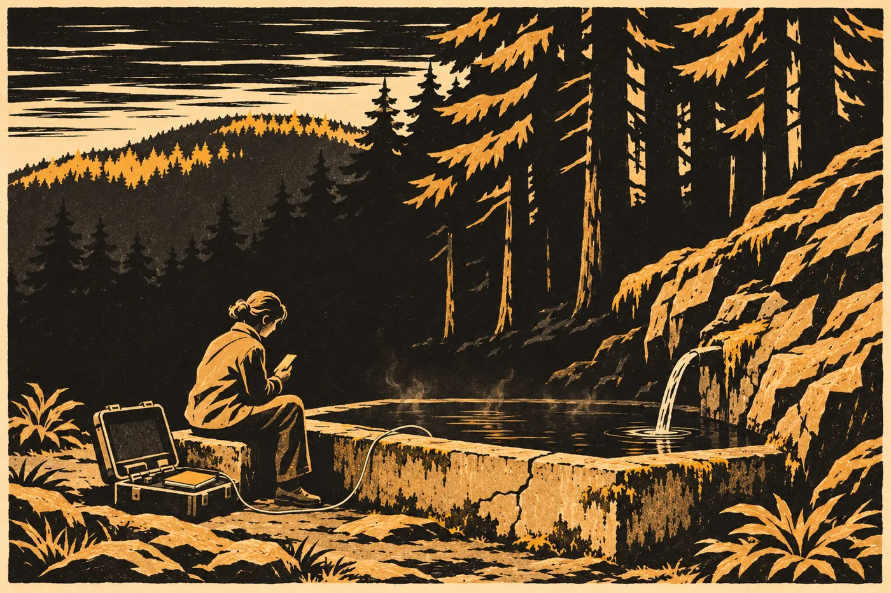

# 9. Dopis

Lis Aven volala ve čtvrtek večer a Hana to nebrala.

Věděla, proč volá. Zpráva přišla odpoledne všem stranám naráz, jak se to od června dělalo. *Pracovní překlad písemnosti bez čísla bude zveřejněn v pátek 20. 7. v 9:00, současně se záznamem čtení.* Hana ji četla ve vlaku z Prahy a pak se dlouho dívala z okna. Výroky rozsudku přišly stejnou cestou už ve středu, v pracovním překladu sítě výpravy, který nikdo z nich neověřil. Celý spis měl společný tým překládat, až skončí s dopisem.

Telefon zazvonil podruhé. Hana ho nechala zvonit a pak napsala.

*Vím, proč voláte. Děkuju. Přečtu si to v devět jako ostatní. H. V.*

Odpověď přišla za minutu. Česky, bez chyby.

*Rozumím. Nechtěla jsem vám to říct dřív. Chtěla jsem vám říct, že jsme to četli nahlas. Celé, třikrát. Všichni tři jsme u toho museli přestat. L. A.*

Hana si zprávu přečetla, položila telefon displejem dolů a šla spát. Nespala.

*

V pátek ráno jela na Chebsko měřit pramen. Byl pátek a v pátek měřila pramen. Dělala to od září třicet jedna, každý pátek, kdy byla doma, a takový pátek nevynechala ani jednou, ani když měla chřipku. Tehdy jela s teplotou a hydrogeolog z ústavu jí za to vynadal.

Pod Hřbetem byl ještě stín. Pramen vytékal ze skály do betonové jímky, kterou tu někdo postavil v padesátých letech a nikdo ji od té doby neopravil. Nad vodou stála slabá pára, jen ráno, než se oteplí vzduch. Hana otevřela kufr s přístroji, ponořila čidlo a čekala.

*29,8.*

O desetinu víc než minulý týden. Zapsala to. Pak vodivost, pak plyn, a podívala se na hodinky.

8:56.

Sedla si na okraj jímky. Beton byl studený a vlhký a Hana to cítila přes kalhoty. Vytáhla telefon. Signál tu byl slabý, jedna čárka, někdy dvě. V lese za ní zpíval pták, kterého neznala. Hana si vzpomněla, jak se jí Sende v Praze na schodech ptal, jak velký je rozdíl mezi tím, kdo je a co dělal, a ona mu neuměla odpovědět.

9:00.

Stránka se načítala dlouho. Pak se otevřela.

*

*Písemnost bez čísla, s vlastním uzávěrem. Uložena v archivu za položkou 14.*

*Pracovní překlad společného týmu: L. Aven (výprava), A. Krausová, lingvistka z Prahy. Čteno nahlas 17.–19. 7. 2035, se záznamem. Pisatelka žádá: „Kdo to bude překládat, ať píše slova, jaká tu stojí. Ne to, co si o nich myslí.“ Tým se o to pokusil. Kde váhal, uvádí obě čtení. Poznámky týmu jsou v hranatých závorkách.*

*Písemnost je psána rukou. Znaky se chvějí. Uprostřed listu je povrch matnější. Na některých místech je pod textem vidět starší vyhlazený zápis.*

Pod tím text.

*

*Ilane,*

*tohle nebudeš číst ty. Než to doletí, budeš dávno mrtvý. Píšu to přesto tobě. A těm, kdo budou po tobě.*

*Nevím, kdo jste. Nevím, jakou řečí mluvíte. Kdo to bude překládat, ať píše slova, jaká tu stojí. Ne to, co si o nich myslí. Píšu krátce, aby se v tom dalo méně splést.*

*Jmenuji se Nara Vess. Jsem advokátka. Jsem matka Ilana Vesse, který odletěl druhým transportem. Snažila jsem se, aby neodletěl. Nepovedlo se to.*

*Všechno ostatní v tomhle kameni je spis. Spis je pravdivý. Tenhle list do spisu nepatří.*

*Ilanovi je sedmnáct let. Když neví, co říct, dívá se na člověka dlouho. Lidé si myslí, že se zlobí. Nezlobí se. Čte si je.*

*Odsoudili ho, protože seděl na náměstí. Bylo jich tam čtyři sta. Odpojili se od sítě, sedli si na zem a mlčeli. Nikomu neublížili. Bylo tam takové ticho, že jsem nic neslyšela. Ventilaci jsem uslyšela až doma, když jsem se odpojila. Tehdy jsem nevěděla, že právě tohle chtěli slyšet. Teď to vím.*

*[Na tomto místě je povrch listu matnější. Věta o tichu byla napsána nejméně dvakrát.]*

*Když mu bylo patnáct, zapnula jsem mu zklidnění. [Funkce sítě, která tlumí silné vzrušení. Na výpravě běžná.] Nezeptala jsem se ho. Rok si myslel, že je klidný člověk. Ten klid nebyl jeho. Byl můj. Byla to první věc, kterou jsem rozhodla za něj. Nebyla poslední.*

*Tam, kam letí, žijí lidé. Viděla jsem je na listech, které tady nejsou. Mají oheň. Nosí děti na zádech. Nevědí o nás. Úřad to ví a posílá ho tam. Jestli jste jeho potomci, jste možná i jejich. Pak tenhle spis není jen o něm. Je i o nich.*

*Na náměstí seděl vedle dívky, která se jmenuje Kesi Amar. Je jí šestnáct. Jestli se o ní někdy něco dozvíte, pamatujte si to jméno. Tam, kam letí, ho nikdo jiný nemá.*

*Poslední den návštěv jsem mu chtěla říct jednu větu. Neřekla jsem ji. Každá věta by po něm něco chtěla. Aby odpověděl. Aby si ji vzal s sebou. Tady nemusí nic. Tady nemůže odpovědět.*

*Chtěla jsem, abys zůstal. Víc, než jsem chtěla vyhrát.*

*[Věta je napsána dvakrát. První zápis je vyhlazený a zčásti čitelný. Text je shodný, tvary znaků jiné. Slovo, které překládáme „vyhrát“, znamená v úřední řeči také „aby bylo rozhodnuto v můj prospěch“. Tým nedokázal rozhodnout, které čtení pisatelka myslela.]*

*Neodpustil mi to. Řekl mi to. Má na to právo. Nepíšu to, aby mi odpustil. Píšu to, aby to někde stálo.*

*Nevím, jestli vám to pomůže. Nevím, jestli to někdo najde. Spor jsem prohrála. Posílám spis, protože je pravdivý. A protože tam, kam letěl můj syn, ho nikdo jiný nemá.*

*Naučila mě to žena, která četla průzkumné listy. Vlevo se píše, co se vidělo. Vpravo, co si o tom kdo myslel. Pravému sloupci se nevěří. Ani tady. Tenhle list je celý pravý sloupec.*

*Na náměstí jsi mi udělal místo. Ustoupila jsem. Je to v záznamu. Tohle v záznamu není.*

*Máma.*

*[Slovo, kterým dítě oslovuje matku. Ne úřední „matka“. Jméno a povolání pisatelky stojí na začátku listu. Pod tímto slovem nestojí nic.]*

*

Hana seděla na okraji jímky.

Pták v lese přestal zpívat. Nebo zpíval dál a ona ho neslyšela. Voda v jímce tekla. Byl to jediný zvuk, kterého si byla jistá.

Přečetla to znovu. Celé, od *Ilane* po *Máma*. Pomaleji. U závorek se zastavila a četla je taky, protože to byly levé sloupce. Tři lidé v místnosti, kde dělali slovník, si všimli, kde je povrch matnější, a napsali to. Nevykládali to. Jen to zapsali.

*Věta o tichu byla napsána nejméně dvakrát.*

*Věta je napsána dvakrát.*

Hana si představila ruku. Ne obličej. Obličej si představit neuměla. Jen ruku, která drží něco, čím se píše, a třese se. Ta ruka napsala větu, smazala ji a napsala ji znovu. Před šedesáti osmi tisíci lety. Někde, kde Hana nikdy nebyla a kde byla zima. Hana nevěděla, proč si myslí, že tam byla zima. V dopise to nestálo. Možná proto, že se ty znaky chvěly.

Nevěděla to. Patřilo to vpravo.

*

Pak se jí stala věc, které se bránila.

Nečetla to jako dopis Ilanovi. Četla to jako dopis sobě.

Věděla, že to tak není. Věděla to přesně a uměla to říct větou: dopis je adresován synovi a těm, kdo budou po něm, a nikdo neví, kdo po něm byl. Nikdo neví, jestli Ilan vůbec někam doletěl. Nikdo neví, jestli měl děti. A i kdyby je měl, šedesát osm tisíc let je dva a půl tisíce generací. To je jako hodit kapku inkoustu do moře a pak se ptát, která vlna je modrá.

A přesto.

*Nevím, kdo jste.*

To byla ona. Na tohle se nedalo nic namítnout. Nara Vess nevěděla, kdo to bude číst. A četla to Hana Vrbová, padesát let, geoložka, na okraji betonové jímky pod Hřbetem, v pátek v devět ráno. S teplotou pramene zapsanou v sešitě na kufru vedle sebe.

*A těm, kdo budou po tobě.*

Sokolová to Haně řekla v roce třicet dva, v kuchyni u sebe doma, nad vínem, když vyšel ten článek. Dvě slabé příměsi. Dvě populace, o kterých se neví nic, jen že mají jinou historii než všechny ostatní. Odkud přišly, Sokolová neřekla. Řekla jen, že jedna z nich je slabá, pod procentem, ale rozšířená. Ne u pár rodin pod horou. U velké části lidí, kteří žijí mimo Afriku.

V té době si tykaly rok, od jara třicet jedna. Nabídla to Sokolová, nad prvními daty. Hana si zvykala týden.

*Tak to máš taky,* řekla tehdy Sokolová. *S pravděpodobností, kterou neumím vyčíslit. Jako skoro každý v tomhle městě.*

*Nic to neznamená,* řekla Hana.

*Ne,* řekla Sokolová. *Statisticky nic.*

Hana seděla na betonu a myslela na tu větu. Statisticky nic. Byla to pravda. Byl to levý sloupec. A vpravo, kam se nevěří, stála žena, která napsala *jestli jste jeho potomci, jste možná i jejich*, a Hana četla to *jestli* a věděla, že na něj nikdy nikdo neodpoví. A stejně ho četla, jako by jí někdo položil ruku na rameno.

*

Telefon zabzučel v 9:14.

Neznámé číslo. Hana ho nechala zvonit. Pak další a po něm redakce, kterou znala, protože jí tam v roce třicet říkali atlantoložka a letos ta, co nevěří ani sobě. Hana to vzala.

„Paní doktorko, viděla jste ten dopis?“

„Ano.“

„Co si o něm myslíte?“

Hana se dívala na vodu v jímce.

„Je to dopis,“ řekla. „Napsala ho matka synovi a lidem, kteří přijdou po něm. Rukou. Víc v něm nestojí.“

„Ale ten konec. *Jestli jste jeho potomci.* Myslíte, že to jsme my? Že ten Ilan…“

„Nevím,“ řekla Hana.

„Ale ten model doktorky Sokolové…“

„Ten model říká, že část lidí nese slabou stopu populace, která má jinou historii,“ řekla Hana. „Neříká nic o jednom člověku. Neříká, jestli ten člověk přistál. Neříká, jestli měl děti. Ten dopis je důležitý. Ale není to důkaz. Je to dopis.“

„Takže nás se to netýká?“

Hana mlčela. Dlouho. Novinář na druhé straně čekal a nepřerušoval ji. To mu musela přiznat.

„Napsala *nevím, kdo jste*,“ řekla pak Hana. „Já taky nevím, kdo jsme. Nevykládejte to za ni. Ona si to nepřála. Napsala, ať se píšou slova, jaká tam stojí.“

Položila to. Ruka se jí trochu třásla. Hana ji nechala.

*

V deset zavolala Sokolová.

„Viděla jsi to.“

„Ano.“

„Budou to chtít po mně,“ řekla Sokolová. Nepozdravila. Nikdy nezdravila, když volala kvůli práci. „Do večera mi napíšou tři redakce a jeden poslanec. Jestli se dá najít Ilanova stopa. Jestli se dá zjistit, kdo z nás je jeho.“

„Dá?“

„Ne.“ Sokolová to řekla ostře, jako by se jí na to Hana ptala vážně. „Na to neexistuje test a nebude existovat. Jeden člověk před šedesáti osmi tisíci lety. Nevíme ani, jestli přistál.“ Odmlčela se. „Řekni to taky. Řekni to dřív, než z toho někdo udělá genealogii.“

„Řekla jsem to.“

„Já vím. Slyšela jsem.“ Sokolová chvíli mlčela. Pak řekla, jiným hlasem, tišším: „Četla jsem to třikrát. U té věty s vyhráváním jsem musela přestat.“

„Já taky.“

„Nedělej z toho genetiku, Hano.“

„Nedělám.“

„Já vím,“ řekla Sokolová. „Proto ti volám. Ty jediná ne.“

*

V jedenáct zavolal zmocněnec.

Byl zdvořilý jako vždycky. Ptal se, jestli ruší. Ptal se, kde je. Když Hana řekla, že u pramene, chvíli mlčel, jako by nevěděl, že nějaký pramen existuje.

„Zítra odpoledne je jednání,“ řekl pak. „Pracovní, o válci. Ale bude se mluvit i o tomhle. Výprava ten dopis četla taky.“

„Ano.“

„Bylo by užitečné,“ řekl zmocněnec opatrně, „kdyby odborná svědkyně řekla, co z toho dopisu plyne. Že úřad, po kterém výprava převzala správu, věděl, že tu žijí lidé. Že sem ty lidi poslal přesto. Je to tam černé na bílém.“

„Je to ve spisu,“ řekla Hana. „Ve výroku a v zápisu. Až bude přeložený, tam to řeknu, když se mě zeptají.“

„V dopise je to taky.“

„V dopise je to v pravém sloupci,“ řekla Hana. „Napsala to sama. *Tenhle list je celý pravý sloupec.*“

Zmocněnec mlčel.

„Paní doktorko,“ řekl pak. „Lidé spis číst nebudou, ani až ho přeložíte. Šedesát stran odůvodnění. Dopis si přečte každý. Každý ho už četl.“

„Já vím.“

„Tak proč…“

„Protože kdybych zítra řekla, že dopis něco dokládá,“ řekla Hana, „bude to za rok stát v každé učebnici. Že to dokládá. A pak přijde někdo, kdo řekne, že je to jen dopis, a bude mít pravdu. A spolu s dopisem pak odhodí i ten spis.“ Odmlčela se. „Spis dokládá. Dopis ne. Ať to zůstane každé na svém místě.“

Zmocněnec dlouho mlčel. Hana slyšela, jak v jeho kanceláři na Hradčanech zvoní jiný telefon a nikdo ho nebere.

„Lidé to nepochopí,“ řekl nakonec.

„Tak ať to nepochopí,“ řekla Hana. „Ale ať jim to nikdo nesplete.“

*

V poledne vydala Wehrleho nadace prohlášení.

Hana ho četla na lavičce u autobusové zastávky pod Hřbetem, ve stínu, s kufrem s přístroji mezi koleny. Prohlášení bylo krátké a dobře napsané. Hana poznala, že ho psal někdo, kdo umí psát.

*Nadace pro rodinnou historii s pokorou přijímá slova, která k nám po šedesáti osmi tisících letech dolehla. Matka psala svým potomkům. Psala nám. Celé generace naší rodiny na tento hlas čekaly. Nyní ho slyší každý.*

Pod tím podpis. *Konrad Wehrle, předseda.*

Hana si to přečetla jednou a telefon položila na lavičku vedle sebe, displejem dolů.

*Psala nám.*

Hana věděla, co by na to mohla říct. Mohla by citovat Sokolovou. Mohla by říct, že dopis je psaný synovi, že *jestli* je *jestli*, že Nara Vess nevěděla, kdo to bude číst, a napsala to výslovně. Mohla by říct, že Wehrleho rod si osm set let říkal *naši otcové* o lidech, o kterých nic nevěděl, a teď si říká *naše matka*.

Neřekla nic.

Kdyby to řekla, vykládala by dopis. Jen opačně. A Nara Vess si to nepřála od nikoho.

*

Odpoledne jela domů.

Na nástupišti v Chebu jí přišla zpráva od Sael. Krátká, bez pozdravu. Sael nikdy nezdravila.

*Kesi Amar. Zapsala jsem si to jméno. Nevím kam. Do žádné knihy nepatří. S.*

Hana si zprávu přečetla a nastoupila do vlaku.

Ve vlaku nečetla. Jen seděla. Krajina za oknem byla zelená a pak žlutá, kde už sklidili. Hana hleděla na pole a myslela na náměstí, které nikdy neviděla.

Čtyři sta mladých lidí, kteří sedí na zemi a mlčí. Odpojení od sítě. Hana nevěděla, jaké to je, být připojený. Sende to věděl. Lis Aven to věděla. Hana viděla Lis Aven sahat si za ucho, když poslouchá, a pochopila, že to je jako sahat si na kapsu, kde má člověk klíče. A čtyři sta lidí si tam sáhlo a vytáhlo klíče a hodilo je pryč. A sedli si a poslouchali ventilaci.

*Tehdy jsem nevěděla, že právě tohle chtěli slyšet.*

Hana poslouchala vlak. Kola na spojích. Někdo o dvě řady dál mluvil do telefonu. Za Prahou začalo pršet.

*

Večer zavolala Lis Aven ona.

Lis Aven to vzala hned, jako by čekala.

„Paní doktorko.“

„Promiňte, že jsem to včera nevzala.“

„Ne,“ řekla Lis Aven. „Měla jste pravdu. Bylo by to špatně.“

Chvíli obě mlčely. Spojení bylo tak dobré, že Hana slyšela, jak Lis Aven dýchá.

„Mohla byste mi to přečíst?“ zeptala se Hana. „Ne česky. V originále. Jak to zní.“

Lis Aven mlčela.

„Nebudu tomu rozumět,“ řekla Hana. „O to nejde. Chci to slyšet. Jen jednou.“

„Dobře,“ řekla Lis Aven.

A četla.

Hana seděla v kuchyni u stolu. Svítila jen lampa nad sporákem a pod ní ležel vytištěný překlad. Hana poslouchala řeč, kterou nikdy neslyšela. Byla měkčí, než čekala. Hlásky se v ní přelévaly, jako se přelévá voda přes kameny. Lis Aven četla pomalu. Věty byly krátké. Hana to slyšela i bez porozumění. Tečka, tečka, tečka. Jedna myšlenka, tečka.

Poznala místo, kde je jméno. *Nara Vess.* Poznala *Ilan*, protože se tam opakovalo. Pak počítala tečky a jela prstem po vytištěném překladu, věta po větě, a věděla, kde Lis Aven je. Poznala náměstí. Poznala zklidnění. A poznala, kde je ta věta. Lis Aven ji přečetla a pak se odmlčela. Ne kvůli textu. Kvůli sobě.

Pak četla dál, až na konec.

Poslední slovo bylo krátké. Dvě slabiky. Lis Aven ho řekla tiše.

Hana ho slyšela a nadechla se.

„Řekněte to ještě jednou,“ řekla. „To poslední.“

Lis Aven to řekla.

Hana seděla pod lampou. To slovo znělo skoro jako u nás. Ne úplně. Ale skoro.

„U vás se to říká pořád?“ zeptala se.

„Ano,“ řekla Lis Aven. „Stejně. Je to první slovo, které děti říkají. Dřív, než se ho naučí.“

„U nás taky,“ řekla Hana.

Chvíli mlčela.

„Ve většině jazyků na Zemi je to podobné,“ řekla pak. „Lingvisté říkají, že je to proto, že to jsou první zvuky, které dítě umí vydat. Rty k sobě a otevřít. Nic to nedokazuje.“

„Ne,“ řekla Lis Aven. „Nic.“

*

„Víte, co se s ním stalo?“ zeptala se Hana. „S Ilanem.“

„Ne.“

„Ve vašem archivu…“

„V našem archivu je druhý transport jeden řádek,“ řekla Lis Aven. „*Odlet proveden.* Kolik osob. Kdy. A pak nic. Žádné hlášení o výsadku. Nic.“ Odmlčela se. „A ve skále pod horou je v rejstříku mezera. Pan Marn to říkal paní Sael. Velká část rejstříku po prvním výsadku je poškozená. Nevíme, jestli tam nic není, protože se nic nestalo. Nebo protože se to ztratilo.“

„Takže to nikdo neví.“

„Nikdo,“ řekla Lis Aven. „A asi se to nikdo nedozví.“

Hana kývla, i když ji Lis Aven neviděla.

„Lis,“ řekla pak. Poprvé jí řekla jen křestním jménem. „Jak dlouho jste to četli? Ten jeden list.“

„Tři dny,“ řekla Lis Aven. „Jeden list. Oboustranně. Tři dny. Paní Krausová řekla, že za třicet let tlumočení nikdy nic tak dlouho nepřekládala. A nikdy nic tak krátkého.“

*

Před půlnocí si Hana sedla ke stolu a otevřela sešit.

Nahoru na okraj stránky napsala:

*Do 30. 8.: 41 dní.*

Pak udělala svislou čáru. Jako vždycky. U hory ji dělala od února třicet, kdy o ní začala psát. Vlevo, co se vidělo. Vpravo, co si o tom myslí.

Pero se zastavilo nad papírem.

*Naučila mě to žena, která četla průzkumné listy.*

Hana se dívala na svou čáru. Udělala ji tisíckrát. Nikdo ji to neučil. Nebo učil. Starý pán s dýmkou na exkurzi v Krkonoších, když jí bylo devatenáct. Říkal, že terénní deník se píše na dvě strany, aby se nepletlo, co je v terénu a co je v hlavě. Hana si už nevybavila jeho jméno.

A šedesát osm tisíc let předtím, někde, kde byla zima, se to naučila jiná žena od jiné ženy. Vlevo, co se vidělo. Vpravo, co si o tom kdo myslel. Pravému sloupci se nevěří.

Byla to stejná čára. Hana to věděla. A věděla také, že to nic neznamená. Kdo jednou píše o věcech, kterým nerozumí, dřív nebo později oddělí to, co viděl, od toho, co si myslí. Nemusí to mít od nikoho. Je to jako *máma*. Rty k sobě a otevřít.

Nic to nedokazuje.

Vlevo napsala:

*20. 7. 2035, 9:00. Zveřejněn pracovní překlad písemnosti bez čísla (L. Aven, A. Krausová, lingvistka z Prahy; čteno nahlas 17.–19. 7., se záznamem). Jeden list, oboustranně, psán rukou. Pisatelka: Nara Vess, advokátka, matka Ilana Vesse (17, druhý transport). Podpis: „Máma“.*

*Ve středu listu: náměstí (400 lidí, odpojeni, mlčeli; věta napsána nejméně 2×). Zklidnění v 15 letech („Byla to první věc, kterou jsem rozhodla za něj.“). Lidé na místě výkonu („Úřad to ví a posílá ho tam.“). Kesi Amar, 16. Věta z posledního dne návštěv, napsána 2× („Chtěla jsem, abys zůstal. Víc, než jsem chtěla vyhrát.“; „vyhrát“ nejisté).*

*Ilan: co se s ním stalo, nikdo neví. Archiv výpravy: „Odlet proveden.“ a nic. Rejstřík skály: mezera (Marn).*

*Pramen pod Hřbetem 8:50: 29,8 °C. +0,1.*

Pak pravá strana.

Hana ji nechala dlouho prázdnou. Teprve potom napsala:

*Psala mně. (Nepsala. Psala Ilanovi. „Nevím, kdo jste“ – to jsem já, ale to je každý, kdo to čte.)*

*Sokolová: mám to taky, „statisticky nic“.*

*Wehrle: „Psala nám.“ Neodpověděla jsem. Kdybych odpověděla, vykládala bych.*

*Lis Aven mi to přečetla v originále. Poslední slovo zní skoro jako u nás.*

*Sael si zapsala Kesi Amar. Nevím kam. Ona taky ne.*

Pak se zastavila. Dívala se na čáru uprostřed stránky. Na levou stranu, kde bylo všechno, co se dá doložit. Na pravou, kde bylo tohle.

A připsala pod to ještě jeden řádek. Malým písmem. Ruka se jí přitom trochu chvěla a Hana ji nechala.

*Ty znaky se chvěly. Nevím proč. Myslím, že tam byla zima.*

Pak sešit zavřela. Nechala ho ležet na stole a šla spát. Tentokrát usnula.
