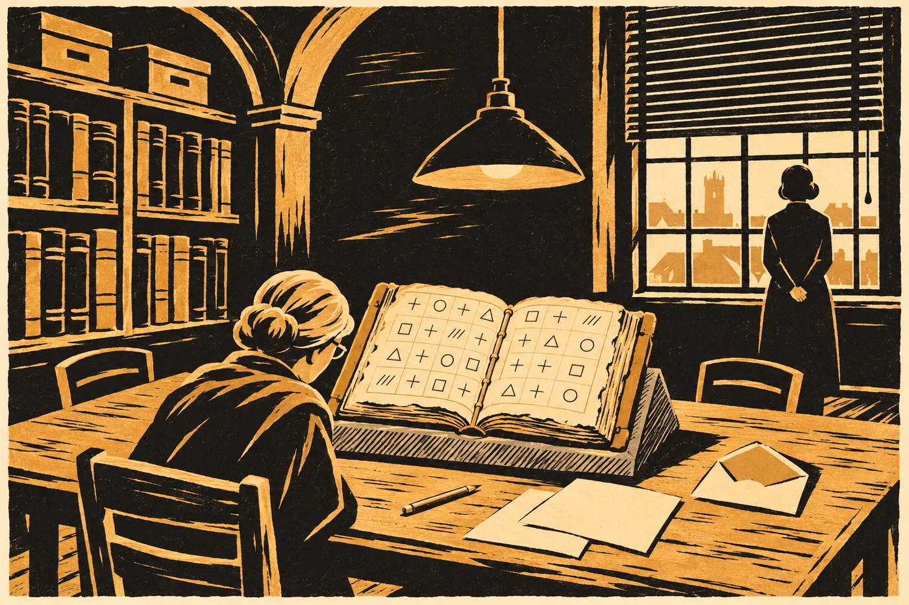

# 10. Klíč

Šindelářová rozložila na stůl osm listů a ani jeden z nich nebyl kresba.

Studovna chebského archivu byla v úterý zavřená pro veřejnost. Rolety stažené do půli, světlo nad stolem ztlumené na tolik, kolik snese pergamen. Ostatní v tom světle mhouřili oči. Sael ne. Viděla v něm všechno: zrnitost papíru, razítka, i drobné písmo Šindelářové, které se za sedmadvacet let nezměnilo. Šindelářová psala tužkou, protože do studovny se inkoust nenosí. Ani archivářka si v tom nedělala výjimku.

„Tohle je historie,“ řekla. „Ne toho, co na tom listu je. Toho, kdo ho kdy viděl.“

Položila prst na první list.

Fond fary v Mlýnci. Do archivu převzat v padesátých letech minulého století, s dalšími farními knihami, v dřevěné bedně, která se dochovala. Kodex v soupisu fary od roku 1783 pod jménem *liber de dracone*, bez obsahu. Před tím nic. Před tím truhla s ornátem v kostele, kterou nikdo nesoupisoval, protože se nesoupisuje, co se nevyndává.

Druhý list. Mikrofilm z roku 1974. Celý kodex, list po listu, pořízený při zajišťování farních fondů. Krabice se pečetila hned po vyvolání a pečeť byla neporušená. Výpůjční lístek prázdný. Za šedesát jedna let si ho nikdo nepůjčil.

Třetí list. Snímky z roku 2025, pořízené pro posudek, který tehdy psala Hana. Uložené v interním systému archivu, nikdy nezveřejněné.

„Nic necitujte,“ řekla Šindelářová. „Ani mně. Tak to tenkrát stálo v průvodním dopise. Platí to pořád.“

Čtvrtý list. Výpůjční kniha studovny za posledních čtyřicet let, výpis všech, kdo kodex měli v ruce. Bylo jich jedenáct. Sael znala všechna jména. Pět z nich bylo mrtvých. Jedno bylo Hanino, třikrát: dvakrát v roce 2025, v lednu a v dubnu, a jednou v roce 2030. Jedno bylo její vlastní.

Pátý list ležel stranou. Šindelářová na něj nesáhla.

Sael ho znala. Byl to opis jejího vlastního zápisu z protokolu o restaurování, s jejím podpisem a s podpisem Šindelářové jako svědkyně. *Oprava. Záznamy „pokračuje“ z X/2027 až X/2029 jsou nepravdivé. Restaurátorské práce byly dokončeny v VII/2027. Kodex jsem úmyslně zadržela v trezoru dílny z důvodů, které nesouvisely s jeho stavem…* Dva a půl roku tehdy psala do protokolu jedno slovo, které nebyla pravda. Kvůli mapě. Kvůli tomu, aby k mapě nikdo nepřišel dřív, než bude kam jít.

„Ten tam patří,“ řekla Sael.

„Já vím, že tam patří.“ Šindelářová se na ni podívala přes brýle. „Ptám se, jestli ho tam chcete vy.“

„Chci.“

„Proč?“

„Protože kdo bude za rok hledat, kdo mohl tu kresbu změnit, najde tři roky, kdy ji držela jedna osoba a psala o tom nepravdu,“ řekla Sael. „Ať to najde tady. Ne jinde.“

Šindelářová chvíli mlčela, než list přisunula k ostatním, na jeho místo v řadě, a nic k tomu neřekla.

Šestý list porovnával tři snímky dvoustrany hnízda: mikrofilm, rok 2025 a zapečetěnou kopii z června. Každý tah, každá skvrna. Restaurátorka z jiného archivu, kterou Sael neznala a která neznala Sael, to podepsala. Shoda. Kresba se za šedesát let nezměnila. Ani v letech, kdy ležela v trezoru dílny.

Sedmý list byl Wehrle.

„Jeho rodová kniha cituje kodex,“ řekla Šindelářová. „*Quae vidit monachus.* Někdo z rodu ho tedy kdysi četl. Kdy, nevíme. Co si opsal, nevíme. Hnízdo v jeho knize podle toho, co nadace kdy ukázala, není. Ale nadace neukázala všechno.“ Poklepala na list tužkou. „Tak to píšu. Že to nevíme.“

Osmý list byla pečeť z 26. června. Pět institucí, čtyři země. Snímky kodexu jsou u pěti lidí, kteří se navzájem neznají. Na webu visí jen kontrolní součty.

„Tohle je všechno,“ řekla Šindelářová. „Kdo chce vědět, jestli někdo z druhého týmu mohl tu kresbu vidět, má tady všechno, co o tom víme. A nic, co nevíme.“

*

Druhý tým přijel v deset.

Daniela Fuchsová vešla první. Byla vysoká a hranatá, jak ji kdysi popisovala Hana, s brýlemi na šňůrce a s krátkými šedivými vlasy. V ruce nesla igelitku z drogerie. Sael by se nedivila, kdyby to byla tatáž igelitka. Za ní šla žena z Vídně, drobná, ve větrovce, s rukama, které nevěděly, kam se dát. Etoložka. Třicet let počítala ptákům na Nové Guineji stavby z větviček a lesklých věcí, které samci skládají před svými altánky pro samice. Sael o těch ptácích do minulého týdne nevěděla nic. Teď věděla, že se jim česky říká lemčíci a že samec, kterému jiný samec posune modrou mušli o dlaň vedle, ji vrátí na místo dřív, než se rozední.

Za nimi přišla Lis Aven a za ní Tadeáš.

Tadeáš se zastavil ve dveřích. Do archivu chodil poprvé. Rozhlédl se po regálech, po krabicích s čísly, po stropě, a Sael věděla, na co myslí. Na archiv pod horou, prázdný, s holými výklenky, ze kterého knihu vynesli před pěti lety.

„Tady je zima,“ řekl.

„Osmnáct stupňů,“ řekla Šindelářová. „Kvůli pergamenu.“

„U nás bylo dvaadvacet,“ řekl Tadeáš. „Kvůli skále.“

Šindelářová kývla, jako by to bylo číslo do protokolu.

Poslední přišla Hronková. Nesla obálku.

*

Klíč vznikl ze čtrnácti listů, které na lodi nikdo nehledal, protože nikdo nevěděl, že je hledat má.

Lis Aven je našla v červnu, v noci po prvním jednání o kodexu. O hoře se na Terře vyprávělo, že v ní kdysi byl drak, a v pozemských zprávách to stálo v každém druhém článku. Zadala do archivu řádu slova, která by takový drak musel mít, bez jména světa. Létající plazi. Hnízda v převisech. Membránová křídla. A síť jí po dlouhém hledání vrátila sbírku, o které nikdo z výpravy nevěděl: katalog signalizace zvířat z mnoha světů, kdysi pořízený jednou z univerzit prstence Halm. Zoologové si do něj vypisovali z průzkumných listů všechno, co se dalo počítat. Tance, barvy, hnízda.

U čtrnácti listů stálo místo jména světa jen katalogové číslo. Lis Aven ho porovnala s katalogem průzkumů, který řád převzal po Koloniálním úřadu. Pod tím číslem stál jediný řádek. *Listy: uloženo u soudu.*

Výpis byl starší než proces. Zoolog ho pořídil, když listy přišly domů, a pak už je nikdo neviděl. Úřad zapečetil průzkum. Na plazy v katalogu univerzity se zapomnělo, protože to byli jen plazi. Když pak v červenci přišel spis, stála ve veřejném zápisu, v levém sloupci průzkumu, podobná věta: *Létající plazi s hnízdy v převisech a s řadami zlatých zrn a krystalů. Po přeletu člunu o řadu víc.* Řady. Rýhy po třech. Tentýž průzkum.

Kerr souhlasila, aby výprava listy předala. Předala je třetího července, po pečeti, veřejně, s kontrolním součtem, a dostali je všichni. Kresbu z kodexu neviděl nikdo z týmu. Fuchsová to podepsala. Etoložka taky. Lis Aven podepsala, že kodex ani jeho snímky nikdy neviděla, a připsala k tomu větu, kterou si Sael zapamatovala: *Podpis není důkaz. Je to jen slib, za který se dá ručit.*

Tři týdny pracovali v Brně, v místnosti bez oken, kterou jim půjčila fakulta. Sael tam nebyla ani jednou. Nesměla. Znala tu dvoustranu líp než kdokoli živý. Tři roky ji měla u sebe, z toho dva a půl roku v trezoru, a kdyby jen prošla kolem dveří, mohl by si někdo říct, že něco řekla.

Dvacátého července odpoledne uložila Fuchsová předpovědi u Hronkové, v zapečetěné obálce. Kontrolní součet poslala všem stranám ve stejnou minutu.

Teď Hronková tu obálku držela nad stolem.

„Pečeť je neporušená,“ řekla. „Kontrolní součet sedí.“ Ukázala to do kamery, kterou Šindelářová postavila na kraj stolu. Záznam se měl zveřejnit celý, všem naráz, jak se to od června dělalo. „Otevírám.“

*

Fuchsová četla předpovědi nahlas. Nepodívala se přitom na kodex, který ležel v krabici na vedlejším stole, zavřený. Nepodívala se na něj ani jednou. Sael to viděla, protože to sledovala.

„Nejdřív to, co víme,“ řekla Fuchsová. „Ve výpisu je devět hnízd v šesti oblastech. Tři z nich průzkumníci navštívili dvakrát. Jeden list je pohyblivý záznam, políčka za sebou. V každém hnízdě leží věci v řadách, s mezerami, a nad nimi nebo mezi nimi jsou rýhy ve skupinách. Rýhy jsou po drápech. To víme od průzkumníků, ne od nás.“

Rozložila první list předpovědí. Byl psaný na stroji, krátce.

„Předpověď jedna. Na pohyblivém záznamu plaz přinese zrno, položí ho na začátek nové řady a pak vyryje tři čáry. Nic jiného. Ve výpisu jí začíná většina řad. Myslíme si, že skupina tří rýh patří tomu, kdo píše. Jako podpis. Nebo jako *já*. Nevíme. Pokud je hnízdo v hoře záznam stejného druhu, budou řady začínat skupinou tří rýh. Častěji než kteroukoli jinou.“

Sael se nepohnula.

„Předpověď dvě. Ve čtyřech hnízdech z devíti se opakuje skupina čtyř rýh, z nichž prostřední je kratší. Pokaždé vedle ní leží zrno a krystal. Všechna čtyři hnízda jsou ve dvou oblastech. A v obou těch oblastech zapsali průzkumníci do levého sloupce teplou vodu s párou a malé lidi pod zemí.“ Fuchsová se odmlčela. „V ostatních čtyřech oblastech ta skupina není. Ani jednou.“

Tadeáš zvedl hlavu.

„Předpovídáme,“ řekla Fuchsová, „že pokud je hnízdo v hoře u teplé vody a pokud tam žili ti, kterým říkáte Ostří, nebo někdo jako oni, bude ta skupina v kresbě. Se zrnem a krystalem. Víckrát.“

Šindelářová psala tužkou.

„Předpověď tři. Ve dvou hnízdech, která průzkumníci navštívili dvakrát, přibyla po přeletu člunu řada. V obou ta nová řada obsahuje skupinu, která v žádném jiném hnízdě a v žádné jiné řadě není. Dvě kratší rýhy a jedna delší. Myslíme si, že to znamená člun. Nebo něco, co přiletělo shora. Nevíme. Jistota nízká, máme jen dva výskyty.“ Otočila list. „Pokud plazi v hoře někdy viděli něco přiletět, bude ta skupina v kresbě. Pokud to, co přiletělo, zase odletělo, bude tam jednou, jako ve výpisu. Pokud to zůstalo, bude se vracet v dalších řadách.“

„A vedle ní?“ zeptala se Šindelářová. Nepřestala psát.

„Ve výpisu leží tmavé kameny vždycky vedle skupin, které se vracejí v každé řadě a při každé návštěvě,“ řekla etoložka z Vídně. Mluvila česky pomalu, s vídeňskou měkkostí. „U lemčíků by to bylo… jak to říct. Co se nehýbe. Co je tam pořád. Ale to jsou ptáci. Tohle nejsou ptáci.“

„Je to v předpovědi?“ zeptala se Hronková.

„Je,“ řekla Fuchsová. „Pokud se skupina dvou kratších a jedné delší rýhy v kresbě vrací, budou vedle ní tmavé kameny. Jistota nízká.“

Pak četla poslední.

„Předpověď čtyři. Ve výpisu končí sedm řad z jedenácti krystalem. Předpovídáme, že v kresbě bude konec řad označený stejně.“ Položila list na stůl. „To je všechno. Nic dalšího jsme neuložili. Co jsme nepředpověděli, se nepočítá.“

*

Šindelářová otevřela krabici.

Kodex ležel v ní na boku, v obalu z nekyselé lepenky, který mu Sael zhotovila v roce dvacet sedm. Šindelářová ho vyndala oběma rukama a položila na klín z pěny. Desky z buku. Kozí kůže, odřená na hranách. Hřbet, ve kterém pořád seděl krystal se sintrem a šupina zlata pod šedým suknem, a nad ním výztuž z japonského papíru, kterou tam dala Sael. Viděla svou práci a viděla, že je dobrá. Nic víc si o tom nedovolila myslet.

Šindelářová kodex otevřela tam, kde měl záložku.

Dvoustrana hnízda.

Fuchsová se k ní poprvé podívala.

Sael se nedívala na kresbu. Kresbu znala. Dívala se na Fuchsovou. Na to, jak se jí v tom slabém světle rozšířily oči a jak ruka na šňůrce od brýlí zůstala stát. Fuchsová si nasadila brýle a naklonila se. Nos měla kousek nad pergamenem, jako by kreslila sama, a Sael si pomyslela, že přesně takhle nad tím listem kdysi klečel ten mnich, v hoře, s kahanem a s provazem.

Mřížka. Osm svislých čar a pět vodorovných, slabých, šedých, jako stopa po nehtu. V čtvercích kroužky, čtverečky, trojúhelníky. Krátké tahy rýh, každý zvlášť. A křížky. Spousta křížků. *Zde bylo, vzali.* Na okraji tři značky s latinskými slovy. *Aurum. Crystallus. Lapis.* A u jedné skupiny drobné *sic*.

„Co jsou ty křížky?“ zeptala se etoložka. Šeptem, jako v kostele.

„Co tam bylo a vybrali to,“ řekla Šindelářová. „Zakreslil, co tam leželo, a přeškrtl, co už tam nebylo. Mezi tím kreslením a dalším dnem odnesli skoro všechno.“

„A tohle?“ Etoložka ukázala, aniž by se dotkla. Sedm křížků jinak, menších, a u každého dvě slova. *A me.*

„Ode mě,“ řekla Šindelářová. „Ty vzal on sám.“

Fuchsová se narovnala.

„Napsal, co sám vzal,“ řekla. Ne nikomu. Sama sobě. „Tolik lidí za šedesát let mi přineslo knihy, kde chyběly stránky. Nikdy mi nikdo nenapsal, které vytrhl.“

*

Pak počítali.

Fuchsová diktovala, Šindelářová psala, etoložka kontrolovala proti vlastním poznámkám a Lis Aven tiše přeložila každé číslo do své řeči a poslala ho na loď. Sael stála u okna s rukama za zády. Nepomáhala. Kdyby ukázala prstem na jedinou rýhu, nikdo by už nevěděl, co našli oni a co jim ukázala ona.

*Předpověď jedna.* Řady začínaly u stěny. Mnich to zakreslil tak, jak to šlo, od díry ke svahu hlíny, a řady se na konci stáčely jako řádky. U jedenácti řad šel začátek přečíst. U devíti z nich stála na začátku skupina tří rýh. V prvním čtverci, hned u díry, *tři, pak mezera, pak dvě*.

„Devět z jedenácti,“ řekla Fuchsová. „Potvrzeno.“ Nevzhlédla. „Neříká to, co ta trojka znamená. Říká to, že je na začátku.“

*Předpověď dvě.* Čtyři rýhy, prostřední kratší. Fuchsová ji našla ve třetím čtverci u stěny. Vedle ní kroužek a čtvereček. Pak o pět čtverců dál. Kroužek, čtvereček. Pak ještě dvakrát.

U každé z těch čtyř skupin stála na okraji listu malá tečka.

Nad tečkami se Fuchsová zdržela dlouho.

„Kdo udělal tyhle tečky?“

„On,“ řekla Šindelářová. „Označil si tu skupinu pokaždé, když na ni narazil.“

„Takže to viděl.“

„Viděl, že je to stejné. Nevěděl, co to je.“

„Čtyřikrát,“ řekla Fuchsová. „Se zrnem a krystalem. Pokaždé.“ Ukázala tužkou nad list, na tři z těch čtyř kroužků. Měly v sobě malý křížek a u něj *a me*. „A z těch tří vzal zlato on.“

„Z těch tří vzal,“ řekla Šindelářová. „Ale zakreslil je dřív, než je vzal. Je to tam.“

Tadeáš stál u stolu a nedýchal. Sael to slyšela. Tadeáš měl dech hlučný jako všichni Ostří, celý život, a teď nebylo slyšet nic.

„Potvrzeno,“ řekla Fuchsová. „Čtyři výskyty. Všechny se zrnem a krystalem.“

*Předpověď tři.* To trvalo nejdéle. Mnich kreslil rýhy krátkými tahy a skupiny dvou kratších a jedné delší se daly snadno splést se skupinami tří, kde jedna ujela. Fuchsová je počítala dvakrát a etoložka potřetí, nezávisle, do vlastního sešitu. Pak porovnaly čísla.

Šest. V prvních řadách u stěny ani jednou. Až od poloviny, a pak pořád, řadu za řadou, až ke svahu hlíny, kde kresba končila. V jedné řadě dvakrát vedle sebe. U pěti ze šesti ležel trojúhelník.

„*Lapis*,“ přečetla etoložka z okraje listu. „Tmavý kámen.“

„Šestkrát,“ řekla Fuchsová. „Ne jednou. Vrací se.“ Odmlčela se. „Potvrzeno. S tím, že jistota zůstává nízká. Opírá se o dva výskyty ve výpisu a o šest tady. To je málo.“

*Předpověď čtyři.* Konce řad. U čtyř z nich stál křížek, *vybráno*, a nedalo se poznat, co tam leželo. U ostatních žádný krystal nebyl. Kroužek, prázdný důlek, nic.

„Nepotvrzeno,“ řekla Fuchsová. Řekla to stejným hlasem jako *potvrzeno*. „U čtyř řad nerozhodnutelné. U ostatních ne.“

Šindelářová to zapsala a tužku položila.

„Dobře,“ řekla. „Jedna nesedí.“

„Kdyby seděly všechny,“ řekla Fuchsová, „první bych si myslela já, že jsme to někde viděli.“

*

Pak to musel někdo napsat větou.

Lis Aven navrhla, aby to napsali všichni tři spolu a nahlas, jako dopis. Fuchsová řekla, že dopis to není, a etoložka řekla, že větu mít musí, protože kdyby ji nenapsali oni, napíše ji do večera někdo jiný. Měla pravdu. Sael to věděla taky.

Psali hodinu. Šindelářová u toho seděla a mlčela, jen dvakrát řekla *ne* a jednou *tohle nevíte*. Sael stála u okna. Venku na nádvoří archivu někdo zametal. Smeták škrábal o dlažbu, pak přestal, pak začal znovu.

Nakonec Fuchsová četla.

*Co kresba hnízda z kodexu podle klíče z průzkumných listů pravděpodobně zaznamenává (předpovědi uložené 20. 7. 2035, ověřeno 24. 7. 2035 na originálu):*

*1. Řady začínají skupinou, kterou si plaz na pohyblivém záznamu vyryje sám. Snad „ten, kdo píše“. Jistota střední.*

*2. Ve čtyřech řadách stojí skupina, která se v průzkumu vyskytuje jen tam, kde průzkumníci zapsali teplou vodu a malé lidi pod zemí. Vždy se zrnem a krystalem. Pracovně: „ti od teplé vody“. Jistota vysoká, že jde o tutéž skupinu znaků. Zda označuje tytéž lidi, kteří u teplé vody v hoře žijí dnes, kresba neříká.*

*3. Od poloviny kresby se opakuje skupina, která se v průzkumu objevila jen po přeletu člunu. Vedle ní obvykle tmavý kámen, který v průzkumu leží u věcí, jež se vracejí. Pracovně: „věci z nebe, které neodešly“. Jistota nízká až střední. „Věci“ proto, že skupina stojí jednou dvakrát vedle sebe. Kresba neříká, co to bylo. Neříká, že to byli lidé.*

*4. Předpověď o koncích řad se nepotvrdila.*

*5. Skupina označená v kresbě „sic“ (čtyři rýhy, jedna rozdvojená) není v klíči. Nečteno.*

*6. Kresba zachycuje jen to, co v hnízdě zbylo po vybírání v dubnu 1172. Rýhy ve skále pokračovaly i pod hlínu, kam autor neviděl. O většině hnízda nevíme nic.*

*Nic v kresbě nemluví o soudu, o trestu ani o lidech, kteří přiletěli. Neříká, kdy se co stalo. Pořadí řad může být pořadím času. Nemusí.*

Když dočetla, bylo ticho. Lis Aven ho přerušila první. Řekla to česky, pomalu, jako větu, kterou si nejdřív musela složit.

„Na lodi se mě budou ptát, jestli to jsme my. Ty věci z nebe.“

„Nejste,“ řekla Fuchsová. „Vy jste přiletěli letos.“

„Já vím. Ale budou se ptát, jestli to byli naši. Ti dávno.“

„Kresba to neříká,“ řekla Fuchsová. „Říká *věci*. Kdyby to byli lidé, nevím, jakou skupinou by to plaz napsal. To v klíči nemáme.“

Sael se od okna nepohnula. Věděla, co v hoře je. Skála, která svítí. Zařízení, které kdosi postavil a nechal tam, a které tři sta let zapisovalo dlaně Ostrých jako poruchu. *Věci z nebe, které neodešly.* Kdyby to řekla nahlas, bylo by to rozumné. Bylo by to tak rozumné, že by tomu do večera všichni věřili.

Neřekla nic.

*

Tadeáš promluvil až potom. Stál pořád u stolu, ruce v kapsách, a díval se na čtyři tečky na okraji listu.

„Ti od teplé vody,“ řekl.

Nikdo mu neodpověděl.

„U nás se říká,“ řekl Tadeáš a zrudl, jako rudl vždycky, když mluvil před cizími, „že voda byla teplá dřív, než skála začala svítit. Že jsme tam byli kvůli vodě. Ne kvůli skále.“ Podíval se na Sael. „To se u nás jen říká. Nikdo to nezapsal.“

„Teď je tu napsané něco jiného,“ řekla Sael. „Že tam byla skupina u teplé vody. Ne kdo.“

„Já vím.“

„Tak to řekni ty,“ řekla Sael. „Jestli jste to vy. Já to říct nesmím.“

Tadeáš se díval na mřížku, na kroužek a čtvereček, na mnichovo *a me*.

„Řeknu to Ladě,“ řekl. „Ať to řekne ona.“

*

Etoložka z Vídně se zeptala, jestli by mohla kodex vidět ještě jednou, zblízka, pod lupou. Šindelářová svolila a podala jí lupu. Pak se etoložka dlouho dívala na jedno místo a Sael věděla na které. Nikdo jiný si ho celé dopoledne nevšiml. Byly to rýhy u trojúhelníku v předposlední řadě, nakreslené jinak než ostatní. Krátčeji. Mnich je kreslil, když mu už ujížděla ruka.

„Tady už byl unavený,“ řekla etoložka.

„Ano,“ řekla Sael. Bylo to první slovo, které k té kresbě za celý den řekla. Nemohla si pomoct. „Muselo to být pozdě. Ve vedlejší řadě se mu zlomilo olůvko. Je tam vidět, kde začal novým koncem.“

Všichni se na ni podívali. Šindelářová položila tužku.

„Tohle ale kresba neříká,“ řekla Sael. „Tohle jsem viděla já, když jsem nad tím listem pracovala. Nepatří to do zápisu.“

„Nepatří,“ řekla Šindelářová. A pak, po chvíli, tišeji: „Ale zapíšu to stranou. Že jste to řekla. A kdy.“

*

Pak se zeptali na horu.

Ptala se Fuchsová, ale Sael poznala, že otázku mají připravenou všichni tři. Mnich zakreslil jen to, co zbylo nad hlínou a co pacholci ještě nevybrali. Rýhy ve skále pokračovaly pod hlínu. A rýhy se vybrat nedají. Pokud hnízdo pořád je, pokud ho voda nevymlela, je v něm víc, než kdo kdy viděl. A klíč by šel ověřit podruhé, nezávisle na mnichovi, na samotném kameni.

„Kde to je?“ zeptala se Fuchsová. „Dnes.“

Tadeáš odpověděl dřív než Sael.

„Za starou štolou,“ řekl. „Štola je pod vodou od dvanáctého století. Ale k zadní stěně vede ucho. Úzká chodba. Naše.“ Odmlčel se. „Taky je pod vodou. Od roku třicet.“

„Takže se tam nedá.“

„Teď ne,“ řekl Tadeáš. „Kdyby se v hoře něco zavíralo, čerpalo by se. Pak by ucho bylo chvíli suché. Den. Dva.“ Pokrčil rameny. „Jednou. Víckrát ne.“

Řekl *kdyby*. Sael to slyšela. Lada by řekla *jestli*. O tom, jestli se v hoře bude něco zavírat, nikdo z nich ještě nerozhodl. Rada Ostrých se k tomu sešla jen jednou a nedošla k ničemu.

„Ptáme se vás obou,“ řekla Lis Aven. Dívala se na Sael. „Tam dole bydlela vaše rodina a jejich rodina spolu. Ten archiv byl váš.“

Sael chvíli mlčela.

Myslela na mnichovy křížky. Na to, že jich je na listu víc než věcí, které na něm zůstaly. Na Konráda, který valouny bral, a na pacholky, kteří ráno přišli s páčidlem. Na sedm *a me*. Na to, že mnich vzal, a pak to aspoň napsal, a že to je víc, než udělali všichni ostatní.

A myslela na Ladu, která v sobotu napsala do modrého sešitu *60. 29.*, a na ucho, které je Ostrých.

„Za sebe a za archiv souhlasím,“ řekla. „S podmínkami.“

Šindelářová vzala tužku.

„Jednou. Jen jestli se tam půjde kvůli něčemu jinému. Kvůli tomuhle samotnému ne. Nic se neodnese. Ani kamínek. Křížků už bylo dost. Jen fotky a měření. A první je uvidí Ostří.“

„A dál?“ zeptala se Fuchsová.

„Dál nic,“ řekla Sael. „Dál je to jejich. Hora je jejich. Ucho je jejich. Já jsem tam jen bydlela.“ Obrátila se k Tadeášovi. „Odneseš to radě?“

„Odnesu.“

„Celé. I to, že jsem řekla ano. Ať vědí, že jsem to řekla dřív než oni. A že to nic neznamená.“

Tadeáš kývl.

*

Lada to vyslechla večer ve světnici, u kamen, která v červenci nikdo netopil. Tadeáš jí to četl z mobilu, pomalu, a dvakrát se spletl a začal znovu. Lada se nedívala na něj. Dívala se na stůl.

Když skončil, chvíli nic neříkala.

„Ti od teplý vody,“ řekla pak.

„Jo.“

„Se zlatem a s krystalem.“

„Jo. Čtyřikrát.“

Lada natáhla ruku a Tadeáš jí podal modrý sešit. Otevřela ho na poslední stránce, kde byla čísla. *60. 29.* Pod ně nenapsala nic. Jen položila na stránku dlaň, jako to dělala vždycky.

„Tak nás si zapsali,“ řekla. „Dřív než ty vaše knihy.“ Podívala se na Sael. „Dřív než ty.“

„Ano.“

„A dřív než ta skála.“

„To nevíme,“ řekla Sael. „Pořadí řad může být pořadím času. Nemusí.“

Lada se na ni dívala zespodu.

„Ty to nevíš,“ řekla. „My jo.“ Odmlčela se. „Ale nikomu to neřeknu jinak, než to napsali. Neboj.“

Pak sešit zavřela.

„Do ucha,“ řekla. „To řekne rada. Ne já sama. Já řeknu, že jo.“ Tadeáš otevřel pusu a ona ho zarazila rukou. „Jestli se bude zavírat. *Jestli.* Nic jsem neřekla o zavírání.“

„Já vím,“ řekl Tadeáš.

„A nic se neodnese.“

„To řekla Sael.“

„Já vím, co řekla Sael,“ řekla Lada. „Teď to říkám já.“

*

Večer vydala Wehrleho nadace prohlášení. Sael ho četla na zápraží statku, s mobilem v dlani a se ztlumeným displejem kousek od očí, protože ve tmě světlo nepotřebovala a nechtěla ho.

*Draci zapsali příchod těch, kdo sestoupili z nebe a zůstali. Naši otcové nepřišli jen ve vzpomínce jednoho mnicha. Přišli i v paměti tvorů, kteří tu byli před námi.*

Sael si to přečetla.

Ve zprávě týmu stálo *věci*. Stálo tam *neříká, že to byli lidé*. Stálo tam *jistota nízká až střední*. Wehrle to četl. Musel to číst, protože jedna věta z jeho prohlášení byla skoro doslova z té zprávy. A pak udělal z věcí otce a z nízké jistoty paměť.

Neodpověděla mu. Napsala Haně, která v pátek poletí do Méridy.

*Klíč sedí ve třech předpovědích ze čtyř. Čtvrtá ne. Fuchsová řekla „nepotvrzeno“ stejným hlasem jako „potvrzeno“. Tadeáš to řekne Ladě a Lada radě. Wehrle už z toho udělal otce. S.*

Odpověď přišla za dvě minuty.

*Ta čtvrtá je nejlepší zpráva dne. H.*

Sael to dočetla a pomyslela si, že Hana má pravdu a že to nikdo jiný než Hana neřekne.

*

Pod sadem stála v rokli pára. Byla vyšší než minulý týden. V lese na druhé straně svítil oheň čekatelů a někdo u něj zpíval tu píseň o návratu, kterou zpívali celé léto.

Sael se dívala na horu.

Ve tmě ji viděla líp než kdo jiný. Viděla hranu hřebene proti nebi, kde se o něco tmavší šedá dotýkala o něco světlejší. Viděla, kde je pod lesem skála. Viděla místo nad roklí, kde se kdysi otvírala Ješkova štola. Teď tam byl jen mech a pod mechem kamení.

Za tím kamením byla voda. Za vodou ucho a za uchem hnízdo, které nikdo neviděl osm set šedesát tři let. Leželo tam v té vodě i s rýhami, které vyryly drápy tří prstů. Možná jedné samice. Možná její matky a matky její matky, každá jinou řadu. Jako se v knize pod horou střídaly ruce. Jedna psala, umřela, a další psala dál. Ta, která píše. Pak další, která píše. Na začátku každé řady se podepsala.

To patřilo vpravo. Sael si to nechala pro sebe.

Myslela na mnicha. Na to, že tam klečel s nosem nad sešitkem a počítal, a když se mu zlomilo olůvko, začal novým koncem a kreslil dál. Na to, že nevěděl, co kreslí, a kreslil to přesně. Na to, že si každou ze čtyř skupin označil tečkou, protože poznal, že je stejná, a neřekl si proč.

A na to, že pak vzal. Sedmkrát. A napsal *a me*.

Osm set let si nikdo nevšiml, že ty křížky jsou to nejpoctivější na celém listu. Dnes si toho všimla Fuchsová, která tu kresbu viděla poprvé. Sael ji tři roky držela v rukou, a nevšimla si toho nikdy.

Šla spát pozdě. Pára nad roklí šedla, když zavírala dveře.
