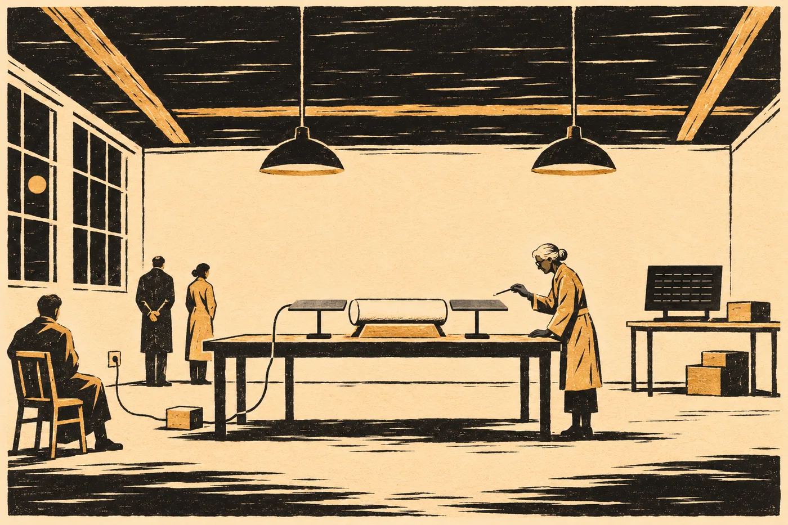

# 11. Válec

V pátek v sedm ráno visí slovník na webu.

Hana ho otevře na letišti v Praze, u okna, za kterým stojí bílé letadlo mexické vlády s vytaženými schůdky. Slovník technických pojmů má čtyři sta dvanáct hesel. U každého znak patronů, jak ho výprava zdědila v návodech ke strojům, které po patronech zůstaly, pak slovo v řeči výpravy a pak česky, anglicky a španělsky. Sto třicet hesel má poznámku *nejisté*. Jednačtyřicet poznámku *nečteno, jen zapsáno*.

K tomu popis kódování. Čtyřicet stran. Hana mu nerozumí. Fuchsová mu rozumí napůl, napsala jí to hodinu po zveřejnění a dodala, že napůl je víc, než čekala.

A k tomu výtah protokolu z archivu řádu. Devět listů, jak ho výprava měla. Nahoře na každém listu opis ve znacích patronů, dole starý pracovní překlad, s mezerami a se slovem *chybí*. Výprava ho zveřejnila celý. I se značkou u slova *kontaminant*. *K překladu připojena poznámka. Viz věc Vess.* A pod ní nový řádek, podepsaný Sendem.

Všechno u pěti institucí ve čtyřech zemích, s kontrolními součty. Dřív, než výprava sáhne na válec.

Ve 7:12 přijde zpráva od Sendeho. Česky, bez chyby.

*Předáno. Za rok nás můžete kontrolovat. I. S.*

Hana odepíše: *Za rok budeme.*

Sedne si a otevře sešit. Nahoru na okraj stránky napíše:

*Do 30. 8.: 34 dní.*

Vlevo zapíše slovník, kódování, výtah a čas. A pod to ještě jednu věc, kterou nosí v hlavě od června a kterou nikomu neřekla, protože nikdo se neptal.

*V pečeti z 26. 6. je „tomografie válce z kliniky (2026)“. Na klinice ale tenkrát snímali repliku. Olovo, pryskyřice, nalepená drť. Originál snímali v létě 2026 Švýcaři, neutrony. Zapečetěno je obojí. Správně, replika patří k historii. Ale ať nikdo neporovnává čtení s CT z kliniky.*

Vpravo: *Měla jsem to říct v červnu.*

Hned ten den napíše Švýcarům a zmocněnci, aby se to do zápisu doplnilo. Do oběda je to doplněné.

Než zavolají k nástupu, otevře v telefonu ještě snímek posledního listu kodexu. Kresbu kosti. Kost se nenašla, inventář z osmnáctého století zná jen knihu. Zůstala mnichova kresba úlomku s mřížkou čar a teček, pět řádků. V roce dvacet šest je porovnala se znaky na čele válce. Stejná pravidla, žádný shodný řádek.

Teď jde heslo po hesle. Ve slovníku je skupina devatenácti hesel nadepsaná *označení vzorku ve sbírce*. Dvanáct z nich má poznámku *nejisté*. Všechna začínají stejnými dvěma tahy jako první řádek kresby. Další dva řádky kresby mají stavbu, jakou slovník uvádí u pořadových čísel. Poslední dva nesedí s ničím.

Vlevo zapíše: *Kost (kresba v kodexu, 1172), ř. 1–3: stavba odpovídá heslům „označení vzorku ve sbírce“. Ř. 4–5 bez shody. Kresba není kost, mnich mohl tah přidat i vynechat. Jistota nízká až střední.*

Vpravo: *Matěj ji držel za relikvii. Možná je to štítek.*

*

V letadle sedí Lis Aven u okna a Edo Marn u uličky, protože se oken bojí.

Marn se bojí i letadla. Hana to pozná podle toho, jak drží opěrky. Letěl lodí přes šest set let, prošel brzděním, sestoupil člunem na zem, a teď se nad Atlantikem drží opěrek a při každém zhoupnutí zavře oči. Hana ho chápe. Loď nemá křídla. Loď se nehoupe.

„Je to normální?“ zeptá se Lis Aven za něj. Česky, aby to Hana pochopila.

„Je.“

Lis Aven to přeloží. Marn oči nechá zavřené.

Lis Aven se dívá z okna. Pod nimi je moře. Je ho tolik, že Hana na něj po dvou hodinách přestane myslet. Lis Aven ne.

„Z dráhy jsme ho viděli celé,“ řekne. „Bylo to jako obraz. Modrá plocha. Tady je to daleko.“

Hana neví, co na to říct. Neřekne nic.

Přes uličku sedí pozorovatel, kterého vyslalo Mexiko a který letěl i na Měsíc. Spí s otevřenou pusou. Zmocněnec nejel. Hana je za to ráda. Česká delegace je tentokrát ona sama a v zápise o cestě stojí, že je tam jako odborná svědkyně. Ne jako mluvčí. Napsala si to tam sama.

*

V Méridě je v sobotu v osm ráno třicet dva stupňů.

Marisol Couoh na ni čeká před ústavem. Je starší. Hana ví, že ona sama taky. Marisol má v černých vlasech šedý pramen, který si nebarví, a pořád stejné tenisky. Podají si ruce. Marisol ji drží o chvilku déle, než je třeba.

„Doktorko Vrbová.“

„Marisol.“

V roce dvacet šest jí přestala věřit. Hana to ví a Marisol ví, že to Hana ví. Pak Marisol vložila Haninu opravu do archivní zprávy ústavu, celou, a za pásku dostala důtku. Od té doby si psaly třikrát. Pokaždé věcně.

„Tentokrát podepisuju já,“ řekne Marisol. „Každý krok. Vy se budete jen dívat.“

„To chci,“ řekne Hana.

Marisol odemkne.

V depozitáři leží válec v nové bedně, ne v té borové od truhláře z obce. Ta stojí vedle, prázdná, a přes horní třetinu víka jde pořád stará páska s modrým nápisem, roztržená a přelepená průsvitnou fólií, aby se nerozpadla. Jako exponát. Hana se na ni dívá a cítí v prstech chlad cenotu. Vyndala ten válec holýma rukama. Bylo to před devíti lety a pořád to cítí.

Nová bedna má na víku list. Ústav ho vydal v září dvacet šest, po trojí zprávě laboratoří, a od té doby na něm nikdo nic nezměnil.

*Předmět se neotvírá. Předmět se nenavrtává. Odběr vzorků zakázán. Výjimku nelze udělit.*

„Výjimku nelze udělit,“ přečte Hana nahlas.

„To jsem tam napsala já,“ řekne Marisol. „Ředitel chtěl *bez souhlasu ředitele*. Řekla jsem mu, že pak za deset let přijde někdo, kdo ředitele přesvědčí.“

*

V neděli v šest ráno se sejde shromáždění ejida X'Kanlum. Ve stejném domě jako tenkrát, se stejnými lavicemi a se stejným ventilátorem pod stropem, který se točí tak pomalu, že ho Hana počítá. Jedna otáčka, dvě, tři.

Luis Ek stojí u dveří. Je mu přes čtyřicet, ztloustl, a když vidí Hanu, usměje se, ale nepřijde k ní. Až po shromáždění, řekne jí očima. Teď je to věc obce.

Don Felipe sedí vepředu. Je mu přes devadesát. Hůl má opřenou o kolena a obě ruce položené na ní. Když mluví, mluví maysky, a mladý muž vedle něj to překládá do španělštiny a Marisol šeptem Haně do angličtiny.

Hana sedí vzadu. Lis Aven a Marn sedí vedle ní, protože je tam posadil Luis. Marn je v košili mokrý až na záda. Lis Aven má ruce v klíně a nedotkne se ucha ani jednou. Hana si toho všimne.

Shromáždění vyslechne, co výprava chce. Číst, ne otvírat. Číst v ústavu, ne jinde. Pět dní. Obrazy každé vrstvy zveřejnit dřív, než je kdo přeloží.

Don Felipe se zeptá Lis Aven. Přímo, bez okolků. Mladý muž to přeloží, Marisol taky, a Lis Aven odpoví španělsky. Mluví jím hůř než česky, pomalu, se špatnými koncovkami, ale každé slovo je tam, kde má být.

„Ptá se, jestli jste vy ti, kdo to tam dali,“ šeptá Marisol, i když to Hana pochopila.

„Ne,“ řekne Lis Aven. „My jsme ti, kdo to chtěli zničit.“

Ventilátor se točí. Jedna otáčka. Dvě.

„V dubnu to stálo v plánu,“ řekne Lis Aven. „Převzít a zneškodnit. Pořád to tam stojí. Je to odložené. Do třicátého srpna.“

Don Felipe se na ni dívá dlouho. Pak řekne něco krátkého a pár lidí na lavicích se zasměje. Ne zle.

„Říká, že je dobře, že jste to řekla vy,“ přeloží Marisol. „Protože kdyby nám to řekl někdo jiný, nevěřili bychom, že to víte vy.“

*

Shromáždění dá podmínky. Don Felipe je diktuje a Luis je píše do sešitu obce, do stejného, do kterého se tenkrát psaly ponorové dny.

Celou dobu čtení bude u válce někdo z obce. Luis. Válec neopustí Méridu. Jméno ejida bude v každém zveřejnění, ve všech jazycích, i ve vašem, řekne don Felipe a ukáže holí na Lis Aven. Na válec nesáhne nikdo kromě konzervátorky ústavu. A jestli v něm bude něco o téhle zemi, o studni nebo o vodě, obec se to dozví ve stejnou minutu jako ostatní. Ne potom.

Hlasují rukama. Hana je nepočítá. Je jich hodně.

Don Felipe ještě něco řekne. Marisol to přeloží až venku, na prahu, kde už je horko.

„Voda ho držela sto tisíc let. Ať ho vaše ruce drží pět dní.“

Luis k nim přijde, až když se lavice vyprázdní. Podá Haně ruku a pak ji obejme, krátce, po mexicku, a Hana se tomu ani nebrání.

„Tenkrát jsem řekl, že to není naše,“ řekne.

„Pamatuju si to.“

„Teď obec řekla ano.“ Pokrčí rameny. „Tak je to trochu naše. Kdyby se něco stalo, bude to naše.“

*

V sobotu večer napsala Sael. Hana tu zprávu čte znovu v neděli v autě, cestou zpátky do Méridy, protože večer v hotelu usnula dřív, než ji dočetla.

*Rada sítí dnes souhlasila. Opisy glos se smějí otevřít a dát týmům, které budou číst válec. Bez jmen, bez míst. Zveřejní se spolu s tím, co týmy napíšou, ne dřív. Hlasovaly čtyři sítě, Vratislav jen poslouchala. Rokyta je opisovala z listů, které nikdo nečetl. Teď je bude číst někdo. S.*

V pondělí v osm ráno se pečeť glos otevře u pěti institucí naráz. Hana to vidí na telefonu v laboratoři ústavu, mezi dvěma kontrolami teploty.

*

Laboratoř je bílá a studená. Klimatizace hučí. Válec leží uprostřed stolu na pěnovém klínu, holý, bez fólie. Hana ho naposledy viděla v roce dvacet šest.

Je stejný. Hladký. Bez švu, bez stopy nástroje. Na čele sedm řádků značek. Krátké čáry, dlouhé čáry, tečky ve skupinách. Každý řádek začíná krátkou čarou. Ve čtvrtém řádku tečka nad čarou. Pod jizvou dvě, kde v roce dvacet šest vzaly laboratoře tři mikrovzorky, je místo o odstín světlejší. Hana ho najde očima dřív, než si uvědomí, že ho hledá.

Konzervátorka ústavu je stará žena s rukama, které se netřesou. Má na nich rukavice a teploměr s tenkým čidlem. Změří povrch válce na šesti místech a čísla nadiktuje Marisol. Marisol je podepíše.

Marn rozbalí přístroj.

Jsou to dvě ploché věci, každá velká jako podnos. Šedé. Bez knoflíků. Marn je postaví na stojany po obou stranách válce, na dva prsty od pláště. Nedotknou se ho. Od jedné vede kabel ke krabici na zemi a od krabice do zásuvky ve zdi. Měnič, podobný tomu v Brně u sondy, jen na zdejší síť. Hana se dívá na ten kabel a na obyčejnou bílou zásuvku a myslí si, že nic na světě nevypadá tak obyčejně jako místo, odkud bere proud věc z jiné hvězdy.

„Než začnete,“ řekne Hana.

Marn se otočí. Lis Aven přeloží.

„Kolik vrstev ten přístroj vidí? Řekněte číslo, než cokoli přečtete. Do záznamu.“

Marn se podívá na Lis Aven a na Marisol. Marisol kývne.

Marn něco řekne do vzduchu, pro sebe, a chvíli čeká. Pak řekne číslo. Lis Aven ho zopakuje česky, španělsky a anglicky.

„Šest set čtyřicet osm.“

Marisol to zapíše. Hana otevře v telefonu soubor, který si v červnu vyžádala od Švýcarů a který je v pečeti od 26. 6. Neutronová tomografie originálu z léta dvacet šest. Tenkrát napsali *stovky vrstev, neinterpretováno*. V červnu jí na její prosbu napsali i počet. Zveřejnili ho dřív, než výprava o válci cokoli řekla.

*Šest set třicet osm až šest set padesát pět, podle toho, jak počítat nejtenčí vrstvy u osy. Přesnější odhad naše rozlišení nedovoluje.*

Hana to přečte nahlas. Marisol to zapíše pod Marnovo číslo.

„Sedí,“ řekne Marisol.

„Sedí s tím, co jde ověřit,“ řekne Hana. „Ne s tím, co je ve vrstvách. To zatím neví nikdo.“

*

Čte se pomalu.

Přístroj nevydá žádný zvuk. Válec se nerozsvítí. Na obrazovce, kterou Marn postaví na vedlejší stůl, se po dvaceti minutách objeví první obraz. Řádky znaků, hustých a drobných, šedých na černém. Pak další. Asi jedna vrstva za pět minut.

Každý obraz jde nejdřív na web. S kontrolním součtem, k pěti institucím. Teprve potom ho Lis Aven otevře. Nečte nahlas. Nečte vůbec, jen se dívá, jestli je obraz celý, a když je, kývne a Marn pustí další. Tak se dohodli. Číst budou čtyři týmy, každý zvlášť, z toho, co je na webu. Výprava. Ústav s epigrafiky z univerzity v Mexiku. Krausová s lingvistkou z Prahy a s Fuchsovou, která rozumí kódování napůl. A tým z Lipska, který si vyžádala Ines. Nesmějí se radit, dokud neodevzdají. Pak se porovná, kde se shodli a kde ne.

Každou hodinu změří konzervátorka teplotu povrchu. Za hodinu čtení vzroste o osm desetin stupně. Konzervátorka řekne, že při dvou stupních se končí. Po dvou hodinách se čtení přeruší a čeká se, až válec vychladne.

Luis sedí na židli u dveří a dívá se. Celý den. Hana mu přinese kafe z automatu na chodbě a on ho vypije, aniž by spustil oči z válce.

Večer je venku sto dvacet šest vrstev.

*

Ve čtyřicáté první vrstvě se Lis Aven zastaví.

Je to v pondělí kolem poledne. Hana sedí u okna a píše do sešitu teploty. Vidí, jak se Lis Aven nad obrazovkou narovná a pak se k ní nakloní blíž. Na svém tabletu otevře jiný obraz. Hana ho pozná i z dálky. První list výtahu. Nahoře opis ve znacích patronů, dole překlad s mezerami.

Lis Aven drží tablet vedle obrazovky. Jede prstem po znacích. Nahoře na tabletu, a pak dole na obrazovce. Znak po znaku.

Tablet položí.

„Paní doktorko,“ řekne. Tiše, ale v laboratoři je ticho, a slyší to všichni. Marisol, konzervátorka, Luis, Marn. „Nebudu číst. Jen řeknu, co vidím.“

„Řekněte to do záznamu,“ řekne Marisol.

„První řádek čtyřicáté první vrstvy má stejné znaky jako první řádek výtahu v našem archivu,“ řekne Lis Aven. „Ve stejném pořadí. Všechny.“ Odmlčí se. „Ve výtahu je pak mezera. Je tam napsáno *chybí*. Ve válci tam mezera není.“

Konzervátorka odloží teploměr.

„To je všechno,“ řekne Lis Aven. „Co ty znaky znamenají, nevím. Teda vím, co znamenají ve výtahu. *Protokol. Pro svět, jenž je kolébkou lidského druhu.* Ale to je starý překlad. Ten jsem nedělala já.“

Marisol to zapíše a otočí se k Haně.

Hana zapíše vlevo: *41. vrstva, 1. řádek = 1. řádek opisu ve výtahu řádu (L. A., znak po znaku, do záznamu). Ve výtahu dál „chybí“, ve válci ne.*

Vpravo: *Je to tam.*

Pak to škrtne. Je to vlevo. Lis Aven to porovnala znak po znaku. Vpravo napíše jen: *Ruka se mi třese. Proč?*

*

V úterý v poledne vysílá mexická televize titulek.

Hana ho vidí v jídelně ústavu, na obrazovce nad pultem s polévkou. *PROTOKOL NALEZEN V MÉRIDĚ.* A pod tím menším písmem, které se posouvá: *LIDÉ NEJSOU KONTAMINANT, TVRDÍ ZDROJ.*

Nikdo nic nepřeložil. Hana to ví jistě, protože to dohodli a protože Lis Aven celý den nečetla, jen se dívala, jestli je obraz celý. Ale v budově je čtyřicet lidí a někdo slyšel, jak Lis Aven včera řekla *protokol*.

Ve 12:40 volá zmocněnec.

„Paní doktorko, je to pravda?“

„Není to nic,“ řekne Hana. „Nikdo nic nepřeložil. Čtou se vrstvy. Je venku asi sto osmdesát obrazů. Překládat budou čtyři týmy zvlášť, a ještě nezačaly.“

„Ministerstvo zahraničí se ptá, jestli by to šlo potvrdit. Aspoň to první. Že tam je protokol.“

„Tam je řádek, který se shoduje s výtahem,“ řekne Hana. „To je v záznamu. Víc ne.“

„Mexičané chtějí tiskovou konferenci. Dnes večer. S vámi. Jste ta, která to vytáhla z vody.“

Hana se dívá na titulek. Posouvá se pořád dokola. *LIDÉ NEJSOU KONTAMINANT.* Chtěla by, aby to byla pravda. Chtěla by to víc, než je zdravé. Kvůli Kláře Rybové. Kvůli Jonášovi, který umí napsat svoje jméno i obráceně. Kvůli Sael, kvůli Ladě. A kvůli sobě, protože ten titulek je přesně to, co by sama napsala vpravo, kdyby si to dovolila.

„Nepůjdu,“ řekne.

„Paní doktorko…“

„Kdybych dnes řekla, že to tam stojí,“ řekne Hana, „a za deset dní by čtyři týmy napsaly něco jiného, kdo jim bude věřit? Mně ne. A jim taky ne. Řeknou, že je někdo dotlačil k tomu, co už bylo v televizi. Ať čtou. Pak řeknu, co napsali. Všechno, co napsali.“

„A do té doby?“

„Do té doby nic,“ řekne Hana. „Tenhle předmět ležel sto tisíc let ve vodě a nikdo o něm nic nevěděl. Deset dní vydrží, aniž by o něm něco říkala televize.“

Zmocněnec mlčí. Pak řekne, že to ministerstvu vyřídí. Řekne to tónem, ze kterého Hana pozná, že to vyřídí jinými slovy.

Večer vydá ústav prohlášení. Napsala ho Marisol. Tři věty: čte se, nic se nepřeložilo, výsledky zveřejní čtyři nezávislé týmy současně. Pod tím jméno ejida X'Kanlum. Ve španělštině, mayštině a angličtině.

Titulek běží dál. Jen se mu přidá otazník.

*

Ve středu ráno se ozve Hesk.

Ne Haně. Výpravě, přes Marna. Marn to pustí z tabletu a Lis Aven to řekne nahlas, protože to tak dohodli: všechno, co přijde z lodi a týká se válce, se říká nahlas.

Hesk navrhuje zrychlit. Dvojnásobný výkon přístroje, bez přestávek na chladnutí. Čtení by skončilo zítra večer, ne v pátek. Nebo válec převézt člunem na loď, kde jsou lepší přístroje a nikdo nemusí čekat, až vychladne.

„Do konce lhůty zbývá devětadvacet dní,“ přeloží Lis Aven. Hesk to říká krátkými větami a Lis Aven je tak i překládá. „Teplota jádra stanoviště stoupá. Každý den čekání je den, kdy nevíme, co protokol dovoluje. A co ne.“

Konzervátorka se podívá na teploměr a pak na Marisol. Řekne španělsky jednu větu. Marisol ji nepřeloží. Nemusí, Hana ji pochopí: při dvojnásobném výkonu by povrch přešel limit za hodinu.

„Ne,“ řekne Marisol. „Na loď ne. Dvojnásobek ne. Válec neopustí Méridu, to je podmínka obce. A teplota je podmínka ústavu.“

Lis Aven to přeloží. Za chvíli přijde odpověď.

„Paní velitelka se ptá na názor odborné svědkyně,“ řekne Lis Aven. Dívá se na Hanu. „Té, která měří stanoviště.“

Hana vstane. Neví proč. Řekne to vestoje.

„Vím, co dělá klenba,“ řekne. „Měřím ji pět let. Každý pátek měřím pramen pod Hřbetem a vidím, jak stoupá. Vím, že je to nebezpečné. Nevymýšlím si to.“ Odmlčí se. „Ale tohle je jediná věc, která nám může říct, co se s lidmi v té hoře smí a nesmí dělat. Ne se zařízením. S lidmi. Jestli ji spálíme, abychom to věděli o den dřív, nebudeme to vědět nikdy.“

Lis Aven překládá. Hana čeká.

„Kdo něco čte ve spěchu,“ řekne pak, „čte to, co chce. To dělám i já. Proto mám dva sloupce.“

Za minutu přijde odpověď. Lis Aven ji řekne bez výrazu.

„Paní velitelka bere na vědomí. Připojuje odlišné stanovisko.“

Marisol to zapíše. Hana si sedne. Ruce má studené, i když je v laboratoři dvacet čtyři stupňů.

Luis u dveří zvedne palec. Jen trochu, aby to nikdo neviděl.

*

Ve čtvrtek přijde zpráva od Krausové. Ne o překladu, ten nesmí nikomu posílat. Je to procesní zpráva.

*Pracujeme. Glosy jsou dobré. Jedna věc: v opisech z archivu rady stojí jeden znak dvakrát vedle sebe, ve dvou podobách. Liší se jedním tahem. Opisovatelka k nim připsala dvě různé glosy. Totéž mají podle všeho i ostatní týmy, protože glosy jsou stejné pro všechny. Víc říct nesmím. A. K.*

Hana si zprávu přečte.

*Liší se jedním tahem.*

Vzpomene si na Lis Aven v hale v Brně, jak nadiktovala dvě slova, protože se lišila jedním znakem. *Dotčená. Blízká.*

Zapíše to vpravo. Vlevo napíše jen: *Krausová: v glosách jeden znak ve 2 podobách, liší se 1 tahem, 2 různé glosy. (Procesní zpráva, bez obsahu.)*

Napíše Sael.

*Rokyta opsala jeden znak dvakrát. Víte proč?*

Odpověď přijde za hodinu. V Chebu je jedenáct večer.

*Protože jsou to dva znaky. Ona to věděla. Já jsem to nevěděla. Psala to pro někoho, kdo to jednou bude číst. S.*

*

V pátek ve 14:20 je venku šest set čtyřicátá osmá vrstva.

Marn vypne přístroj. Nic se nestane. Žádný zvuk, žádné světlo. Jen obrazovka na vedlejším stole ztmavne a Marn si sedne na židli a zakryje si obličej rukama, a Hana pochopí, že pět dní nespal víc než čtyři hodiny za noc.

Konzervátorka změří povrch. Šest míst, šest čísel. Za hodinu je měří znovu. Válec má teplotu laboratoře. Konzervátorka ho nafotí ze všech stran, stejně jako v pondělí ráno, a fotky položí vedle sebe. Nic se nezměnilo. Ani odstín pod jizvou dvě.

Marisol podepíše. Luis podepíše za obec. Lis Aven podepíše za výpravu. Hana podepíše, že u toho byla.

Pak se válec vrátí do bedny. Konzervátorka ho tam položí sama. Marisol přes víko nalepí novou pásku, bílou, s modrým nápisem, a podepíše se přes ni a přes dřevo. Hana to vyfotí. Nemusí. Udělá to ze zvyku a Marisol se usměje.

„Zase,“ řekne.

„Zase,“ řekne Hana.

*

Lis Aven ji najde na chodbě u automatu na kafe.

Je bledá. Jizva za uchem je v tom světle vidět víc než jindy. Hana ví, že Lis Aven celý týden nečetla. Ví taky, že se dívala. Kdo se pět dní dívá na znaky, které umí číst, a nečte je, ten je stejně čte. Jen si to nesmí přiznat.

„Paní doktorko,“ řekne Lis Aven.

„Neříkejte mi to,“ řekne Hana.

Lis Aven se zarazí.

„Neřeknu,“ řekne pak. „Jen procesní věc. Ta smím.“

„Dobře.“

„Je tam víc,“ řekne Lis Aven. „Víc než to, co je v televizi. Víc, než chtějí slyšet oni. A víc, než chceme slyšet my.“ Odmlčí se. „Až to týmy napíšou, bude to těžké. Pro všechny. I pro vás.“

„Kdy?“

„Za deset dní. Třináctého srpna v devět. Všem naráz.“

„Tak třináctého v devět,“ řekne Hana. „Jako ostatní.“

Lis Aven kývne. Pak udělá něco, co Hana nečeká. Sáhne si za ucho, na jizvu, a hned ruku stáhne, jako by se spálila.

„Odpojila jsem se,“ řekne. „Na celý týden. Aby mi to síť nepřečetla sama. Kdybych se připojila, přeložila by mi každý obraz, který jsem viděla. Nechtěla jsem to.“ Pokrčí rameny. „Je to divné. Takové ticho.“

Hana si vzpomene na náměstí. Na čtyři sta lidí, kteří si sedli na zem a mlčeli. *Bylo tam takové ticho, že jsem slyšela ventilaci.*

„Slyšíte klimatizaci?“ zeptá se Hana.

Lis Aven poslouchá. Hana jí na tváři vidí, že pochopila, na co se ptá.

„Ano,“ řekne Lis Aven. „Pět dní ji slyším.“

*

Večer ji Luis odveze do X'Kanlum. Luis nejdřív nechce, aby jela. Pak chce. Řekne, že don Felipe řekl, ať ji tam vezme, a s donem Felipem se nehádá ani Luis.

Cesta trvá necelé dvě hodiny. Prach, pak les, pak brána ejida, kterou Luis odemkne svým klíčem. Pak pole pana Chana.

Na poli rostou dýně. Velké, oranžové, mezi širokými listy. Uprostřed pole, kde byl tenkrát vrt, stojí betonový křížek, malý, po kolena, a dýně kolem něj rostou tak hustě, že ho skoro nevidět.

Pan Chan stojí na kraji pole. Zvedne ruku. Hana mu zamává.

K cenotu jdou pěšky. Luis ji vede po pěšině, kterou zná líp než kdokoli. U kraje se zastaví. Dolů nejdou. Hana tam už dolů nikdy nepůjde, a ví to, a Luis to ví taky.

Voda dole je tmavá. Nad ní stojí vzduch, horký a těžký, a pod převisem visí kořeny.

„Tady jsem ho vzala do ruky,“ řekne Hana.

„Já vím. Natáčel jsem to.“

„Byl studený.“

„Voda je dole na ruku studená,“ řekne Luis. „I pod tou slanou, co je teplejší.“

Hana se dívá do vody. Za šest set čtyřicet osm vrstev, za čtyři týmy, za deset dní přečtou, co v tom válci stálo. Bude to těžké, řekla Lis Aven. Pro všechny.

Nikdo to ještě nečetl. Ani ona. A přece ví, že to nebude tak nevinné jako titulek v televizi. Pozná to podle Lis Aven. Podle toho, jak si sáhla za ucho a ucukla.

*

V hotelu otevře sešit.

Nahoru: *Do 30. 8.: 27 dní.*

Vlevo:

*Mérida, 27. 7. – 3. 8. 2035. Slovník technických pojmů (412 hesel), popis kódování a výtah protokolu z archivu řádu zveřejněny 27. 7. v 7:00, před čtením. Doplněno do pečeti: CT z kliniky 2026 = replika.*

*29. 7. souhlas shromáždění ejida (podmínky: Luis u válce, válec neopustí Méridu, jméno ejida všude, sahá jen konzervátorka, obec se dozví současně). 28. 7. souhlas rady sítí s otevřením glos. Opisy otevřeny 30. 7. v 8:00 u 5 institucí.*

*Přístroj výpravy: 648 vrstev (Marn, před čtením). Švýcarská neutronová tomografie 2026: 638–655. Čteno 30. 7. – 3. 8., bez dotyku, s vnějším napájením. Povrch +0,8 °C/h, limit +2 °C. Válec beze změny (foto, teploty, podpisy: M. C., L. E., L. A., H. V.).*

*41. vrstva, 1. řádek = 1. řádek opisu výtahu (L. A.). Nic nepřeloženo. Překládají 4 týmy zvlášť. Výsledek 13. 8. v 9:00.*

*Hesk: zrychlit nebo převézt na loď. Ústav a obec: ne. Já: ne. Hesk: odlišné stanovisko.*

*Televize: „LIDÉ NEJSOU KONTAMINANT, TVRDÍ ZDROJ.“ Nikdo nic nepřeložil.*

Vpravo:

*Ten titulek bych napsala taky. Proto jsem nešla.*

*Rokyta opsala jeden znak dvakrát, protože jsou to dva znaky. Věděla to. Za šedesát let si toho nikdo nevšiml.*

*Lis Aven: „Je tam víc, než chceme slyšet my.“ Kdo jsme „my“? Výprava? Nebo i já?*

Zastaví se nad pravým sloupcem, nad tou poslední otázkou. A připíše pod ni ještě jeden řádek.

*Až to přečtou, budu to muset říct celé. I to, co nechci.*

Zavře sešit. V hotelu hučí klimatizace, stejná jako v laboratoři. Hana ji slyší. Pět dní ji slyšela a nevšimla si jí.
