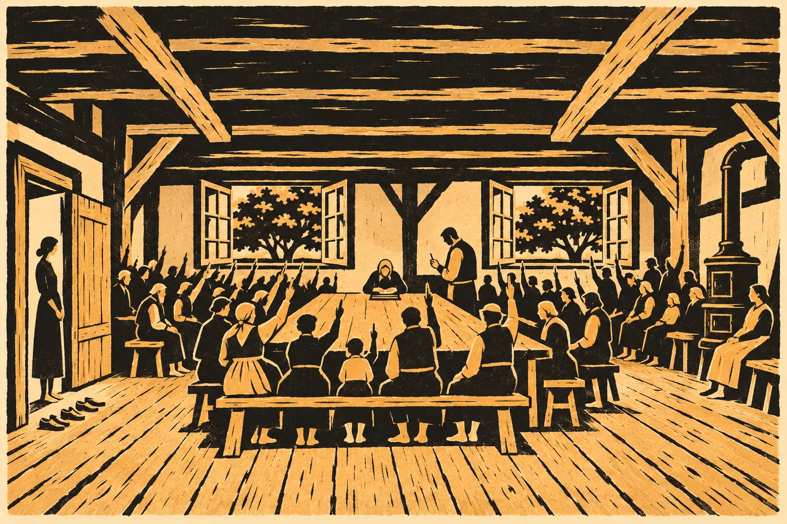

# 16. Ostří

V sobotu ráno napsala Lada do modrého sešitu *61. 27.*

Sael stála za ní a viděla, jak se propiska u sedmičky zastavila. Lada ji neobtáhla. Napsala ji jednou, tence, a pak propisku položila vedle sešitu, rovně, jako se klade příbor.

„Schod za tejden,“ řekla.

„Ano.“

„V červnu dva za čtyři. Teď jeden za jeden.“ Lada zavřela sešit. Dlaň na něj tentokrát nepoložila. „Tadeáš to spočítá líp. Já to vidím takhle.“

Venku ve dvoře už stála auta. Tři s českými značkami, jedno se saskými. Kryštof přinášel z kůlny lavice a stavěl je podél zdi světnice, protože u stolu se všichni nevejdou. Ve světnici bylo teplo. V srpnu, v osm ráno, s otevřenými okny. Šlo zespodu, podlahou, jako vždycky. Kdo sem přišel, sundal si boty a chodil bos, protože prkna hřála.

Sael se dívala na prkna. Na tmavé skvrny od suků. Na místo u kamen, kde byla prkna ochozená víc než jinde, protože tam sedávala Apolena, a před ní její matka, a před ní ta, o které už nikdo nevěděl, jak se jmenovala. Prkna hřála od doby, kdy je někdo položil. A dřív kámen pod nimi.

Za měsíc, možná za dva, budou studená.

*

Ve čtvrtek u stejného stolu seděli jiní lidé.

Edo Marn, s tabletem, na který nic nepsal, protože kreslil rukou na papír. Tadeáš vedle něj. Velitel hasičů z Chebu, ten, který tu stál i před pěti lety. Hydrogeolog ze státního ústavu, hubený muž v pracovní bundě, který dal v roce třicet ke kamenu u pramene první záznamník a od té doby k němu jezdil s Hanou každý pátek. Hana, která přijela z Brna rovnou a ještě měla v tašce vytištěnou svou zprávu. Lada v čele. Sael u dveří, jako vždycky.

Marn mluvil a Lis Aven překládala. Mluvil pomalu, protože věděl, komu to říká.

Zařízení se dá zastavit. Ne vypnout, jako se vypíná světlo. Zastavit. Postupně, okruh po okruhu, odebírat mu teplo a zavírat, co je otevřené, v pořadí, které zná stanoviště a které zná on. Některé okruhy zná jen stanoviště. Některé zná jen Tadeáš. Ten poslední, vnější, ten, který Ostří drželi, zná jen Tadeáš a jeho ruce.

Jak dlouho? Dva týdny, možná déle. Pak už jen čekat.

A pak?

„Pak to bude studené,“ řekla Lis Aven za Marna. „Jádro vychladne. Voda vychladne. Za rok, možná za dva. Pak se dá vyčerpat. Síně zůstanou. Chodby zůstanou.“ Marn se odmlčel a Lis Aven taky. „Teplo ne. Stanoviště, které se zastaví, už se nespustí. My to neumíme. A podle toho, co víme, se to ani nemá.“

Lada se dívala na Marnův papír. Na čáry, které nakreslil. Nebyly to čáry, jaké by Sael uměla přečíst. Kroužky, šipky, číslice.

„A skleník?“ zeptala se Lada.

Tadeáš odpověděl dřív než Marn. Česky, bez překladu.

„Skleník bez tepla je sklep.“

Lada se na něj nepodívala. Dívala se dál na papír.

Pak mluvil velitel hasičů. Statek stojí nad komorou. Když se bude zavírat, musí být prázdný. A potom taky, dokud se klenba neusadí. Jak dlouho, to nikdo neví. Kámen, který se roky hřál, se bude jinak chovat, když chladne. Hydrogeolog řekl, že to nejde spočítat. Jde to jen měřit. Hana řekla, že bude měřit.

A pak řekl velitel to druhé. Co bude, když se nezavře.

Velitelka z lodi má plán na pátek třicátého prvního. Evakuace do dvou kilometrů. Celý Mlýnec, dvě stě osmdesát sedm lidí, statek, louka, stany v lese. Pak zával komory. Zasypat, utěsnit. Hora zůstane stát. Nikdo se do ní už nedostane.

„A teplo?“ zeptala se Lada.

Marn chvíli mlčel, než řekl jednu větu, a Lis Aven ji přeložila.

„Pod závalem se bude hřát dál.“

*

To bylo ve čtvrtek. V sobotu se Ostří sešli, aby rozhodli.

Nebyla to rada. Rada, to bylo jedenáct lidí u stolu. Tohle bylo všechno. Každý, kdo byl Ostrý a měl věk, aby mluvil. Přijeli ze statku a z Mlýnce, kam se někteří přestěhovali, když hora začala stoupat. Dvě rodiny ze Saska, jedna z nich z Annabergu. Starý muž z Bavorska, který nebyl ve statku třicet let a teď stál ve dveřích a díval se na prkna, jako by je viděl poprvé. Sael ho znala z knihy. Vojtěch. Narodil se tu, ve skleníku, pod lampami, jako Lada. Odešel, když mu bylo čtyřicet, za ženou do Pasova. Žena umřela před deseti lety a on zůstal tam.

Třicet čtyři. Sael je spočítala ode dveří, protože tam stála.

Děti zůstaly venku. Kryštofova vnučka je vzala do sadu. Byla to ta holčička, která v roce třicet nakreslila Haně obrázek a napsala na něj *PRO PANÍ CO MĚŘÍ*. Teď jí bylo dvanáct a byla vyšší, než Sael čekala. U dveří se otočila a zeptala se:

„A bude se ještě měřit?“

„Bude,“ řekla Hana. Stála na dvoře, protože do světnice nepatřila a věděla to.

Holčička kývla a odvedla děti.

*

Lada začala tím, že řekla, kdo tu nehlasuje.

„Sael,“ řekla. Ukázala na ni, ani se neotočila. „Je to i její dům. Bydlí v něm dýl než kdokoli z nás. Ale není Ostrá.“ Odmlčela se. „Bude u toho. Hlasovat nebude.“

„Nebudu,“ řekla Sael.

„Hana taky ne. Ta je venku.“

Několik lidí se zasmálo. Hana na dvoře taky. Sael to slyšela oknem.

„Tadeáš řekne, co se říkalo ve čtvrtek,“ řekla Lada. „Celý. I to, co se nelíbí.“

Tadeáš to řekl. Celé, ve stejném pořadí jako Marn, a bez Marnových kroužků. Stál u stolu s rukama opřenýma o desku a mluvil jako člověk, který tu věc zná rukama a slovy ne. Levou ruku měl ve světle a přes předloktí se mu táhla jizva po opaření. Lesklá, světlejší. Sael věděla, že v zimě bolí. Teď bylo léto.

Když skončil, bylo ticho.

Pak se ozval Vojtěch ode dveří.

„Tak co tu volíme?“ řekl. Měl hlas starého muže, který mluví málo a pak najednou. „Jestli ji zabijeme my, nebo ona nás? Nebo ta z nebe ji zasype a bude se hřát pod hlínou, dokud nepraskne?“

Nikdo neodpověděl.

„Hora nás hřála dřív, než skála svítila,“ řekl Vojtěch. „To říkal můj děda a jeho děda. Byli jsme tu kvůli vodě. Ne kvůli tomu, co je v ní. A teď ji zavřem kvůli lidem, co přiletěli až teď?“

„Ne kvůli nim,“ řekl Tadeáš. „Kvůli klenbě.“

„Klenba drží čtyřicet tisíc let.“

„Šedesát osm tisíc,“ řekl Tadeáš. „Ne čtyřicet. Čtyřicet je ten kámen na Měsíci. Stojí to ve spisu. A stejně se hejbe. Pět let. Každej rok rychlejc. Tohle neříkaj oni. Tohle říká ona sama. A měří to Hana. A já. Každej tejden.“

Vojtěch se díval na něj, a když se nedočkal ničeho dalšího, obrátil oči k Ladě.

„Ty to víš taky,“ řekl jí.

Lada mlčela.

*

Pak mluvila Johana.

Bylo jí dvacet osm a měla dvě děti v sadu. Bydlela s mužem v Mlýnci od třicátého prvního, v domě po mlynáři, který nebyl Ostrý a přiženil se k Ostrým před sto lety. Sael ho měla v knize. Johana mluvila rychle, jako lidé, kteří mají doma malé děti a málo času.

„Já chci vědět, kam,“ řekla. „Kam půjdou děti. Kde budou spát. Jestli půjdou do stejný školy. Jestli budeme spolu, nebo nás rozdělej po kraji. Jestli nám někdo bude psát, kdo jsme. O hoře se rozhodne. Ale o tomhle chci rozhodnout já. Ne úřad. Ne loď.“

„To se rozhodne,“ řekla Lada. „Dneska. Tady.“

„Kdo?“

„My,“ řekla Lada. „Kdo jinej.“

Kryštof u okna zvedl ruku. Ne k hlasování. Jen aby věděli, že chce mluvit.

„Teplo se dá koupit,“ řekl. „Uhlí, plyn, dřevo. Platí ho celej Mlýnec. Zaplatíme ho taky. Horu koupit nejde. Když spadne, je pryč. Když se zasype, je pryč. Když ji zavřem, zůstane. Studená. Ale naše.“

„Studená není naše,“ řekl Vojtěch.

„Studená je naše víc než zasypaná,“ řekl Kryštof.

*

Pak promluvili ti dva v černém.

Byli tu i v červnu, rovnou z pohřbu sestry, a od té doby nosili černou dál. Sael nevěděla, jestli ze zvyku, nebo proto, že se to u Ostrých tak dělá. V knize o tom nic nestálo. Starší z nich, muž, řekl jen jednu větu.

„Sestra chtěla, aby někdo šel dolů, dokud je kam.“

Pak si sedl.

Sael si tu větu pamatovala z června. Tehdy znamenala něco jiného. Tehdy šli dolů číst. Teď to znamenalo, že se dolů půjde naposledy. A že potom už nebude kam.

*

Lada mluvila až nakonec.

Seděla v čele stolu, malá, ruce na sešitu. Devadesát pět let. Sael ji znala od doby, kdy Lada byla dítě a pletla se dospělým pod nohy ve strojovně, protože tam bylo nejtepleji. Znala jejího otce. Znala její babičku. Ladino narození zapsala do knihy Rokyta. Narození Ladiných dětí už zapsala Sael, svou rukou.

„Tadeáši,“ řekla Lada. „Řekni mi to ještě jednou. Jenom mně.“

Tadeáš se na ni podíval.

„Až to zavřete,“ řekla Lada, „bude dole teplo?“

„Ne.“

„Ve skleníku?“

„Ne.“

„Nikdy?“

Tadeáš se nadechl.

„Nikdy,“ řekl.

Lada kývla. Pomalu, jako se kývá na číslo, které už člověk zná, ale chtěl ho slyšet ještě jednou nahlas.

Pak se dlouho dívala na sešit. Ten modrý, s čísly. Sael viděla, jak jí po krku přejde něco, co nebylo slovo.

„Já jsem chtěla dolů,“ řekla Lada. „Do skleníku. K lampám, kde jsem se narodila. Pět let spím nad vlastní postelí a voda mi do ní teče. Myslela jsem, že někdo zavře ventil a vyleje vodu a já sejdu dolů a lehnu si.“ Odmlčela se. „Sael to ví. Říkala jsem jí to v květnu.“

„Ano,“ řekla Sael.

„Tak teď vím, že ne,“ řekla Lada. „Kdyby to zavřeli, bude to sklep. A kdyby to nezavřeli, spadne to. Nebo to zasypou. Tak jako tak dolů nesejdu.“ Zvedla ruce ze sešitu a podívala se na ně. „A nohy by mě tam stejně nedonesly. Ani kdyby bylo teplo. To je pravda taky.“

Ve světnici nikdo nic neřekl.

„Takže to nevolím pro sebe,“ řekla Lada. „Já už dolů nepůjdu. Volím to pro ně.“ Kývla k oknu, k sadu, kde byly slyšet děti. „Hora je dům. Dům, co hoří, se nechá vyhasnout. Nenechá se spadnout lidem na hlavu. A nenechá se zasypat, aby hořel pod zemí, kde to nikdo neuvidí.“

Pak řekla to, na co Sael čekala celé dopoledne.

„Zavřít. Ale za našich podmínek. Podmínky řekneme my. Ne ta z lodi, ne úřad, ne Sael.“

*

Hlasovali rukama. Tadeáš počítal nahlas a Kryštof po něm, jako vždycky.

Třicet pro. Tři proti. Jeden se zdržel.

Vojtěch byl proti. Když Tadeáš dopočítal, ozval se.

„Zapište, že jsem byl proti,“ řekl. „Jménem. Ať se ví, že ji někdo nechtěl zavřít.“ Odmlčel se. „I když vím, že máte pravdu.“

Tadeáš to zapsal. Jménem.

*

Pak ucho.

Ucho bylo Ostrých. Úzká chodbička od staré cesty k zadní stěně, tam, kde v roce třicet Lada vedla Apolenu a Sael proti průvanu. Kde podle Ostrých kdysi poslouchala Ostra. Za chodbičkou, za vodou a za starou štolou, ležela zadní stěna hnízda. Rýhy, které nikdo neviděl osm set šedesát tři let. Které mnich obkreslil olůvkem; jedno olůvko mu přitom prasklo.

Sael promluvila jen tady. Lada jí dala slovo a ona se nepohnula ode dveří.

„Ve čtvrtek jsem řekla Ladě, co za archiv,“ řekla. „Za archiv souhlasím, ať se hora zavře. Archiv je prázdný. Kniha je v Chebu. Co v hoře zbylo z nás, jsou police a světlé obdélníky na zdi, kde stály svazky. Přijdu o dům. Stejně jako vy. Bydlela jsem v něm sto čtyřicet let. Ale je to váš dům a já v něm bydlela.“

Nikdo ji nepřerušil.

„A o jednu věc vás prosím,“ řekla Sael. „Bez vás ji udělat nesmím. Ucho. Až se bude čerpat a bude suché, jednou. Jen jednou. Aby se mohlo ověřit, co přečetli z mnichových kreseb. Na rýhách, které vyryli sami draci. Nic se neodnese. Jen fotky a měření. Fotky uvidíte první. Kdo tam půjde, řeknete vy.“

Někdo se zeptal, proč to potřebuje.

Sael chvíli mlčela.

„Nepotřebuju to,“ řekla. „Zapsali nás. Vás. *Ti od teplé vody.* Dřív než ty naše knihy. Lada to řekla v červenci. Jestli je to pravda, je to tam. Na zdi. A už nikdy se k té zdi nikdo nedostane. Tohle je jednou.“

Johana se otočila k Ladě.

„Je to naše?“ zeptala se. „Ta zeď?“

„Draci to psali o nás,“ řekla Lada. „Tak je to naše.“

„Pak ať to vidí naši,“ řekla Johana. „Ne cizí. Ať tam jde Tadeáš.“

„Půjde,“ řekla Lada. „A kdo ještě, řekne on.“

Hlasovali. Třicet jedna pro. Tři proti.

*

Pak zápis o rukou.

Lada ho chtěla zveřejnit od června. *Že jsme to drželi.* Rada to tehdy odložila. Ne proto, že by nechtěla. Protože chtěla, aby se o tom rozhodlo spolu s horou. Aby svět nejdřív nezjistil, že Ostří stroj drželi, a hned nato z novin, že ho někdo zasypal.

Teď to rozhodnuté bylo.

Tadeáš to přečetl nahlas. Ne celé. Celé to byly tisíce řádků. Přečetl jich dvacet. *Kontakt s rozhraním. Biologický. Neautorizovaný.* A k tomu čísla. Teplota dlaně. Tep. Doba. Pětatřicet minut. Dvě hodiny. Jedenáct minut. Čtyřicet jedna minut.

Pak přečetl tu druhou větu, tu, která se opakovala tisíckrát. *Vnější okruh. Zásah. Místní. Neautorizovaný.*

„Tři sta let,“ řekl. „Pak je to přepsaný. Co bylo dřív, neví ani ona.“

Lada se dívala na stůl.

„Ať to ví všichni,“ řekla. „Hned. Že jsme tam byli. Že jsme to drželi. Že tomu nahoře říkaj *neautorizovaný*, ale že jsme to drželi, když nikdo jinej. Apolena tam je. Jinde nikde. V knize je pod jménem z občanky. Tady je, jak sedí na lavici.“

Hlasovali. Všech třicet čtyři.

„A pošlete to i tomu z lodi,“ řekla Lada, když Tadeáš dopočítal. „Tomu, co píše ty papíry.“

„Delegátovi?“

„Tomu.“ Lada se dívala na Tadeáše. „Ať si to přečte, než něco podepíše. Ať ví, kdo tu byl.“

*

Pak podmínky. Ty trvaly nejdéle.

Tadeáš je psal na notebook a Kryštof je diktoval, protože se ukázalo, že Kryštof umí smlouvat a Tadeáš ne. Johana do toho mluvila, kdykoli šlo o děti. Lada mlčela a jen občas zavrtěla hlavou, a když zavrtěla, Kryštof bod škrtl.

V jedenáct zavolal Kryštof starostce do Mlýnce. Dal telefon doprostřed stolu, na hlasitý odposlech, a všichni ztichli.

Starostka byla žena kolem šedesáti, kterou Sael znala jen z dálky. Z hřbitova, když se pohřbívala Apolena. Tehdy stála u brány a nic neříkala, a pak, když všichni odešli, zavřela bránu sama.

„Pane Kryštofe,“ řekla. „Poslouchám.“

„Ta škola,“ řekl Kryštof. „Co jste nabízela. Stará škola.“

„Ano.“

„Celá. Ne půlka.“

Chvíli ticho.

„Půlku má knihovna,“ řekla starostka.

„Tak knihovnu dejte do hasičárny,“ řekl Kryštof. „Hasiči nám to dlužej. Byli tu pět let a pořád jim vaříme kafe.“

Několik lidí se zasmálo. Starostka taky. Bylo to slyšet v telefonu, krátký smích přes nos.

„Dobře,“ řekla. „Celá.“

„Statek zůstává náš,“ řekl Kryštof. „Na papíře i jinak. Klíč od vrat zůstává nám. Vrátíme se, až řekne úřad a až řeknem my. Tadeáš měří. Jeho čísla platěj taky. Ne jenom ty úřadu.“

„To nemůžu slíbit za úřad.“

„Tak to napište, že to chcem. Ať to úřad čte.“

„Napíšu.“

„Žádný seznam,“ řekl Kryštof. „Kromě toho, co kdo napíše sám.“

„Na nájemní smlouvu potřebuju jména,“ řekla starostka. „To musím.“

Kryštof se podíval na Ladu. Lada kývla.

„Na smlouvu jo,“ řekl Kryštof. „Na nic jinýho. Ne do žádný tabulky, kde by stálo, co jsme zač. Ne pro kraj, ne pro loď.“

„Pro loď určitě ne,“ řekla starostka. Řekla to rychle a Sael v tom slyšela něco, co nebylo úřední.

Pak Johana. Děti spolu, ve stejné škole v Mlýnci, kam už chodí. A bod, na kterém trvala Lada, i když ho řekl Kryštof: Ladina postel jde s ní. A prkno z Apoleniny postele taky, to, na které Apolena naposledy dala dlaně, protože na kámen nedosáhla. Prkno ze stromu, který rostl na hoře.

„Prkno?“ zeptala se starostka.

„Prkno,“ řekl Kryštof.

„Dobře,“ řekla starostka. „Prkno.“

A teplo. Kryštof řekl, že ho budou platit jako ostatní. Ať jim ho aspoň někdo spočítá dobře, protože ho nikdy neplatili a neumějí to.

Starostka chvíli mlčela.

„Do Mlýnce jste chodili sto let,“ řekla pak. „Na pivo, na mši, na pohřby. Já to vím od babičky. Nikdy jsme se neptali, odkud chodíte. Tak to vydržíme i teď. Školu do pátku vymalujem.“

Kryštof poděkoval. Telefon zavěsil sám, palcem, a dlouho se na něj díval.

*

Byl ještě jeden bod. Ten se starostkou neřešil, protože se jí netýkal.

Tadeáš ho napsal na konec, pod podmínky, a přečetl ho nahlas, aby ho slyšeli všichni.

*Poslední okruh zavře Ostrý. Rukou. Tadeáš.*

Lada kývla. Ostatní mlčeli.

*

Ve čtyři odpoledne poslal Tadeáš všechno najednou. Všem stranám jednání z prvního června, tak jako tenkrát v červnu Marn. Vládě, Němcům, Rakušanům, Mexičanům, radě sítí, výpravě. Ve stejné minutě, ve stejném znění.

Sael stála za ním a dívala se na obrazovku.

*Ostří všem stranám, současně. Sobota 25. 8. 2035.*

*1. Ostří souhlasí s odstavením stanoviště společným týmem. 30 pro, 3 proti (Vojtěch jménem), 1 se zdržel. Za podmínek níže.*

*2. Ostří souhlasí s přístupem k zadní stěně hnízda uchem, jednou, při čerpání. Půjde Tadeáš. Nic se neodnese. Fotky nejdřív Ostrým. 31 pro, 3 proti.*

*3. Ostří zveřejňují zápisy stanoviště o kontaktu s rozhraním (dlaně) a o vnějším okruhu. V příloze. 34 pro.*

*4. Podmínky přestěhování (dohodnuto s obcí Mlýnec, 25. 8. v 11:20).*

Pod tím body. Škola celá. Statek. Klíč. Čísla Tadeáše. Žádný seznam. Děti. Postel. Prkno. Teplo.

A úplně dole:

*Poslední okruh zavře Ostrý. Rukou.*

*Hora je dům.*

Tadeáš to poslal. Notebook pípl. Tadeáš se opřel a zavřel oči.

Za minutu přišla první odpověď. Od Hany, která stála na dvoře pět metrů od nich.

*Dostala jsem to v 16:00. Jako ostatní. H.*

*

Večer, když auta odjela, zůstala Sael s Ladou ve světnici sama.

Lada seděla u kamen, která byla studená, a Sael na lavici naproti. Okna byla pořád otevřená. Ze sadu šla vůně jablek, která už padala, a ze země pod nimi teplo, které šlo zespodu, z hory.

„Ty jsi taky přišla o dům,“ řekla Lada.

„Ano.“

„Měla jsi hlasovat.“

„Ne,“ řekla Sael.

„Sto čtyřicet let,“ řekla Lada. „To už není bydlení.“

„Ostří to tak nikdy neříkali.“

„Ostří to neříkali, protože se jich nikdo neptal,“ řekla Lada. „Já to říkám teď.“ Odmlčela se. „Ale dobře, žes nehlasovala. Kdybys hlasovala, řeklo by se, že to rozhodla zase ta z archivu. Za nás. Jako vždycky.“

Sael se na ni podívala.

„Ano,“ řekla. „Proto.“

Lada natáhla ruku a položila dlaň na prkno lavice vedle sebe. Na to místo, kde sedávala Apolena. Nechala ji tam dlouho.

„Hřeje,“ řekla.

„Ano.“

„Tak ať hřeje,“ řekla Lada. „Dokud může.“

*

V noci stála Sael v sadu.

Pára nad roklí byla bílá, rovná, vyšší než kdy předtím. Sael ji viděla proti tmavému lesu jako sloup. V lese na druhé straně svítil oheň čekatelů. Méně ohňů než v červnu. Někteří odjeli, když se ukázalo, že výprava nejsou žádní otcové. Někteří zůstali a zpívali dál, jen tišeji.

Nad hřebenem na západě se pohybovalo světlo. Pomalu, rovně. Dole v hoře se teď rozsvítila skála, bledě, celou plochou, a pak skvrna, tři, dva, čtyři. Sael to neviděla. Věděla to. Za měsíc, za dva, až se zavře poslední okruh, se rozsvítí naposledy. A pak už ne. Loď půjde nad hřebenem a hora jí neodpoví.

Myslela na archiv. Na police z tmavého dřeva, které tam stály od doby, kdy je Rokytina babička nechala postavit. Na stůl pod lampou, kde Rokyta opisovala, dokud viděla, a pak už ne. Na schody, které Sael znala nohama, od archivu dolů až k dolní chodbě. Teď stojí voda na sedmadvacátém. Pak tam bude tma, studená, a voda, která se bude dát vyčerpat. A pak nic.

Sto čtyřicet let bydlela nad teplou skálou. Psala do knihy v místnosti, kterou nikdy nemusela vytápět, protože ji hřálo to, co Ostří drželi. Nikdy se nezeptala, co je to za teplo. Nebylo třeba. Bylo to teplo domu.

Teď to věděla. A dům přestane být domem v té podobě, ve které ho znala. Zůstane v knize. Zůstane v modrém sešitě. Zůstane v zápisech stanoviště, kde Apolena sedí na lavici čtyřicet jedna minut s tepem šedesát čtyři.

Myslela na Vojtěcha, jak řekl *zapište, že jsem byl proti*. Na Johanu, která chtěla vědět, kam půjdou děti. Na Kryštofa, který smlouval o celou školu a o prkno. Na Ladu, která volila pro ty v sadu, protože sama už dolů nesejde.

Nic z toho Sael nerozhodla. Stála u dveří a dívala se.

Šedesát let by to rozhodla sama. Řekla by Ladě, co je správné, a Lada by se na ni podívala zespodu a řekla, že zase rozhodla za ně. A měla by pravdu.

Tentokrát nerozhodla nic. Jen se zeptala na ucho.

To byla cena. Domov, a k tomu ještě něco, co se těžko pojmenovává. Že o konci domu, ve kterém žila celý život, rozhodli jiní. Správně, a bez ní.

Patřilo to vpravo. Nikomu to neřekla.

*

Ráno, když odcházela k autu, ležel modrý sešit na stole ve světnici. Lada ještě spala. Sael ho otevřela, jen na poslední stranu.

*61. 27.*

Pod tím nic. Příští sobotu tam bude další číslo. A za měsíc, možná za dva, až se zavře poslední okruh, tam Lada napíše číslo, které bude menší než to předchozí.

Poprvé za pět let.

Sael sešit zavřela. Položila na něj dlaň, tak, jak to dělávala Lada, a chvíli ji tam nechala, než odešla.
