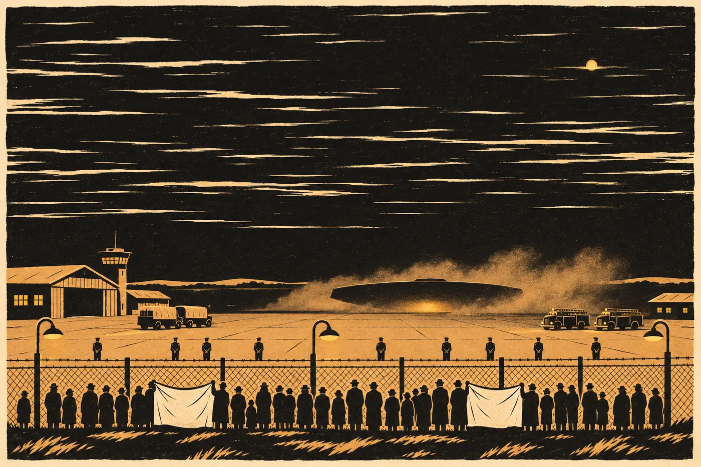

# 17. Člun

Na mostě přes Ohři je v neděli ráno nápis, který tam v pátek nebyl.

Hana jde z hotelu k autu na parkoviště za řekou pěšky, protože do devíti nemá kam spěchat a protože chce vidět řeku. Nápis je na betonové zdi pod zábradlím, sprejem, černě, písmeny vysokými jako dítě. *LINIE SE NEMÍSÍ.* A pod tím, menšími, jako podpis: *— VRBOVÁ*.

Hana se zastaví. Vytáhne telefon a vyfotí to. Ze zvyku. Pak stojí a dívá se na své jméno na zdi.

Nahoru na stránku sešitu napíše, opřená o zábradlí: *Do 30. 8.: 4 dny.*

Vlevo: *Most přes Ohři, Cheb, 26. 8., 7:40. Sprej. „LINIE SE NEMÍSÍ. — VRBOVÁ.“ Nebylo tam 24. 8. večer.*

Vpravo: *Já jsem to takhle neřekla.*

Pak to škrtne. Řekla to přesně takhle. Tři slova, slovo od slova, ve středu dopoledne, do protokolu. Řekla jen víc.

Vpravo napíše znovu: *Řekla jsem to takhle. Jen ne jenom tohle.*

*

V 10:12 volá Kubeš.

„Paní doktorko. Jste v Chebu?“

„Jsem.“

„Můžete přijet? Do Varů. Ke mně.“ Odmlčí se. „A nikomu to neříkejte, dokud vám neřeknu, komu to říct můžete.“

„Je to kvůli tomu mostu?“

„Jakému mostu?“

Hana mu to řekne. Kubeš chvíli mlčí.

„Ne,“ řekne pak. „Ale možná to souvisí. Přijeďte.“

*

Kubeš má pořád stejnou kancelář. Třetí patro, fíkus na okně. Za pět let ho nikdo nezalil a nikdo ho nevyhodil, a fíkus to nějak vydržel. Má šest listů. V roce třicet jich měl osm.

Kubešovi je pětapadesát. Vlasy má úplně šedé a na stole pořád hrnek s hokejovým klubem. Propisky leží rovnoběžně s okrajem stolu. Když si Hana sedne, jednu z nich posune o milimetr, aby ležela přesně.

„Od roku třicet sledujeme jednu skupinu,“ řekne. „Ty, co psali na fórum. Tu adresu Rybových. *Ukažte nám toho kluka.* Nikdy jsme jim nic nedokázali. Psali, nedělali. Tak jsme se dívali.“

Položí na stůl tři listy. Vytištěné, se začerněnými jmény.

„Uzavřená skupina. Šest lidí, aktivní čtyři. Od června píšou jinak.“ Ukáže prstem na řádky, ale nečte je za Hanu. Nechá ji číst.

Hana čte.

Nejdřív obvyklé věci. Země není vaše. Ať táhnou. Nadávky na loď, na vládu, na *nelidi*. Na Hanu taky. Od středy čtyřikrát, se jménem. Pak řádky z posledního týdne, kratší.

*pondělí v noci až budou otevření*

*máme těch 28. i s mapou*

*ať táhnou i se svejma*

„Pondělí v noci,“ řekne Kubeš. „Nevím, co je v pondělí v noci. *Otevření*. Nevím, co bude otevřené. *Těch 28.* Nevím, co je těch 28. A tohle.“

Položí na stůl čtvrtý list. Fotku.

Je to fotka mapy. Někdo položil na stůl list papíru a vyfotil ho telefonem. Na listu je mapa nakreslená rukou. Les, rokle, potok. Přerušovaná čára, která vede od východního konce hřbetu dovnitř. Poznámky na okraji, německy, drobným písmem technika, který kreslí rád a přesně. A na kraji, zvlášť, tři číslice. *3 – 2 – 4.*

Hana se na tu mapu dívá dlouho.

„Znáte to?“ zeptá se Kubeš.

„Tohle je stará cesta do hory,“ řekne Hana. „Korytem odtoku. Komory. Tady je ucho.“ Ukáže na místo, kde se čára zúží. „Tady krk. Tady voda po pás. Tudy šli v roce třicet ti tři. A tudy je pak Lada vyvedla ven.“

„Tu mapu jsme tenkrát u nich nenašli,“ řekne Kubeš. „Technik ji měl v hlavě. Ne v tašce.“

„Tak ji někdo nakreslil potom.“

„Kdo?“

Hana se dívá na drobné německé písmo. Na pečlivé šipky. Na číslici *4*, která má nahoře malý háček, jak se píše v Německu.

„Nevím,“ řekne. „Kdo tou cestou šel a přežil, aby ji mohl nakreslit. Ten technik. Pohl a ten druhý od Brandla, co šli s ním. Brandl ji zná z evakuačního plánu.“ Odmlčí se. „A kdo ji od nich dostal.“

„Wehrle,“ řekne Kubeš.

„Nevím. To je výklad.“

Kubeš kývne. Napíše si to. *Výklad.* Hana to vidí přes stůl, protože píše velkými písmeny.

*

„Ještě něco,“ řekne Hana. „Wehrle byl v červnu u člunu. Říkal jste mi to. Vrátili mu obálku.“

„Vrátili.“

„Nevím, co jim nabízel. Ale jestli jim nabízel cestu do hory, mají tu mapu taky. A jestli ji mají, poznají, jestli je to tatáž.“

Kubeš se na ni dívá.

„Výprava nám nic říct nesmí,“ řekne. „Delegát to v červnu řekl tomu policistovi u brány. Že předává obálku. Ne informace.“

„Zeptám se ho,“ řekne Hana. „Jestli smí.“

Kubeš chvíli mlčí a posune hrnek o kousek dál od sebe, jako by mu překážel.

„Zeptejte se,“ řekne.

*

Ve 13:30 napíše Hana Sendemu z chodby. Česky, krátce. Ví, že rozumí.

*Pane delegáte. Jsem u policie v Karlových Varech. Mají fotku mapy staré cesty do hory a zprávu o „28“. Potřebuji vědět, jestli to znáte. Nevím, jestli mi to smíte říct. H. V.*

Odpověď přijde za šest minut.

*Nesmím. Oznámím to vedoucí. Na odpověď čekat nebudu. Kde jste? I. S.*

Hana mu napíše adresu.

*

Sende přijede v půl čtvrté, s Lis Aven, v policejním autě, které pro něj Kubeš poslal na letiště.

Je bledý a v plné gravitaci stojí líp než v červnu. Ve dveřích Kubešovy kanceláře se zastaví a dívá se na fíkus, na Kubeše, na Hanu.

„Kapitáne,“ řekne česky.

„Pane delegáte,“ řekne Kubeš. Vstane. Nepodá mu ruku, protože neví, jestli se to dělá. Sende mu ji podá sám.

Sedne si. Lis Aven si sedne vedle něj a položí na stůl tablet. Kubeš posune propisky, aby se tablet vešel.

„Nemám pravomoc vám to dát,“ řekne Sende. Mluví pomalu a Lis Aven mu do toho občas řekne jedno slovo, když zaváhá. „Mandát mi ukládá podávat stanoviska vedoucí výpravy. Ne pozemským orgánům. Vedoucí jsem to oznámil ve 13:40.“ Odmlčí se. „Odpověď nepřišla. Kdybych čekal, přijde možná zítra. Zítra je pondělí.“

„Proč pondělí?“ zeptá se Kubeš.

„To vám řeknu,“ řekne Sende. „Nejdřív mapa.“

Lis Aven otočí tablet. Na obrazovce je fotka. Táž fotka. Hana to vidí dřív, než si to stačí říct. Mapa nakreslená rukou na listu papíru, vyfocená shora. Les, rokle, potok. Přerušovaná čára. Německé poznámky. *3 – 2 – 4.*

Kubeš položí svůj vytištěný list vedle tabletu.

Chvíli se jen dívají.

Je to stejná fotka. Ne stejná mapa. Stejná fotka. V levém dolním rohu je na obou stín palce, který držel papír, když se fotilo. Na obou je v pravém horním rohu ohyb, kde byl list kdysi přeložený. Na obou je u okraje stolu, na kterém papír ležel, kousek něčeho tmavého. Hrana kožené vazby. Kovový roh.

„Tohle napsal pan Wehrle na otevřený kanál výpravy,“ řekne Sende. „Sedmého června. Kanál čte síť. Poslala to velitelce Varo. Velitelka to má v záznamu. Odtud jsem to vzal. Od nás to neodešlo. Ověřil jsem to. Síť zapisuje každé předání. Tahle fotka byla předána jednou. Od velitelky mně, dnes ve 14:10.“

„Takže to odešlo od něj,“ řekne Kubeš.

„To nevím,“ řekne Sende. „Vím, že od nás ne.“

Kubeš ukáže na tmavou hranu u okraje fotky. Na kovový roh.

„Co je tohle?“

„Kniha,“ řekne Sende. „Rodová kniha pana Wehrleho. Převázaná v kůži, nejspíš v devatenáctém století, s kovovými rohy. Viděl jsem ji sedmého června. Otevřel ji přede mnou. Mapa ležela na ní, když ji fotil.“ Odmlčí se. „Nesl ji v brašně. Sám.“

„Kdo k ní má přístup?“

„To nevím.“

Hana se dívá na kovový roh.

„Kdo pro něj tu cestu chodil,“ řekne, „ten s ní uměl pracovat. Ten technik. Z roku třicet.“

Kubeš si něco zapíše a sáhne po telefonu a někomu napíše zprávu, dlouhou, a čeká.

*

„Dvacet osm,“ řekne Sende.

Kubeš zvedne hlavu od telefonu.

„Dvacet osm rodin,“ řekne Sende. „Sto čtyři osoby. Tři generace, s rodokmeny. Tolik nám pan Wehrle nabídl sedmého června. Úplný seznam, prý. Německá policie má jen neúplnou kopii. Šestnáctého srpna to nabídl znovu. Velitelce Varo. Jako základ záznamu svěřenců. Paní Sael u toho byla. Paní doktorka Hronková taky.“

Kubeš si to napíše. Velkými písmeny. *28 = W.*

„Pondělí v noci,“ řekne.

„Dnes v noci letí člun nahoru,“ řekne Sende. „K lodi. V noci z pondělí na úterý ve dvě deset se vrací. S vybavením pro odstavení stanoviště. Rampa bude otevřená asi čtyřicet minut. Vykládá se na nákladní auta vaší armády a hasičů. Rozpis má společný tým. Šedesát adres. Kraj, hasiči, armáda, ústav, obec. My.“

„Takže čas je od nás,“ řekne Kubeš. „A mapa a seznam od něj.“

„To nevím,“ řekne Sende znovu. „Vím, kdo co měl.“

Kubeš se na něj dívá. Hana vidí, že se Kubešovi ten člověk líbí. Nedá to na sobě znát. Jen posune propisku, která ležela rovně, o milimetr, a pak zpátky.

„Velitelka ví, že jste tady?“ zeptá se.

„Ví,“ řekne Sende. „Řekl jsem jí to, než jsem odjel. Let nezruší.“

„Proč?“

„Řekla, že když ho zrušíme, přijdou jindy. A nebudeme vědět kdy.“

Kubeš kývne pomalu.

„To říkáme my taky,“ řekne.

*

Pak Kubeš řekne Haně, ať mu dá všechno, co ví. Ne to, co si myslí. To, co ví.

Hana mu to dá.

Zavolá Hronkové. Hronková to vezme v Brně, v neděli, u oběda, Hana slyší talíře. Hana jí řekne, oč jde, krátce. Hronková mlčí tři vteřiny.

„Dejte mu můj zápis ze šestnáctého,“ řekne pak. „Celý. I to, co Wehrle řekl Sael o šedesáti letech. I to *byl u mě*.“

„Je to o vás. O vaší práci.“

„Je to o seznamu,“ řekne Hronková. „Dejte mu to.“

Hana mu to dá. Hronková zápis pošle za dvacet minut, naskenovaný, s razítkem. Kubeš si ho vytiskne a čte. U věty *Neunikl ode mě, ale byl u mě* se zastaví a podtrhne ji tužkou.

Pak Hana napíše, co ví o staré cestě. Kdo o ní věděl v roce třicet. Ostří. Ona. Policie. Brandl, z evakuačního plánu. Ti tři. Wehrle, protože jeden z nich byl jeho technik. Napíše, kde cesta začíná, protože to policie ví. Nenapíše, kudy vede uvnitř, protože to není její a protože to policie nepotřebuje.

Napíše, co bude znamenat, kdyby se člunu něco stalo. Že na něm letí vybavení, bez kterého společný tým horu nezavře. Že bez toho zbude jen plán velitelky, zával v pátek ráno a evakuace celého Mlýnce. Že Ostří včera souhlasili se zavřením za podmínek, které si vyjednali, a že ty podmínky by pak neplatily.

Kubeš to dočte a řekne nahlas, krátce, jako do protokolu:

„Člun. Vybavení. Bez toho zával. Mlýnec.“

„Ano.“

Pak mu zavibruje telefon. Přečte zprávu. Dlouho.

„Technik z roku třicet,“ řekne. „Jeho věc se vlekla dva roky a skončila tiše. Od roku třicet tři je u nadace. Jako archivář. Správce knihovny.“ Odmlčí se. „Knihovny pana Wehrleho.“

Chvíli je slyšet jen ventilace.

Sende se dívá na tablet. Na stín palce v rohu fotky. Hana se dívá na Sendeho. Neví, na co myslí. Ví jen, že tenhle člověk před dvěma hodinami udělal něco, co udělat nesměl, a že to ví.

*

Než odejdou, podá Kubeš Sendemu list.

„Svědecká výpověď,“ řekne. „Co jste nám řekl. Podepíšete to? Nemusíte.“

Sende si list přečte. Celý, pomalu. Lis Aven mu dvě slova přeloží. Sende sáhne do kapsy a vytáhne propisku. Modrou, s okousaným koncem. Hana ji pozná. Hronková okusuje všechny své propisky.

Sende se podepíše. Latinkou, pomalu, písmem, které vypadá jako písmo dítěte.

*I. Sende.*

„Děkuju,“ řekne Kubeš.

„Neděkujte,“ řekne Sende. „Zapište to.“

*

V pondělí je Hana od rána ve statku.

Ostří se stěhují. Ne všichni a ne najednou. Škola v Mlýnci ještě není vymalovaná a starostka poslala vzkaz, že do pátku. Ale první věci odjíždějí. Krabice s kuchyňským nádobím. Kamna, ta malá, z Kryštofova pokoje. Sešity. Kryštof je nosí na dvůr a Johanin muž je skládá do dodávky, kterou půjčila obec.

Hana tu nemá co dělat. Je tu kvůli hydrogeologovi, se kterým mají v poledne projít místa, kde se bude měřit, až se začne zavírat. Ale hydrogeolog volal, že přijede ve dvě. Tak sedí na lavici u studny a dívá se.

Lada sedí na židli uprostřed dvora. Kryštof ji tam ráno posadil, aby viděla, co se nosí, a ona tam sedí a dívá se a občas zavrtí hlavou. Když zavrtí hlavou, Kryštof krabici vrátí dovnitř.

V 11:05 Haně zavibruje telefon.

*Archivář zadržen v Chebu. U sebe kopie. K.*

Hana si to přečte a dá telefon do kapsy.

Lada se na ni dívá přes dvůr.

„Co se děje?“

„Nic,“ řekne Hana. „Policie.“

Lada se na ni dlouho dívá.

„To je dobře, když se nic neděje,“ řekne pak. A dívá se zase na krabice.

*

Ve 14:20:

*Tři zadrženi u Sokolova. Jedna osoba chybí. K.*

Hydrogeolog přijel. Jdou spolu kolem rokle, po pěšině nad párou, a on jí ukazuje místa. Tady čidlo. Tady druhé. Tady u pramene, ten jejich starý záznamník, ten zůstane. Hana si to píše do sešitu a nemyslí na nic jiného. Nebo se o to snaží.

Pára nad roklí je bílá a stoupá rovně. Není vítr.

V 16:48:

*Čtvrtá taky. Nádraží v Chebu. K.*

Hana stojí nad roklí a dívá se na to slovo. *Čtvrtá.* Žena. Kubeš to napsal schválně. Píše vždycky přesně.

V 17:30:

*U nich seznam (28), mapa a prostředky. Prostředky nerozepisuju. K.*

V 17:31:

*Nikdo zraněn. K.*

Hana si sedne na kámen u pěšiny. Hydrogeolog se na ni podívá. Nic neřekne. Počká.

Pak jdou dál.

*

V noci nemůže spát.

Ve dvě je na letišti. Neví proč. Ví, že tam nic není potřeba. Ví, že je to přesně to, co dělají čekatelé v lese u Mlýnce. Stojí u plotu, protože se něco děje, a nemůžou nic.

U plotu stojí asi třicet lidí. Pod lampami, se svítícími telefony. Dvě prostěradla. *VÍTEJTE DOMA*, zašedlé a roztrhané v rohu. A nové, které Hana ještě neviděla. *JSME PŘÍBUZNÍ.* Pod tím, tužkou, malým písmem, které přečte, až když přijde blíž: *vzdálení.*

Za plotem stojí policisté. Víc než v červnu. Stojí v řadě, zády k plotu, a dívají se ven. Na beton, na tmu, na pole za letištěm. Na plochu dojíždějí nákladní auta. Armádní, zelená, s plachtou. A dvě hasičská.

Ve 2:09 se nad polem něco pohne.

Hana to neslyší. Nikdo to neslyší. Je to tvar proti nebi, tmavší než tma, a pak světlo pod ním, slabé, rozptýlené, jako když se díváte na lampu přes mlhu. Pak prach. Člun dosedne na beton za plotem a prach se zvedne a pomalu klesá.

*Bez zvuku, jen prach,* napsal Kalina prvního června. Hana si to pamatuje.

Rampa se otevře. Ze světla uvnitř vyjdou lidé. Marn, Hana ho pozná podle chůze. Za ním dva od Hesk, s bednami na vozíku. Z aut vystupují vojáci a hasiči. Nikdo nemluví nahlas. Bedny jdou z rampy do aut, jedna za druhou. Dlouhé, ploché, šedé.

Hana se dívá a počítá. Neví, co počítá. Bedny. Minuty.

Čtyřicet minut.

Nic se nestane.

*

Muž vedle ní se na ni podívá. Je mu kolem čtyřiceti, má na sobě tričko s nápisem, který Hana nečte, a v ruce kelímek s kávou ze stánku, který tu stojí od června a nikdy nezavírá.

„Vy jste ta Vrbová,“ řekne.

Hana nic neřekne.

„Z toho mostu.“ Muž se usměje. Ne zle. „Řekla jste pravdu. *Linie se nemísí.* Konečně to někdo řekl.“

„Řekla jsem víc,“ řekne Hana.

„Jo,“ řekne muž. Napije se kávy. „Ale to už nikoho nezajímá.“

Pak se otočí zpátky k plotu.

Hana stojí vedle něj a dívá se na beton. Na bedny, které jdou do aut. Na prach, který si sedá. Ten muž má pravdu. To je na tom nejhorší. Ve středu řekla celou větu a dnes ve dvě ráno z ní na letišti zbyla půlka. Ta, kterou si kdo vzal.

Nemůže to opravit. Je to venku celé. Kdokoli si to může přečíst celé. Nikdo nemusí.

*

Ve 2:51 se rampa zvedne.

Na okraji rampy, dřív než se zavře, stojí člověk. Hana ho pozná podle toho, jak stojí. Opatrně, nohy trochu od sebe. Dívá se ven, přes beton, k plotu. K lampám. K lidem s prostěradly.

Zvedne ruku.

Hana neví, jestli ji vidí. Je to sto metrů a ona stojí v řadě třiceti lidí pod lampou. Ale zvedne ruku taky.

Rampa se zavře. Člun stojí. Nákladní auta odjíždějí k bráně, pomalu, jedno za druhým. Lidé u plotu se začnou rozcházet.

Žena s prostěradlem *JSME PŘÍBUZNÍ* se na Hanu podívá.

„Komu jste mávala?“

„Někomu, kdo mával,“ řekne Hana.

*

V úterý ráno jde přes náměstí v Chebu.

Před hotelem, kde má Wehrle od června sál, stojí dvě policejní auta. Z vchodu vynášejí krabice. Papírové, s čísly fixou. Prapor nadace visí pořád v okně v prvním patře. Modrý, s orlem a s devíti hvězdami. Nikdo ho nesundal.

Wehrle sedí na lavičce u kašny. Sám, v dobrém obleku, s rukama na kolenou. Brašnu nemá.

Hana by šla kolem. Chce jít kolem. Ale on zvedne hlavu a uvidí ji, a ona se zastaví, protože jít kolem by teď bylo jako odpovědět.

„Frau Vrbová,“ řekne.

„Dobrý den.“

Mluví německy. Hana mu rozumí. Odpovídá česky a on rozumí jí.

„Odvezli i mého řidiče. Dvacet let mi řídil auto,“ řekne Wehrle. Nedívá se na ni. Dívá se na hotel, na krabice. „Ne archivář. Archivář je u mě od třicátého třetího. Ten, co mi řídil, je u mě dvacet let. Odvezli oba. Ten, co řídil, prý nic nevěděl. Já nevím, jestli věděl.“

Hana mlčí.

„Já jsem tu knihu dal archiváři do ruky,“ řekne Wehrle. „Aby ji opatroval. On znal tu cestu. Šel tam pro mě. V roce třicet. Málem tam umřel.“ Zvedne ruce z kolen a zase je položí. „Myslel jsem, že mi to dluží.“

„Řekněte to policii,“ řekne Hana.

„Řeknu,“ řekne Wehrle. „Celé.“

Pak se na ni konečně podívá. Má staré oči. Hana si vzpomene, jak je v roce třicet viděla v německé televizi. Sael jí tehdy vyřídila, co o ní řekl: že je nebezpečná, protože všechno zapíše.

„Vy jste ve středu řekla celé znění,“ řekne Wehrle. „*Dokud.* Myslel jsem, že teď konečně… Že když oni odešli, tak jsme zůstali my.“ Zarazí se. „A pak ta tři slova na mostě. S vaším jménem. A dnes v noci…“

Nedořekne to.

Hana neodpoví. Ví, co by mohla říct. Že *dokud* je jen jedno ze dvou čtení. Že pod posledním řádkem je znak, který nikdo nepřečetl. Že nikdo neví, kdo zůstal, a nejmíň on. Mohla by to říct a bylo by to všechno pravda.

A byl by to výklad.

Kývne mu a jde přes náměstí dál, ke kostelu, a neotočí se.

*

V 7:50 přijde zpráva od Sendeho.

*Velitelka dnes v 7:00 požádala vedoucí o ukončení odkladu pro náhlé zhoršení. Důvod: skupina měla mapu přístupu do stanoviště a byla několik hodin od činu. Vedoucí rozhodne v 9:00. I. S.*

Hana si to přečte dvakrát a zapíše to vlevo.

Je to pravda. Skupina měla mapu staré cesty. Do hory, ne jen k člunu. Policie neví, co s ní chtěli. Hana to neví taky. Velitelka to neví. Ale mapa byla u nich a teď je v krabici na policii, a velitelka to ví a má pravdu, že to ví.

*

V hotelu otevře sešit.

Nahoru: *Do 30. 8.: 2 dny.*

Vlevo:

*26. 8. Kubeš: skupina sledovaná od 2030 má „těch 28 i s mapou“. Sende: táž fotka (stín palce, roh vazby) v záznamu výpravy od 7. 6., od Wehrleho; od výpravy neodešla. Já: kdo znal starou cestu, co by znamenalo poškození člunu.*

*27. 8.: archivář nadace a čtyři další zadrženi, u nich seznam, mapa, „prostředky“. Nikdo zraněn.*

*28. 8., 2:09–2:51: člun přistál, nic. 7:00 Hesk žádá o ukončení odkladu. Rozhodnutí v 9:00.*

Vpravo:

*Nikdo z nás to nevěděl sám. Kubeš neměl mapu z lodi. Sende neměl Kubeše. Já jsem neměla nic, jen jsem věděla, kdo kudy chodil. Dohromady to byl celý řádek.*

*Nic se nestalo. To je to, co se stalo.*

*Muž u plotu: „To už nikoho nezajímá.“ Má pravdu.*

*Hesk má pravdu, že to byla mapa do hory. Nevím, jestli má pravdu v tom, co z toho udělá.*

Zastaví se nad posledním řádkem a přepíše ho.

*Bojím se, že má pravdu i v tom.*

Zavře sešit. Za oknem je náměstí. Policejní auta odjela. Prapor visí v okně dál, orel a devět hvězd, devátá menší. Wehrle na lavičce u kašny už nesedí.
