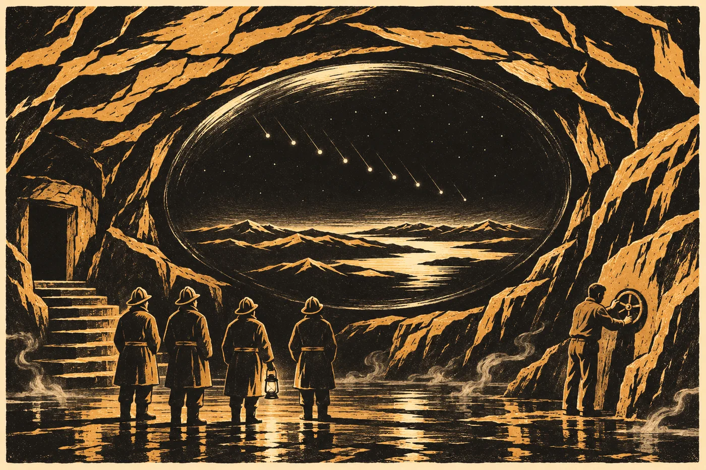

# 19. Odstavení

V pondělí ráno byl statek prázdný. Ne na noc a ne na rok, jako v roce třicet. Natrvalo.

Sael to věděla dřív, než otevřela vrata do dvora. Nebyl cítit chléb. Neozýval se Kryštof, který si u studny vždycky zpíval, když myslel, že ho nikdo neslyší. Okna světnice byla zavřená a za nimi nesvítilo nic. Na zápraží stála jediná věc, kterou Ostří nechali: lavice od kamen, ta, na které sedávala Apolena. Kryštof ji v pátek vynesl ven, protože se nevešla do dodávky, a pak ji tam nechal, protože se mu ji nechtělo nakládat na druhou fůru.

Sael si na ni nesedla. Položila na ni dlaň. Dřevo bylo studené od noci. Byla to první studená věc v tomhle dvoře, kterou si pamatovala.

U brány stáli dva od Hesk. Šedozelené bundy, na rukávech nic. Dívali se ven, k lesu, ne do dvora. Za nimi na louce stála tři hasičská auta, jedno s německou značkou, a bílá dodávka ústavu, ze které hydrogeolog vytahoval cívky kabelu. Hesk stála u auta s velitelem hasičů. Když uviděla Sael, udělala k ní dva kroky a zastavila se.

„Dobré ráno,“ řekla česky. Pomalu, každou slabiku zvlášť. „Hlídáme. Nikoho nepustíme.“

„Dobré ráno,“ řekla Sael.

Hesk se otočila zpátky k veliteli a dál mluvila svou řečí, kterou Sael neznala, a velitel jí odpovídal česky a oba si zřejmě rozuměli líp, než by kdo čekal.

Lada tu nebyla. Seděla ve škole v Mlýnci, ve třídě, ze které se stal její pokoj, a vedle postele měla na židli telefon. Tadeáš jí měl volat dvakrát denně. Ráno číslo a večer číslo. *Ať to slyším,* řekla Lada v pátek. *Napíšu si to sama. V sobotu, jako vždycky. Ale slyšet to chci každej den.*

*

Společný tým měl šest jmen na listu, který visel na dveřích kůlny. Sael ten list četla každé ráno, i když se nezměnil.

*E. Marn – stanoviště. Tadeáš – vnější okruh. Velitel HZS Cheb a 8 osob. Feuerwehr Waldsassen, 4 osoby, čerpadla. Ústav (hydrogeologie) – čidla. H. Vrbová – měření.*

A dole, menším písmem, Tadeášovou rukou: *Lada – teplo.*

Sael na listu nebyla. Tadeáš se jí v neděli zeptal, jestli tam chce být. Řekla, že ne. Že bude u toho. Že nic dělat nebude.

„Tak budeš u vrat,“ řekl Tadeáš. „Vidíš potmě. To se hodí.“

Byla u vrat. První týden se tam skoro nic nedělo, co by šlo vidět.

Čerpalo se. Hadice vedly z dolní chodby nahoru po schodech, přes archiv, chodbou k vratům a ven, do rokle, a byly horké tak, že se jich nikdo nedotýkal holou rukou. Voda z nich tekla do potoka pod roklí a potok se kouřil celou svou délkou až k mlýnu, jak to v Mlýnci nikdo nepamatoval. Lidé z Mlýnce se na to chodili dívat z mostu. Hasiči z Waldsassenu měli čerpadla, která hučela dnem i nocí, a jejich nejstarší, šedivý muž s tváří jako z kůry, sedal po službě na Apolenině lavici a kouřil. Sael mu jednou řekla, na čí lavici sedí. Omluvil se, vstal a příště si přinesl stoličku.

Tadeáš volal Ladě ráno a večer. Sael ho slyšela přes dvůr.

„Třicet jedna,“ řekl v úterý ráno.

„Třicet jedna,“ opakovala Lada v telefonu. Sael to slyšela, protože Lada mluvila do telefonu nahlas, jako by Tadeáš stál na druhém konci údolí.

„Třicet tři,“ ve středu večer.

„Třicet tři.“

Číslo schodu rostlo. Voda klesala. Teplota ne. Šedesát jedna, šedesát jedna, šedesát jedna. Hana měřila u pramene pod Hřbetem každý den, ne jen v pátek, a posílala čísla všem stranám v sedm ráno. Pramen se nehnul.

V sobotu napsala Lada do modrého sešitu *61. 34*. Kryštof to Haně vyfotil a Hana to poslala Sael.

Pod fotkou stálo jen: *Voda dolů. Teplo ne.*

*

V úterý jedenáctého bylo ucho suché.

Tadeáš to oznámil v šest ráno, ve dvoře, s hrnkem v ruce. Nikomu zvlášť. Řekl to do vzduchu, jako se říká počasí.

„Ucho je suchý.“

Velitel hasičů se podíval na hodinky. Marn se podíval na Tadeáše. Hana, která stála u dodávky ústavu, odložila tablet.

„Dneska,“ řekl Tadeáš. „Zejtra tam může bejt voda zas. Klenba se hejbe a cesty vody taky. Půjdu já. A Sael.“

Sael se na něj podívala.

„Rada řekla, že jde Ostrý,“ řekla. „A kdo ještě, řekneš ty.“

„No,“ řekl Tadeáš. „Tak to říkám.“ Napil se z hrnku. „Ty víš, kde se mu zlomilo olůvko. Já ne.“

Hana přišla s pouzdrem, které Sael znala. Černé, ošoupané, s lepicí páskou na rohu. Vytáhla z něj měřítko. Dvě kostky na tyči, černobílé dílky, štítek s číslem. Neřekla nic. Položila ho na kapotu dodávky a vedle něj druhé, ocelové pravítko z ústavu, a dílek po dílku je porovnala. Velitel hasičů a hydrogeolog se dívali, jak to dělá ještě jednou, stejně pomalu.

„Sedí,“ řekla. Podala měřítko Tadeášovi. „Ke každé řadě. Vždycky ve stejné vzdálenosti, souběžně s řadou. A fotku každé řady dvakrát, jednou s bleskem, jednou bez.“

Tadeáš si měřítko vzal a obrátil ho v ruce.

„Tohle je to, co se v roce dvacet šest posunulo?“

„To je jiné,“ řekla Hana. „To bylo v počítači, ne na tyči. Tohle je moje.“

Tadeáš se poprvé za ten týden zasmál.

*

Ucho odbočovalo ze staré cesty kus před krkem. V roce třicet ho míjeli. Lada se tu tehdy zastavila jen na chvíli a položila dlaň na ohlazené místo na konci, kde Ostra poslouchala. Dál se nechodilo, za ním byla voda. Sael si pamatovala průvan a pamatovala si Apoleniny ruce kolem svého krku, malé a tvrdé, když ji pak nesla korytem.

Teď tu byl průvan zase. Teplý, vlhký, vycházel z hory jako dech. Za nimi hučela čerpadla, slabší a slabší, jak šli dál. Tadeáš šel první, s čelovkou, s měřítkem přes rameno a s fotoaparátem na prsou, a nemusel se shýbat. Sael se shýbat musela. Ucho bylo dělané pro lidi o hlavu menší. Skála se jí otírala o záda a o ramena a místy musela jít bokem. Na stěnách byly žlábky po rukou. Ostří se tu přidržovali tisíce let a skála si to pamatovala líp než oni.

Kámen pod nohama byl kluzký a teplý. Voda z něj odešla teprve v noci. V prohlubních ještě stála, po kotníky, a kouřila.

„Tady,“ řekl Tadeáš po dlouhé chvíli.

Ucho se rozšířilo. Ne moc. Tolik, že se dalo stát vedle sebe. Vyústilo u zadní stěny hnízda a před nimi byla podlaha.

Sael ji viděla dřív než on. Čelovka ještě kroužila po stěnách, po vodě v prohlubních, po spadlých kamenech, a Sael už viděla ve tmě pod ní řady.

Nebyly to čáry, jak je kreslí člověk. Byly to rýhy, hluboké jako článek prstu, rovné, s hladkým dnem, a ležely ve skupinách. Tři a mezera. Dvě a mezera. Čtyři. Řada za řadou, od stěny, u které stáli, až ke svahu hlíny, jako písmo na linkovaném listu. Přes všechny ležela bílá kůra sintru. Tenká u stěny, kde řady začínaly. Dál ke svahu hlíny tlustší, takže tam rýhy vypadaly mělčí, jako by je někdo napsal křídou a pak je chtěl smazat.

Sael stála a dívala se. Tadeáš sklonil čelovku a světlo na podlahu dopadlo.

„Jo,“ řekl tiše. Víc neřekl.

Znala je. Znala je ze dvoustrany kodexu, kterou kdysi celé měsíce skoro denně držela v rukavicích pod lampou. Znala mnichovy tahy, olovo pod inkoustem, opatrné a stejné, a jeho tečky na okraji. Teď stála před tím, co mnich obkresloval. Před originálem. Rýhy byly větší, než si je představovala. A byly hlubší. Mnich kreslil, co viděl, a neměl jak nakreslit hloubku.

„Kde začneme?“ zeptal se Tadeáš.

„U stěny vlevo,“ řekla Sael. „Jako on.“

Tadeáš položil měřítko na kámen vedle první řady, rovně, ve vzdálenosti, kterou mu Hana ukázala. Rýh se nedotkl. Fotil. Blesk se v uchu rozprskl bíle a Sael na okamžik neviděla nic. Pak zase rýhy, druhá fotka bez blesku a druhá řada.

Šlo to pomalu. Neměli kam spěchat a zároveň měli. Hasiči jim dali dvě hodiny.

*

U třetí řady našla Sael první skupinu se čtyřmi rýhami.

Čtyři, prostřední kratší. Vedle nich v kameni malá prohlubeň, okrouhlá, hladká, jako by v ní kdysi něco leželo dlouho a těžce. Zrno, napsala Fuchsová do zprávy. Mnich tam nakreslil kroužek. A o kus dál druhá prohlubeň, hranatá. Krystal. Prázdná.

Na okraji té skupiny, blíž ke stěně, malá hladká skvrna v sintru, velká jako konec palce. Sael na ni posvítila víc a pak to pochopila. Tam se kůra nevytvořila, protože tam někdo dlouho držel prst. Ne dlouho jednou. Dlouho mnohokrát.

Tadeáš se díval s ní. Natáhl ruku, otevřenou dlaní k podlaze, a zastavil ji těsně nad kamenem.

„To je Ostra?“ řekl.

„Nevím,“ řekla Sael.

„Ani já ne.“ Tadeáš ruku nechal ve vzduchu ještě chvíli, než ji spustil a položil měřítko vedle řady. „Ale někdo tu sahal. Na tohle místo. Furt na to samý.“

Fotil.

Sael si všimla, že dýchá jinak. Pomaleji. Jako když v archivu otevírala svazek, o kterém věděla, že ho naposledy otvírala Rokyta.

*

V předposlední řadě byly tahy kratší. Sael to věděla předem. Řekla to v červenci v Chebu a Šindelářová si to zapsala stranou, s časem. Tady to bylo vidět i na podlaze. Ne na mnichově kresbě, ale na kameni samém. Tahy v té řadě byly mělčí a užší, jako by je dělala jiná ruka. Menší. Nebo jiná generace drápů, pomyslela si Sael, a hned tu myšlenku odložila na stranu, kam patřila. Mnich tu řadu kreslil olůvkem a olůvko se mu ve vedlejší řadě zlomilo. Na kresbě to bylo vidět: dva tahy silnější a pak dál tenčí, jinou stranou hrotu.

Na kameni to vidět nebylo.

„Tady,“ řekla Sael. Ukázala, ale nedotkla se. „Tady mu prasklo.“

Tadeáš se podíval na rýhy a potom na ni.

„Jak to víš?“

„Opravovala jsem ten list,“ řekla Sael. „Pod lupou je vidět, kde začíná druhý hrot.“

Tadeáš kývl a fotil. Dvakrát. Pak potřetí, i když to Hana nežádala.

*

Skupinu, u které mnich napsal *sic*, našla Sael v sedmé řadě.

Jedna rýha se v polovině dělila na dvě. Jako větev. Na jednom konci jedna, na druhém dvě vedle sebe, a mezi nimi úzký hřbítek kamene, nepoškozený. Žádný škrábanec. Žádná oprava. Kdo to dělal, dělal to tak schválně.

Mnich ji tehdy obkreslil přesně a vedle napsal to jedno slovo, aby si nikdo nemyslel, že se přepsal. Tak to stálo v kodexu. Tak to stálo i na kameni.

„Co to je?“ zeptal se Tadeáš.

„To nikdo nečetl,“ řekla Sael. „Ve výpisu to nemají. Klíč to neumí.“

„A ty?“

„Já taky ne.“

Tadeáš se na to díval dlouho, než to vyfotil, tak jako všechno ostatní, s měřítkem, s bleskem a bez blesku. Nic víc.

Sael se dívala na rozdvojenou rýhu a myslela na to, že tohle je poslední den, kdy ji někdo vidí. Pak se sem vrátí voda, nebo nevrátí, a klenba se usadí, nebo neusadí, a do ucha se už nikdo nevejde. Ta rýha tu bude dál. Ve tmě. A nikdo ji nepřečte.

Nebylo to špatně, pomyslela si. Bylo to jen tak.

*

Ve čtyřicáté minutě druhé hodiny zavolal velitel hasičů do vysílačky, že mají dvacet minut. Tadeáš dofotil poslední řadu u svahu hlíny, tu nejvíc zarostlou sintrem, kde se rýhy daly jen tušit. Pak sklapl fotoaparát, zastrčil měřítko pod paži a ještě jednou posvítil na celou podlahu.

Stáli tam spolu.

„Nic jsme neodnesli,“ řekl Tadeáš.

„Ne.“

„Ani kamínek.“

„Ani kamínek.“

Tadeáš se otočil a šel první, a Sael za ním, shýbnutá, s rukama na stěnách, v žlábcích, které vyhladili Ostří.

Venku bylo jedenáct dopoledne a slunce. Sael přimhouřila oči a dlouho nic neviděla. Slyšela čerpadla a Hanin hlas. Hana se ptala, jestli jsou v pořádku, a Tadeáš odpověděl, že jo, a pak řekl, ať mu nikdo nesahá na foťák.

Fotky nejdřív uvidí Ostří. Tak to stálo v bodě dva.

*

Tadeáš je odvezl do Mlýnce sám, ve svém autě, s fotoaparátem na sedadle spolujezdce, připoutaným pásem. Sael jela s ním, protože ji o to požádala Lada. Telefonem, v poledne, jednou větou: *Ať jede taky ta, co to četla v knize.*

Ve škole byla cítit barva a polévka. Na chodbě visely ještě staré nástěnky, nikdo je nesundal. *Naše obec v minulosti.* Fotky mlýna, hřbitova, hasičské zbrojnice. Ve třídě, která byla teď Ladin pokoj, stála Ladina postel, rovně pod oknem, a vedle ní na zemi prkno z Apoleniny postele. Lada seděla na posteli. Kryštof přinesl notebook a Johana přinesla židle.

Tadeáš pustil fotky jednu po druhé. Nikdo nemluvil. Lada se naklonila k obrazovce tak blízko, že jí Kryštof musel podržet loket.

U třetí řady se zastavila.

„Tohle,“ řekla. Ukázala prstem na čtyři rýhy. Na prostřední kratší. „To jsou oni? Ti od teplý vody?“

„Podle klíče,“ řekla Sael. „Vysoká jistota, že je to ta skupina. Jestli jste to vy, kresba neříká.“

„Kresba ne,“ řekla Lada. Dívala se dál na fotku. „Čtyři. A prostřední kratší.“ Odmlčela se. „Tak se u nás chodí, když se jde dolů. Dva vepředu, dva vzadu. A dítě mezi nima. Aby nespadlo.“

Nikdo nic neřekl.

„To si myslím já,“ řekla Lada. „Ať se to tak zapíše. Že si to myslím já.“

Sael si to zapsala. Do svého sešitu, na pravou stranu, kterou dřív nikdy nepoužívala. *Lada: čtyři rýhy, prostřední kratší = tak se chodí dolů, dítě mezi dospělými. Její výklad.*

Pak Lada uviděla tu hladkou skvrnu nad skupinou, malou jako konec palce, a dlouho se na ni dívala.

„Tam někdo sahal,“ řekla.

„Ano,“ řekl Tadeáš.

Lada se opřela. Zavřela oči. Kryštof jí pustil loket.

„Tak pošlete to,“ řekla. „Všem. Ať to viděj.“

Tadeáš to poslal ve 14:00. Všem stranám jednání, současně, s fotkami, s měřítkem, s časem každého snímku. Pod to napsal větu, kterou mu nikdo nediktoval.

*Nic se neodneslo. Ostří to viděli první.*

*

Zpráva týmu přišla v pátek. Fuchsová ji podepsala jako první, etoložka z Vídně druhá, Lis Aven třetí. Sael ji četla u vrat, na Apolenině lavici, kterou mezitím někdo přisunul ke zdi.

*Podlaha hnízda se s kresbou shoduje ve všech řadách, které lze na snímcích přečíst (11 z 12; dvanáctá u svahu hlíny je zakrytá sintrem). Skupina se čtyřmi rýhami, prostřední kratší, je na podlaze čtyřikrát, vždy u prohlubně po okrouhlém předmětu a u prohlubně hranaté. Předpovědi 1–3 obstály na podlaze tam, kde obstály na kresbě. Předpověď 4 se na podlaze nepotvrdila stejně jako na kresbě; na konci čtyř řad jsou hranaté prohlubně bez předmětu, tam nerozhodnutelná. Skupina „sic“ je na podlaze tak, jak ji zakreslil autor kodexu; nečtena. Vrstva sintru přibývá od řad u stěny k řadám u svahu hlíny. To připouští, že řady u stěny jsou mladší. Nedokazuje to.*

A pod tím věta, kterou Sael od Fuchsové nečekala.

*Kreslíř ze dvanáctého století zakreslil podlahu přesně. Ve dvou místech přesněji, než by bylo třeba.*

Sael list složila a dala do kapsy.

*

V neděli šestnáctého se poprvé otevřela spodní síň bez vody.

Vypadala jinak, než ji Sael znala. Vždycky ji znala v páře, s vodou v žlábcích, s mokrou klenbou. Teď byla klenba pořád mokrá, ale podlaha ne. Ležely na ní nánosy, rezavé a bílé, a v jednom rohu Haniny stativy, které už nikdo nezvedl, protože nebylo proč. Hana přinesla nové. Postavila je o metr dál a nic neřekla.

Téhož rána sešel Tadeáš po pěti letech do strojovny. Čerpadla tam dobírala poslední vodu z nejnižšího místa dolní chodby, po kotníky, a on šel v hasičských holínkách. Tři kola ventilů u stropu zarostla bílou krustou a ručičky manometrů pod nimi stály. Třetí kolo, to, které tam Lada té noci v květnu třicet nechala otevřené, nepovolilo napoprvé ani napodruhé. Napotřetí se do něj Tadeáš opřel ramenem a kolo šlo. Zavřel ho. Ladě to řekl až večer, ve škole, u její postele.

„Zavřenej.“

„Tak,“ řekla Lada. Víc nic.

Marn potom řekl, že na stanoviště to vliv nemá. Ventil pouštěl vodu do skleníku, ne teplo ze skály. Ladě na tom nezáleželo. Pět let čekala, až to někdo udělá, a udělal to Ostrý.

Ve spodní síni byla skála pořád teplá. Tloukla v ní skvrna velká jako dlaň. Tři, dva, čtyři.

Marn položil na lavici svůj plochý předmět. Na to světlejší místo. Skála se rozsvítila čarami, jako v červnu.

„Rejstřík modulů,“ řekla Sael.

Marn se na ni podíval přes masku.

„V červnu jste řekla, ať počkají.“

„Počkali,“ řekla Sael. „Po pátku už to nepůjde. Teď se to přečte, nebo nikdy.“

Marn kývl. Chvíli stál a díval se na čáry. Byly to jiné čáry než v červnu. Hustší, drobnější. Řádek za řádkem, tisíce řádků.

„Ukládám,“ řekl anglicky. „Všechno. Nahoře se to porovná se seznamem ze sondy. Všechny strany současně. Tady to celé nepřečtu. Je to dlouhé jako město.“

„Jeden řádek,“ řekla Sael. „Nahlas.“

„Který?“

„Ten, který všichni znají ze spisu.“

Marn hledal déle, než Sael čekala. Nakonec se zastavil a dlouho se díval na jedno místo na skále, tam, kde se mezi čarami nic nehýbalo.

„Oblast šest,“ řekl. „Modul čtyři. Řádek dvě stě osm.“ Odmlčel se. „Eren. Technik údržby distribučních sítí. Přiznání podepsáno. Doprovod: Maela, Tio. Dcera, šest let.“

Sael to přeložila Tadeášovi. Tadeáš si to zapsal do notesu, aby to večer přepsal Ladě do modrého sešitu, a zeptal se, jestli je tam ještě něco.

Marn četl dál, tiše, pro sebe, než řekl:

„Výsadek potvrzen.“

„A dál?“

„Dál nic,“ řekl Marn. „Rejstřík modulů končí výsadkem. Kdo přistál, s kým, v kterém modulu. Co bylo potom, tu není.“

Sael stála a dívala se na ten řádek, který nedokázala přečíst. Sto čtyřicet let četla jména v knize pod horou. Narození, svatby, úmrtí. Tady bylo jedno jméno a pod ním nic. Ani datum smrti. Jen to, že přistál.

Pak se zeptala ještě na jedno.

„Je tam Amar?“

Marn hledal. Netrvalo to dlouho.

„Ne,“ řekl. „Tohle je jen první transport.“

„Já vím,“ řekla Sael.

Věděla to. Zeptala se přesto. Marn se na ni díval přes sklo masky a neptal se proč.

*

Porovnání přišlo ve středu. Lis Aven a Krausová ho dělaly s lingvistkou z Prahy dva dny a dvě noci, a jejich zpráva byla krátká.

*Rejstřík modulů stanoviště 3 (přečten 16. 9. 2035 na místě) a jmenný seznam Terry ze sondy (položka 3, rozsudek Terra, veřejná část) se v porovnaných oddílech shodují. Porovnány oblasti 1–8, řádky s čitelným jménem. Neshody: 0 ve jménech, 14 v čitelnosti (poškozený znak v jednom z pramenů). Příklad: „Oblast 6. Modul 4. Eren.“ v obou pramenech. Seznam ze sondy je seznam odsouzených. Rejstřík je seznam těch, kdo přistáli. O dalším osudu osob neříká nic žádný z nich.*

Hana to Sael přeposlala s jedinou větou nahoře.

*Dva prameny, které o sobě nevěděly. Šedesát osm tisíc let. Vlevo.*

*

V pátek jednadvacátého zbýval poslední okruh.

Ve spodní síni jich stálo šest. Marn u lavice, Tadeáš u stěny vpravo, kde ze skály vycházelo kolo velké jako talíř a kde Ostří tři sta let a déle otáčeli tím, čemu stanoviště říkalo *vnější okruh*. Velitel hasičů u vchodu, s vysílačkou. Hana se svými stativy. Sael u vrat, o dva schody výš, odkud viděla celou síň. A starý hasič z Waldsassenu, ten s tváří jako z kůry, s velkým světlem v ruce, protože ho velitel o to požádal a protože se nabídl sám.

Nahoře ve dvoře stála Hesk se svými lidmi. Ve škole v Mlýnci seděla Lada u telefonu, a telefon ležel na posteli vedle ní, na hlasitém odposlechu, a u něj Kryštof a Johana a kdo se vešel do třídy. Tadeáš měl u ucha sluchátko a mluvil do něj krátce.

„Jsme dole.“

„Slyším,“ řekla Lada.

Dva týdny zavírali Marn a Tadeáš okruh za okruhem. Sael tomu nerozuměla a nesnažila se. Viděla jen to, co se dalo vidět. Že skála tluče pomaleji. Že skvrna je menší. Že teplo z ní už nesálá do tváře, když člověk stojí u lavice, jen do dlaní, když je k ní natáhne. Že voda v žlábcích, kterou čerpadla nestačila vzít, už nekouří.

Marn se podíval na Tadeáše.

„Your hand,“ řekl.

Tadeáš položil obě ruce na kolo.

A skála se rozsvítila.

Ne čarami. Ne bledě celou plochou, jak svítila lodi. Rozsvítila se zevnitř, hluboko, jako by na dně té hladkosti někdo zapálil světlo a zvedal ho k hladině. Bylo bílé a studené. Hasič z Waldsassenu pomalu sklonil svou lampu k zemi, jako by se styděl, že svítí.

Marn řekl něco ve své řeči. Pak anglicky: „To není v deníku.“

Nikdo se nepohnul.

V té hladkosti byla tma. Ne tma síně. Jiná, hlubší a čistší, a v ní světla. Mnoho, drobných, nehybných, jako hvězdy, když se na ně člověk dívá z dálky a nic se mezi ním a nimi nechvěje. Sael je znala. Viděla je každou noc ze sadu. Tady jich bylo víc a byla blíž.

Pak se některá z nich pohnula a padala. Pomalu, v řadě, jedno za druhým, a za každým zůstávala bledá stopa.

Sael je počítala. Nechtěla, a počítala. Osm. Ne. Devět. Jedno bylo slabší než ostatní a padalo pozadu.

Pod nimi se ze tmy vynořilo něco velikého a zakřiveného. Zelené, modré a bílé. Hory a mezi nimi voda, která se leskla. Kraj shora. Sael ho nepoznala. Nikdo by ho nepoznal. Ta voda už možná nebyla a ty hory se možná rozpadly.

Světla padala do kraje a zmizela v něm.

Pak domy. Nízké, oblé, jako bochníky položené na prkno, a stály v řadách tak rovných, jak nikdy nic nestálo, co Sael znala. Mezi nimi cesty. Na cestách postavy. Malé. Chodily na dvou nohách.

A nad nimi, z jiné strany tmy, světlo, které nepadalo. Přicházelo. Jako člověk s lucernou na cestě v noci, nejdřív jiskra, pak bod, a pak se zvětšuje a ty nevíš, kdo to je.

Pak tma. A znovu hvězdy.

Sael věděla, co vidí. Četla to. V kodexu to stálo osm set let latinsky, písmem, které se na tom místě zmenšilo, jako by se ruka bála. *Vidi lumina multa, sicut stellas. Ex eis novem cadebant.* Mnich to viděl tady. Tři kroky od místa, kde teď stála ona. A zapsal, že neví, co to je.

Ani ona to nevěděla.

Podruhé. Stejné. Sael se dívala na postavy mezi oblými domy a snažila se je spočítat, a nešlo to.

Potřetí. Hana stála u stativů a nepsala. Sael ji viděla v tom bílém světle, jak drží tablet u boku a dívá se. Velitel hasičů měl vysílačku u úst a nic do ní neříkal. Tadeáš měl ruce na kole. Nehýbal se.

Pak se světlo začalo sbírat.

Stahovalo se z celé hladkosti do jednoho místa, do středu, a tam hustlo. Bylo tak jasné, že se na ně nedalo dívat. Sael přimhouřila oči a viděla ho i tak, bílé, přes víčka. Pak se dalo do pohybu. Šlo po hladkosti nahoru, pomalu, jako kapka po skle, jenže proti tomu, kam padá voda. Došlo k hornímu kraji, kde hladkost končila a začínala rozpukaná skála. Nezastavilo se. Šlo dál, do skály, a puklinami ve skále prosvítalo bíle. Do klenby. Výš. A slabší.

„Teď,“ řekl Marn. Tiše, česky. Naučil se to slovo kvůli téhle vteřině.

Tadeáš otočil kolem.

Pomalu. Celou vahou, a Sael viděla, jak se mu na levém předloktí napjala jizva po opaření, lesklá a světlejší. Kolo šlo ztuha. Pak lehčeji. Pak se zastavilo a dál nešlo.

„Zavřeno,“ řekl Tadeáš do sluchátka.

V Tadeášově sluchátku bylo ticho. Sael ho poznala z jeho tváře. Takové ticho bývá jen tam, kde na druhé straně poslouchá hodně lidí.

Světlo v klenbě zhaslo.

Skvrna na skále netloukla. Byla pryč. Hladkost byla jen tmavá a mokrá a v kuželu čelovek se v ní odrážely kapky. Nic víc.

Starý hasič z Waldsassenu udělal dva kroky k lavici. Velitel na něj zavolal, ale on se nezastavil. Natáhl ruku a položil ji na skálu, vedle místa, kde Ostří sedávali. Zůstal tak, dokud se nepodíval na svou ruku, jako by mu nepatřila.

„Kalt,“ řekl.

Tiše, pro sebe. Nikdo se ho nezeptal, o čem.

*

Tadeáš pustil kolo, chvíli stál a díval se na ně, a potom přešel k lavici a sedl si na ni. Na to světlejší místo, ohlazené, kam si sedala Apolena a kam v červnu položil Marn svůj předmět.

Položil obě dlaně na kámen.

Nikdo ho nezastavil. Sael viděla Marna, jak se dívá na lavici, na čáry, které na skále nebyly, a jak potom obrátil oči k Tadeášovi a pomalu zavrtěl hlavou.

„Už nezapisuje,“ řekl anglicky.

Sael to přeložila. Tadeáš kývl a ruce nesundal.

„Je teplá,“ řekl. Česky, do síně. „Pořád je teplá. Jako člověk.“

„Bude ještě rok,“ řekl Marn, když mu to Sael přeložila. „Možná dva.“

„Já vím.“ Tadeáš se díval na své ruce na kameni. „Ale už neposlouchá.“

Seděl tak, dokud velitel nezavolal, že je čas. Pak vstal, vzal z lavice Marnův předmět a podal mu ho. Šel k vratům. Na schodech se zastavil vedle Sael a nic neřekl. Ona taky ne.

Nahoře ve dvoře se Hesk otočila od brány, když vycházeli. Byla to dlouhá chvíle. Pak udělala věc, kterou Sael u ní nikdy neviděla. Sklonila hlavu. Krátce, jako se kývá na pohřbu u hrobu člověka, kterého jsi neznal.

*

V noci šla loď nad Chebskem ve 23:41. Sael stála v sadu a viděla ji přejít hřeben na západě.

Hora mlčela.

Kamera u dubových vrat svítila zeleně a nezachytila nic. Kalina to napsal Haně v 23:43 a Hana to přeposlala Sael. Jedno slovo.

*Nic.*

Ráno nad roklí stoupala pára. Slabší než jindy. Ne rovně, jako po staletí za bezvětří. Rozplývala se nízko nad smrčím a vítr ji bral k lesu. Hasiči z Waldsassenu balili čerpadla. Stála od večera a voda se přes noc vrátila do dolní chodby. Zastavila se na pětatřicátém schodu. Výš nešla. Starý muž s tváří jako z kůry přišel k Sael, podal jí ruku a řekl německy, že jeho praděd byl v klášteře zahradníkem a že tam o téhle hoře nikdy nikdo nic nevyprávěl. Pak dodal, že teď už bude.

*

V sobotu dvacátého druhého jela Sael do Mlýnce.

Lada seděla na posteli ve třídě. Na židli vedle ní ležel modrý sešit, otevřený na poslední straně, a propiska napříč. Tadeáš stál u okna. Číslo řekl už ráno do telefonu, ale přišel ho říct ještě jednou. Tak to chtěla Lada.

„Šedesát,“ řekl. „Třicet pět.“

Lada vzala propisku. Psala pomalu. Šestka, nula. Tečka. Pak třicet pět. Propisku položila vedle sešitu, rovně, jako se klade příbor.

Dívala se na tu stránku. Sael stála za ní a dívala se taky.

*61. 34.*

*61. 41.*

*60. 35.*

„Menší,“ řekla Lada.

Nikdo jí neodpověděl. Nebylo třeba.

„Poprvé za pět let,“ řekla Lada. Natáhla ruku a položila dlaň na sešit, jak to dělávala, když ho zavírala. Ale sešit nezavřela. Nechala ho otevřený a dlaň na něm. „Tak. Teď už to půjde jenom dolů.“

Pak se podívala na prkno z Apoleniny postele, které leželo u postele na zemi. Spustila nohu z postele a položila na ně bosé chodidlo.

„Nehřeje,“ řekla. „Nikdy nehřálo. Je to jen prkno.“ Odmlčela se. „Ale je z hory.“

Nohu nechala na prkně. Sael viděla, jak se dívá z okna, přes střechy Mlýnce, k hřbetu. Na hoře nebylo nic vidět. Les, skála, nebe. Pára nad roklí se z Mlýnce vidět nedala ani dřív.

„Bylo to slyšet,“ řekla Lada. „V tom telefonu. Jak řekl *zavřeno*. Johana brečela. Kryštof ne. Já nevím. Já to nevím.“

„Ano,“ řekla Sael.

„Ty jsi tam byla,“ řekla Lada. „Celou dobu u těch vrat.“

„Ano.“

„A nic jsi nedělala.“

„Ne.“

Lada kývla a natáhla ruku, aniž se otočila, a Sael ji vzala. Byla malá a tvrdá a studená na konečcích prstů. Lada ji držela dlouho, než ji pustila.

„Dobře,“ řekla.
