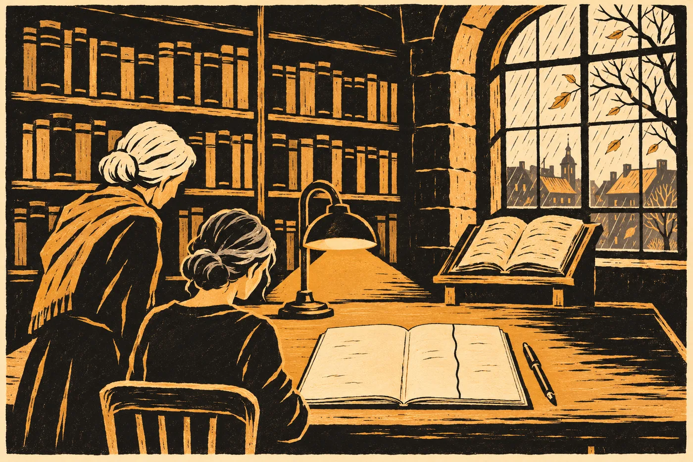

# Epilog. Tobě, kdo přijdeš

Kodex leží na stejném pultu jako před deseti lety a lampa nad ním pořád nehřeje.

Venku je konec října. Hana přijela z Brna včera večer, protože v e-mailu stálo *kodex se vrací do depozitáře, chtěla bych, abyste u toho byla*, a protože Šindelářová nikdy nepíše, že by něco chtěla. Ráno byla u pramene pod Hřbetem, jako každý pátek. Pak teprve sem.

Šindelářová má brýle zase dvoje. Jedny na nose, druhé na šňůrce. Vlasy bílé. Za deset let zestárla a Hana taky, a obě to vědí, a ani jedna to neříká.

„Tak,“ řekne Šindelářová.

Na stole leží dossier provenience. Osm listů z července a k nim devátý, nový. Šindelářová ho přečte nahlas, protože se tak dělá, když se něco uzavírá.

*Srovnání dvoustrany s podlahou hnízda v hoře nad Mlýncem, snímky Tadeáše (Ostří), 11. 9. 2035, s měřítkem. Shoda ve všech čitelných řadách. Kresba beze změny proti snímkům z let 1974, 2025 a 2035. Zvláštní režim ukončen. Kodex se vrací do depozitáře.*

Pod tím volné místo pro dva podpisy.

Šindelářová se podepíše první a podá pero Haně.

Hana se podepíše. *RNDr. Hana Vrbová, Ph.D.* Celým jménem, jako tenkrát pod opravu, kterou zveřejnila v dubnu dvacet šest. Tah je rovný. Žádný schod.

*

Kodex leží otevřený na dvoustraně.

Hana se na ni dívá. Mřížka natažená provazem, osm na pět loktů. Řady rýh. Kroužky, čtverečky, trojúhelníky. Tečky na okraji u skupiny se čtyřmi rýhami, prostřední kratší. Křížky. Sedm křížků s *a me*. A u jedné rýhy, která se v polovině dělí na dvě, slovo *sic*.

V září tu podlahu viděla na fotkách. Tadeáš je poslal všem ve dvě odpoledne a Hana je otevřela ve stejnou minutu jako ostatní. Rýhy byly hlubší, než si je kdy představovala. A ta rozdvojená tam byla. Přesně tak. Ten, kdo to kreslil, se nepřepsal.

„Ve dvou místech přesněji, než by bylo třeba,“ řekne Šindelářová. Cituje zprávu. Ví, že Hana ji zná.

„Ano.“

„Ještě něco vám chci ukázat.“

Šindelářová sáhne do šuplíku a vytáhne obálku z nekyselého papíru. Na ní tužkou: *Příloha k deponátu. Bez zařazení. Předala Sael, 16. 10. 2035. Psal Jonáš R., skoro 6 let.*

Uvnitř je papír složený na čtvrtinu. Šindelářová ho rozloží v rukavicích.

*KESI AMAR.*

*RAMA ISEK.*

Hana se na to dívá dlouho. Fixou, velkými tiskacími písmeny, dětskou rukou. Dopředu a pak obráceně, aby to šlo přečíst z obou stran.

„Nevím, kam to patří,“ řekne Šindelářová.

„Tam, kde to je,“ řekne Hana.

Šindelářová kývne. Složí papír zpátky na čtvrtinu, přesně v těch přehybech, a vloží ho do obálky. Obálku položí na krabici s knihou z hory, která stojí na vozíku vedle pultu. Půjdou do depozitáře spolu.

*

Hana vytáhne z batohu svůj starý deník.

Ne ten pravý. Originál je v Méridě, s jejím přiznáním na první stránce. Od března dvacet šest ho měla prokuratura a po skončení řízení ho vrátila ústavu do archivu. Ona má ověřenou kopii, tři svazky s razítkem ústavu. První z nich vozí s sebou, i když ho roky neotevřela.

Otevře ho na straně z dubna dvacet pět, kde je ta čára. Od horního okraje k dolnímu, bez pravítka.

Vlevo: *teplá skála – hydrotermy. Mrtvá zvířata – CO₂. Světlo – zemětřesné jevy? hypoxie? Krystal – rift.*

Vpravo: *Proč si byl jistý?*

Všechno vlevo je pořád pravda. Teplá voda je teplá voda. Oxid uhličitý zabíjí zvířata v prohlubních a zabíjel je i tehdy. Krystal je z riftu. Jen to nebylo všechno. Před deseti lety si myslela, že to umí vysvětlit. Uměla. Jen ne celé.

Světlo, stojí tam. Zemětřesné jevy, otazník. Hypoxie, otazník.

Video má od druhého března třicet. Čas z družic v záběru, devět světel, jedno slabší. Že světlo je skutečné, dokázala kamera už tehdy. Jestli k tomu, co člověk vidí očima, nepřidává něco dusno, to kamera říct nemohla. Na schodech bylo tehdy jedna celá šest procenta CO₂, u lavice skoro čtyři. Otazník zůstal.

Jednadvacátého září stála ve spodní síni u svých stativů, s detektorem pod límcem, a viděla to. Detektor ukazoval celou dobu méně než půl procenta. Na sklep dost, na přeludy nic. Žádný kahan, žádná pára, žádná únava, kterou by neznala. Viděla tmu s hvězdami a světla, která padala, pomalu, v řadě, stejně jako na videu. Devět. Jedno slabší, pozadu. Kraj shora, který nepoznala. Nízké oblé domy v rovných řadách. Světlo, které přicházelo odjinud. Třikrát. Pak se to stáhlo do jednoho bodu a odešlo nahoru skrz skálu, a starý hasič z Waldsassenu položil na kámen ruku a řekl jedno slovo.

Nepsala si nic. Celou dobu držela tablet u boku. Zapsala to až nahoře, ve dvoře, a ruka se jí přitom třásla tak, že to musela psát dvakrát.

Do kopie s razítkem se nepíše. Hana to ví a nepíše. Ten řádek z dubna dvacet pět si odnese jinam.

Zavře kopii a položí ji na kraj pultu, daleko od kodexu.

Pak vytáhne nový sešit. Modrý, školní, z trafiky na náměstí v Chebu, tam, kde si Lada v roce třicet dva koupila svůj. Hana ho koupila ráno, cestou od pramene. Prodavačka se zeptala, jestli je pro vnučku. Hana řekla, že ne.

Otevře ho na druhé straně. První nechá prázdnou.

Udělá svislou čáru. Od horního okraje k dolnímu, bez pravítka. Čára je trochu křivá, jako pokaždé, a pokaždé jinak.

*

Vlevo píše, co se za deset let doložilo. Krátce. Kdo bude chtít víc, ví, kde to najde.

*2025: Sintr z krystalu v kodexu se vysrážel z vody s hlubokým uhlíkem. Ohárecký rift.*

*2026: Válec z cenotu u X'Kanlumu. Kompozit, neznámá mikrostruktura. Izotopy pozemské: vyroben tady. Stáří kalcitu kolem něj 96–104 tisíc let; stáří předmětu ne. Moje chyba: vzorek 3. Opraveno, zveřejněno.*

*2030: Pod horou nad Mlýncem zařízení, které nikdo z nás nepostavil. Teplo, světlo, tlukot 3–2–4. Pod horou lidé, kteří ho drželi.*

*2032: Dvě příměsi (Sokolová). První nese velká část lidí. Slabě.*

*2035: Objekt na Měsíci: obal mimo přímku Země–Měsíc (3 laboratoře). Uvnitř spis. Seznam odsouzených = rejstřík těch, kdo přistáli (0 neshod ve jménech). Výrok III. Protokol z válce celý: svěřenci, ochrana; izolace, dohled nad počtem. Klíč dračí kroniky: 3 předpovědi ze 4, na kresbě i na podlaze hnízda. Genetická předpověď výpravy: příbuzní, vzdáleně. Deník stanoviště: dlaně Ostrých, tři sta let.*

*21. 9. 2035: stanoviště odstaveno. Ostrý zavřel poslední okruh rukou. Předtím se na skále ukázalo totéž, co je v kodexu: devět světel, kraj shora, domy v řadách, světlo odjinud, třikrát. Viděla jsem to sama. Svědci: Marn, Tadeáš, velitel HZS, hasič z Waldsassenu, Sael. K řádku z dubna 2025: hypoxie ne. Co to je, nevím.*

Nic tím nevysvětluje. Škrtá jedno vysvětlení, které bylo pohodlné.

*Pramen pod Hřbetem, pátek 26. 10.: 29,6 °C.*

Dívá se na to. Je toho dost na jednu stranu. Je toho málo na deset let.

Pak pravá strana.

Píše pomaleji.

*Kdo byli ti, po kterých zůstaly znaky v protokolu, a kam se poděli.*

*Kam doletěl druhý transport. Jestli vůbec.*

*Co se stalo s Ilanem.*

*Kesi Amar.*

*Kost – kde?*

*Mnich napsal devět světel. Rejstřík má osm oblastí.*

*Co je ten znak pod posledním řádkem protokolu. Dokud, nebo pokud.*

*O čem mlčel. Tacui.*

A pak, na samostatný řádek, opíše tu otázku ze starého deníku. Slovo od slova.

*Proč si byl jistý?*

Za ni napíše do závorky rok. *(2025)*

Dívá se na pravou stranu. Je delší než levá. Vpravo je víc místa, vždycky bývá. Tohle si pomyslela v Mexiku, v noci nad zápisem, pod kterým vpravo nenapsala nic, a tehdy to byla výčitka.

Teď ne.

*

Šindelářová stojí za ní. Hana ji necítí, ale ví to. Za deset let se naučila, kde Šindelářová stojí, když nic neříká.

„Ještě první strana,“ řekne Šindelářová.

„Ano.“

Hana otočí list zpátky. Prázdná stránka. Nahoře, kde v letošním sešitě stál od června odpočet a pak jen data, není nic.

Dlouho drží pero nad papírem.

Ví, co tam napíše. Věděla to ve vlaku a věděla to v srpnu na chodbě fakulty, když četla celé znění v devět ráno. Možná to věděla už tenkrát v dubnu, když poprvé četla překlad u tohohle pultu, v rukavicích, ačkoli držela jen papír. Jen to nechtěla napsat, dokud to nebude pravda.

Píše.

*Tobě, kdo přijdeš po mně a budeš to číst.*

*Vlevo je, co jsem viděla. Vpravo, co jsem si myslela, a co nevím. Nepleť to dohromady.*

*Co vpravo zůstalo, je tvoje.*

Pod to nic. Ani jméno.

Šindelářová se dívá přes její rameno. Dlouho.

„To je topos,“ řekne pak.

„Já vím,“ řekne Hana.

Šindelářová se usměje. Sundá si brýle z nosu a nechá je viset vedle těch druhých, na šňůrce, a chvíli se nedívá na nic.

*

Kodex odnáší do depozitáře Šindelářová sama. Na vozíku, s krabicí z hory a s obálkou navrchu. Hana jde s ní až ke dveřím. Dál nesmí.

Za dveřmi jsou regály až ke stropu a ticho, jaké mají jen archivy a kostely. Šindelářová zajede s vozíkem mezi ně a zmizí za rohem. Hana slyší kolečka. Pak už nic.

Dveře se zavřou samy, pomalu, na pružinu.

Hana se vrátí ke stolu ve studovně. Sešit leží otevřený na první straně, kde inkoust ještě neuschl. Nedotkne se ho. Sedne si na židli vedle a čeká. Za oknem je Cheb v říjnu, šedý a mokrý, a na náměstí stojí stánky s dýněmi a jablky.

Hana se dívá na první stranu. Na tu větu. Ve studovně je osmnáct stupňů a lampa nehřeje, a inkoust schne pomalu.

Počká, až uschne.

Pak sešit zavře.
