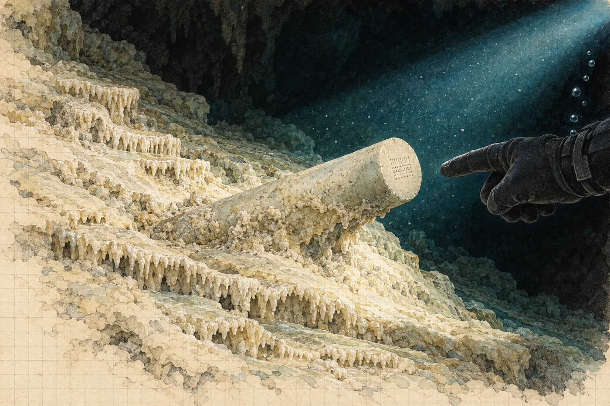

# Prolog. Studna

V lednu zamrzá byt odspodu. Nejdřív práh balkonových dveří, pak spára pod oknem, pak sklo v rozích, kde se mráz drží jako plíseň. Radiátor tiká a nehřeje. Hana sedí u kuchyňského stolu ve svetru a ve dvojích ponožkách a píše posudek na archeologický dohled u obchvatu Ivančic. Tři sondy, dvě negativní, jedna s keramikou, kterou stavebník nechal zavézt dřív, než přijel archeolog. Píše to slušně. Ví, že to nikdo nebude číst.

Od září má na fakultě poloviční úvazek na dva roky. Poloviční úvazek znamená celou výuku, polovinu výplaty a posudky, které docent Fiala rozděluje na poradách se slovy *to je přece vaše parketa*. Grant v prosinci zase neprošel. Tentokrát s hodnocením *velmi dobrý*, což je v jazyce grantových agentur nejzdvořilejší způsob, jak říct ne.

Telefon na stole zabzučí ve čtvrt na deset.

Viktor. Žádný text, jen soubor. Video, čtyřicet vteřin.

Hned za ním zpráva: *Pusť si to se zvukem. A sedni si.*

Hana si nesedne, protože už sedí. Pustí si to.

*

Nejdřív jen dech. Automat, nádech, dlouhý výdech a bublinky, které cvakají kolem mikrofonu jako drobné kamínky v plechovce. Tma. Pak světlo baterky, úzký kužel, a v něm bílá.

Sintr. Pozná to dřív, než si to stihne pojmenovat. Sintrová poleva, krémová, zvlněná do teras, jako by se po svahu kdysi rozlilo mléko a ztuhlo v pohybu. Na okrajích teras drobné zuby krystalů. Voda je tak čirá, že ji nevidí. Vidí jen, že se světlo nikde neodráží, že padá do prázdna a končí, až když narazí na kámen.

Kužel se posune doleva a zastaví se.

Z polevy vystupuje něco bledého. Válec, dlouhý asi jako předloktí, možná víc, zapuštěný šikmo do sintru jako kost do hlíny v profilu. Je hladký. Hana nevidí žádný šev, žádnou spáru, nic, kde by se dvě části potkaly. Barvu na displeji telefonu nepozná: šedobílá, pod světlem trochu do zelena, ale to může být čip kamery.

Ruka v rukavici vjede do záběru a ukáže na konec válce. Kužel se tam přesune. Kamera zaostří, rozostří a zase zaostří.

Na čele válce jsou značky. Ryté, drobné, z rovných čar a teček, sestavené do pole, které vypadá jako mřížka. Tři vteřiny ostré. Pak se záběr zachvěje, někdo vydechne, bublinky zacvakají, světlo uhne a video skončí.

Hana se dívá na černý displej.

Pak si ho pustí znovu.

*

Napočtvrté ho zastaví ve třicáté první vteřině, kde je obraz nejostřejší, a zvětší ho prsty, až se rozpadne na čtverečky.

Žádné měřítko. Samozřejmě.

Válec tedy může mít čtyřicet centimetrů, nebo devadesát. Značky můžou být hluboké milimetr, nebo deset. Ale jedna věc se zvětšením nezmění a ta je na tom videu nejdůležitější, víc než značky. Válec neleží na sintru. Leží v něm. Poleva k němu dotekla, obtekla ho zespodu a z boku a na horní straně se ztenčila do povlaku, přes který jeho povrch prosvítá. Ten předmět tam ležel dřív, než ho voda začala obrůstat kamenem.

A ta voda nebyla ta, ve které se na videu vznáší Viktor. Sintr se pod vodou netvoří. Roste na vzduchu, z kapek a stružek, které stékají po skále do suché jeskyně. Když je dnes všude kolem voda, znamená to, že jeskyně bývala suchá a zatopila se později. A předmět v ní ležel už předtím.

Jak dlouho předtím, to z videa nikdo nepozná. Jak dlouho je ta jeskyně pod vodou, to by se dalo zjistit. Na to je datování uranem a thoriem.

Hana položí telefon na posudek, displejem dolů, jako by ho chtěla zakrýt.

Telefon za minutu zabzučí znovu. Tentokrát volá.

*

„Tak co?“ řekne Viktor. Bez pozdravu, jako vždycky, když je nadšený. V pozadí je slyšet vítr a nějaký pták, který neumí mlčet. U něj je den.

„Kde to je?“

„Yucatán. Vnitrozemí, dvě hodiny od Méridy. Cenote na pozemku jedné obce, nikdo tam nejezdí, žádní turisti. Boční síň pod haloklinou, třicet metrů, za zúžením, kterým by ses protáhla tak akorát.“ Odmlčí se. „Luis ji našel. Místní kluk, teda chlap, je mu třicet tři. Nejlepší jeskyňář, jakého jsem kdy viděl ve vodě, a to jsem viděl lidi v Hranicích.“

„Co to je, Viktore?“

„To se ptám já tebe.“

„Je to v sintrové polevě,“ řekne. „Zarostlé zespodu. Leželo to tam, když byla jeskyně suchá.“

„Já to věděl.“ Slyší, jak se usmívá. Patnáct let ten úsměv slyší v telefonu. Poprvé v Moravském krasu, kdy jí v Býčí skále podal ruku z vody a řekl *vy jste ta geoložka, co nám řekne, kudy dál*, a ona mu řekla, že tudy ne, a měla pravdu. Pak Hranická propast, tři sezony, jeho kamery, její vzorky a jeho dokument, ve kterém ji nazval *naše paní Země* a ona se tři dny nemohla podívat do zrcadla. „Proto volám. Potřebuju geoarcheoložku.“

„Máš tam INAH.“

„Mám povolení od INAH. Na dokumentaci. Natočit, změřit, nafotit, vzít pár gramů sintru na datování, a nic víc. Nic se nevyzvedává. Paní z INAH je na to jako pes, a dobře dělá.“ Nadechne se. „Proto potřebuju tebe. Někoho, kdo umí kámen a kdo nebude chtít nic vytahovat.“

„Kdo to platí?“

„Sponzor. Americká produkce, dokumenty pro jednu velkou platformu. Mají rádi záhady a ještě radši mají rádi, když je záhada pořádně podložená. Zaplatí laboratoř na uran-thorium. Rychlou. A CT, kdyby bylo potřeba.“ Krátká pauza. „A zaplatí tebe. Normálně, Hanko. Ne za kafe a ne za jméno v titulcích. Šest týdnů, odlet na začátku března.“

Hana neřekne nic. Na stole leží posudek z Ivančic a pod ním obálka od pronajímatele s novou zálohou na topení, kterou ještě neotevřela, protože ví, co v ní je.

„Hranice,“ řekne Viktor. Už se neusmívá, jen mluví tiše. „Pamatuješ, co jsi mi tam řekla? Ten první rok, když jsme se pohádali kvůli té zprávě pro kraj?“

„Že ti nebudu psát, co chceš slyšet.“

„Že mi řekneš, že je to kámen, když je to kámen.“

„A když to kámen nebude?“

„Tak mi řekneš i tohle.“ Vítr v pozadí zesílí a zase utichne. „Tentokrát to bude jinak, Hanko. Tentokrát to někdo zaplatí.“

„Zítra,“ řekne Hana.

„Zítra,“ řekne Viktor, jako by to bylo ano.

*

Složka *Mlýnec* stojí na poličce nad lednicí mezi kuchařkou, kterou nikdy neotevřela, a krabicí s náhradními žárovkami. Je to papírová složka, modrá, s gumičkou. Založila si ji v srpnu podle té v počítači, protože do papíru se dá psát tužkou a papír se dá položit vedle čehokoli jiného.

Uvnitř je její posudek ke krystalu, doplněk z dubna, vytištěný regest jáchymovského spisu. A pracovní překlad kodexu, který jí Šindelářová nakonec v létě poslala poštou. Kancelářská sponka a lístek, napsaný rukou: *Nic necitujte. Ani mně.*

Na posledním listu výtisku je černobílý náhled, jaký archiv přikládá k objednávkám reprodukcí. Malý, zrnitý, sotva větší než pohlednice. Poslední list kodexu. Text, pod ním kresba úlomku kosti a na úlomku značka. Rovné čáry a tečky v pravidelné mřížce. Pod tím věta, kterou Hana zná nazpaměť, i když latinu čte špatně.

*Hoc signum non est naturae.*

Položí telefon vedle náhledu. Zastavené video, třicátá první vteřina.

Dívá se dlouho.

Rovné čáry. Tečky. Pole, které má řádky. Na kosti jsou čáry svislé a tečky mezi nimi, na válci jsou čáry, tečky a ještě něco, co může být kratší čára, nebo stín. Náhled je moc malý, aby spočítala tečky. Video je moc rozmazané, aby spočítala cokoli.

Podobnost je zarážející.

A nic nedokazuje. Hana to ví tak přesně, že se jí z toho skoro uleví. Rovná čára a tečka jsou nejjednodušší znamení, jaká lidská ruka udělá. Najdou se na kostech z mladého paleolitu, na kalendářních hůlkách, na hrncích, na dveřích stodol a na kamenech, které nikdo neryl, protože je tak poškrábal led. Člověk, který chce vidět podobnost, ji vidí. Na to je celý obor plný knih. Stojí v antikvariátech v oddělení, kam ona nechodí.

Šindelářová tehdy řekla: *Asi viděl na relikvii rytinu.* A mnich, který ke všemu v knize připsal, jestli to viděl, nebo neviděl, k té kosti nepřipsal nic. Napsal tu větu, jako se píše, kolik je dva a dva.

Hana zavře složku. Pak ji zase otevře, protože náhled chce mít před sebou, až bude psát.

*

Terénní deník leží na stole od srpna, kde ho nechala. Obal má ohlazený a jeden roh rozmočený od hrnku. Otevře ho na čisté dvoustraně a vede svislou čáru shora dolů, pravítkem, protože tahle čára má být rovná.

Vlevo píše, co vidí.

*15. 1. 2026. Video V. B., 40 s, cenote, Yucatán, boční síň, hl. ~30 m (podle V. B.). Předmět válcovitý, bledý, bez viditelného švu, zapuštěný do sintrové polevy; poleva ho obrůstá zespodu a z boku. Na čele pole rytých značek: rovné čáry, tečky. Bez měřítka. Rozlišení nedostatečné.*

Pak, pod to, menším písmem, protože i tohle je pozorování:

*Sintr = vznik na vzduchu. Síň byla suchá, když tam předmět už ležel.*

Vpravo dlouho nic.

Venku přejede tramvaj a sklo v okně se jemně zachvěje. Hana se podívá na náhled, na telefon a zase na náhled.

Pak napíše doprava:

*Tatáž mřížka jako kost z Mlýnce?*

Podívá se na otazník. Nechá ho tam.

*

Viktorovi napíše ve tři čtvrtě na jedenáct. Jedno slovo.

*Ano.*

Telefon nechá ležet a vrátí se k posudku z Ivančic, protože ten musí být v pátek u Fialy a protože jí to pomáhá myslet na sondy, ve kterých nic není. Napíše dva odstavce. Pak vezme telefon znovu a připíše druhou zprávu.

*A příště dej do záběru měřítko.*

Odpověď přijde hned, jako by Viktor držel telefon v ruce a čekal.

*Proto tě beru.*

Hana zhasne v kuchyni a chvíli stojí ve tmě. Mráz na skle je proti pouliční lampě vidět jako jemná mapa, plná řek, které nikam netečou. Myslí na tu bílou polevu a na to, že pod ní je ještě jedna vrstva a pod tou další a že každá z nich někdy byla povrchem, po kterém tekla voda.

Myslí taky na obálku od pronajímatele. Neotevře ji ani teď.
