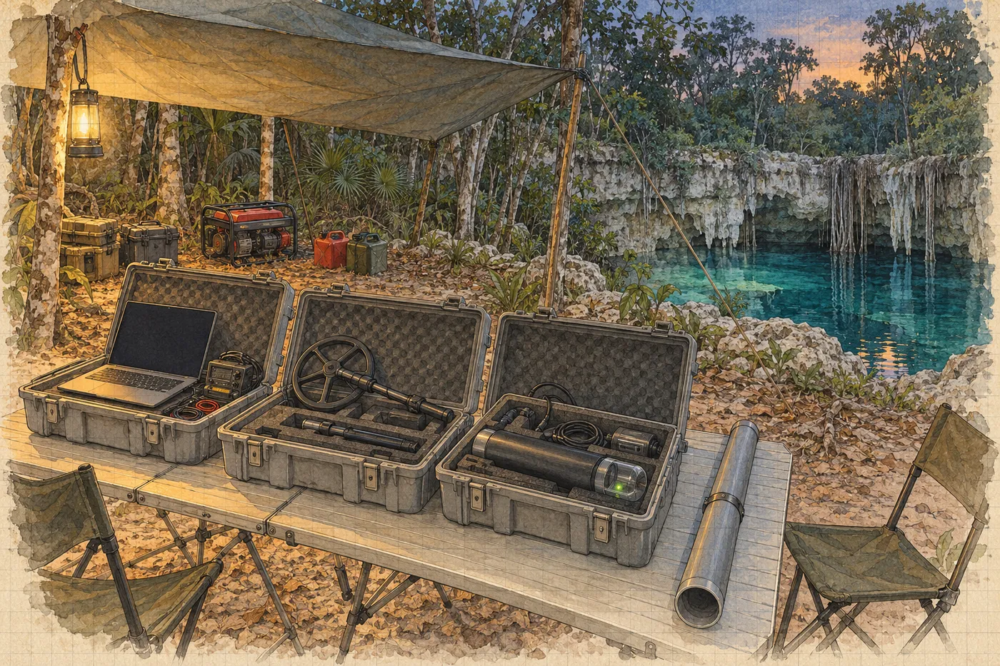

# 4. Kalina

Soupis vzorků podepisuje na kapotě Salcedovy dodávky, protože jinde v táboře není rovná plocha, na které by nestálo něco mokrého.

Je sobota, půl osmé ráno. Kapota je už teplá. Salcedo drží krabici s vystlanými přihrádkami, ve kterých leží tři sáčky, každý v dalším sáčku, každý s číslem. Formulář má dvě strany. Na první jsou kolonky: číslo vzorku, popis, místo odběru, hmotnost, datum. Hana je vyplnila večer, přepsala je z deníku. Zkráceně, ale se stejným tvrzením.

*Vzorek 3: kontaktní kůra, spodní lem u horního čela předmětu. 2 fragmenty jednoho odběru.*

Podepíše se. Podruhé za dva dny pod touž větu. Slunce svítí na papír tak ostře, že vlastní podpis vidí jako modrou čáru, která se rozpíjí do bílé.

„Laboratoř je zaplacená,“ řekne Salcedo. Zasune formulář do desek a desky pod paži. „Papíry k vývozu vzorků vyřídím v Méridě. V úterý odletí kurýrem. Nebojte se, *doctora*. Takové věci dělám deset let.“

„Nebojím se,“ řekne Hana.

Salcedo se usměje, jako by věděl, že to není pravda, a že to nevadí. Pak nasedne a odjede, a za dodávkou se zvedne bílý prach a dlouho visí ve vzduchu nad cestou.

*

Kalina přijede ve čtyři odpoledne. Sám, v malém bílém autě z půjčovny, o hodinu později, než měl, protože navigace ho poslala na cestu, která končila v lese u kozí ohrady.

„Zeptal jsem se,“ řekne místo pozdravu, když vystoupí. „Pastevec mi poradil. Dobře. Jen mi to trvalo, než jsem pochopil, že mi radí doleva, a ne že mi ukazuje kozu.“

Je vysoký a hubený, s bledou kůží, kterou si zjevně celou cestu chránil. Dlouhé rukávy, plátěný klobouk se širokou krempou, na ušních boltcích bílé šmouhy krému, který se nevstřebal. Brýle se mu při vystoupení z klimatizovaného auta zamlží. Sundá je, otře o košili a nasadí je zpátky, a celou tu dobu se dívá na zem, jako by tam hledal něco, co upustil.

„Doktor Kalina,“ řekne Viktor a podá mu ruku. „Náš zaklínač.“

„Kalina.“ Kalina ruku stiskne a hned ji pustí. „Rušení se nezaklíná. Měří se.“

Hana ho pozná, až když promluví. Před šesti nebo sedmi lety, v Moravském krasu, na jedné akci jeskyňářů, kteří hledali pokračování chodby pod lesem a potřebovali vědět, kde přesně kopat. Přijel tehdy s anténou na střeše auta, na chatě u stolu, kde se pilo, celý večer nepromluvil a pak celou noc chodil s cívkou po lese. Jeskyňáři mu říkali Tichý. Ráno jim na mapu nakreslil křížek a vedle něj číslo s chybou. Kopali tam. Chodba tam byla.

„My se známe,“ řekne Hana. „Holštejn. Před lety.“

Kalina se na ni podívá. Poprvé zvedne oči výš než k jejím ramenům.

„Vrbová,“ řekne. „Geoložka. Vy jste jim tehdy řekla, že pod tím svahem bude hlína, a ne chodba.“

„Měla jsem pravdu?“

„Napůl. Byla tam hlína. A pod ní chodba.“ Odmlčí se. „Měla jste pravdu, jen to nebyla celá pravda. To se stává.“

Pak se otočí ke kufru auta a začne vykládat bedny. Tři plastové, šedé, s kovovými přezkami. A dlouhý tubus z novodurové trubky, zalepený na obou koncích lepicí páskou, na které stojí fixou *NEOTVÍRAT VE VĚTRU*.

*

Problém je jednoduchý, nebo aspoň Viktor si myslí, že je jednoduchý.

Expedice má radiolokační maják. Koupil ho Viktor v zimě od firmy, která je dodává záchranným týmům a jeskyňářům. Maják je cívka v pouzdře. Potápěč ho položí v jeskyni na dno, vodorovně, a maják začne vysílat nízkofrekvenční magnetické pole. Pole projde skálou, vodou, hlínou, vším. Nahoře nad tím chodí člověk s přijímací cívkou a hledá místo, kde pole míří kolmo vzhůru. To místo je přímo nad majákem. Z tvaru pole kolem něj se pak dá spočítat hloubka. Tak se v jeskyních zjišťuje, kde přesně pod povrchem jsou. Tak se vrtá k uvězněným.

Expedice má taky jeskynní spojení, dvě krabičky, které si posílají krátké textové zprávy skrz skálu na stejném principu. Jedna je na povrchu, druhá na skalní římse v horní suché chodbě nad cenotem, kde Luis drží zásobní láhve. Pojišťovna to chtěla. Civilní ochrana taky.

Ani jedno nefunguje. Maják ve zkoušce na povrchu, padesát metrů od přijímače, zní ve sluchátkách jako rádio mezi stanicemi. Krabičky si pošlou zprávu, a pak hodinu nic.

„Potřebuju jen, aby to pípalo,“ řekne Viktor.

„Ono to pípá,“ řekne Kalina. „Jen to pípá do něčeho, co pípá hlasitěji.“

Otevře první bednu. Notebook, přijímač, malá skládací cívka na tyči. Druhá bedna: další cívka, větší, a černé pouzdro z plastové trubky, tlusté jako stehno, s průhledným víčkem, pod kterým bliká dioda. Třetí bedna: kabely, nářadí, baterie, stará krabička od bonbonů s pojistkami.

„Ten maják jsem si postavil s kolegou,“ řekne Kalina, když vidí, že se Hana dívá na černé pouzdro. „Na Holštejn. Krabicím, do kterých nevidím, nevěřím.“

Zapojí přijímač, rozloží cívku a pošle Ríšu s koupeným majákem na druhý konec mýtiny. Pak se posadí k notebooku pod plachtou a nějakou dobu jen kouká.

Hana si sedne vedle něj. Nikdo ji nepozval. Kalina ji nevyhodí.

Na obrazovce je obraz, který zná z přednášek o seismice. Vodorovně frekvence, svisle čas, a barvy, které ukazují sílu. Čas teče shora dolů, jako by obrazovku polévala voda. Většina plochy je modrá, zrnitá. Ale přes celou výšku, odshora dolů, vedou svislé žluté čáry. Rovné, ostré, stejně daleko od sebe. Desítky. Jako zuby hřebenu.

„Šedesát hertzů,“ řekne Kalina. „Síť. A její násobky. Sto dvacet, sto osmdesát, dvě stě čtyřicet a dál, až nahoru. Tady je síť na šedesáti, ne na padesáti jako u nás. Harmonické leží jinde.“ Ukáže prstem, aniž by se dotkl displeje, na jednu z čar vpravo. Je silnější než ostatní. „A tady sedí váš maják. Ten koupený. Tři tisíce čtyři sta sedmdesát pět hertzů. Osmapadesátá harmonická šedesáti je tři tisíce čtyři sta osmdesát. Pět hertzů vedle. V Evropě by seděl přesně mezi dvěma zuby. Tady sedí na jednom.“

„Odkud ta síť?“

„To zjistím.“ Kalina přepne na jiné okno. Široký šedý pás, rozmazaný, přes polovinu obrazovky. „A tohle je váš generátor. Střídač, levný. Dělá šum přes celé pásmo, jako když někdo hází písek na plech.“

Hana se dívá na obrazovku. Na zuby hřebenu, na šedý pás, na zrnitou modrou mezi nimi.

„Jsou to vrstvy,“ řekne. Napůl sama pro sebe.

Kalina se na ni podívá.

„Myslím,“ řekne Hana, „že je to jako profil. Musíte nejdřív poznat všechno, co tam je, abyste viděl, co tam být nemá.“

„Musím nejdřív vědět, co všechno to *není*,“ řekne Kalina. Řekne to pomalu, jako by to slovo zkoušel. „Teprve pak se můžu ptát, co to je.“

„To je celá moje práce.“

„To je celá práce kohokoli, kdo měří.“ Kalina se zase podívá na obrazovku. „Jen to většina lidí dělá obráceně.“

*

Večer přeladí svůj maják.

Sedí u stolu pod žárovkou, kolem které krouží můry, s notebookem připojeným kabelem k černému pouzdru, a píše do terminálu čísla. Hana sedí naproti a přepisuje si do deníku odpolední odstřel. Patnáct dvanáct, slabý, zákal jen u kuželu.

„Tři tisíce pět set deset,“ řekne Kalina, aniž by vzhlédl. „Mezi osmapadesátou a devětapadesátou. Třicet hertzů od obou. To stačí.“

Pak píše dál.

„Co teď nastavujete?“

„Kdy bude vysílat.“ Kalina otočí notebook, aby viděla, i když Hana na obrazovce vidí jen řádky. „Ve dne to tu nemá smysl. Ve dne běží v lomu drtiče a vedení k lomu je jeden velký vysílač na šedesáti hertzích. Ale v noci lom stojí. Zůstane jen trafo a to je slabé. A generátor se o půlnoci vypíná. Takže budu měřit v noci.“

„A maják bude dole sám.“

„Maják bude dole sám. Deset minut každou celou hodinu. Pak padesát minut ticho, aby šetřil baterii. Kdykoli se v noci rozhodnu měřit, počkám na celou hodinu a on se ozve.“ Kalina zapíše poslední řádek a stiskne klávesu. Dioda pod víčkem pouzdra blikne dvakrát rychle a pak zhasne. „Na tenhle režim vydrží baterie zhruba měsíc.“

Viktor stojí za ním s pivem a dívá se mu přes rameno. Hana si ho nevšimla přijít.

„Jak dlouho to tam bude pípat?“ zeptá se Viktor.

„Dokud to někdo nevyndá, nebo dokud nedojde baterie. Měsíc. Řekněme do desátého dubna.“

„A kdo to uslyší?“

Kalina se otočí a podívá se na něj zdola, přes okraj brýlí.

„Kdo má přijímač, ví, na jakém kmitočtu poslouchat, a stojí nad tím místem do pár set metrů.“ Krátká pauza. „Takže já.“

Viktor se zasměje a poklepe mu na rameno. „Dobře. Tak to je náš soukromý rozhlas.“ A odejde k ohni, kde Ríša pouští Rose a dětem na telefonu záběry z prvního ponoru.

Kalina se za ním chvíli dívá. Pak sklopí oči k notebooku.

„Proč ho to zajímá?“ řekne. Ne Haně. Spíš sám sobě.

Hana neodpoví. Neví. Neřekne mu, že ji nenapadlo se zeptat.

*

V neděli ráno jde Kalina po vedení.

Hana jde s ním. Řekne si, že kvůli lomu, protože ho chce vidět zblízka, a je to pravda. Kalina nese malou cívku na tyči a přijímač na popruhu přes rameno a každých sto metrů se zastaví, poslouchá ve sluchátkách a píše si do sešitu. Sešit je obyčejný, linkovaný, v kroužkové vazbě. Píše tužkou.

Vedení začíná u obce, kde odbočuje z hlavní linky, a vede podél silnice na Méridu, na betonových sloupech, až k lomu. Mezi tím z něj nic nevede, jen jedna přípojka k čerpací stanici na vodu, malé budce z tvárnic s nádrží na střeše.

„Takže tohle vedení živí lom,“ řekne Hana.

„Tohle vedení je lom.“ Kalina sundá sluchátka. „Když se drtí, teče do lomu velký proud a ten proud není čistý. Drtiče, motory, regulátory. Každý přidá vlastní zub. Vedení je dva kilometry dlouhá anténa. Vysílá to všechno do krajiny.“

„A pod zem?“

„Pod zem taky. Nízké frekvence jdou do země dobře. Proto je používáme na majáky.“ Nasadí si sluchátka zpátky. „To je ta nepříjemná symetrie.“

U lomu se zastaví u plotu z vlnitého plechu. Pod jeho spodní hranou je vyhrabaná díra, od zvířete nebo od člověka. Hana se dívá dovnitř.

Bílá díra je zblízka větší, než vypadala ze silnice. Stupně, každý vysoký tak pět metrů, vylámané do vápence jako schodiště pro obry. Na nejvyšším stupni stojí vrtná souprava, malá, na pásech, a dva muži v helmách vrtají do skály řadu otvorů. Jeden vedle druhého, v pravidelných rozestupech, jako stehy.

„Vývrty na nálože,“ řekne Hana. „Na zítra. Nebo na úterý.“

Kalina se na soupravu podívá a nic neřekne.

Hana se dívá na stěnu pod ní. Vápenec. Stejný jako ve stěnách studny, jen tady je to čerstvý lom, bílý, ostrý, a v něm je vidět, jak hornina vypadá uvnitř. Vrstvy, téměř vodorovné. A přes ně, šikmo, pukliny. A v puklinách dutiny. Malé jako pěst, velké jako hlava, zarostlé krystaly. A jedna, ve čtvrtém stupni, velká jako dveře, černá, jejíž konec není vidět.

„Jak se šíří otřes v krasu?“ zeptá se Kalina. Pořád se dívá na soupravu.

„Nevím.“

Otočí se k ní.

„Nikdo to neví přesně,“ řekne Hana. „Závisí to na puklinách, na dutinách, na vodě. Vlna se láme na každém rozhraní. Někde se utlumí, někde se zesílí. Dalo by se to měřit. Seismometry kolem lomu a v jeskyni, a pak porovnávat. Nikdo to tady nedělá.“

„Proto si zapisujete odstřely.“

„Proto si zapisuju odstřely.“

Kalina kývne. Jednou, krátce.

„To je dobrý důvod,“ řekne.

Cestou zpátky mlčí. U čerpací stanice se pak zastaví a podívá se na ni.

„Viktor říkal, že už máte vzorky.“

Hana cítí, jak se jí něco stáhne pod žebry. Malý pohyb, jako když člověku na schodech ujede noha a on ji hned zase najde.

„Mám.“

„Máte kontrolní vzorek? Mimo předmět?“

„Mám.“

„Dobře,“ řekne Kalina. A jde dál.

Nic víc. Hana jde za ním po silnici, ve vedru, a myslí na to, že to byla ta správná otázka. Ta, kterou by položila sama. A že na ni odpověděla pravdivě.

*

V pondělí v sedm ráno napíše týdenní zprávu.

Píše ji anglicky, protože Marisol píše anglicky, a píše ji pomalu. Odstavec o prvním ponoru. Odstavec o odstřelech, s časy, se zákalem, se závalem za téčkem. A pak odstavec, který si slíbila.

*Odchylka od schválené metodiky: dne 6. 3. byly odebrány tři vzorky sintru (místa 1–3, viz příloha) před provedením fotogrammetrie síně. Důvody: riziko dalšího zřícení po odstřelu 5. 3. (zával v hlavní chodbě), časová omezení financování. Odběry byly zdokumentovány videozáznamem (V. Brabec) a fotografiemi s měřítkem před odběrem a po něm (H. Vrbová). Fotogrammetrie síně bude provedena před jakýmkoli dalším zásahem. Za odchylku odpovídám.*

Přečte si to. Je to pravda, každé slovo. Je to celá pravda o pořadí.

Foto po odběru u vzorku tři nemá. Napsala *před odběrem a po něm*, jako by to platilo pro všechny tři.

Chvíli se na tu větu dívá. Pak za ni připíše do závorky: *(u místa 3 pouze před odběrem; po odběru nebylo z důvodu plynu možné)*. Je to tak malá věc. Je to tak snadné. A pak se na ni podívá a nechápe, proč tohle opravit dokáže a tamto ne.

Odešle to v sedm čtyřicet.

*

Do síně jde s Janou a s Luisem.

Kalina jim maják předá na plošině s takovou péčí, jako by podával dítě. Černé pouzdro na třech krátkých nožičkách, s vodováhou na víčku, a kolem něj kruhová cívka, tenká, plochá, v průměru asi jako talíř na pizzu, zalitá do pryskyřice.

„Vodorovně,“ řekne. „Bublina uprostřed. Když bude cívka nakloněná, pole se nakloní s ní a já budu hledat bod nad majákem o pár metrů vedle. A ne blíž než půl metru od předmětu. Chci znát polohu předmětu, ne polohu majáku, který leží na předmětu.“ Podívá se na Hanu. „A změřte, kde přesně leží vůči němu. Pásmem. Vzdálenost a směr.“

„Zaměřím.“

„V jedenáct se zapne poprvé. Deset minut. Dioda bude blikat zeleně. Když nebude blikat, nevyndávejte ho, jen mi to řekněte.“

*

Viditelnost v hlavní chodbě je lepší. Dvanáct metrů, možná patnáct. Za blokem u téčka se Hana podívá nahoru, na jizvu ve stropě. Je pořád světlá. Pukliny kolem ní taky. Nic nového. Nebo nic, co by poznala.

Hrdlo. Haloklina. Mlha. Tma bez hrany.

V síni Luis tentokrát nezůstane u Abuela. Dva v sale, třetí u vchodu, a u vchodu zůstane Jana. Luis vede Hanu sedm kopů doleva, pod převis, a pak ještě kus dál, k místu, které Hana ve středu neviděla, protože se dívala jen na válec.

Krápník. Pahýl, zlomený kdysi v polovině, s plochým vrškem, metr od převisu. Na jeho patě je přivázaná destička. *LE 14*. Luisův měřicí bod. Odsud vede jeho měření síně, odsud se vztahuje všechno, co ví o tom, kde co leží. Vedle pahýlu je terasa, plochá, téměř vodorovná, hladká jako stůl.

Hana položí maják na terasu. Nohy pouzdra se zaboří do tenkého povlaku, jen o milimetr. Bublina ve vodováze uteče doprava. Hana podloží jednu nohu kouskem olova ze své kapsy. Bublina se vrátí. Skoro do středu. Podloží ji ještě o chlup. Střed.

Pak vytáhne pásmo a Luis podrží jeho konec u středu cívky a Hana ho vede k čelu válce. Osmdesát sedm centimetrů. Kompas. Směr. Zapíše to na tabulku, dvakrát, a Luis si to přečte a kývne.

Ví, že maják na terase je zásah do síně dřív, než ji Ríša nafotí. Jinak to nejde: Kalina musí měřit teď, v noci, dokud lom mlčí, a fotogrammetrie je odložená. Do modelu ho potom zapíše jako cizí předmět, ne jako součást nálezu, a do příští zprávy pro Marisol taky.

Teď teprve se podívá na válec.

Na lemu u horního čela je jizva. Malá, bílá, ostrá, tam, kde v pátek tlouklo dláto. Druhá jizva, menší, na boku. Na svahu nad válcem třetí, u vzorku jedna. Pod vodou bez života se nic nezahojí. Ty jizvy tu budou bílé, dokud sem nepřijde někdo s větším dlátem, nebo dokud voda zase neopadne a ze stropu nezačne kapat. Tedy navždy, co se lidského času týče.

Podívá se do žlábku.

Úlomky leží, kde ležely. Krémové a o něco tmavší. Vpravo, tam, kde v pátek ležel ten druhý kousek, o kterém se nerozhodla, leží kousek s lomem. Hana na něj posvítí. Lom je bílý. Ostrý.

Čerstvý?

Neví. Ví jen, že teď, v klidu, bez Viktorova manometru za zády, ten pravý kousek vypadá stejně čerstvě jako ten, který vzala.

Natáhne ruku. Zastaví se.

Třetí podmínka. Na válec ani na nic kolem se nikdo nesáhne, dokud Ríša neudělá model. Sama si ji vymohla. Sama ji vyslovila u stolu, s Viktorovou teplou suchou dlaní v ruce.

Stáhne ruku zpátky.

Luis vedle ní visí ve vodě a dívá se na ni. Možná neví, na co se dívá ona. Možná ví. Pod maskou to nepozná.

*

V jedenáct nula nula se dioda pod víčkem rozbliká.

Zeleně, pomalu, jednou za vteřinu. Hana se na ni dívá a počítá bliknutí. Jedno. Dvě. Pět. Deset. Luis vedle ní zvedne palec a ukazovák do kroužku.

Na bílé polevě teď stojí dvě věci, které tam nepatří. Jedna z nich je jejich. Černá, s blikajícím zeleným světýlkem, s cívkou jako talíř a s kouskem olova pod jednou nohou. Vedle ní, osmdesát sedm centimetrů daleko, ta druhá. Bledá, hladká, bez švu. Nehýbe se a nebliká a nic nedělá. Nikdy nic nedělala, napadne ji, aspoň ne za ten čas, co ji obrůstal kámen.

Jana u vchodu ťukne na manometr.

*

Nahoře na povrchu Kalina maják zachytí, ale jen slabě. Vzduch je plný šedesáti hertzů z lomu. Ve sluchátkách se tón objevuje a mizí, jako když člověk poslouchá hlas v sousední místnosti, kde hraje rádio. Najde směr. Najde přibližně oblast, v lese, čtyři sta metrů od cenotu severovýchodním směrem. Víc ne.

„V noci,“ řekne, když se Hana vynoří z dekomprese. Klečí na plošině s přijímačem v klíně a se sluchátky kolem krku. „Ve dne to tady nemá smysl. Tma, ticho, a pak to bude.“

Jana si sundá masku a podívá se na Hanu.

„Kde je Ríšův model?“ zeptá se. Tiše, aby to neslyšel nikdo jiný. „Viděla jsem jizvy. Říkal Viktor, že se vzorkovalo podle tvé metodiky.“

„Modelu není,“ řekne Hana. „Vzorkovali jsme bez něj. Dneska ráno jsem to napsala INAH.“

Jana se na ni ještě chvíli dívá.

„Aha,“ řekne.

Nic víc. Začne si sundávat láhve.

*

Marisol odpoví v pět odpoledne. Tři řádky.

*Beru na vědomí. Fotogrammetrii proveďte před jakýmkoli dalším zásahem, jak píšete. Příště mi zavolejte předem, ne potom. M. C.*

Hana si to přečte dvakrát. *Ne potom.* Pak zavře telefon a jde pomoct Kalinovi nabíjet baterie do čelovek.

*

Generátor zhasne o půlnoci a tábor se ponoří do ticha, které není ticho. Cvrčci. Žába, která cvrká jako cvrček. Pták, který se ptá čtyřikrát. Kompresor stojí, Viktor slíbil, že ho do rána nikdo nezapne. Lom stojí. Trafo u obce je odsud kilometr.

Ve tři čtvrtě na jednu vyjdou do lesa.

Kalina nese cívku na tyči. Hana nese GPS, sešit a dvě čelovky, jednu na hlavě, jednu v kapse. Jdou po pěšině, kterou ve dne vysekali pomocníci z obce, a pak bez pěšiny, mezi stromy, kde kmeny ve světle čelovek vypadají jako sloupy v síni a liány visí jako šňůry, které někdo zapomněl napnout. Pod nohama šustí listí. Na kraji lesa začíná spálená milpa. Černá, s pahýly kukuřice a s pařezy, které ještě voní kouřem.

Tři minuty před jednou se Kalina zastaví a nasadí si sluchátka.

V jednu nula nula zvedne ruku.

Pak sundá sluchátka a podá je Haně.

Ve sluchátkách je šum. Tichý, praskavý, jako déšť na střeše z dálky. A pod ním, jasně, čistě, tón. Vysoký, rovný, nekonečný. Jako by někdo pod zemí, padesát metrů pod jejíma nohama, pod vápencem, pod vodou a pod bílou mlhou, držel na klavíru jednu klávesu a nepouštěl ji.

„To je on,“ řekne Kalina.

Hana mu sluchátka vrátí. Ruce se jí trochu třesou. Neví proč.

Kalina chodí. Pomalu, s cívkou na tyči před sebou, a otáčí s ní, a poslouchá, kdy tón zeslábne a zmizí. Tam, kde zmizí, se zastaví a zapíše si směr. Pak jde jinam a zopakuje to. Hana mu svítí do sešitu a diktuje mu čísla z GPS. Je to pomalé. Je to tak pomalé, že po prvních deseti minutách maják zmlkne a oni musí čekat na druhou hodinu, sedět na pařezu ve spálené milpě a poslouchat les.

„Nevadí vám to?“ zeptá se Hana. „To čekání.“

„Nevadí.“ Kalina se dívá na hvězdy. Nad lesem na východě vychází ubývající měsíc, zatím nízko, a hvězd je pořád víc, než si Hana pamatuje odkudkoli. „Na čekání mám celý obor.“

Ve dvě maják zazní znovu.

Ve dvě nula sedm stojí Kalina na kraji spálené milpy, mezi dvěma pahýly kukuřice, s cívkou nastavenou svisle, a tón ve sluchátkách se při každém otočení cívky zmenší na nulu ve stejném místě, ať se otočí kamkoli.

„Tady,“ řekne. „Tady je přímo nad ním.“

Hana zarazí do země kolík z kusu větve a obváže ho reflexní páskou. Zapíše polohu. Kalina pak odměří deset kroků na sever a deset na jih a zkusí, pod jakým úhlem tam pole přichází, a dlouho počítá do sešitu, tužkou, s čelovkou nakloněnou nad papírem.

„Dvaapadesát metrů,“ řekne. „Řekněme plus minus šest.“

„Šest je hodně.“

„Šest je poctivé. Obvykle bych řekl plus minus tři.“ Zavře sešit. „Ale nad majákem je slaná voda. Slaná voda vede proud, a co vede proud, to pole tlumí a ohýbá. Neumím přesně říct jak, protože nevím, jak silná ta vrstva je a jak se mísí. Takže šest.“ Pauza. „Rád bych měřil ještě tři noci. Zprůměruju to. Možná z toho bude pět.“

„Plus minus šest,“ zopakuje Hana. Líbí se jí, jak to zní. „Nikdo mi za celý pobyt neřekl číslo i s chybou.“

Kalina na ni chvíli kouká, jako by nevěděl, jestli je to pochvala.

„Plus minus šest je to, co vím,“ řekne. „Číslo bez chyby je to, co si myslím.“

*

Ve tři ráno sedí pod plachtou. Kalina si uvaří čaj na vařiči, který nikdo jiný než Rosa nesmí používat, a nabídne i Haně. Hana kývne, i když je jí horko. Chce mít něco v rukou.

Kalina otevře notebook. Hana čeká, že uvidí data z majáku. Místo toho se na obrazovce objeví něco jiného. Šedý čtverec, zrnitý, jako starý film, plný drobných skvrn. Některé jsou ostřejší, jasnější, většina jen šum. Uprostřed čtverce malý kroužek, nakreslený programem.

„Co to je?“

Kalina se zarazí. Pak, jako by si to rozmyslel, notebook nezavře.

„Moje,“ řekne. „Ne vaše. S expedicí to nesouvisí.“

„To jsem si myslela.“

„Data z jedné evropské sítě nízkofrekvenčních antén. Na dálku. Každou noc se zpracují a já si je stahuju a dívám se.“ Ťukne do klávesnice a čtverec se změní na jiný, podobný, se stejným kroužkem uprostřed. „Tohle je kus nebe. Šum, galaxie, kvasary, všechno, co tam má být, odečtené podle katalogu. Zbude tohle.“

V kroužku je skvrna. Slabá. Tak slabá, že Hana nepozná, jestli je ostřejší než šum kolem, nebo jestli ji tam vidí jen proto, že je kolem ní kroužek.

„Od října,“ řekne Kalina. „Třikrát. Pokaždé na hranici. Pokaždé jen trochu nad šumem.“

„A co to je?“

„Nejspíš nic.“

Řekne to bez zaváhání. Jako číslo s chybou.

„Ionosféra,“ pokračuje. „Ionosféra dělá s nízkými frekvencemi strašné věci. Chyba kalibrace. Slabý zdroj, který katalog nemá, protože ho ještě nikdo nehledal. Rušení, které se odrazí odněkud a vypadá, jako by přišlo shora. Moje chyba ve zpracování.“ Na chvíli se odmlčí. „Většinou to bude moje chyba ve zpracování.“

„Proč se na to tedy díváte?“

Kalina se podívá na obrazovku. Dlouho.

„Protože nevím, co to je,“ řekne. „A to mi vadí víc než všechno, co vím.“

„Ukázal jste to někomu?“

„Kdybych to někomu ukázal, řekl by mi, ať si zkontroluju kalibraci. A měl by pravdu.“ Kalina pokrčí rameny, malým, úsporným pohybem. „Tak si ji kontroluju. Až budu vědět všechno, co to není, ukážu to. Nebo to zahodím. Obojí je výsledek.“

Hana se dívá na tu skvrnu v kroužku. Na šedý zrnitý čtverec. Na Kalinu, který nad tím sedí ve tři ráno uprostřed yucatánského lesa, s čajem, který mu stydne, a s bílými šmouhami krému na uších, a nic z toho nechce. Nechce, aby to bylo něco. Jen chce vědět, jestli to něco je.

„A co když to něco je?“ zeptá se.

„Pak to bude něco, co jsem ještě nevyloučil.“

Kalina zavře okno. Na obrazovce zůstanou čísla z majáku. Padesát dva, plus minus šest.

„Píšete si to?“ zeptá se Hana.

„Píšu.“ Kalina ťukne prstem na sešit v kroužkové vazbě. „Tužkou. Co jsem změřil, a zvlášť, co si o tom myslím. Na každé straně zvlášť.“

Hana sáhne po batohu pod stolem. Ruka ví, kde je deník. Chce ho vytáhnout a ukázat mu tu svislou čáru, která vede od horního okraje k dolnímu, na každé dvoustraně od roku, kdy jí bylo devatenáct. Chce mu říct: já taky. Chce, aby to viděl.

Prsty nahmatají hřbet deníku. A vedle něj tvrdý okraj tabulky z předloktí.

Ruka se zastaví.

V deníku je dvoustrana z pátku. Levá půlka plná, pravá prázdná, a pod ní její podpis. Kdyby deník otevřela, otevřel by se možná jinde. Možná ne.

Vytáhne ruku z batohu prázdnou.

„To je dobrý zvyk,“ řekne.

„Je to jediný zvyk, který mám,“ řekne Kalina. A poprvé za celý den se trochu usměje, jen koutkem, a hned toho nechá, jako by si nebyl jistý, jestli se to smí.

*

V pět padesát dva začne v lomu běžet drtič.

Hana to neslyší. Je to dva a půl kilometru a les mezi nimi. Ale Kalina usnul nad notebookem s hlavou na předloktí a sluchátka nechal na stole, zapojená do přijímače, a když se Hana nakloní, aby je odsunula od hrnku s čajem, uslyší v nich tiché bzučení. Rovné, hluboké, rostoucí. Hřeben se vrací.

Otevře deník. Ne na pátku. Na čisté straně.

Vlevo:

*9.–10. 3. Radiolokace (T. K.). Maják T. K. (3510 Hz, 10 min každou celou hodinu, baterie ~1 měsíc) na terase u měř. bodu LE 14, 0,87 m od horního čela předmětu, směr zapsán. Bublina na střed (podloženo olovem). Vysílá od 9. 3. 11:00. Bod nad majákem: SV od cenotu ~400 m, okraj spálené milpy, kolík s reflexní páskou. Hloubka 52 ± 6 m (slaná voda tlumí a ohýbá pole; T. K. chce měřit další 3 noci). 05:52 lom v provozu – rušení zpět.*

Vpravo dlouho nic. Pak:

*Číslo bez chyby je to, co si myslím. (T. K.)*

Podívá se na tu větu. Na to, kde stojí. Je to věta, která patří doprava, a ona ji tam napsala. Je to tak snadné, když jde o cizí větu.

Zavře deník. Nad cenotem se rozednívá a netopýři se vracejí, spirála za spirálou, dolů do bílé studny, a mizí ve tmě nad vodou.
