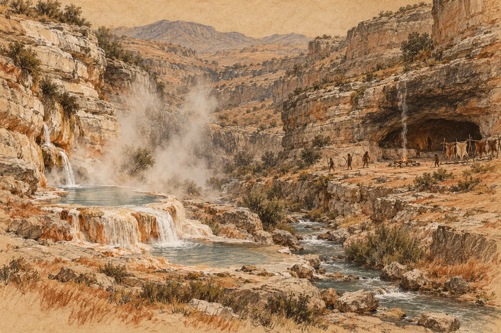

# 3. Voda

Čtvrtý den ráno plnil Eren láhev u potoka a počítal.

Počítal od chvíle, kdy zašrouboval víčko, do chvíle, kdy láhev přetekla. První den to bylo čtyřicet dva vteřin. Druhý den padesát. Včera šedesát osm. Dnes napočítal devadesát jedna a pak ještě chvíli čekal, protože nevěřil, že to číslo je správné.

Bylo správné. Voda vytékala z vložky pomaleji, tenčím pramínkem, a když ho Eren podržel proti světlu, byl pořád čirý. Vložka nepouštěla špínu. Jenom ji v sobě držela. Každá kapka hlíny, kterou potok nesl, v ní zůstala a ucpávala cestu kapce, která přišla po ní.

Na obalu náhradní vložky stálo úředním písmem: *Kapacita 400 litrů.* A pod tím menšími znaky: *při běžné kvalitě vody.* Eren se nad tím slovem zastavil už první den a pak na něj zapomněl. Teď si na něj vzpomněl. *Běžné.* Kdo to psal, myslel vodu z rozvodu nebo vodu z nádrže. Ne tuhle, žlutohnědou, plnou jemné hlíny, která se neusadí, ani když se nechá stát přes noc.

Seděl na kameni u potoka a počítal dál. Křivka nebyla rovná. Zpomalovala se rychleji, než by se zpomalovala, kdyby to bylo jen opotřebení. Za tři, čtyři dny tou vložkou nepoteče nic. Tři vložky v zásobě. Když vydrží každá deset dní, dvanáct, s touhle vodou…

Do podzimu. Pokud se tady pozná, kdy je podzim.

Sundal víčko a podíval se na vložku zespodu. Byla zahnědlá, slizká. Dala by se propláchnout. Proti proudu, čistou vodou. Jenže čistou vodu by musel mít, aby jí proplachoval, a tu neměl. Měl jen tu, kterou se snažil vyčistit.

Vrátil víčko a zůstal sedět.

Za ním se ozval kašel. Byl to ten chlapec, devítiletý, s ovázanou dlaní. Stál kus nad ním na svahu, ohnutý v pase, a kašlal, a pak ho popadla křeč a utíkal mezi stromy. Eren se díval jinam. Dva dny dělala totéž polovina dětí a třetina dospělých. Ti, kteří se první den napili rovnou z potoka, protože filtr byl pomalý a měli žízeň. Sefa jim dávala pít převařenou vodu, když se podařilo udržet oheň, a říkala, že to přejde. Pak dodala, že to aspoň u lidí doma přecházelo.

*

Pára stoupala z rokle, když se Eren vrátil nahoru.

Viděl ji už ráno předtím a nevěděl, co to je. Byla to bílá vrstva nad stromy na pravé straně údolí, tam, kde se svahy sbíhaly k sobě a kde z nich vystupovaly bílé skály. Potok tekl odtamtud. Eren si myslel, že je to mlha. Mlha ležela ráno všude.

Jenže dnes ráno byla mlha v údolí řídká a nad tou roklí zůstala hustá. A nestála. Stoupala. Pomalu, v chomáčích, které se nahoře trhaly a rozpouštěly ve světle. Pod nimi ale přibývaly nové, ze stejného místa, pořád.

Eren stál na svahu s láhví v ruce a díval se. V habitatech něco takového viděl jen u chladicích věží, když studený vzduch z rozvodu narazil na teplou vodu z reaktorového okruhu. Teplá voda pod studeným vzduchem. Pára. Musí tam být teplá voda. A teplá voda musí mít zdroj tepla.

Dlouho stál a díval se. Tváří mu prošel studený ranní vítr a pára v rokli se přitom ani nepohnula.

Pak si všiml, že nad roklí, výš, nad bílými skalami, stoupá i ten tenký rovný kouř. Tentýž, který viděl první den od potoka. Pára a kouř. Na jednom místě.

*

Orrin to rozhodl ještě to dopoledne.

Ráno po první noci pod plachtou jim to řekli, jak Orrin slíbil. Spolu. Orrin stál na bedně a Eren vedle něj a Orrin mluvil. Řekl to dobře; Eren to musel uznat. Klidně a bez strachu. Že tady nejsou sami. Že tu žijí lidé, možná celé skupiny, a že je to dobrá zpráva, protože kde žijí lidé, tam je jídlo a voda a ten, kdo ví, jak se tady přežije. Pak se ozvali ti, kdo měli strach. Orrin je nechal mluvit a odpověděl každému zvlášť.

Někdo se zeptal, proč jim úřady řekly, že je to tu neobydlené. Na to Orrin neodpověděl. Jen se usmál, jako by ta otázka byla odpověď sama.

Teď stál u svého ohně a díval se na páru, kterou mu Eren ukázal.

„Teplá voda,“ řekl.

„Myslím, že ano.“

„A oheň.“ Orrin kývl k tenkému kouři nad skalami. „Tam bydlí. U teplé vody.“ Chvíli mlčel. „Já bych tam bydlel taky.“

„Nevíme, kolik jich je.“

„Nevíme ani, kolik je nás,“ řekl Orrin. „Pořád se počítáme a pořád nám to vychází jinak.“ Obrátil se k Erenovi. „Kolik vydrží vložky?“

Eren mu to řekl. Orrin poslouchal, a když Eren došel k podzimu, přikývl. Bylo vidět, že s tím už počítal. Možná nevěděl, kolik vteřin teče voda z láhve, ale věděl, že dole u potoka se nedá žít.

„Půjdeme tam,“ řekl. „Dnes. Ne všichni. Třicet, čtyřicet lidí. Ostatní zůstanou u beden.“

„Ozbrojených?“

„Ne.“ Orrin se zamyslel. „S rodinami.“

Eren se na něj podíval.

„Když tam přijde čtyřicet mužů se sekerami,“ řekl Orrin, „víš, co uvidí? Čtyřicet mužů se sekerami. Když přijdou ženy a děti, uvidí lidi, kteří hledají, kde bydlet.“ Usmál se. „Což je pravda.“

Bylo to rozumné. Eren to věděl a stejně se mu to nelíbilo. Nevěděl, co přesně. Možná to, že by na to přišel sám a nepřišel. Možná to, že Orrin řekl *s rodinami* stejně, jako řekl *ozbrojených*: jako slovo, které se dá položit na stůl a vzít zpátky.

„Sekery si vezmou taky,“ řekl Eren.

„Samozřejmě,“ řekl Orrin. „Nejsme blázni.“

*

Maela chtěla, aby Tio zůstala u beden. Tio chtěla jít s Erenem. Eren nevěděl, co chce, a tak řekl, že Tio půjde, když půjde i Maela. Maela se na něj dívala dlouho a pak si sbalila láhev a plachtu.

„Zase,“ řekla jen. Nic dalšího.

Šli podél potoka proti proudu. Byla jich asi čtyřicítka, s Orrinem vpředu a s Kajem hned za ním. Kaj nesl na zádech svinutou plachtu a v ruce sekeru a rozhlížel se po stromech, jako by očekával, že z každého něco vyskočí. Sefa šla s nimi, protože Orrin chtěl, aby šla, a ta učitelka s chlapcem, protože chlapec chtěl vidět teplou vodu. Bylo s nimi šest dětí, nebo sedm.

Eren nesl Tio na ramenou, pak ji nechal jít, pak ji zase nesl.

Nové boty ho dřely. Na levé patě měl puchýř od druhého dne. Třetí den praskl a dnes ráno byl na jeho místě rudý mokvající kruh, který při každém kroku třel o tvrdý okraj boty. Eren se naučil došlapovat jinak, víc na špičku, a pak ho od toho začalo bolet lýtko. Kameny pod nohama se kývaly. Kořeny čněly ze země v místech, kde je nečekal. Svah, který zdálky vypadal hladký, byl zblízka samá hrana, prohlubeň a schod. Doma chodil po rovných podlahách sedmatřicet let a nikdy o nich neuvažoval. Teď na ně myslel s něhou.

Potok se měnil. Nejdřív to Eren nepoznal. Pak klekl, aby si namočil ruce, a voda byla vlažná. Ne teplá, jen méně studená, než měla být. O kus dál ještě vlažnější. A čistší. Kal se z ní ztrácel. Na kamenech v korytě se objevil bílý povlak, tvrdý a drsný jako hrubá omítka. Eren ho seškrábl nehtem a promnul mezi prsty. Rozpadal se na prášek. Ochutnal ho. Hořký, trochu slaný.

„Co to je?“ zeptala se Tio.

„Nevím. Usazenina. Něco, co voda nese a tady to nechává.“

„Proč to nechává tady?“

Nevěděl. Věděl, že teplá voda nese víc rozpuštěného materiálu než studená a že ho pustí, když vychladne. Tohle si pamatoval sám, ze školy, ze stěn výměníků, které se jednou za rok musely čistit kyselinou. Jenže tady žádný výměník nebyl. Tady byla jen hora.

Na skále nad potokem seděla zvířata.

Uviděla je Tio. Zastavila se a zatáhla Erena za ruku a ukázala. Byla to zvířata velká jako dítě, šedohnědá a chlupatá, bez ocasu nebo jen s pahýlem. Seděla na hraně skály v řadě, tři, pět, osm. Jedno mělo na břiše přitisknuté malé. Měla holé obličeje, růžové a vrásčité. A ta zvířata se dívala dolů na lidi stejně, jako se lidé dívali nahoru na ně.

Celá kolona se zastavila. Někdo vykřikl. Jedno zvíře vycenilo zuby, dlouhé a žluté, a vydalo krátký štěkavý zvuk. Eren ho poznal. Ten smích z první noci.

Muž kus před Erenem se sehnul pro kámen.

„Nech to,“ řekl Orrin. Ani se neotočil. „Nevíš, čí jsou.“

Muž kámen pustil. Zvířata na skále se ještě chvíli dívala. Pak se jedno po druhém otočila a odešla po hraně skály nahoru, pomalu, beze spěchu. To malé se ohlédlo přes matčino rameno.

Tio se smála. Smála se ještě dlouho potom, co zvířata zmizela, a Eren si uvědomil, že ji neslyšel smát se od probuzení.

*

Rokle začínala náhle. Stromy ustoupily, svahy se přiblížily a zvedly a z obou stran vyrostly skály. Bílé a šedé, ve vrstvách, které ležely přes sebe jako desky v nedbalé hromadě. Potok tekl mezi nimi. Nad ním visela pára. Tady byla tak hustá, že Eren pocítil vlhko na tváři a jemné kapky na vlasech. Vzduch voněl jinak než dole, ne pryskyřicí, ale kamenem. Mokrým kamenem. Bylo v tom ještě něco nakyslého, jako ve skladu, kde se nechalo ležet kovové nářadí.

Šli roklí nahoru. Pěšina tu byla. Skutečná, vyšlapaná do suti, úzká a jistá, a nevedla nahodile. Vedla tam, kudy se dalo jít nejsnáz. Kdo ji vyšlapal, šel touhle cestou mnohokrát.

Pak se rokle rozšířila do kotle a Eren je uviděl.

Na pravé straně, nad potokem, byla ve skále jeskyně. Ústí měla široké a nízké, jako ústa, která se rozevřela jen napůl. Skála nad ním byla černá od sazí. Před ústím ležela terasa, rovná plocha z kamení a ušlapané hlíny, a na ní stály tyče, na kterých visely kůže. Kouř stoupal od ohně, který hořel v kruhu kamenů blízko ústí. Ten tenký rovný kouř, který viděl první den od potoka.

A na terase stáli lidé.

Věděli o nich. Eren to poznal okamžitě. Nestáli překvapeně, nestáli roztroušeně. Stáli v řadě na hraně terasy, muži vpředu, a v rukou měli dlouhé tyče, které nebyly tyče. Byly to oštěpy. Na konci každého seděl kámen, šedý a plochý, opracovaný do hrotu se dvěma ramínky, kterými byl přivázaný k dřevu. Za muži stály ženy, a za ženami, napůl schované, děti. Celé ty dny o nich věděli. Viděli ohně na svahu. Čekali.

Bylo jich méně než vyhnanců, kteří přišli. Dvacet pět, možná třicet.

Kolona se zastavila na suti pod terasou. Nikdo nemusel nic říkat. Eren slyšel, jak lidé kolem něj sahají k pasu, k nožům a sekerám, a slyšel ten zvuk, kovový a suchý. Kaj vedle Orrina zvedl sekeru do výšky prsou. Orrin svou držel v ruce spuštěné, ale držel ji.

Eren se díval na lidi na terase.

Byli to lidé. Nic jiného. Stejně vysocí jako vyhnanci, stejně stavění, s rukama a obličeji, jaké mohl potkat na kterékoli chodbě habitatu. Jen jinak oblečení. Měli na sobě kůže, srstí dovnitř, sešité dohromady a přepásané. Někteří měli ramena holá. Kůže na obličejích a rukou byla ošlehaná a hrubá. Měli dlouhé vlasy, spletené nebo stažené, a ve vlasech a na tvářích červenou barvu, tmavou jako zaschlá krev. Na krku jim visely šňůrky a na nich drobné bílé předměty, provrtané uprostřed. Lesklé. Něco, co nebylo kámen.

Jeden z mužů vpředu zakřičel.

Bylo to slovo, krátké a ostré. Pak znovu. A znovu. Nemířil na nikoho. Mířil na všechny. Hrot jeho oštěpu se pohnul dolů, k vyhnancům, a zůstal tam.

„Klid,“ řekl Orrin. Nahlas, ale ne moc. „Nikdo nic nedělá.“

„Míří na nás,“ řekl někdo vzadu.

„My na ně taky.“

Muž na terase zakřičel znovu. Teď to bylo jiné slovo, delší. Další dva muži vedle něj sklonili oštěpy. Vzadu na terase se rozplakalo dítě a nějaká žena ho umlčela. Rozplakalo se i dítě mezi vyhnanci, pak druhé. Učitelka si přitiskla chlapce k sobě. Eren cítil, jak se Tio na jeho ramenou napnula. Sundal ji dolů a postavil ji za sebe. Držela ho za bundu oběma rukama.

Bylo ticho. Ne úplné: potok šuměl, pára syčela kdesi nad vodou, a od ohně na terase bylo slyšet praskání. Ale lidé byli zticha. Obě řady. Stáli proti sobě a dívali se a nikdo nevěděl, co dál.

Eren to viděl jako schéma. Neuměl to jinak. Dva systémy, oba pod tlakem, oba s pojistkou nastavenou na první pohyb druhého. Muž na terase čekal, až někdo z vyhnanců udělá krok. Kaj čekal, až muž na terase hodí oštěp. Takový systém se neuklidní sám. Takový systém čeká, až někde povolí těsnění, a pak to povolí všude naráz.

Pak uviděl, že se hroty oštěpů třesou.

Ne moc. Jen u některých. Ten muž, který křičel, měl ruce pevné, ale hrot oštěpu vedle něj se chvěl drobně a rychle. Muž, který ho držel, byl mladý, mladší než Kaj. Eren se mu podíval do obličeje. Viděl tam totéž, co v Kajově. Strach a snahu, aby nebyl vidět.

*

Chlapec sešel z terasy dřív, než ho kdokoli stačil zastavit.

Eren si ho předtím nevšiml. Stál vzadu mezi dětmi a teď se protáhl mezi ženami a mezi muži a seskočil z hrany terasy na suť. Žena za ním zasyčela. Muž s pevnýma rukama na něj něco zavolal. Chlapec se neotočil. Bylo mu deset, možná jedenáct. Byl hubený a bosý, s kůží přes ramena a s červenou čárou přes čelo. Šel po suti dolů, pomalu, s rukama u těla, a díval se na vyhnance. Nedíval se na sekery. Díval se na děti.

Zastavil se pět kroků od Erena. Díval se za něj. Na Tio.

Tio vykoukla zpoza Erenovy bundy.

Chlapec se na ni díval a ona na něj. Pak se jeho pohled svezl níž, k jejím botám. Šedým, vysokým, o dva prsty větším. Podíval se na ně dlouze a nedůvěřivě, a pak na své bosé nohy na kamení, a zase na její boty. Udělal obličej. Nebyl zlý. Byl to obličej, jaký dělají děti, když vidí něco, co nedává smysl.

Tio se rozesmála.

Nahlas, krátce, jako předtím pod skálou se zvířaty. Pustila Erenovu bundu. Sáhla do kapsy a vytáhla šišku. Tu velkou těžkou šišku, kterou si nesla od prvního dne a nepustila ji, ani když spala. Natáhla ruku a podávala ji chlapci.

Eren ji chtěl zadržet. Neudělal to. Ruku měl ve vzduchu a nechal ji tam.

Chlapec přišel o tři kroky blíž. Pak o další. Opatrně, jako by zkoušel, jestli ho země unese. Vzal šišku z Tiiny dlaně a obrátil ji v prstech. Přičichl k ní. A pak se rozesmál taky. Smál se, až se mu ramena třásla, a ukázal šiškou za sebe, na svah, na ty ploché stromy, které rostly všude, kam se člověk podíval. Bylo jasné, co tím myslí. Tohle je přece všude. Tohle mi dáváš?

Tio se smála s ním a nevěděla čemu.

Chlapec jí šišku vrátil. Pak si poklepal prstem na prsa a řekl slovo. Krátké, jednoslabičné. Eren ho slyšel jako *Ru*, nebo něco hodně podobného, s hrdelním zvukem na začátku, který neuměl napodobit.

Tio se na něj dívala. Pak si poklepala na prsa taky.

„Tio,“ řekla.

Chlapec to zopakoval. Špatně, ale zopakoval.

Na terase se někdo zasmál. Krátce, polohlasem. Byla to žena. Mezi vyhnanci se zasmál taky někdo, nervózně a příliš nahlas. Muž s pevnýma rukama na terase pořád držel oštěp sklopený, ale Eren viděl, že se mu ramena trochu uvolnila.

Kaj sekeru nespustil.

*

Pak se pohnuli lidé v jeskyni.

Eren to zaregistroval nejdřív podle lidí na terase. Ženy se rozestoupily. Muži na kraji terasy pootočili hlavy dozadu, k ústí jeskyně, a dva z nich zvedli hroty oštěpů z vyhnanců ke skále nad sebou. Ne na nikoho. Jen pryč. Bylo to gesto, které Eren znal, aniž ho kdy viděl. Takhle se v habitatu ustupuje ke stěně, když chodbou jde někdo, kdo má přednost.

Z ústí jeskyně vyšli malí lidé.

Bylo jich pět. Nebo šest; šestý zůstal ve stínu tak hluboko, že ho Eren viděl jen jako tvar. Vyšli až na kraj stínu, kde končil převis, a dál nešli. Byli malí. Nejvyšší z nich by Erenovi sahal sotva k prsům. Ale nebyli to děti. Na první pohled ne. Měli široká a těžká těla, plecatá, s krátkými silnými pažemi, a ruce, které byly na jejich výšku obrovské, s tlustými prsty. Hlavy velké, tváře široké a ploché. Kůži bledou, skoro šedou. Měli na sobě kůže jako lidé na terase, jen jinak sešité, a jeden držel v ruce kámen. Velký a oblý, jako by ho vzal z potoka, jen s jednou hranou ohlazenou do lesku.

A oči. Eren se na ně podíval a zachvěl se.

Byly světlé. Tak světlé, že se v nich skoro nedala poznat barva, jako voda v nádrži, když se na ni člověk dívá shora. A byly přimhouřené proti světlu, které na ně padalo z kotle. Ten vpředu, žena, zvedla ruku a podržela si dlaň nad očima jako stříšku. Jako člověk, který vyšel z tmavé místnosti do příliš ostrého světla. Pod tou stříškou se dívala dolů na vyhnance.

Nikdo z nich nepromluvil.

„Co je to?“ zašeptal někdo za Erenem.

„Děti,“ řekl Kaj. Neznělo to jako odpověď. Znělo to jako modlitba.

„To nejsou děti.“ To byla Sefa. Hlas měla tichý a velmi klidný, jako vždycky, když se bála. „Podívej se jim na ruce.“

Eren se díval. Ta žena vpředu, ta s dlaní nad očima. Nehýbala se. Stála na kraji stínu a za ní stáli ostatní. Teprve teď si Eren všiml, kam se dívá. Nedívala se na sekery a nedívala se na děti. Dívala se na vodu.

Pod terasou, mezi kamením, tekla teplá voda. Vycházela ze skály kdesi pod ústím jeskyně, neviděl přesně odkud, a plnila tůň, mělkou a čistou, ohraničenou bílým okrajem té tvrdé usazeniny. Z tůně přetékala přes bílý práh do druhé tůně níž, větší, a teprve z té tekla do potoka. Nad oběma visela pára. Horní tůň ležela blíž jeskyni. Ta malá žena stála tak, že mezi ní a vyhnanci ležela právě horní tůň.

Eren si toho všiml a nevěděl, co to znamená.

*Neobydlená divočina,* řekl v jeho hlavě hlas. *Oblast přistání byla prověřena.*

Prověřena. Někdo sem přišel, díval se a napsal: neobydlená. Někdo, kdo nevěděl, nebo věděl a napsal to stejně. Eren v tu chvíli nedokázal říct, co je horší. Jen věděl, že ten list s obrázkem stromu, který nesl v kapse, nepsal nikdo, kdo by tady stál.

Muž s pevnýma rukama na terase něco řekl. Tiše, směrem ke stínu. Malá žena odpověděla. Jedno slovo, hluboké, s hlasem, který vycházel odněkud z hrudi. Muž přikývl. Jeho oštěp zůstal sklopený na vyhnance.

A Kajova sekera zůstala ve výšce prsou.

*

Eren nevěděl, kdy se rozhodl. Možná se nerozhodl vůbec. Ruka sáhla k pasu dřív, než o tom stačil přemýšlet.

Vytáhl nůž. Slyšel, jak se lidé kolem něj napjali, i to, jak se muž na terase přikrčil. Eren nůž nezvedl. Držel ho za čepel, rukojetí od sebe. Pomalu si klekl, levé koleno na suť, a ucítil, jak se mu pod ním posunul kámen a puchýř na patě se otřel o botu. Položil nůž na plochý kámen před sebou, tak, aby ležel na očích obou řad. Pak ho od sebe kousek odsunul. Prsty od něj dal pryč. Vstal.

Ruce měl prázdné. Nechal je viset podél těla, dlaněmi dopředu.

„Erene,“ řekl Orrin. Tiše. Ne přísně. Varovně.

Eren se neotočil. Díval se na muže s pevnýma rukama a ten se díval na něj. Pak se podíval na nůž na kameni a zase zpátky na Erena, a Eren v jeho tváři uviděl něco, co znal: člověka, který se snaží spočítat, co to znamená, a nemá dost údajů.

„Co děláš?“ To byla Maela, za ním. Šeptem, prudce.

Nevěděl, co dělá. Věděl jen, že někdo musí povolit první, a že když to bude on, nepovolí to naráz všude. Tak to aspoň fungovalo u tlakových systémů. U lidí to nevěděl. Stál s prázdnýma rukama na suti před cizími oštěpy a cítil se nahý tak, jak se ještě nikdy necítil, ani v hale, kde je svlékli a ostříhali.

Tio stála vedle něj. Ten chlapec, Ru, stál pořád pět kroků od ní a díval se na nůž. Pak na Erena.

Na terase se zvedla stará žena.

Eren ji předtím neviděl, protože seděla. Seděla u ohně v kruhu kamenů, nízko, zabalená do kůží, a teď se zvedala. Pomalu, opírala se o hůl, kterou předtím přikládala do ohně. Konec hole ještě doutnal. Byla stará. Vlasy měla bílé, spletené do jednoho copu, a obličej tak vrásčitý, že v něm oči byly jen dvě lesklé štěrbiny. Postavila se. Stála chvíli, než se jí srovnal dech.

Pak řekla jedno slovo.

Nebylo hlasité. Eren si nebyl jistý, jestli ho vůbec slyšeli všichni. Ale muž s pevnýma rukama zvedl hrot oštěpu. Ne celý. O dlaň. Pak ještě o kus, aby nemířil na nikoho, a postavil oštěp tupým koncem na zem.

Za Erenovými zády, po dlouhé chvíli, cinkl kov o kámen. Eren se ohlédl. Sefa položila svůj nůž vedle jeho. Pak učitelka. Pak ještě někdo, koho neznal. A ještě jeden.

Orrin svou sekeru nepoložil. Ani Kaj. Stáli vpředu, oba, a drželi je.

Stará žena na terase se na ně dívala. Pak se podívala na dva nože na kameni, pak na tři, čtyři, pět. Pak na Erena.

Dlouho. Než se zase posadila k ohni a přiložila.
