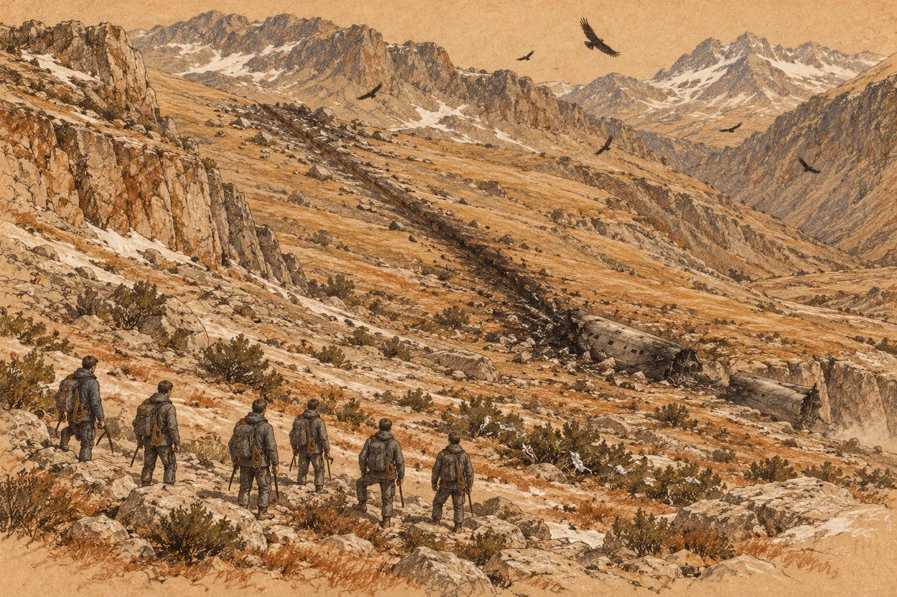

# 4. Sedmá loď

Nůž ráno ležel na kameni, kde ho Eren nechal.

Nevrátil se pro něj večer. Nevěděl proč; možná proto, že se bál, co by znamenalo, kdyby ho vzal zpátky. Spal pod plachtou dole v kotli, u potoka, kam se vyhnanci stáhli, aby nebyli na očích terase, a celou noc na ten nůž myslel. Ráno sešel k suti a nůž tam ležel. Vedle něj Sefin, učitelčin a ještě dva další. Pět čepelí, orosených, studených. Nikdo je nevzal.

Eren stál nad nimi a dlouho se díval nahoru k jeskyni. Na terase hořel oheň. U něj seděla stará žena a nedívala se na něj.

Teprve pak nůž zvedl a zastrčil si ho za pás.

*

Tak to trvalo čtyři dny. Vyhnanci dole, místní nahoře. Mezi nimi potok a ta dvojí tůň, nad kterou se ráno válela pára. Nikdo nikoho nenapadl. Nikdo s nikým nemluvil, protože nikdo nevěděl jak. Jen ten chlapec, Ru, sbíhal po suti dolů, kdykoli se dospělí nedívali, a Tio za ním utíkala, kdykoli se nedívala Maela. Eren je jednou našel u dolní tůně. Seděli na bílém prahu, nohy ve vlažné vodě, a ukazovali si na věci. Ru řekl slovo a Tio ho opakovala. Tio řekla slovo a Ru se smál.

Malé lidi z jeskyně už Eren neviděl. Jen jednou, za šera, zahlédl ve stínu pod převisem pohyb a světlou skvrnu obličeje, který se díval dolů na kotel. Pak tam nebylo nic.

Ostatní vyhnanci přišli od beden druhý den. Přinesli, co se dalo unést, a zbytek beden zůstal na svahu pod hlídkou. Kotel byl náhle plný šedých postav, plachet, ohňů a hlasů. Muži na terase stáli celý den na hraně s oštěpy a dívali se. Večer stará žena poslala dolů tři ženy. Položily na suť kus masa, syrového a tmavého, zabaleného v listech. Pak se vrátily. Orrin se na to maso díval dlouho. Pak ho nechal rozdělit mezi děti.

Pátý večer si Orrin přisedl k Erenovu ohni.

„Ten sedmý,“ řekl.

Eren čekal, kdy to přijde. Myslel na to každý večer, když se díval přes kotel k horám. Zářez odsud vidět nebyl, zakrývala ho stěna rokle. Ale věděl, kde je.

„Nevíme, jestli tam někdo nežije,“ řekl Orrin.

„Je to přes týden.“

„Je to přes týden,“ souhlasil Orrin. „A kdyby tam někdo žil, má ještě šedesát dní jídla. Jestli se k němu dostal.“ Díval se do ohně. „A má výbavu. Plachty. Lana. Vložky.“ Na posledním slově se zastavil. „Ty víš, kam to spadlo.“

Eren mu neřekl o dvou kamenech. Nikomu o nich neřekl. Orrin to přesto věděl, nebo to uhodl, a Erena to už nepřekvapilo.

„Vím, kterým směrem,“ řekl. „A asi jak daleko.“

„Jak daleko?“

„Padesát kilometrů. Vzdušnou čarou.“

Orrin se na něj podíval přes oheň. „Tady se vzdušnou čarou nechodí,“ řekl. Neříkal to výsměšně. Bylo to první, co se tu oba naučili.

„Dva dny,“ řekl Eren. „Možná tři.“

„Půjdeme pozítří,“ řekl Orrin. „Šest lidí. Ty povedeš.“

*

Maela to slyšela. Ležela pod plachtou s Tio, dva kroky od ohně, a Eren věděl, že nespí. Když si k nim večer lehl, chvíli bylo ticho. Plachta nad nimi se pohybovala ve větru, cvakala o kolík a zase se uklidnila.

„Ty tam nejdeš kvůli živým,“ řekla Maela.

Řekla to potichu, do tmy, aby Tio nevzbudila.

„Kvůli komu tedy?“

„Kvůli tomu, co tam zbylo.“ Slyšel, jak se obrací na bok, k němu. „Je to stroj. Rozbitý stroj. Ty jsi od přistání nesáhl na nic složitějšího než na šroubovací víčko.“

„To není pravda.“

„Je to pravda.“ Neřekla to zle. Řekla to unaveně, jako něco, co ví dávno. „Já ti to nevyčítám. Jen neříkej, že jdeš kvůli živým.“

Eren mlčel. Tio mezi nimi oddechovala.

„A až tam něco najdeš,“ řekla Maela, „co uděláš?“

„Přinesu to.“

„Pro koho?“

Nevěděl, co odpovědět. *Pro nás.* *Pro všechny.* Obojí znělo jako věta z bedny. Maela chvíli čekala.

„Naposledy, když jsi šel udělat něco pro ostatní,“ začala.

Pak to nedořekla. Eren ve tmě slyšel, jak se nadechla, a jak ten dech zadržela, a jak ho nakonec pomalu pustila. Pak se obrátila na druhý bok, zády k němu, a víc nepromluvila.

Eren ležel a díval se na plachtu nad sebou. Byla tmavá a skoro neviditelná, a když na ni zafoukal vítr, prohnula se k jeho obličeji. Dlouho nemohl usnout.

*

Šli v šesti. Orrin, Kaj, Eren a ještě tři. Haro byl Orrinův člověk, velký a mlčenlivý, s rukama, které nevěděly, co dělat, když zrovna nic nenesly. Bena byla vyhublá žena kolem čtyřicítky, která chodila rychleji než všichni ostatní a nikdy se neohlížela. A Ardo, operátor nákladní dopravy. Orrin si ho vybral, protože Ardo kdysi nakládal moduly a věděl, kde v nich co bývá.

Eren je vedl.

Došli ke dvěma kamenům na svahu nad starým tábořištěm. Ležely v trávě, kde je nechal, pořád v jedné čáře. Eren se postavil za ně, přimhouřil oči a srovnal je se zářezem na hřebeni. Levý vrchol vyšší a oblý, pravý užší, mezi nimi mezera po vylomeném zubu. Pak si vybral strom, který ležel v té čáře, a za stromem skálu, a za skálou další bod, a takhle šli.

Bylo to horší, než si myslel. Čára vedla rovně, ale země ne. Šli dolů do údolí a přes potok a zase nahoru. Svah se zvedal tak prudce, že se museli chytat kořenů. Pak je zastavila skalní stěna a museli ji obejít. Jakmile ji obešli, ztratil Eren zářez z očí a dlouho ho nemohl najít. Les byl hustý. Stromy s vodorovnými větvemi stály tak těsně, že pod nimi bylo šero i v poledne. Zem pod nimi pokrývalo jehličí, staré a měkké, do kterého se nohy bořily. Pryskyřičná vůně tu byla tak silná, že ji Eren cítil v puse.

Kaj šel hned za Orrinem. Celý den. Když se Orrin zastavil, zastavil se i Kaj, a když Orrin pil, Kaj čekal, až dopije, a pak pil sám. Bylo mu devatenáct. Eren to věděl, protože to Kaj řekl první večer u beden. Řekl to Orrinovi, jako by předkládal něco, za co se stydí.

V poledne Eren cítil v patě každý krok. Odpoledne ho bolela kolena, obě, z výstupu, a večer ho bolelo všechno. Nejen jeho. Ardo kulhal. Kajovi se rozedřely obě paty a večer si je ovazoval pruhy ze spodní vrstvy a nic neříkal. Jen Bena šla, jako by ji nic nebolelo. Když se jí Eren zeptal, ukázala mu chodidla. Byla celá ve strupech.

„Bolí to stejně,“ řekla. „Jen o tom nemluvím.“

*

V noci mrzlo. Spali vysoko, na kraji lesa, kde stromy řídly a začínala tráva a kamení. Rozdělali oheň. Šlo to rychleji než první večer. Eren už věděl, jak vypadá suché dřevo: šedé, lehké, bez kůry, a když se zlomí, lupne. Dvanáct škrtnutí. Pořád se to počítalo.

Orrin rozdělil plachty. Dvě na zem, dvě přes ně, a všech šest pod ně těsně vedle sebe, zády k ohni a tváří k tmě, nebo obráceně, každou hodinu se otočit. Kaje dal doprostřed.

„Proč já?“ zeptal se Kaj.

„Protože jsi nejlehčí,“ řekl Orrin. „Lehcí mrznou první.“

Kaj chtěl něco namítnout a pak si lehl doprostřed. Eren ležel na kraji a cítil, jak mu zima leze po zádech. Za zády cítil Benino tělo, kostnaté a horké. Vpředu oheň. Nad ním nebe, ještě větší než dole v kotli, a hvězdy, které se chvěly.

„Vždycky mě zajímalo,“ řekl Orrin do tmy, „kdo ty sítě drží.“

Mluvil tiše. Mluvil k Erenovi, ačkoli ležel na druhém kraji.

„Člověk si myslí, že se drží samy,“ pokračoval. „Že to tak prostě je. Proud jde, vzduch jde, voda jde. A někde jsou lidé, kteří to každou noc drží pohromadě rukama.“

„Ne rukama,“ řekl Eren.

„Ne?“

„Většinou ne. Většinou se jen díváš. Síť se drží sama, skoro vždycky. Ty jen čekáš, až se nebude držet.“

„A když se nedrží?“

„Pak víš, kde je slabá.“

Orrin chvíli mlčel.

„To jsem si myslel,“ řekl.

Víc nepromluvil. Eren ležel na kraji a díval se do ohně a cítil, jak mu ta poslední věta leží na prsou. Byla obyčejná. Byla úplně obyčejná. Mohl ji říct kdokoli o čemkoli. Mohl ji říct o lese, o kotli, o třech stech lidech, kteří se každý den počítali a pořád jim to vycházelo jinak.

Dlouho nemohl usnout. Když konečně usnul, zdálo se mu o ventilátorech.

*

Druhý den došli k zářezu.

Zblízka nebyl pravoúhlý. Byl to široký průsmyk mezi dvěma vrcholy, plný suti a balvanů a nízkých tuhých keřů s trny. Vítr jím profukoval tak silně, že se museli předklánět. Ze země tu vylézal holý kámen, šedý a ostrý, a mezi kameny ležely staré skvrny sněhu, tvrdé a špinavé. Eren šel první. Dýchal ztěžka. Vzduch tu byl řidší, nebo to tak aspoň cítil, a v hlavě mu bušilo.

Ucítil to dřív, než to uviděl.

Byl to pach spáleniny. Ne kouře, jaký znal od ohně. Ostřejší, chemický, pach roztavených izolací a plastů, ze kterého se mu stáhlo hrdlo. Ten znal. Ten znal z habitatu, z obou nehod v potravinových modulech, a ještě z jedné, o které nikdy nikomu nevyprávěl. Pod tím pachem byl další, nasládlý a těžký. Ten znal také.

Kaj za ním se zastavil. „Co je to?“

Nikdo mu neodpověděl.

Z průsmyku se otevřel výhled na druhou stranu. Dolů klesal svah do vysokého údolí, kamenitého a holého, s pruhy trávy. Uprostřed toho svahu byla rýha.

Byla dlouhá. Eren ji odhadl na tři sta metrů, možná víc. Začínala nahoře pod průsmykem, kde byly kameny rozmetané do stran jako od výbuchu a tráva spálená do černa. Pak vedla dolů po svahu, hluboká a rovná, a na jejím konci, kde se svah lámal přes skalní stupeň, ležel modul.

Ležel na boku. Přední část měl zmačkanou o skálu, skrčenou do sebe, jako když se šlápne na plechovku. Zadní část se odtrhla a ležela kus dál, rozervaná a černá od ohně. Mezi oběma částmi se po svahu táhla stopa ze sutin, z kusů pláště, z věcí. A všude kolem, na keřích, na kamenech, v trávě, se něco třpytilo.

Byla to fólie. Stříbrná, tenká, roztrhaná na cáry, které vítr převracel a nechával jimi pleskat o kameny. Některé byly malé jako dlaň, jiné velké jako plachta. Leskly se ve slunci tak ostře, že to bolelo do očí, a s každým poryvem se celý svah zablýskal jako voda.

„Izolace pláště,“ řekl Eren. Hlas měl cizí. „Strhla se při průletu.“

Nad údolím kroužili ptáci. Velcí a tmaví, s roztaženými křídly, širšími, než by roztáhl ruce dospělý muž. Kroužili, aniž by máchli křídly, pomalu a vytrvale, a jeden po druhém klesali k modulu a mizeli za skalním stupněm.

Nikdo nic neřekl. Orrin první vykročil dolů.

*

Toho muže našli dřív než modul.

Seděl pod balvanem kus stranou od rýhy, zády opřený o kámen, nohy natažené. Ruce měl zkřížené na prsou a dlaně zastrčené v podpaží. Hlavu měl skloněnou, jako když člověk usne vsedě. Byl v šedém, jako všichni. Tvář mu Eren neviděl a byl za to rád, protože ptáci k němu přišli dřív než oni.

Bena k němu přistoupila první. Zastavila se dva kroky před ním a pak se otočila zpátky.

„Byl vzhůru,“ řekla.

Eren se na ni podíval.

„Vylezl ven.“ Ukázala dolů, na stopy, které vedly od rozervané přední části modulu k balvanu. Šlápoty v trávě, nepravidelné, jedna noha se vlekla. „Byl vzhůru. Vylezl ven a sedl si sem. A pak…“ Neřekla to.

Eren to věděl. Znal to slovo ze záznamů o haváriích v servisních prstencích, kde se při výpadku topení vypínala oddělení jedno po druhém. Podchlazení. Tělo se nejdřív třese, pak přestane, a pak člověk usne. Ten muž se probudil po šesti stech letech do první noci na Zemi. Byl zraněný a sám, kolem něj byla tma a v hlavě ticho. Vylezl z vraku a sedl si pod kámen, aby byl z větru. Strčil si ruce do podpaží. A ráno už ne.

Seděl tváří k průsmyku, kterým oni přišli. Tím směrem, za horami, dosedlo šest modulů. To už se nedozvěděl.

Haro rozložil plachtu a přikryl ho. Pak nanosili kameny. Nosili je mlčky, všichni, a skládali je kolem něj a na něj, dokud nebyl vidět. Trvalo to dlouho. Ptáci nad nimi kroužili a čekali.

*

V modulu byla tma.

Rudé světlo nesvítilo. Nesvítilo nic. Vešli dovnitř trhlinou v boku, kde se plášť rozevřel jako okraj rány, a denní světlo šlo za nimi jen kousek. Dál byla šedá tma. Ze stropu, který teď byl stěnou, visely kabely. Pod nohama, na stěně, která teď byla podlahou, ležely kusy obložení a věci, které se při nárazu utrhly. Pach tu byl tak hustý, že se dal skoro nahmatat.

Lůžka byla na svých místech. Ve třech patrech, v řadách. Jen ležela na boku.

Eren šel k prvnímu. Víko bylo zavřené. Nad obličejem mělo průzor, malé okénko z čirého materiálu, kterého si ve svém lůžku nevšiml, protože se díval zevnitř. Na průzoru ležel prach. Eren ho setřel rukávem.

Pod ním byl obličej. Žena. Oči měla zavřené a tvář klidnou, jako by spala. Byla ostříhaná nakrátko, jako všichni. Vypadala tak, jak vypadal on, než se probudil.

Eren šel k dalšímu lůžku. A k dalšímu. Setřel prach z deseti průzorů, z dvaceti. Pod každým obličej. Muži, ženy, starý muž s jizvou přes bradu. Dítě. Všichni se zavřenýma očima. Všichni klidní.

Probouzecí sled se nespustil. Eren to věděl, aniž by to musel kontrolovat. U jejich modulu začal ještě nad zemí a dveře se otevřely, až když bylo hotovo. Tady modul dopadl dřív, než to stihl. Napájení vypadlo při nárazu nebo hned potom. A bez napájení oběh v lůžkách stojí a tělo, které v něm spí, se už nevzbudí. Nevěděli o tom. Spali, a potom už nebyli.

Jen ten muž venku. U něj se lůžko otevřelo. Možná nárazem. Možná pojistkou, která ještě stačila sepnout. Eren nevěděl, co je lepší. Spát, nebo se vzbudit sám do té noci.

Za ním někdo zvracel. Kaj. Klečel u vchodu do trhliny a dávil se a pak se rozplakal, nahlas, jako dítě, a styděl se za to a nemohl přestat. Haro k němu přistoupil a dal mu ruku na záda.

Orrin stál uprostřed haly a díval se na lůžka. Nehýbal se dlouho. Pak šel podél řady. Pomalu, od jednoho k druhému, a na každé víko položil na okamžik dlaň. Neříkal nic. Jen položil dlaň, sundal ji a šel k dalšímu. Eren ho sledoval a nevěděl, co si o tom myslet. Bylo to něco, co by sám nikdy neudělal. Bylo to něco, co by udělat měl.

Ardo počítal. Eren slyšel jeho šepot ze tmy. Čísla. Řadu po řadě.

Ve zmačkané přední části lůžka nebyla. Bylo tam jen něco, co lůžka bývala. Tam nikdo nechodil.

*

Zadní část, ta odtržená, vyhořela.

Ardo je k ní dovedl. Znal moduly, a tak věděl, kde bude náklad. Na tom kusu pláště, který ležel dál po svahu, se nedalo poznat nic. Byl celý černý, místy roztavený a stečený do kapek jako vosk. Uvnitř ležely popraskané bedny, spečené do sebe, a z nich vytékala hmota, která kdysi byla dávkami a teď byla černá a lesklá a voněla spáleným cukrem.

Ardo se tím prohrabával dlouho. Prsty měl černé až po zápěstí. Nakonec vytáhl, co se dalo. Dvě bedny, které ležely u vnější stěny a oheň je jen ohlodal. Několik balíků plachet, ztvrdlých na okrajích. Lana. Svazek nožů. A krabici s filtračními vložkami, zatavenými, nepoškozenými, padesát dva kusů.

Bena je spočítala dvakrát a pak je přitiskla k hrudi, jako by je někdo mohl vzít.

„To je všechno?“ zeptal se Orrin.

„To je všechno, co tu je,“ řekl Ardo. „Zbytek je tohle.“ Kopl do černé hmoty pod nohama. Na botě mu zůstala lesklá šmouha.

Pak se Eren podíval na příď.

*

Servisní oddíl byl tam, kde ho čekal. Moduly měly různou stavbu, ale tohle se nestavělo různě. Za řídicím prostorem, u přepážky, byl poklop s tím symbolem, který znal z každé technické místnosti, kde kdy pracoval. Tři čárky v trojúhelníku. Údržba.

Poklop se při nárazu zkroutil. Eren ho páčil sekerou a pak Haro, a nakonec ho Haro vykopl.

Uvnitř byla tma a pach, ten ostrý, kyselý, který Eren poznal hned. Elektrolyt. Vytáhl kus fólie, který sebral venku, nastavil ho tak, aby odrazil denní světlo z trhliny, a podíval se.

Na stojanu u stěny bylo šest článků. Šest hranatých kusů, každý velký jako dlaň a tlustý jako tři prsty, v kovovém pouzdře. Čtyři byly prasklé. Pouzdra se rozevřela podél švu a z nich vytekla tmavá hustá kapalina, která po stojanu stekla na podlahu a zaschla tam do krusty. Ten pach šel od ní. Pátý článek byl celý. Eren ho vytáhl ze stojanu a otočil. Na čele měl řadu šesti rysek, ukazatel stavu. Stiskl ho. Nic se nerozsvítilo.

Šestý byl celý taky. Eren stiskl ukazatel.

Rozsvítily se dvě rysky ze šesti. Slabě, nazelenale. Chvíli svítily, pak zhasly.

Eren zůstal stát s článkem v rukou. Byl těžký. Byl teplý, nebo se mu to zdálo. Byla v něm energie, uložená, změřená, konečná. Dvě rysky ze šesti. Nevěděl, kolik to je, protože nevěděl, jakou má článek kapacitu. Kapacitu by mu řekla síť. Věděl jen, že je to všechno. Že nikde na téhle planetě, v celém tom ohromném prostoru pod chvějícími se hvězdami, není nic jiného, v čem by bylo uloženo tolik práce najednou. A až se to vybije, nebude to.

Pod stojanem ležela bedna.

Byla plochá a dlouhá, s polstrovaným lůžkem uvnitř, a v tom lůžku ležel řezák.

Eren ho znal. Ne tenhle kus, ale typ. Servisní řezák pro opravy pláště. Těžký nástroj na dvě ruce, s pistolovou rukojetí vzadu a s druhou pod tubusem, s tryskou na konci, která uměla řezat kov a vrtat do skály a svařovat, když se přepnula. Jednou s takovým pracoval, na vnějším prstenci, při výměně poškozeného panelu. Byl to dobrý nástroj. Byl to nejlepší nástroj, jaký kdy držel v ruce.

Vytáhl ho z bedny. Ruce se mu trochu třásly.

„Co je to?“ zeptal se Kaj. Stál ve vstupu do oddílu. Byl ještě bledý, ale oči mu svítily.

„Řezák,“ řekl Eren.

„Co řeže?“

„Všechno.“

Vložil článek do pouzdra pod tubusem. Zacvaklo to. Pak sevřel rukojeť.

Na boku rukojeti se rozsvítilo malé rudé světýlko. Jedno. Pak zhaslo, a rozsvítilo se znovu, a zase zhaslo. Pravidelně. Eren to znal. Nástroj se ptal. Ptal se implantátu v ruce, která ho držela: kdo jsi a smíš to? Servisní oprávnění, úroveň, záznam do provozního deníku. Doma by to trvalo zlomek vteřiny a světýlko by zezelenalo, a v koutku mysli by mu naskočil řádek: *servisní řezák, oprávnění potvrzeno, záznam založen.*

Implantát za jeho uchem mlčel. Světýlko blikalo rudě.

„Nefunguje,“ řekl Kaj.

„Funguje,“ řekl Eren. „Jenom mě nezná.“

*

Sedl si na zem v servisním oddílu, s řezákem v klíně, a nožem povolil kryt rukojeti.

Šrouby byly malé a měly hlavu, na kterou nůž nepasoval. Eren to zkoušel dlouho. Nakonec nabrousil špičku nože o kamennou hranu stojanu, až pasovala na jeden šroub, a pak na druhý. Kryt odpadl. Pod ním byla deska s obvody, malá, hustá, a na ní to, co hledal. Ověřovací obvod. Znal ho. Nikdy ho neviděl zrovna v tomhle nástroji, ale všechny se podobaly, protože je všechny navrhovali stejní lidé podle stejných pravidel.

A každý měl stejnou slabinu. Nástroj se musí zkoušet ve výrobě, ještě předtím, než má jakéhokoli oprávněného majitele. Proto má každý ověřovací obvod zkušební režim. Dva kontakty na desce, nepájené, krytě schované pod okrajem. Když se propojí a nástroj se zapne, obvod se nikoho na nic neptá. Myslí si, že je ve výrobě. Myslí si, že je to jen zkouška.

Eren vytáhl z rozervaného obložení kousek drátu. Odizoloval ho zuby. Ohnul ho do háčku. Ruce měl teď klidné. Pracoval tak, jak pracoval vždycky, když se něco skutečně dělalo: bez myšlenek, jen prsty a oči.

Pak se zarazil, s drátem nad deskou.

Věděl, co dělá. Dělal to už jednou.

Ne tenhle obvod, ne tenhle nástroj. Jinou desku, na jiném stole, v místnosti, kde svítilo bílé světlo a ventilátory hučely tak, jak hučí, když je všechno v pořádku. Dva kontakty a háček z drátu. A hlas za jeho zády, přátelský, trochu netrpělivý: *Je to jen test, Erene. Neškodný test.* A v koutku mysli řádek, který neměl rád: *auditní ochrana: vypnuto.* A pod ním seznam oprávnění, která ten upravený nástroj bude mít. Byl delší, než měl být. Mnohem delší. Eren ho tehdy četl a seznam neměl konec, a on…

Zaťal zuby. Nemyslel dál. Uměl to. V cele se to naučil: kde přestat, aby to nebolelo víc, než se dá unést. Myšlenka se zastavila na tom místě, kde se zastavovala vždycky, a on ji tam nechal.

Přiložil háček na kontakty.

Světýlko na rukojeti zhaslo. Na okamžik zhaslo úplně a Eren si myslel, že něco zkratoval. Pak se rozsvítilo. Ne rudě. Žlutě, stále, bez blikání. Zkušební režim. Nástroj se nikoho na nic neptal.

Eren zajistil drát a přiklapl kryt, jak to šlo. Pak se zvedl.

*

Venku už se začínalo smrákat. Ostatní na něj čekali u trhliny. Ardo a Bena seděli na bednách, Haro stál. Kaj se díval na řezák v Erenových rukou, jako se Tio dívala na zvířata na skále.

„Funguje?“ zeptal se Orrin.

Eren mu neodpověděl. Došel k přídi, kde přepážka mezi servisním oddílem a skladem výbavy zůstala zaseknutá. Dveře se při nárazu zkroutily do rámu a nešly otevřít ani páčit; Haro to předtím zkoušel celou svou vahou. Eren si stoupl, nohy od sebe, a namířil trysku na okraj dveří. Stiskl spoušť.

Řezák zahučel. Nejdřív hluboko, pak výš, a z trysky vyšel jazyk světla. Bílý a modrý, tenký jako prst a tak jasný, že Eren musel přimhouřit oči a stejně ho viděl skrz víčka. Syčel. Kov na okraji dveří zrudl, pak zbělal, a pak tekl. Tekl jako voda, v drobných jasných kapkách, které padaly na zem a syčely a hasly. Do obličeje Erenovi udeřilo horko. Ucítil pach, ostrý a suchý, jako by se vzduch sám pálil. Řezák mu v rukou vibroval a hřál, a Eren ho vedl podél okraje dveří, pomalu, rovnoměrně, jak se to dělá. Za tryskou zůstávala zářící čára, a když vychladla, byla to mezera.

Celé to trvalo krátce. Eren pustil spoušť.

Ticho bylo hlasité. V uších mu zvonilo. Kus dveří se s kovovým zaskřípěním vyvalil z rámu a dopadl na zem.

Nikdo nemluvil. Kaj stál s otevřenou pusou. Bena si zakrývala oči rukou. Orrin se na Erena díval. Ne na řezák, na Erena.

Eren otočil řezák a stiskl ukazatel na článku. Dvě rysky. Jedna z nich teď blikala.

Rychle to spočítal. Neměl dost údajů, ale něco spočítat šlo. Dvě rysky na začátku. Krátký řez, ani ne minuta, a jedna z nich bliká. Kolik minut řezání? Deset? Patnáct, pokud bude šetrný. Možná víc, kdyby jen vrtal. Tryska byla horká; cítil to dlaní přes tubus. Kdyby řezal déle, musel by nechat nástroj vychladnout.

Deset minut. Patnáct. Všechno, co zbylo z jeho světa, se vešlo do čtvrthodiny.

*

Za vypáčenými dveřmi bylo jen málo. Pár beden s dávkami, menších, které patřily posádce. Sanitní skříň. Svazek lan. Ardo to vynosil ven. Haro rozdělil, kdo co ponese, a byla to tíha, se kterou se nedalo jít rychle.

Orrin přišel k Erenovi, když Eren ukládal řezák zpátky do bedny.

„Ponesu ho,“ řekl. „Je těžký. Ty poneseš článek.“ Usmál se. „Rozdělíme se o to.“

Eren se na něj podíval. Orrin stál klidně, s rukama volně podél těla. V jeho tváři nebylo nic než únava a laskavost a ta stará jistota člověka, který stojí na bedně.

„Ne,“ řekl Eren.

Orrin čekal, jestli řekne něco dalšího. Eren neřekl nic. Zavřel víko bedny a nasadil si ji na záda. Popruhy se mu zařízly do ramen. Článek vytáhl a strčil si ho pod bundu, na prsa, kde ho tlačil do žeber.

Kaj se díval na Orrina. Čekal, co Orrin udělá. Eren to viděl a viděl, jak Kaj zvedá bradu, jak jeho ruce hledají sekeru za pasem.

Orrin se zasmál. Tiše, upřímně, jako se člověk směje dítěti, které se nechce podělit o hračku.

„Dobře,“ řekl. „Je tvůj.“ Poklepal Erenovi na bednu na zádech, dvakrát, jako by klepal na dveře. „Stejně ho nikdo jiný nerozchodí.“

Kaj ruce spustil. Díval se na Erena zvláštním pohledem, ve kterém byl obdiv a ještě něco jiného, co Eren neuměl pojmenovat.

„Naučíš mě to?“ zeptal se.

„Ne,“ řekl Eren.

*

Oheň rozdělali na úbočí nad vrakem, v závětří skalního stupně. Dál než sto kroků od modulu nemohli, protože už byla tma. Ptáci odletěli. Fólie na keřích šustila ve větru a ve světle ohně se tu a tam zableskla, jako by někdo v tmě kolem otvíral a zavíral oči.

Jedli dávky. Ardo jednu ohřál na kameni u ohně a zkusil to. Bylo to horší. Mlčeli. Kaj usnul první, ještě vsedě, a Haro ho opatrně položil a přikryl plachtou. Bena si sundala boty a dívala se na svá chodidla ve světle ohně.

Eren seděl s bednou za zády. Nesundal ji. Článek pod bundou ho tlačil a hřál, teplý od jeho těla.

Orrin seděl naproti. Dlouho se díval do ohně. Pak zvedl oči.

„Děkuju ti, Erene,“ řekl.

„Za co?“

Orrin se na něj díval přes plameny. Klidně, přátelsky. Unaveně.

„Za to, co jsi pro nás udělal.“

Eren chvíli nevěděl, co říct. Pak se podíval na bednu za svými zády a pochopil to. Zámek. Řezák. Dveře, které se otevřely, když je nedokázal otevřít Haro.

„Ještě jsem nic neudělal,“ řekl. „Otevřel jsem krabici.“

„Udělal,“ řekl Orrin.

Víc nic. Přiložil do ohně a díval se, jak se větev chytá. Pak se zvedl, přešel ke Kajovi a narovnal mu plachtu, která mu sjela z ramene. A lehl si vedle něj, zády k ohni.

Eren seděl dál.

*Za to, co jsi pro nás udělal.* Pro nás. Pro šest lidí na úbočí nad vrakem. Pro tři sta dvanáct lidí v kotli pod jeskyní. Pro… Myšlenka se pohnula dál, k tomu místu, kde se zastavovala vždycky, a Eren ji tam zastavil. Uměl to. *Je to jen test, Erene.* Nemyslel na to. Ten hlas tu nebyl. Byl šest set let daleko a byl mrtvý jako všichni, kdo tehdy hučeli s ventilátory.

Orrin myslel řezák. Samozřejmě, že myslel řezák.

Fólie na keřích šustila. Dole ve tmě ležel modul na boku a v něm čtyři sta lidí, kteří se nevzbudili, a jeden, který se vzbudil a sedí pod hromadou kamenů s rukama v podpaží. Eren se na to místo díval, i když tam nic neviděl.

Pak bednu přece jen sundal. Otevřel víko a ve světle ohně povolil nabroušenou špičkou nože kryt rukojeti. Háček z drátu seděl na kontaktech, kam ho zajistil. Vyndal ho. Na okamžik ho držel mezi prsty, malý, ohnutý, lehčí než cokoli, co ten den nesl. Pak kryt přiklapl a háček zastrčil do švu na límci bundy, kde ho nahmatal palcem.

Až řezák příště někdo sevře, světýlko na rukojeti zase zabliká rudě a bude se ptát. Řezák v bedně, článek pod bundou, háček v límci. Tři kusy. Žádný z nich sám nic neuměl.

Bednu si znovu nasadil na záda a lehl si na bok, aby ji měl za sebou. Pravou rukou sáhl dozadu a nahmatal přes víko tubus. Kov byl studený. Za chvíli od jeho dlaně zteplal.

V hlavě bylo ticho. Ne to ticho po síti. Jiné. To, ve kterém zní jen jedna věta, pořád dokola, vlídným hlasem, a nikdo na ni neodpovídá.
