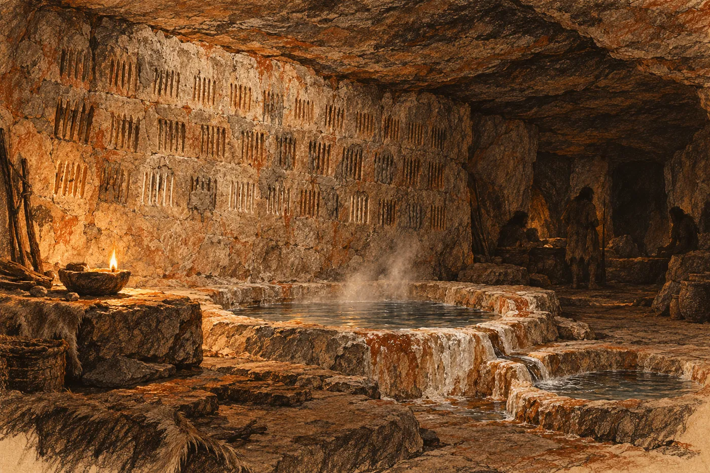

# 9. Skalní lid

Malá žena na něj čekala u horní tůně.

Bylo to čtrnáctého dne od sněhu, za šera, ještě před svítáním. Eren tam chodil každé ráno, od té noci, kdy seděl mokrý na kameni. Nikdo ho o to nežádal. Došel k bílému okraji, podíval se do vody, jestli v ní nic neplave, a podíval se k zálivu pod převisem, jestli se pěna na hladině pořád stáčí do štěrbiny. Pak šel zpátky. Trvalo to chvíli. Bylo to jako obchůzka po šachtách na začátku směny: nic se nedělo, a proto se to dělalo.

Tentokrát stála v zálivu, ve stínu převisu, a nehýbala se. Viděl ji, až když byl blízko.

Neměla dlaň nad očima. Šero bylo její světlo. Dívala se na něj a on se zastavil na tři kroky od ní, protože dál nevěděl, jestli smí.

Položila si ruku na prsa. Plochou dlaň, celou, pod krk.

„Dabra,“ řekla.

Hlas jí šel z hloubky, z hrudi, a to *r* v něm se převalilo jako kámen ve vodě. Eren to slovo slyšel a nevěděl, co to je. Pak pochopil. Tio to dělala úplně stejně, první den pod terasou, když se s Ruem neznali. Ruka na prsa, slovo.

Položil si ruku na prsa.

„Eren.“

Dabra se na něj chvíli dívala. Pak to zopakovala. Řekla to jinak než on, hlouběji a pomaleji, a z obou samohlásek udělala jednu dlouhou. Ale bylo to jeho jméno. Za šestatřicet dní na této planetě ho nikdo z místních neřekl. Říkali mu *hlas ze stropu*.

Pak ukázala na ústí jeskyně. Pak na nebe na východě, kde se nad hřebenem začínalo bělat. Pak pomalu sjela dlaní k obzoru na druhé straně, na západ, kam slunce zapadá, a dlaň tam nechala ležet, plochou, jako víko.

Až se setmí.

A ukázala na něj.

*

„Proč ty?“ řekla Maela.

Krájela dávky. Od toho večera s kýtou s ním mluvila jen o dávkách, o dřevě a o Tio, a to krátce. Eren to nesl. Nevěděl, jak jinak.

„Nevím.“

„Já vím.“ Maela nezvedla hlavu. „Protože jsi stál v jejich vodě. A protože jsi tam pak celou noc seděl a nic nechtěl.“ Odložila nůž. „Zeptej se, kolik nás tam pustí.“

„Nevím, jestli se dokážu zeptat.“

„Tak se dívej,“ řekla Maela. „Spočítej to.“

Orrin to slyšel od někoho jiného. Před polednem přišel k jejich ohni, sedl si na bobek a natáhl ruce k žáru, jako každý, kdo kolem šel. Mluvil o dřevu. Mluvil o tom, že se Dornovi zlepšuje levé oko a pravé zatím ne. Pak se zvedl a položil Erenovi ruku na rameno.

„Dívej se dobře, Erene,“ řekl. „Jsi první z nás, kdo tam vejde.“

Bylo to vlídné. Eren tu ruku cítil na rameni ještě dlouho potom, co Orrin odešel.

*

Pro Erena přišel Ru, za soumraku. Vzal ho za rukáv a vedl ho nahoru po suti, na terasu. Tio chtěla jít s nimi a Ru jí řekl něco krátkého. Tio zůstala stát u plachty s rukama zaťatýma v pěst.

Na terase seděla Tal u ohně. Podívala se na Erena, jak jde kolem, a kývla. Jen bradou. Ikku stál u tyčí s kůžemi a nekývl.

Ústí bylo nízké. Eren se v něm musel shrbit a pak se zase narovnal, protože uvnitř se strop zvedal. Byla tam síň. Velká, větší, než by čekal, s klenbou, kterou ve tmě nebylo vidět. Strop i stěny byly do výšky dvou mužů černé od sazí. Ty saze tu nebyly z jedné zimy. Na zemi ležely kůže a pod nimi suchá tráva, srovnaná do lůžek. Podél stěn stálo dřevo, naskládané až ke stropu, polena a otep a suché větve, a mezi nimi visely na šňůrách pruhy sušeného masa. Ohniště tu byla tři. Hořelo jen jedno. U ostatních ležel popel a Eren viděl, že pod popelem je zase popel, a pod ním tmavá vrstva, a pod ní další. Někdo tu topil, dokud nezestárl, a pak tu topil jiný.

Tady budou místní zimovat. Až sníh přijde do kotle.

Na kůžích u hořícího ohně spaly dvě děti, schoulené do sebe. Ru kolem nich prošel po špičkách.

Na konci síně se strop snižoval a zem stoupala a v zadní stěně byl otvor. Před ním ležela v zemi řada plochých kamenů. Byly zapuštěné do hlíny, jeden vedle druhého, od stěny ke stěně, ohlazené tak, že se na nich lesklo světlo z ohně.

Ru se u nich zastavil.

Nepřekročil je. Stál špičkami těsně u nich a pak se podíval na Erena a zavrtěl hlavou. Ne cvaknutím jazyka. Hlavou, jako to dělala Tio, když se jí něco nechtělo. Pak ukázal na kameny, na sebe, a dlaní, plochou, dolů, ze strany na stranu.

Ani on ne.

Za kameny, ve tmě otvoru, stála Dabra. Eren ji viděl jen proto, že jí oči v odrazu ohně svítily. Dvě světlé tečky, nízko, ve výšce jeho prsou.

Ru mu dal do ruky něco teplého. Mělkou kamennou misku, vybroušenou do hladka, a v ní tuk. Z tuku trčel knot ze stočeného mechu a na knotu se držel malý žlutý plamínek. Ru ho zapálil o oheň, zatímco Eren stál u kamenů. Eren si toho ani nevšiml.

Překročil kameny.

*

Šel za ní dlouho. Nevěděl jak dlouho, a tak počítal kroky. Nic jiného neměl.

Chodba klesala. V místech, kde byla příliš strmá, byly ve skále vytesané stupně, nízké a široké, každý stejný. Eren je cítil pod botami dřív, než je viděl. Plamínek v misce osvětlil jen kus stěny vedle něj a vlastní ruku. Dabra šla vpředu, mimo kruh světla. Eren ji slyšel. Šla tiše, ale ne neslyšně, a když na chvíli zastavila, aby počkala, slyšel její dech.

Strop klesal taky. Po šedesáti krocích se musel shrbit. Po stovce šel s hlavou mezi rameny a jednou rukou se opíral o stěnu. Stěna byla hladká. Ne jako ohlazená vodou. Jako ohlazená rukama, stovkami let rukou, které se o ni opíraly na tomtéž místě.

Byla teplá.

A vzduch se změnil. Venku byl mráz a v síni kouř, ale tady byl vzduch vlhký a vlažný a voněl kamenem a vodou. Eren slyšel tu vodu dřív, než ji uviděl. Tichý, souvislý šum, kdesi vpravo pod ním.

Po sto čtyřiceti krocích chodba uhnula a voda tam byla. Tekla vedle chodby v korytu, které někdo vysekal do skály. Bylo úzké, na šířku dlaně, a hluboké na šířku dvou, a mělo hrany tak rovné, že Eren nevěřil, že je dělala ruka bez nástroje. Voda v něm tekla rychle a nehlučně a od hladiny stoupala pára. Šla stejným směrem jako oni. Dolů a dál.

Ze štěrbiny, pomyslel si. Ze zálivu horní tůně. Tohle je ta voda, co mizí.

Šel podél ní. Nesahal do ní.

U další zatáčky se Dabra zastavila. Počkala, až dojde k ní, a pak udělala něco, co nečekal. Vzala ho za zápěstí. Ruku měla tvrdou a teplou a sevřela ho tak, že by se nevyprostil, ani kdyby chtěl. Položila jeho dlaň na stěnu.

Stěna tam nebyla kámen. Byla to hlína. Mazanice, uhlazená do roviny, velká jako dvě dlaně, vtlačená do skály tak pečlivě, že ji Eren ve slabém světle od kamene nerozeznal. Pod prsty byla chladnější než skála kolem. A když držel ruku klidně, ucítil, jak kolem okraje mazanice tahne vzduch. Studený. Venkovní.

Přiložil k hlíně ucho.

Slyšel potok. Tlumeně, daleko a zároveň blízko, jako slyšel v habitatu vodu v potrubí za stěnou kajuty. Ne vodu v korytu vedle sebe. Tu druhou, venku, v soutěsce.

Dabra ho pustila. Ukázala na mazanici. Na vodu v korytu. Pak dlaní pomalu ze strany na stranu, a tentokrát k tomu cvakla jazykem, ostře, dvakrát.

Ne. Tady ne. Na tohle se nesahá.

Eren se díval na tu hlínu. Byla to oprava. Viděl jich v životě tisíce a tohle byla oprava, stejně jasná jako záplata na potrubí. Skála tu byla tenká. Chodba s vodou se tu přiblížila k vnější stěně soutěsky tak blízko, že mezi nimi zbyl jen kus kamene a ten kus někde praskl. Oni tu prasklinu našli a zalepili, a hlídali ji. Kdyby povolila, šla by jejich voda ven.

Kývl. Dabra se na něj podívala, jestli to myslí vážně, a pak šla dál.

Počítal kroky až k té zatáčce. Nevěděl proč. Bylo to sto devadesát od kamenů u ohně.

*

Pak se chodba otevřela a byli dole.

Eren stál na prahu a nehýbal se.

Byla to síň, nižší než ta venkovní, ale delší, a táhla se do tmy, kam jeho plamínek nedosáhl. Strop měla nízký. Eren se pod ním mohl narovnat jen uprostřed, kde byl nejvýš. Podél stěn byly ve skále vytesané výklenky, jeden vedle druhého, každý tak velký, aby se do něj schoulil člověk jejich výšky. V některých ležely kůže. V některých ležel někdo.

A voda. Koryto z chodby vtékalo do síně a tam se rozdělovalo. První nádrž byla vysekaná ve skále u vchodu, kulatá a hladká, a voda v ní stála čistá a kouřila. Z ní přetékala úzkým žlábkem do druhé, větší a mělčí. Z druhé do třetí. Z třetí do žlábku, který vedl pryč, někam do tmy na konci síně, kde ji slyšel téct pod zem.

Eren to viděl a věděl, co vidí, dřív, než si to řekl.

Pití. Pak mytí. Pak pryč.

Bylo to jako ve čtvrtém prstenci. Nádrž pitné vody, okruh užitkové, odpad. Stejné pořadí. Stejná logika. Voda jde jedním směrem a nikdy se nevrací, a nikdo nesmí zaměnit první nádrž s druhou, protože pak je po všem. Tohle někdo postavil. Ne vymyslel včera. Postavil a udržoval a předal dalším, kteří to udržovali dál.

V síni bylo teplo. Ne teplo ohně. Teplo, které šlo ze skály a z vody, rovnoměrně, odevšad. Eren cítil, jak mu po tváři stéká pot. Poprvé od přistání se potil a nebyla to horečka.

Ve tmě kolem něj se rozsvítily oči. Desítky. Světlé tečky ve výklencích, u nádrží, nízko u země. Nikdo nevykřikl. Nikdo se nepohnul. Jen se na něj dívali, a on stál s plamínkem v misce a byl jediné světlo v celé síni.

Pak se ozval zvuk. Kámen o kámen. Pravidelný, tichý, jako tep. Eren otočil hlavu.

Kus od něj, na kraji světla, seděl na zemi starý muž. Malý, široký, s bílými vousy na hrudi. Měl mezi koleny kámen a druhým kamenem do něj klepal. Neviděl na to. Nepotřeboval. Klepal a pak přejel po kameni palcem, pomalu, a zase klepal. Pod jeho rukama vznikala miska. Napůl hotová, už teď tak hladká uvnitř, že se v ní plamínek odrážel.

Dělal to ve tmě. Celý život to dělal ve tmě.

Eren si na ně celou dobu v duchu říkal *malí lidé*. Říkal to celý kotel. Teď se díval na toho starého muže, na jeho ruce, na misku, na koryto s ostrými hranami a na stupně v chodbě, a to slovo se mu nehodilo. Ten starý byl stejně široký jako Haro. Nebyli malí. Byli z kamene. Žili v něm a dělali z něj, co potřebovali, a kámen je poslouchal.

*Skalní lidé*, pomyslel si. To slovo nikdo neřekl. Patřilo jen jemu.

*

Dabra ho vedla k zadní stěně síně.

Stěna tam byla ohlazená do roviny a celá pokrytá zářezy. Krátké svislé rýhy, hluboké a přesné, v řadách nad sebou. Některé řady byly staré, s okraji otřenými do měkka. Jiné byly čerstvé, světlé. A některé zářezy byly zamazané hlínou, tou stejnou jako na stěně v chodbě. Zamazané tak, že se rýha pod hlínou ještě dala nahmatat, ale vidět už ne.

Dabra položila prst na první zářez v nejnižší řadě. Pak na druhý. Pak se otočila a položila ruku na hlavu dítěte, které stálo u ní a dívalo se na Erena svítícíma očima. Pak zase na zářez.

Eren pochopil. Počítala.

Vzal ji za slovo. Prošel řady, jednu po druhé, s prstem na kameni, jako ona. Rýhy byly seskupené po šesti, každá šestice oddělená od další mezerou. Zamazané nepočítal. Napočítal patnáct šestic a ještě tři. Devadesát tři.

Devadesát tři lidí. V celé hloubce.

Pak se podíval na zamazané. Bylo jich hodně. Víc než těch otevřených. Mrtví, pomyslel si. Nebo ti, kdo odešli. Nevěděl to. Ale nikdo je nevyškrábal. Zamazali je hlínou, a nechali je na stěně.

Dabra počkala, až dočítá. Pak udělala dlaní pohyb, který znal od Rua. Kolik? Ukázala na stěnu, na Erena, a pak rukou ven, nahoru, k chodbě. Ke kotli.

Kolik vás je?

Eren neměl dost prstů. Neměl slovo. Rozhlédl se a uviděl na zemi úlomek kamene, ostrý. Zvedl ho. Klekl si na zem pod stěnou, kde byla skála hladká a holá, a začal rýt.

Rýhy po deseti. Ne po šesti, jak to dělali oni. Po deseti, jak se to naučil jako dítě, než měl řádek, který počítal za něj. Deset rýh, mezera. Deset rýh, mezera. Desítka Harova. Desítka Ardova. Desítka, ve které byla Hela. Ryl a úlomek mu klouzal v prstech a dvakrát se o něj řízl.

Skalní lidé se kolem něj shromáždili. Slyšel je. Slyšel jejich dech a tiché kroky a cítil, jak se tma kolem něj zahušťuje těly. Nikdo nemluvil. Starý muž přestal klepat.

Třicet jedna desítek. A dvě rýhy navíc. Pak se zarazil a odečetl v duchu Briho. Nechal tam jeho rýhu stejně. Nevěděl, jak se škrtá.

Když se zvedl, kolena ho bolela. Podíval se na to, co udělal.

Jeho rýhy pokrývaly kus podlahy větší, než byla celá jejich stěna. Řady a řady, nerovné, ošklivé vedle jejich přesných zářezů. Bylo to jako obraz, na který se Eren nechtěl dívat a nemohl přestat.

Dabra stála nad tím dlouho.

Pak se Eren rozhlédl po síni, protože se nechtěl dívat na její tvář. A začal počítat jinak.

Strop. Nízký, pod ním se dalo stát jen uprostřed. Výklenky, devadesát, možná sto. Vzduch. Cítil, jak se v síni pohybuje, slabě, od chodby k zadní stěně a pryč někam do skály. Tah tu byl, ale malý, tak akorát pro lidi, kteří nepotřebují oheň, protože vidí ve tmě. Kolik ohňů by tu potřebovalo tři sta lidí, kteří ve tmě nevidí? Třicet? A kam by šel kouř? Za jednu noc by tu bylo nedýchatelno. Za dvě by tu ti, kdo tu teď žijí, umírali. A voda. Tři nádrže, jedna po druhé, a tři sta lidí, kteří ještě před měsícem nevěděli, že se do sání nic nehází. Za týden by z první nádrže byla druhá.

Neunese to. Ne tři sta dvanáct. Ani polovinu. Ani čtvrtinu, pokud mají zůstat ti, kdo tu jsou.

Eren to věděl stejně jistě, jako věděl, kolik vydrží vložka. A bylo to poprvé od přistání, kdy se jeho počty dotkly něčeho skutečného, a on byl rád, že je umí. A zároveň si přál, aby je neuměl.

Podíval se na Dabru. Pak pomalu zvedl ruku, plochou dlaní dolů, a pohnul jí ze strany na stranu.

Ne.

Dabra se na něj dívala. Světlé oči bez barvy, nízko, ve výšce jeho prsou. Pak se jí něco v obličeji pohnulo. Eren nevěděl co. Ale kývla. Jednou a pomalu.

*

Na cestě zpátky šel první. Dabra šla za ním a jeho plamínek ji neoslepoval. Počítal kroky. Sto devadesát od zatáčky s mazanicí k ohni. Šel kolem hlíny ve stěně a položil na ni dlaň a cítil ten tah. Pak šel dál.

Celou cestu nahoru myslel na tu síň.

Na teplo, které šlo ze skály. Na vodu, která tekla jedním směrem. Na výklenky, ve kterých spali lidé, a na nádrže, které se nesměly zaměnit. Bylo to první místo na celé planetě, kterému rozuměl. Ne napůl, ne jako cizí řeči. Celé. Kdyby ho tam nechali, věděl by za týden, kde co je a proč. Za měsíc by věděl, kde to praská. Uměl by to udržovat.

Bylo to nejblíž domovu, kde od přistání byl.

A nebylo to jeho.

Řekl si to, když překračoval řadu plochých kamenů. Řekl si to nahlas, tiše, aby to slyšel vlastním hlasem a ne jen v hlavě. *Není to moje.* Tak jako tehdy první noc říkal do tmy *Tio spí, dech pravidelný*, protože to nikdo jiný neřekl.

*Není to moje.*

Dabra za ním zůstala stát u kamenů. Neohlédl se.

*

U ohně na terase seděla Tal a čekala.

Byli tam i Ru a Tio. Tio se tam nějak dostala. Seděla vedle Rua na kůži a Tal jí dala do ruky kus sušeného masa a Tio ho žvýkala a dívala se na Erena, jako by se vrátil z velké dálky.

Dabra vyšla za ním. Zůstala stát v šeru u zadní stěny síně, daleko od ohně, s dlaní nad očima. Tal na ni promluvila. Dabra odpověděla. Mluvily spolu krátce, hlubokým hlasem a místním, a Eren nerozuměl ani slovu. Ale viděl, že spolu takhle mluvily už mnohokrát. Bez spěchu. Jako dvě, které vědí, co ta druhá řekne.

Pak Tal sáhla vedle sebe do hromádky kamínků u ohně a začala je klást na zem. Jeden vedle druhého. Do řady.

Eren počítal. Dvanáct.

Tal promluvila k Ruovi. Ru k Tio. Tio se zamračila.

„Dvanáct,“ řekla. „Dvanáct našich. Můžou spát tady, u vchodu.“ Ukázala na místo u ústí, kde byla stěna nejčernější a kde táhlo zvenku. „Děti. A nemocní. Ne zdraví. Ne… ne mámy. Jenom ty, co jsou nemocné.“ Zeptala se Rua na něco. „Od teď. Ne až přijde sníh. Hned.“

„A za to?“

Tio se zeptala. Tal něco řekla a ukázala na dřevo u stěny. Pak na ruce. Na Erenovy ruce.

„Dřevo,“ řekla Tio. „Máme nosit dřevo. Sem. Pro ně.“ Zaváhala. „Za každého, kdo tu spí, jedno… jednu náruč. Každý den.“

Dabra ze tmy promluvila. Krátce. Tal přikývla a řekla to Ruovi.

„A kameny,“ řekla Tio. Ukázala na řadu plochých kamenů v zadní části síně. „Přes ty nikdo. Nikdy. Ani nemocný. A voda…“ Tio se odmlčela, protože to nemusela říkat. Všichni věděli, co s vodou.

Dvanáct míst. Dvanáct ze tří set. Eren se díval na kamínky na zemi a viděl v nich Helu, jak sedí u Briho, a mladou matku s dítětem, které se třáslo v mokré spodní vrstvě. Bylo to málo. Bylo to strašně málo.

A bylo to víc, než měli včera.

Natáhl ruku a položil ji nad kamínky. Nedotkl se jich. Pak se podíval na Tal a kývl.

Tal se na něj dívala těma tmavýma očima, které nebyly staré. Pak řekla ještě něco a Ru se zasmál.

„Co?“

„Že vás je moc,“ řekla Tio. „Že vás je tolik, že musíte bydlet venku. Jako v létě. Že máte postavit…“ Nevěděla to slovo. Udělala rukama kruh nad hlavou, a pak spojila prsty nad ním do špičky. „Takové. Jaké mají oni v létě. Dole.“

*

Druhý den šli dolů.

Tal šla s nimi, pomalu, s holí, a Ru ji podpíral, ačkoli to nepotřebovala. Eren, Sefa, Ardo a Tio. Šli kotlem kolem tůní a pak podél potoka dolů, kudy přišli první den. Rokle se zúžila, kolem rozštípnutého balvanu, a Eren se na balvan nepodíval. Pak se rokle zase rozevřela a pod ní leželo údolí.

Tal je vedla stranou, na mírný svah nad potokem, kde se mezi stromy otevírala rovina. Tam to bylo.

Kruhy. Z kamenů, položených v trávě, každý tak velký, že by si do něj lehlo deset lidí hlavou ke středu. Kameny byly zarostlé mechem a do poloviny zapadlé do země. Uvnitř každého kruhu ležela uprostřed skvrna, tmavší než hlína kolem, a Eren do ní šťouchl klackem a byl tam popel. Starý, ztvrdlý. A po obvodu, mezi kameny, byly v zemi díry. Malé, kulaté, v pravidelných vzdálenostech. V některých ještě trčely zbytky ztrouchnivělého dřeva.

Kůly, pomyslel si. Kůly do kruhu, nahoře spojené do špičky. Jak to ukazovala Tio.

Kruhů bylo sedm, osm. Rozházených po rovině, jak kdo chtěl. Jeden tady, dva tamhle u stromů, jeden úplně dole u potoka. Mezi nimi vyšlapaná místa, kde kdysi chodili.

„Tady bydleli v létě,“ řekla Sefa. Klekla si do jednoho kruhu a hladila kámen. „Celé léto. A teď je to jenom kruh.“

Ardo chodil od kruhu ke kruhu a měřil je kroky. Byl to jeho zvyk. Dřív měřil nákladový prostor.

„Na deset lidí jeden,“ řekl. „Když se lehne hustě.“ Podíval se na Erena. „Kolik nás je? Tři sta deset?“

„Tři sta jedenáct.“

„Tak třicet jedna.“ Ardo se rozhlédl po rovině. „Třicet jedna kruhů. Sem se nevejde ani polovina, jak to mají oni.“

Eren se díval na kruhy. Na to, jak leží rozházené, každý jinde. Jak ten nejníž leží u potoka. Pak se díval na svah. Byl mírný, ale byl to svah. Když prší, voda poteče dolů. A na jaře, až roztaje sníh, který ještě nenapadl, poteče dolů hodně vody.

Vzal klacek. Sedl si na bobek do trávy na kraji roviny, kde byla holá hlína, a začal kreslit.

Kruh. Vedle něj kruh. Vedle něj další. Do řady, podél svahu, ne dolů. Nad tou řadou druhá řada, posunutá o půl, aby kruhy nestály přímo nad sebou. Mezi řadami čára. Rýha v zemi. Kudy poteče voda, když prší, aby netekla dveřmi dovnitř, ale pod nimi, kolem, pryč.

Ohně uprostřed každého kruhu. Tečka v každém. Řady tak daleko od sebe, aby jiskra z jedné střechy nedolétla na druhou. Eren nevěděl, jak daleko doletí jiskra. Odhadl to. Přidal krok.

A mezi řadami cesta. Rovná. Aby se dalo projít od prvního domu k poslednímu, i v noci, i ve sněhu, a vědělo se, kde co je. Kde je který dům. Kde je která desítka. Třicet jedna kruhů v pěti řadách, a v šesté jeden.

Díval se na to. Bylo to správně. Bylo to správně tak, jak byly správně chodby čtvrtého prstence, číslované, každá vedle každé.

Tio se nad tím sklonila. „To jsou chodby,“ řekla. „Jako doma.“

Eren nic neřekl.

Tal stála nad jeho kresbou a dívala se dlouho. Pak se zasmála. Ne zle. Krátce, jako se smála, když Sefa předváděla průjem. A řekla něco k Ruovi. Ru se zasmál taky.

„Co říká?“

Tio se zeptala, a pak se zachichotala, a pak se snažila tvářit vážně.

„Že takhle chodí mravenci,“ řekla. „Za sebou. Jeden za druhým.“

Ardo se zasmál nahlas. Sefa taky. Eren seděl na bobku s klackem v ruce a cítil, jak mu horkne obličej, a nevěděl, jestli je to stud, nebo něco jiného.

Pak se Tal přestala smát. Sehnula se, pomalu, opřená o hůl, a vzala mu klacek z ruky. Dívala se na kresbu. Na dolní řadu. Ukázala na ni klackem a pak se otočila a ukázala dolů, k potoku. Na stromy u potoka.

Eren se podíval, kam ukazuje.

Na kmenech stromů u potoka, ve výšce kolen, možná víc, byla čára. Ne čára. Pás. Kůra tam byla jinak zbarvená a ve větvích nízkých keřů visely zachycené chuchvalce suché trávy a klacků, šedé a zplihlé. Všechny ve stejné výšce. Jako by tu někdo natáhl provaz a všechno na něj pověsil.

Voda. Tak vysoko sem došla voda. Jednou, někdy na jaře.

Tal zvedla klacek a zarazila ho do hlíny. Nad Erenovu dolní řadu. O kus výš. Pak se podívala na Erena.

Eren se díval na ten pás na stromech. Pak na klacek v hlíně. Pak smazal dlaní dolní řadu, celou, a nakreslil ji znovu, výš, nad klackem. Ostatní řady posunul taky. Teď končily těsně pod stromy na horním okraji roviny.

Tal se dívala, jak to dělá. Pak cvakla jazykem. Ne jako *ne*. Krátce, jednou, a kývla.

„Říká, že mravenci aspoň nebydlí ve vodě,“ řekla Tio.

Tentokrát se smál i Eren.

*

Večer stál na bedně. Vylezl tam, aniž ho někdo poslal, a uvědomil si to, teprve když stál nahoře a kotel se na něj díval.

Řekl jim to, jak to uměl. Jako hlášení. Dvanáct míst ve vnější síni, hned, pro nemocné děti a nemocné. Za každého jedna náruč dřeva denně. Přes řadu kamenů v síni nikdo. Domy v údolí, na rovině pod roklí. Třicet jedna. V řadách.

Pak se ho začali ptát.

Hela chtěla vědět, kdo rozhodne, kdo je nemocný. Eren řekl, že Sefa. Sefa řekla, že ano. Mladá matka s tříletým dítětem chtěla vědět, jestli může jít s dítětem. Eren řekl, že nemocné dítě ano a ona ne. Ona řekla, že tříleté dítě samo nespí. Eren nevěděl, co odpovědět, a Sefa řekla, že to vyřeší s Tal. Eren nevěděl, jestli to Sefa vyřešit dokáže. Ale řekla to tak, že se matka uklidnila.

Pak se ptal Orrin.

Stál dole u beden a ptal se klidně a věcně. Nikdo se tak neptal. Jak je ta síň dole velká? Jak daleko je od vchodu? Kolik tam je těch malých? Eren řekl devadesát tři. Orrin to zopakoval: „Devadesát tři.“ Jak široká je chodba? Kolik lidí v ní projde vedle sebe? Je tam teplo? Je. Jak velké? Celou noc? Celou noc, ze skály. A voda? Je tam voda?

„Je.“

„Odkud teče?“

Eren otevřel pusu. Viděl koryto s ostrými hranami a zatáčku a hlínu ve stěně, velkou jako dvě dlaně, a pod prsty cítil ten studený tah.

„Shora,“ řekl. „Z tůně. A pak dolů.“

Orrin čekal, jestli řekne víc. Eren neřekl. Orrin kývl.

„Děkuju, Erene,“ řekl. „Je dobře, že to víme.“

Teprve když Eren slezl z bedny, uvědomil si, co udělal. Odpovídal tak, jak se odpovídá při hlášení: přesně, celé, bez vynechání. Kolik, kde, jak široké, jak teplé. Jako by stál před stěnou s mapou a někdo se ho ptal na stav okruhů. Řekl to všechno. Všechno kromě jedné věci.

A tu jednu věc nevynechal z rozumu. Pusa se mu zastavila sama, dřív, než věděl proč.

*

Maela seděla u ohně a čekala na něj.

„Dvanáct,“ řekla.

„Dvanáct.“

„A Tio?“

„Tio je zdravá.“

Maela se na něj dívala přes oheň. Pak se podívala na Tio, která spala pod plachtou, stočená, s pěstí u pusy. Dívala se dlouho.

„Zatím,“ řekla Maela.

Eren to slovo slyšel potřetí. Předtím ho dvakrát řekl Orrin, naposledy o vodě.

V noci nemohl spát. Ležel pod plachtou a cítil na zádech mráz ze země a myslel na síň dole. Na teplo, které šlo odevšad. Na nádrže, jednu po druhé. Na starého muže, který ve tmě klepal kamenem do kamene a dělal misku, a nepotřeboval vidět.

*Není to moje.*

Řekl si to ještě jednou, do tmy. Pak ještě jednou. Pomáhalo to stejně málo jako tehdy, první noc, ten dech. A stejně to říkal dál.

Tio se ve spánku pohnula a zakašlala. Jednou. Pak spala dál.

Eren počítal její dech, dokud neusnul.
