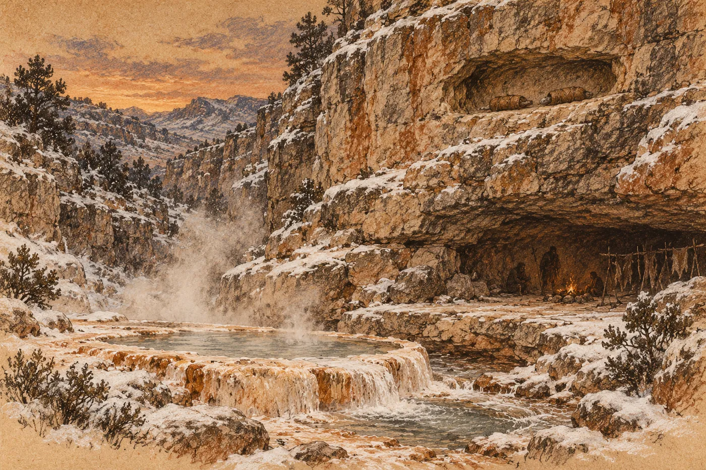

# 17. Záruka

Dvanáct se vrátilo za tmy.

Eren je nesl nahoru sám, s Ardem a s Vesou, jednoho po druhém, po suti, kterou v noci zmrzlý sníh udělal kluzkou jako sklo. Muži na kraji terasy ustoupili. Nikdo nemířil. Ve vnější síni čekala řada kamenů a na každém ležela kůže, srovnaná, jako by je někdo ráno vytřepal a čekal, kdy se vrátí. Vesina holka šla zase sama. Na dvanáctém kameni si sedla, přitáhla si kůži přes ramena a dívala se do ohně.

Starší z dvou sester z Ardovy desítky se na Erena podívala, když ji pokládal.

„Už jsme něco udělali?“ zeptala se.

„Ne,“ řekl Eren. „Ani teď ne.“

Nevěděla, jestli je to lepší. On taky ne.

*

Ráno stál u bedny s rozbitým rohem.

Nevylezl na ni. Stál vedle, na zemi, a na víko položil řezák. Zabalený v cárech, jak ležel v bedně od návratu ze sedmého. Těžký a studený. Lidé se scházeli pomalu. Ze sněhu, zpod plachet, s rukama v podpaží a s dechem, který jim před ústy stál bílý a nechtěl se rozplynout. Viděli řezák na bedně a zastavovali se dál, než by se zastavili jindy.

Eren počkal, až přijdou všichni, kdo přijít chtěli. Pak počkal ještě chvíli.

Orrin přišel poslední. Haro za ním, Svit, Dorn s obvazem přes oko. Nezastavili se mezi ostatními. Stáli kus stranou, u kamenů pod teplou skálou, kde sníh roztál.

Maela stála s nimi. Tio ne. Tio zůstala v přístřešku u Sefy.

„Byl jsem nahoře,“ řekl Eren.

Hlas mu zněl jinak, když nestál na bedně. Nesl se hůř. Lidé vzadu se nakláněli, aby slyšeli, a ti vpředu se neohlíželi, aby jim to řekli. Nechal to tak.

Řekl jim všechno. Ne tak, jak by podával hlášení. Pomaleji. Víčko, voda jen z dolní tůně, pro všechny. Žádné zbraně v jeskyni, ani jejich, ani naše, a že Tal nechala vynést oštěpy ze síně dřív, než to slíbil kdokoli z nich. Kořist podle práce, a kolik, to se řekne spolu. Tři kameny. Kdo zabije, bude souzen. Všemi. I Dorn.

Na Dornovo jméno se nikdo neotočil. Všichni věděli, kde stojí.

„A chtějí záruku,“ řekl Eren.

Položil ruku na řezák.

„Tohle. A článek. Řezák dostane Tal. Článek Dabra. Oba kusy půjdou do niky nad horní tůní, na skále pod terasou, a vzít je odtamtud půjde jen tehdy, když budou chtít obě. Tal i Dabra. Ne jedna. A já nikdy.“

Ticho. Pak se někdo zasmál. Krátce, nevěřícně. Byl to Svit.

„Slíbil jsem jim to,“ řekl Eren. „A slíbil jsem jim, že se nejdřív zeptám vás. Tak se ptám.“

*

„Proč?“ zeptala se mladá matka.

Stála vpředu, s dítětem na boku, zabaleným do kusu plachty tak, že mu byly vidět jen oči. Neptala se zle. Ptala se, jako se ptala vždycky, unaveně a přímo.

„Protože dokud ho mám,“ řekl Eren, „mluví se mnou proto, že ho mám.“

„To je špatně?“

Eren se díval na řezák pod svou dlaní.

„Tal ví, že jsem s ním byl u skály,“ řekl. „Dabra taky. Hloubka to cítila. Říkají, že děti plakaly.“ Polkl. „Dokud ho držím já, nebo kdokoli z nás, je každé slovo, které nám řeknou, slovo pod tímhle. Dávají nám vodu, protože se bojí. Nechávají nám síň, protože se bojí. A strach vydrží, dokud vydrží článek.“ Zvedl oči. „Deset minut, možná míň. A pak?“

Nikdo neodpověděl.

„Až ho dáme pryč,“ řekl Eren, „nebudeme mít nic, čím by se nás báli. Budou nás potřebovat, nebo nebudou. A my budeme potřebovat je.“

„To už potřebujeme,“ řekla Hela.

„Ano,“ řekl Eren. „To už potřebujeme.“

Orrin se pohnul. Neudělal krok dopředu. Jen zvedl hlavu, a lidé, kteří stáli mezi ním a bednou, se trochu odsunuli, aby na Erena viděl.

„Dáváš jim jedinou věc, kvůli které s námi mluví,“ řekl. Klidně. „Sám jsi to právě řekl. A pak budeš stát dole pod sutí s prázdnýma rukama a čekat, jestli se jim zachce.“

„Ano.“

„A až se jim nezachce?“

„Pak budu čekat dál.“

Orrin se na něj díval. Pak se usmál, tak jak se usmíval vždycky, vlídně a trochu smutně.

„Tohle umíš, Erene,“ řekl. „Čekat. To ti nikdo nevezme.“

Kotel to slyšel. Někdo se zasmál, ale nikdo se nepřidal.

*

„Kdo chce, ať položí kámen,“ řekl Eren. „Sem. Na bednu. Kdo nechce, ať ho nechá ležet.“

Nevěděl, kde to vzal. Nemělo to žádný řád, žádný záznam, nikdo to nemohl ověřit ani spočítat znovu. Kameny se daly přidat i ubrat. Ale ležely tu všude, pod sněhem, kolem ohnišť, na suti, a každý je měl po ruce.

„A když jich bude málo?“ zeptal se Ardo.

„Pak jim to nahoře řeknu. A řezák zůstane v bedně.“

Ardo se na něj chvíli díval. Pak kývl, jako by to bylo to jediné, na co se chtěl zeptat.

Hela šla první. Sehnula se u ohniště, vyhrabala ze sněhu kámen velký jako vejce a položila ho na víko vedle řezáku. Nepodívala se na Erena. Vrátila se na své místo.

Pak Ardo. Pak Vesa, s rukou pořád ovázanou, a za ní její lidé, jeden po druhém. Pak Bena, kulhavě, s nohama zabalenýma v kůži. Pak lidé, jejichž jména Eren neznal. Šli k bedně, pokládali kameny a vraceli se, a nikdo nic neříkal. Bylo slyšet jen sníh pod botami a cvaknutí kamene o kámen.

Mladá matka stála dlouho.

„A když nás zase vynesou?“ řekla. Ne Erenovi. Spíš sobě. „Do sněhu. Za někoho.“

„Pak se sejdou tři kameny,“ řekl Eren. „A budeme se ptát. Všichni.“

Dívala se na něj. Dítě na jejím boku se zavrtělo a vystrčilo ruku z plachty. Mladá matka se sehnula, vzala ze země kámen a dala ho dítěti do dlaně. Pak ho s ním odnesla k bedně a nechala dítě, aby ho pustilo samo.

Kámen se skutálel po hromadě a zůstal ležet na kraji.

Od kamenů pod teplou skálou nepřišel nikdo. Haro stál se založenýma rukama. Svit se díval jinam. Dorn se díval na Erena, tím jedním okem, a v obličeji neměl nic. Lidé z Orrinových desítek stáli za nimi a někteří z nich se dívali na bednu. Dva z nich přišli. Muž a žena. Položili kameny a vrátili se zpátky ke svým, a nikdo z Orrinových jim nic neřekl.

Maela stála vedle Orrina a nehýbala se.

Eren se na ni nepodíval. Věděl, že kdyby se podíval, bylo by to, jako by se ptal jí zvlášť. Nechtěl se ptát zvlášť.

Hromada na víku rostla. Kameny se sesypávaly z hromady na řezák, na cáry, ve kterých byl zabalený, a pak ho zakryly celý.

„Kdo je spočítá?“ zeptal se někdo vzadu.

Eren mlčel. Věděl, kdo by to udělal nejlíp. Stála u teplé skály a nehýbala se.

„Já,“ řekla Hela.

Počítala nahlas. Brala kameny z hromady jeden po druhém a skládala je vedle bedny do sněhu, po deseti, do řad. Lidé se dívali. Někteří počítali s ní, polohlasem, a když se spletla, nikdo ji neopravil, protože se pletli taky. Trvalo to dlouho. Kotel byl tak tichý, že bylo slyšet, jak v tůních bublá voda.

„Sto šedesát sedm,“ řekla Hela.

Narovnala se. Na víku zůstal ležet řezák v cárech, prázdný a šedý, a vedle něj ve sněhu sedmnáct řad kamenů. Poslední řada nebyla celá.

„A dost lidí, co nepoložili nic,“ řekl Orrin.

„Ano,“ řekl Eren.

„Spočítal jsi je?“

„Ne.“

Orrin chvíli mlčel. Pak kývl. Ne Erenovi. Kotli.

„Tak jim ho dej,“ řekl. „Řezák je tvůj. Řekl jsem to od začátku.“ Odmlčel se. „Článek je můj. Uschoval jsem ho pro všechny, kdo tu jsou. A tady dnes stojí jen ti, kdo položili kámen.“

Otočil se a šel nahoru, k přístřešku. Haro za ním, Svit, Dorn. Maela šla taky. U teplé skály se jednou ohlédla. Ne na Erena. Na řady kamenů ve sněhu.

*

Ru seděl u dolní tůně.

Ráno sem chodili místní pro vodu, s měchy a kamennými mísami, a Ru s nimi. Teď už byli pryč a on tam zůstal, na bobku v páře, a házel do odtoku pod tůní kamínky. Okrová čára na tváři se mu v páře rozpila. Když uviděl Erena, přestal házet.

Eren si k němu přidřepl.

Celou cestu přes kotel si tu větu opakoval. Krátkou, místní, se dvěma cvaknutími. Tio mu ji řekla včera ráno, a od té doby z ní nezbylo moc. Začátek. Cvaknutí. Něco uprostřed, co neuměl zopakovat. Druhé cvaknutí.

„Tio,“ řekl a ukázal nahoru, k přístřešku. Pak to řekl. Tak, jak to měl v puse.

Ru se na něj díval. Pak se mu roztáhla pusa a začal se smát. Nahlas, s rukama na kolenou, tak, až se mu pára před obličejem roztrhala. Řekl to po Erenovi. Jeho slovy, Erenovou výslovností, s cvaknutími na špatných místech, a smál se ještě víc.

Pak to řekl správně. Úplně jinak. Delší a měkčí, a obě cvaknutí byla tam, kde je měla Tio.

Eren to nepoznal. Nebyla to ta věta, kterou nesl. Nebo byla a on ji nesl tak špatně, že z ní přinesl něco jiného.

Ru vstal. Něco řekl a ukázal na Erena a pak nahoru, k přístřešku, a pak na svou pusu. Eren pochopil. Má jí nést odpověď.

Ru mu ji řekl. Pomalu. Dvakrát.

Eren ji opakoval celou cestu zpátky přes kotel a věděl, že ji ztrácí krok po kroku, jako se ztrácí teplo z kamene vytaženého z ohně. Nesl zprávu mezi dvěma dětmi, kterým nerozuměl, a ani jedno z nich se ho nezeptalo, co znamená.

*

Odpoledne se kotel dal do pohybu.

Ne celý. Jen horní kraj, pod teplou skálou. Eren to viděl od domů, kam sešel nosit pruty. Lidé z Orrinových desítek tam stáli v hloučcích a pak se rozcházeli, každý ke své plachtě, a začali ji skládat. Někdo vázal lana. Někdo vytahoval kůly, které ve zmrzlé zemi držely přístřešky, a když nešly ven, řezal je sekerou těsně u země. Haro a Svit nesli bednu. Pak druhou.

„Odcházejí,“ řekla Vesa. Stála vedle Erena s prutem v ruce a dívala se nahoru. „Takhle to vypadalo u jezera. Ten den předtím.“

Eren se díval.

Ten den předtím. Lidé, kteří balí, než se rozhodnou, kam jdou. Nebo už se rozhodli a nikomu to neřekli. Orrin stál uprostřed toho všeho, s rukama za zády, a mluvil s každým, kdo k němu přišel. Krátce. Pak ten člověk odešel a balil dál.

Eren dopletl řadu. Pak odložil pruty a šel nahoru.

*

Orrinův přístřešek stál na černé zemi pod teplou skálou a pára z něj stoupala do mrazu, jako by dýchal.

Plachta u vchodu byla odhrnutá. Uvnitř bylo šero a teplo, tak teplo, že Erenovi po cestě sněhem zaslzely oči. Skála v zadní části byla holá a mokrá a dýchala. Na zemi ležely kůže, některé už srolované a svázané řemenem. Bedna stála u vchodu, víko pootevřené. V ní nic.

Sefa ležela u skály. Pod tou kůží, kterou kdysi Orrin přinesl Tio, tmavou, se srstí dlouhou na prst. Tio seděla vedle ní, s nohama pod sebou, a držela Sefinu ruku v klíně. Maela klečela u skály. Přebírala kamínky. Nepočítala je.

Orrin byl venku. Přišel za Erenem, jako by čekal, kdy přijde.

„Pojď dál,“ řekl. „Je tu teplo.“

Eren zůstal ve vchodu.

„Přišel jsem pro článek,“ řekl.

„Já vím.“ Orrin vešel dovnitř, kolem něj, a sedl si na srolovanou kůži. „Neodmítám tě, Erene. Jen ti říkám, jak to je. Ráno ses ptal kotle a kotel ti odpověděl. Zítra odcházíme.“

Maela zvedla hlavu.

„Kam?“ zeptal se Eren.

„Dolů. Kolem velké vody a dál.“ Orrin pokrčil rameny. „Vesa říkala, že u jezera bylo víc trávy. Že tam sníh tolik nedrží. Že tam byly stopy zvěře až k vodě.“ Podíval se na Erena. „Tady budeme hosté. Pod oštěpy. Pod pravidly, která jsi jim nahoře vyměnil za náš poslední nástroj. Já nechci být host.“

„Bylo tam šedesát mužů se sekerami,“ řekl Eren. „U jezera. Tak to Vesa říkala taky.“

„Ano.“ Orrin kývl. „Řekla to. A já to slyšel.“

Nechal to ležet. Eren nevěděl, jestli to bylo varování, nebo slib, nebo nic.

„Článek ti nedám,“ řekl Orrin. „Ne proto, že bych ho potřeboval. Bez tebe je to kus kovu. Ale je to jediný kus kovu, který z té lodi zbyl a o kterém jsi nerozhodl ty.“ Usmál se. „Nech mi aspoň tohle.“

Eren mlčel.

Venku se ozval Harův hlas. Pak Haro sám, sehnutý pod plachtou, s náručí plnou řemenů. Rozhlédl se po přístřešku a začal brát kůže ze země. Jednu, druhou. Srolovával je a svazoval, rychle a pevně, tak jak se dělají věci, které se dělaly už mnohokrát.

U Sefy se zastavil.

Podíval se na Orrina.

Orrin se díval na Sefu. Dlouho. Sefa měla oči otevřené a dívala se na něj taky. Dýchala krátce a mělce a při každém výdechu jí v hrudi zachrastilo, jako když se v trubce pohne voda.

„Tu taky,“ řekl Orrin.

*

Haro se sehnul.

Tio držela kůži oběma rukama. Ne silně. Jen ji držela, protože ji měla v rukou, a dívala se na Hara a nechápala, co dělá. Haro jí ji vzal. Ne zle. Opatrně, jako se bere věc od dítěte, které ji drží omylem. Vytáhl jí ji z prstů a stáhl ji ze Sefy jedním pohybem.

Pod kůží ležela Sefa v šedé bundě. Byla menší, než ji Eren pamatoval. Bunda na ní ležela jako na hromádce klacků. Kolena měla přitažená a ruce v podpaží a třásla se. Celá. Drobně a rychle.

Tio se podívala na Erena.

Pak na Maelu.

„Má pravdu,“ řekla Sefa.

Hlas měla tichý a hrubý. Dívala se na Orrina. Ne vyčítavě. Skoro vlídně.

„Já nikam nepůjdu,“ řekla. „Na cestu ji potřebujou. Ty, co půjdou.“ Nadechla se a v hrudi jí zachrastilo. „Spočítal to dobře.“

Orrin se na ni díval a mlčel. Pak se podíval na Maelu, jako by čekal, že to potvrdí. Jako vždycky, když něco řekl a pak se podíval dolů, k bedně, a řekl *Maela to spočítala*.

„Ta kůže udrží na cestě naživu dítě,“ řekl tiše. „Možná dvě. Spočítej to, Maelo.“

Maela přestala přebírat kamínky.

Seděla u skály s dlaní plnou kamínků a dívala se na Sefu, jak se třese v šedé bundě na holé kůži. Pak na Hara s tmavou srolovanou kůží v náručí. Pak na Tio, která měla pořád zvednuté ruce, tak jak jí z nich kůži vytáhli.

„Já vím,“ řekla Maela. „Spočítala jsem to.“

Otevřela dlaň. Kamínky se jí sesypaly do klína a z klína na zem a rozkutálely se po černé mokré zemi, pod kůže, pod bednu, do tmy u skály. Nesbírala je.

Vstala. Stáhla si z ramen kůži, tu, kterou Eren neznal a kterou nosila od chvíle, kdy přišla k Orrinovi. Klekla si k Sefě a přikryla ji. Až po bradu. Zastrčila jí ji pod krk, opatrně, tak jak to tehdy udělal Orrin u Tio.

Pak šla ke skále.

Do zadní části přístřešku, kde byla skála holá a mokrá a kde se z ní kouřilo. Klekla si tam. Odvalila kámen u paty skály, plochý, velký jako dvě dlaně. Pod ním byla prohlubeň. Maela do ní sáhla a vytáhla balíček v kusu plachty, malý a hranatý.

„Maelo,“ řekl Orrin.

Neřekl to ostře. Řekl jen její jméno.

Haro pustil kůži na zem a udělal krok.

„Nech ji,“ řekl Orrin.

Haro se zastavil. Orrin se nepohnul. Seděl na srolované kůži a díval se na Maelu, jak stojí u skály s balíčkem v rukou, a v obličeji měl něco, co Eren u něj ještě neviděl. Nebyl to vztek. Bylo to spíš překvapení. Jako když se člověk spolehne na zámek, který sám postavil, a zámek se otevře někomu jinému.

„Řekl jsi mi, kde je,“ řekla Maela. „Ten první den. Než jsi šel za ním.“ Kývla k Erenovi, aniž se na něj podívala. „Vždycky mi to řekneš první.“

„Ano.“

„Myslela jsem, že je to poctivost.“ Maela držela balíček oběma rukama u prsou. „Možná je. Já jsem počítala s tebou, Orrine. Celou dobu. Proto jsem sem šla.“ Podívala se na Sefu pod svou kůží. „Ty počítáš jenom ty, kdo půjdou.“

Orrin mlčel. Pak pomalu kývl, jako by mu dala za pravdu.

„Ano,“ řekl. „To je pravda.“

„Já ne,“ řekla Maela.

Prošla kolem něj. Kolem Hara, který stál s rukama podél těla, a kolem Erena ve vchodu. Venku se zastavila, v páře, na kraji černé země, kde začínal sníh.

„Ponesu tohle,“ řekla. „Ty poneseš ji.“

*

Sefa nevážila skoro nic.

Eren ji zvedl i s Maelinou kůží, jak ji Maela zabalila, a cítil přes kůži její kosti. Hlavu měla na jeho rameni a dýchala mu do krku, krátce a horce. Tio šla vedle něj a držela se cípu kůže. Nemluvila.

Orrin vyšel z přístřešku až za nimi. Zůstal stát u vchodu.

„Erene,“ řekl.

Eren se zastavil. Neotočil se.

„Neukradl jsem ti ho,“ řekl Orrin. „Uschoval jsem ho. Pamatuješ? A teď ho máš zpátky. Takže jsem nelhal.“

Eren šel dál.

Kotel se na ně díval. Lidé vylézali zpod plachet a stavěli se do sněhu, a když šli kolem, otáčeli za nimi hlavy. Viděli Maelu s balíčkem u prsou. Viděli Sefu v Erenově náruči, zabalenou do cizí kůže. Viděli Tio. Nikdo nic neřekl. Ale když došli k bedně s rozbitým rohem, stáli kolem ní lidé. Hela. Ardo. Vesa. Bena, opřená o ni. Čekali.

Eren postavil Sefu na nohy. Nedokázala stát, a tak ji Hela vzala do náruče, jako by to bylo dítě, a Sefa se o ni opřela.

Pak Eren vzal z bedny řezák.

*

Slunce zapadlo za hřebeny, když vyšli na suť.

Nahoře na kraji terasy stáli muži. Tentokrát bez oštěpů. Oštěpy stály opřené o skálu za nimi, hroty nahoru, a muži stáli před nimi s prázdnýma rukama, jak to viděli dělat Erena. Mezi nimi stál mladý lovec s ovázanou hlavou. Tal stála v ústí, opřená o hůl. Vedle ní Ru.

A Kaj, na jejím kameni u ohně. Vstal, když je uviděl.

Lidé z kotle šli za nimi. Eren je neslyšel přicházet, a pak se ohlédl a stáli za ním. Ne všichni. Sto šedesát sedm kamenů. Možná ani tolik. Stáli pod sutí ve sněhu a dívali se nahoru, a za nimi, na horním kraji kotle, pod teplou skálou, stál u svého přístřešku Orrin a díval se taky.

Skalní stupeň byl pod terasou, nalevo, kde se stěna zvedala nad horní tůň. Eren ho viděl tolikrát. Plochý kus skály, široký tak, že se na něj vešlo pět lidí, a nad ním stěna, ve které byla ve výšce dvou mužů nika. Mělká a suchá. Teď v šeru jen tmavší skvrna.

Pod stupněm, na zálivu horní tůně, kde skála přečnívala nad vodou, stála Dabra.

Nebyla sama. Za ní, v šeru pod převisem, stáli další. Pět, šest, s dlaněmi nad očima, i když slunce už bylo pryč. Eren poznal starého muže s miskou. Ten, který brousil ve tmě, když šel Eren poprvé dolů. Stál nejblíž u vody a díval se nahoru, na stupeň.

Na stupeň se dalo vylézt z obou stran. Ze suti a od zálivu. Eren vylezl ze suti, s řezákem pod paží. Maela za ním.

Tal na stupeň sešla z terasy. Pomalu, s Ruem po boku, který ji držel za loket. Dabra vylezla od vody. Rychle, jak skalní lidé chodili po kameni, bez rukou, jako by stupeň byla rovná zem.

Stáli na něm čtyři. Eren, Maela, Tal a Dabra. A Ru, který se přitiskl ke skále, aby se tam vešel.

*

Eren rozbalil řezák.

Cáry spadly na kámen. Tubus ležel v jeho rukou, šedý a studený, delší než předloktí, s rukojetí, kterou naposledy svíral tu noc u žebra. Nesvítil. Nic na něm nesvítilo. Kotel pod nimi ztichl. Skoro nikdo z nich ho neviděl pracovat. Jen o něm slyšeli.

Tal se na něj dívala. Nevztáhla ruku.

Eren sáhl k límci.

Vytáhl zpoza pasu nůž a přiložil ho k švu. Prsty se mu třásly zimou a musel to udělat dvakrát. Bílá nit, tenká jako vlas, ta, která se nikdy nepřetrhne, se pod čepelí přece jen rozešla. Steh za stehem. Pak sáhl do švu a vytáhl háček.

Malý ohyb drátu. Na dlani vypadal jako nic. Jako kus, který upadne z rukávu a nikdo se pro něj nesehne.

Ten, kdo by věděl, co to je, by ho nepotřeboval. Ten, kdo by to nevěděl, by ho nepoznal. Eren ho držel na dlani a díval se na něj a cítil, jak se v něm zvedá něco, co neumí pojmenovat. Ne úleva. To by poznal. Úlevu znal. Tohle bylo těžší a pomalejší, jako když si člověk po dlouhé směně sedne a teprve tehdy ucítí, jak ho bolí nohy.

Vložil háček do cárů. Pak řezák. Zabalil to dohromady, jak to bylo předtím, a podal to Tal.

Tal to vzala oběma rukama. Byla to těžká věc a ona byla stará. Ru jí podržel loket. Tal se podívala na balík v rukou, pak na Erena, a pak řekla něco, krátce, Ruovi.

„Ona se ptá, co je to malé,“ řekl Ru.

„To patří k ohni,“ řekl Eren. „Bez toho nehoří.“

Ru to přeložil. Tal kývla. Nepodívala se do balíku znovu.

*

Maela stála vedle něj s balíčkem u prsou.

Eren se na ni otočil. Nenatáhl ruku. Jen se na ni podíval a čekal.

Maela se dívala na Dabru. Dlouho. Na malou ženu se světloplachýma očima a s rukama, které byly širší než její. Pak se podívala dolů, pod stupeň, na kotel. Na lidi ve sněhu. Na Tio, která stála dole s Helou a se Sefou a dívala se nahoru.

Pak rozbalila plachtu.

Článek ležel v její dlani, malý a hranatý. Na jedné straně dvě rysky. Jedna stála, slabě, zeleně. Druhá blikala. Rychle a krátce, jako tep zvířete, které se bojí.

Dabra ucukla.

Nebylo to moc. Jen se jí stáhla víčka a hlava se trochu odvrátila, jako když člověk vejde ze tmy do světla. Za ní, pod převisem, se skalní lidé pohnuli. Pak zase zůstali stát.

„Tys to slíbil,“ řekla Maela.

Podala mu článek. Eren ho vzal. Byl teplý od její ruky. Držel ho chvíli a cítil v dlani to blikání. Necítil ho, to věděl. Článek se nehýbal. Ale cítil ho.

Pak ho podal Dabře.

Dabra ho vzala. Dlaň měla tvrdou a teplou, jako tehdy v chodbě. Podívala se na blikající rysku. A pak udělala to, co dělala vždycky, když bylo světla moc. Přikryla ho druhou dlaní.

Blikání zmizelo. Zůstala jen ruka na ruce a mezi nimi něco malého a teplého, co se nehýbalo.

*

Na niku nevylezl Eren.

Vylezl na ni mladý lovec. Tal ho zavolala jedním slovem a on sešel z terasy, vzal od ní balík a stál s ním chvíli na stupni. Díval se na Erena. Pak se otočil ke skále, chytil se, zapřel se nohou a vylezl, jednou rukou, s balíkem pod paží. Uložil ho do niky. Na levou stranu.

Pak slezl a odstoupil.

Od zálivu vylezl na stupeň skalní člověk. Mladý, menší než Dabra, s rukama, které byly samé šlachy. Dabra vytáhla zpoza pasu kus kůže, zabalila do něj článek a dala mu ho. Mladý skalní člověk vylezl na niku tak, jak skalní lidé lezou, bez zaváhání, jako by stěna byla schody. Uložil článek na pravou stranu. Mezi oběma kusy zůstala mezera na dlaň.

Pak slezl i on.

Nika byla zase jen tmavší skvrna ve skále. Nic se v ní nehýbalo. Nic nesvítilo.

Tal se podívala na Dabru. Dabra na Tal. Neřekly nic, ani tou starou řečí, a Eren viděl, jak se jejich ruce pohnuly. Ne k sobě. Každá k sobě, k prsům, dlaní na srdce. Tak jako se Dabra představila u horní tůně, když řekla svoje jméno.

Pak Dabra slezla k vodě a skalní lidé zmizeli pod převisem. Tal se otočila a Ru ji vedl zpátky po skále na terasu. Na stupni zůstali Eren a Maela.

*

Kotel pod nimi se rozcházel. Pomalu, ve tmě, která přicházela ze soutěsky. Lidé se otáčeli a šli ke svým plachtám, k ohňům, a nikdo se moc neohlížel. Viděli to, co viděli. Nástroj, který skoro nikdo z nich neviděl pracovat, šel do díry ve skále. Bylo to málo na to, aby se o tom mluvilo, a moc na to, aby se o tom mlčelo.

Eren stál na stupni a díval se na niku.

Mohl by tam vylézt. Byla jen ve výšce dvou mužů. Zapřít nohu, chytit se tam, kde se chytil mladý lovec, a za chvíli by měl oba kusy v rukou. Věděl, jak dlouho by to trvalo. Věděl i to, kdo by ho viděl. Síň. Terasa. Tůň. Kotel. Všichni.

Nevylezl.

„Teď už nemáme nic,“ řekla Maela.

Nebyla to otázka. Stála vedle něj, bez kůže, jen v šedé bundě, a třásla se zimou. Eren si sundal svou plachtu z ramen a podal jí ji. Vzala si ji.

„Ne,“ řekl.

Myslel na to, co ztratili. Ne na řezák. Na to, co řezák znamenal. Někde za hvězdami, šest set let daleko, stály dílny a sklady a sítě, které by věděly, co s tím udělat. Dokud ležel řezák v bedně, byla mezi nimi a tím vším tenká nit. Nedalo se po ní vrátit. Ale dala se držet.

Teď ji držela Tal. Napůl. A Dabra napůl. A žádná z nich nevěděla, za co drží.

„Dobře,“ řekla Maela.

Eren se na ni podíval. Řekla to stejně jako tehdy, ve tmě pod plachtou, když jí poprvé řekl o terminálu. *Dobře.* Neznamenalo to, že je to dobře. Znamenalo to, že slyšela.

„Kde budeme spát?“ zavolala zdola Tio.

Stála pod stupněm, s Helou, a Hela pořád držela Sefu. Sefa se dívala nahoru. Na niku.

Maela se podívala dolů na Tio. Pak nahoru, na terasu. Tal tam stála u ohně, opřená o hůl, a dívala se na Sefu v Helině náruči. Pak zvedla ruku a ukázala do síně. Na kameny. Za ohněm, kde ležela teplá kůže a kde nebylo místo, protože všechna místa byla plná.

Ukázala na Sefu. Pak na své lůžko u stěny, kůže na plochém kameni, na kterém spávala ona.

„Tady,“ řekla Maela.

Pak se podívala na Erena.

„Rozhodla jsem já,“ řekla.

„Ano.“

„Ne kvůli tobě.“

„Ne.“

„A ne proti tobě.“

Eren mlčel. Nevěděl, co by na to řekl. Maela to věděla. Sestoupila ze stupně na suť, opatrně, po kluzkém sněhu, a šla k Tio a k Sefě.

*

Tu noc spal ve druhém domě, pod plachtou, u ohně, který přikládal Ardo.

Tio přišla za tmy. Maela zůstala nahoře u Sefy, na Talině lůžku, a Tio se s ní dohodla, nebo jí to Maela dovolila, Eren se nezeptal. Vlezla k němu pod plachtu a stočila se k němu zády, jak to dělávala první noci v kotli.

„Řekl jsi to Ruovi?“

„Řekl.“

„A co řekl on?“

Eren to zkusil. Celou odpověď, kterou si nesl přes kotel. Nezbylo z ní moc. Začátek. Jedno cvaknutí. Konec, o kterém nevěděl, jestli je konec.

Tio se zasmála. Do tmy, potichu.

„To je dobře,“ řekla.

„Co to znamená?“

„To je naše,“ řekla Tio. A usnula.

Eren ležel na boku a díval se škvírou ve vchodu nahoru, přes údolí, ke kotli, k terase, kde hořel oheň. Nad horní tůní byla skála a ve skále nika a v ní nebylo vidět nic.

Sáhl si na límec. Šev byl rozpáraný. Pod prsty nic.

Neví, co je v nice, pomyslel si o Tal. Ví jen, že to tam je.

Bylo to zvláštní. Celý život stavěl a opravoval věci, o kterých lidé nevěděli, jak fungují. Věděli jen, že fungují. A teď poprvé on sám nevěděl, jestli článek nahoře ještě bliká.

Nemohl se jít podívat. Nikdo mu nezakázal se podívat. Jen tam nemohl jít sám.
