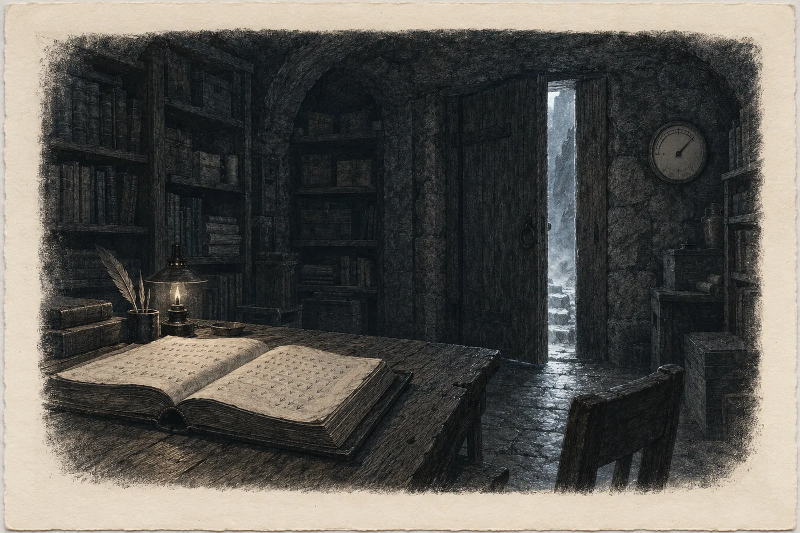

# Prolog. Teplo

Úmrtí se zapisovala v noci. Tak to bylo, dokud Sael pamatovala, a tak to podle knihy bylo i dřív. Ve dne se pláče, vaří a myje mrtvé tělo. Teprve když se v sídle zhasne, sedne si ten, kdo pamatuje, ke stolu a napíše řádek, který už nikdo nezmění.

Václav Ostrý zemřel v pondělí čtrnáctého ledna ve čtvrt na pět odpoledne. Nahoře ve statku, v posteli u okna, ze kterého bylo přes sad vidět na střechy Mlýnce. Bylo mu sto čtyři roky. V občance měl osmdesát jedna, protože víc se u malého suchého dědka z kopců vysvětlit nedalo. Lada u něj seděla od poledne a držela ho za ruku. Když bylo po všem, otevřela okno dokořán, jak se to u nich dělá, i když venku bylo dvanáct pod nulou. Pak sešla dolů do sídla, zastavila se ve dveřích archivu a řekla jen: „Bratr.“

Sael kývla. Víc nebylo třeba říkat. Znaly se celý Ladin život.

*

Kniha ležela na stole, kde ležela vždycky, otevřená na posledním svazku. Ten založila Rokyta v zimě po válce, když se starý svazek zaplnil až k deskám. Rokytina ruka byla na prvních stránkách široká a jistá. Pak přišel řádek, pod nímž stál znak úřadu v jiné ruce, s dlouhým tahem dolů, který se v ohybu trochu zdvojil. Sael ho nakreslila v osmdesáti šesti letech a bála se. Od té doby psala ona.

Václavovo narození bylo o čtyřicet listů dřív. Zima roku 1926, Rokytinou rukou. Sael si pamatovala, jak tehdy držela lampu, protože Rokytě se třásla ruka zimou, a jak se novorozenec ve vedlejší síni rozkřičel tak, že Rokyta zvedla pero a čekala, až přestane. Nepřestal. Rokyta se zasmála a napsala to s tím křikem v uších.

Teď Sael napsala jeho konec.

Psala jejich písmem, ptačími stopami. Václav nepřišel zvenku, narodil se tady, pod horou, a tak se jeho jméno psalo písmem, které se pod horou psalo vždycky. Občanské jméno připsala na kraj latinkou, drobně. To dělala až ona a Rokyta jí to tehdy vyčítala. Kniha není pro úřady, říkala. Sael odpověděla, že úřady o knize nevědí. Jednou se ale někdo zeptá, kdo byl Václav Ostrý z čísla popisného sedmnáct. Až se zeptá, má se vědět, že to byl tentýž člověk.

Rokyta tehdy nic neřekla. Za tři roky jí podala pero.

*

Teplo si Sael všimla až u data.

Nejdřív ne na kůži. Na papíře. List pod její dlaní se nepatrně zvedl na okraji, jako se zvedá list, když se k němu přiblíží lampa. Sael zvedla ruku a podívala se na stránku proti světlu. Papír byl v pořádku. Jen se hýbal.

Podívala se na vlhkoměr na stěně. Šedesát let ukazoval mezi čtyřicítkou a pětačtyřicítkou. Jen v srpnu se ručička někdy pohnula výš, když nahoře v sadu pršelo týden v kuse. Teď stála na padesáti a Sael se na ni dívala tak dlouho, až se posunula na padesát jedna.

Za stěnou archivu byla skála. Ne zeď, kterou postavil někdo z nich, ale skála hory, hladce otesaná, ve které stála vrata do spodních síní. Šedesát let byla teplá. Stejně teplá v lednu jako v červenci, teplá jako dlaň člověka, který spí. Když Sael psala dlouho a bolela ji záda, opřela se o ni a nechala si to teplo jít do ramen. Nikdy nad tím nepřemýšlela. Tak bylo dobře. Tak to bylo vždycky.

Teď se o ni opřela znovu, protože chtěla vědět.

Skála hřála jako kamna, do kterých se právě přiložilo.

Sael vstala. Kniha zůstala ležet otevřená a inkoust na Václavově řádku ještě nezaschl. Na tohle myslela jako první, později se za to styděla. Pak teprve na lidi.

Vrata do spodní síně byla dřevěná, z dubových fošen, stará přes sto let. Sael pamatovala, jak je stavěli. Přes noc se na nich zevnitř srazila voda. Ne kapky. Jemná šedá mlha, jako dech na skle, a když Sael přejela prstem po dřevě, zůstala za ním tmavá čára.

Nahoře na schodech se ozvalo pípání. Krátké, vysoké, vytrvalé.

Lada scházela dolů rychleji, než chodila roky. Byla malá i na jejich míru, sotva Sael po prsa, a široká v ramenou, s bílými vlasy staženými do uzlu. Jednou rukou se držela zábradlí a ve druhé nesla měřák, žlutou krabičku velkou jako mýdlo, kterou jí Tadeáš loni koupil přes internet. Měřák pípal a blikal červeně.

„Dolů ne,“ řekla Lada. Zastavila se na posledním schodu a podržela měřák nad hlavou. Pípání zesláblo. Spustila ho ke kolenům a pípání zhoustlo. „Leží to dole. U země. Jako voda.“

„Kolik?“

„Nahoře dvě procenta. U podlahy čtyři. Za vraty víc, to tam nepůjdu měřit.“ Lada se dívala na vrata, na šedý dech na dubovém dřevě. Ještě měla na sobě zástěru ze statku, s mokrou skvrnou na břiše, kde se opírala o umyvadlo. „Kluci jsou nahoře. Všichni. Poslala jsem je, jak to začalo.“

„Kdy to začalo?“

„Před dvěma hodinami. Kotelna ve skleníku hlásí osmdesát na vstupu. Má tam mít čtyřicet.“ Lada konečně pohlédla na Sael. Měla oči zarudlé od odpoledne a teď v nich bylo ještě něco jiného. Sael to znala. Viděla to v knize, v rukách, které psaly roku 1172, i když to nikdo nenapsal. „Skála se hýbe, Sael. Cítím ji v nohou.“

Sael to necítila. Nohy Ostrých slyšely skálu líp než její uši. Tak to bylo vždycky.

„Vrata,“ řekla.

„Ne.“

„Jen nahoře. Škvírou.“

Lada se na ni dívala dlouho. Pak sešla z posledního schodu, postavila se vedle ní a podala jí měřák. Sama vzala za železnou kliku.

*

Spodní síň byla dlouhá a nízká a na konci, kde se strop zvedal, končila skálou, která nebyla skála.

Sael ji znala. Viděla ji tisíckrát. Kus hladkosti velký asi jako vrata do stodoly, který kdysi vyčistili předkové Ostrých. Kolem něj zůstala surová hornina, rezavá a rozpukaná. Hladkost byla tmavá, mírně vypouklá, bez spáry a bez rýhy, a v tom tmavém se nic neodráželo, ani kahan, ani tvář. Pod ní stála kamenná lavice, na kterou si staří sedali, když chtěli být sami. Někdy na ni položili dlaň a mlčeli. Nikdo z nich neuměl říct, co to je. Říkali tomu teplá skála, protože tak tomu říkala Ostra, tak to stálo i v mnichově knize a jiné jméno nikdo neměl. A když se někdo z dětí zeptal, proč nikdy nesvítí, jak se vypráví, odpověděli mu Ostřinými slovy, která se pod horou předávala přes osm set let:

*Skála spí.*

Teď nespala.

Uvnitř hladkosti bylo světlo.

Sael stála na prahu, u škvíry ve vratech pootevřených na šířku dlaně, a dívala se po schodech dolů, přes celou síň. V ruce držela Ladin měřák. Měřák pípal. Nedívala se na něj.

Světlo nepřicházelo zvenku. Kahany v síni nehořely. Od Vánoc tam nikdo nesvítil. Světlo bylo hluboko uvnitř, jako by hladkost byla vodní hladina a někdo daleko pod ní pomalu zvedal lampu. Nebylo žluté ani bílé. Bylo bledé tak, jak je bledý list papíru, když se drží proti oknu, aby se ukázal vodoznak. Sael tu barvu znala z dílny. Znala ji z tisíce listů, které proti oknu držela. Teď ji viděla v kameni.

Pak světlo sílilo a za ním se otevřela tma.

Hluboká, čistá, a v ní světla. Tolik, kolik jich Sael neviděla ani za nejjasnějších nocí nad hřebenem, kam za mládí chodila sama. Hustá jako zrní, které se vysype na tmavé sukno. Hvězdy, řekla by kdokoli. Sael řekla jen to, co viděla: tečky světla, nespočet.

Některé se pohnuly.

Počítala je, protože počítat bylo to jediné, co v té chvíli uměla. Devět. Padaly pomalu, v řadě, jedno za druhým, a za každým zůstávala bledá stopa. Deváté bylo slabší než ostatní a padalo pozadu, jako by se opozdilo. Mnich tenkrát napsal *novem*, devět. Sael to věděla, protože tu stránku držela v rukou tolikrát, že ji uměla nazpaměť i s dírou v pergamenu, kterou mnichův text obtékal.

Pod padajícími světly se z tmy zvedlo něco velkého a zakřiveného. Mnich tam viděl zelenou, modrou a bílou. Sael viděla jen to, že je to světlejší než tma, místy víc, místy míň, a že jedna z těch barev mohla být modrá. V šeru barvy nerozeznávala nikdy. Rokyta jí to kdysi vyčítala u inkoustů. Pak se to zakřivené přiblížilo a byl to kraj, viděný shora, jak ho vidí káně nad hřebenem. Hory. Mezi nimi voda, lesknoucí se. Sael ty hory neznala. Nebyly to Krušné hory ani Slavkovský les. Nebyly to žádné hory, které by kdy viděla.

Světla do toho kraje padala a zmizela v něm.

Pak domy.

Nízké, oblé, jako bochníky položené na prkně, a stály v řadách. V tak rovných řadách, že Sael napadlo jen jedno: jako řádky v knize, kterou psal někdo, kdo se nikdy nespletl. Mezi nimi cesty a na cestách postavy, malé, tak malé, že neviděla nic než to, že chodí.

A nad nimi, nad oblými střechami, se tma znovu otevřela a v ní bylo jedno světlo. Nepadalo. Přicházelo. Zvětšovalo se, jako se na noční cestě zvětšuje lucerna toho, kdo jde k domu, a Sael pochopila, proč mnich napsal *aliunde*. Nepřicházelo z místa, odkud padala ta první. Přicházelo z jiné strany tmy.

Pak zhaslo všechno.

Sael se podívala na hodinky. Nevěděla, proč to udělala, ale udělala to, a pak si uvědomila, že čeká na začátek. Když se světlo uvnitř hladkosti zvedlo podruhé, stiskla tlačítko na boku. Mnich to měřil Otčenášem. Ona měla hodinky s malým displejem, které jí dala Olše k sedmdesátinám v občance, protože prý nikdy neví, kolik je hodin.

Třicet osm vteřin.

Potřetí třicet osm vteřin.

Vedle ní Lada nedýchala. Pak ano, krátce a mělce, jak se dýchá v plynu, a Sael ji vzala za loket, aniž se otočila.

Mnich psal, že potom viděl světlo stoupat skrz skálu. Sael na to čekala. Viděla tu stránku tolikrát.

Nestalo se to.

Světlo se stáhlo doprostřed hladkosti, to ano. Zmenšilo se na skvrnu velkou jako dlaň, mdlou, sotva viditelnou. Tam zůstalo. A tam pulzovalo, slabě a pomalu, zesílilo a zesláblo, zesílilo a zesláblo, jako tep na zápěstí, když se člověk dotkne dvěma prsty. Sael počítala. Pak přestala, protože dlouhé počítání bylo k ničemu. Tep nebyl pravidelný. Měl skupiny. Tři a pauza, dva a pauza, čtyři.

Pak zhasl i ten.

Hladkost byla tmavá. Po jejím povrchu stékal tenký film vody a ve tmě se z něj kouřilo. Sael to viděla dobře, líp než by to viděl kdokoli denní. Teplo z té věci šlo až ke schodům, přes celou síň, a dýchalo jí do tváře.

„Hoří,“ řekla Lada tiše.

„Nehoří.“

„Hoří.“ Lada vzala Sael měřák z ruky. Pípal pořád. „Ty to nevidíš. Ty vidíš, co je v knize.“

Sael neodpověděla. Lada měla napůl pravdu a obě to věděly.

Shora zarachotily kroky. Tadeáš, ve svetru přes pyžamo, s otevřeným notebookem v náručí jako s dítětem. Zastavil se na odpočívadle, kde ho Lada zarazila zvednutou rukou, a díval se dolů, na škvíru ve vratech, na tmu za ní. Bylo mu třicet let a celý život se díval na tu hladkost a chtěl vědět, jak funguje. Teď měl v obličeji výraz, pro který by Sael v knize napsala jediné slovo. Radost.

„Ve skleníku stoupá všechno,“ řekl. „Voda, vzduch, tlak v okruhu. Začalo to v jedenadvacet čtyřicet. A teď…“ Podíval se na displej. „Teď jsem měl na čidle u skály skok. Třiadvacet padesát jedna.“

„Napiš si to,“ řekla Sael.

„Mám to.“

„Napiš si to rukou.“

Tadeáš se na ni podíval, jako by nerozuměl. Pak sáhl do kapsy svetru pro propisku a napsal si čas na hřbet ruky, protože jiný papír u sebe neměl.

*

Archiv byl teplý. Vlhkoměr ukazoval padesát čtyři.

Sael zavřela vrata do spodní síně a pod spáru nacpala deku, jak jí Lada poradila. Pak otevřela okno do šachty nad stolem, které se neotvíralo od léta, a do archivu vtekl mráz ze statku. Nadechla se ho. Pak si sedla.

Kniha ležela otevřená. Inkoust na Václavově řádku zaschl.

Vzala pero.

Psala pod Václava, protože jiné místo kniha neměla. Kniha byla na lidi, ne na skálu. Ale v nejhlubší vrstvě, na nejstarším listu, stál vedle kresby kopce kruh a čtyřicet jedna čárek, každá za jednoho, kdo tehdy vyšel z hory živý. To taky nebyl jen rodokmen. Kniha zapisovala, co se stalo lidem pod horou. A dnes v noci se lidem pod horou stalo tohle.

Psala přesně. Tak, jak to dělali všichni před ní, jak to dělala Rokyta, Svída, Jíva, Aurel a ti, jejichž jména se nezachovala, jen jejich znak. Nevykládala. Nehledala slovo, které by bylo krásné. Hledala slovo, které bylo pravdivé.

*Teplá skála se rozsvítila uvnitř. Světlo bledé. Tečky světla, nespočet. Devět se pohnulo a padalo pomalu v řadě, deváté slabší a pozadu. Kraj shora, hory a voda, hory neznámé. Domy nízké a oblé v rovných řadách. Postavy. Jedno světlo přichází.*

Zastavila se.

Jejich písmo bylo staré a chudé. Mělo znak pro shora a znak pro zdola. Mělo znak pro z lesa, z vody, z nitra hory. Mělo znak pro zvenku, pro ty, kdo přišli z denního světa. Ten se psal u přijatých dětí, u nástrojů, u soli. Mělo všechno, co potřeboval lid, který žil pod jednou horou a ve dvou lesích a u jedné řeky a znal každou cestu, kterou se k němu dalo přijít.

Nemělo znak pro odjinud.

Sael seděla nad stránkou s perem ve vzduchu a za zády jí hřála skála. Vlhkoměr se zastavil na padesáti pěti. Nahoře ve statku někdo zavřel Václavovo okno. Slyšela to šachtou, tichý dřevěný úder rámu o rám.

Mnich na to slovo měl. Napsal ho latinkou, ve svém jazyce, protože jeho jazyk byl širší a znal víc cest. *Aliunde.* Odjinud. Sael tu stránku viděla stokrát a do dnešní noci se nad tím slovem nezastavila. Bylo to prostě slovo cizího muže v cizí řeči.

Pak namočila pero znovu a napsala na konec řádku latinkou, pečlivě, aby se to dalo přečíst i za čtyři sta let:

*aliunde*

Tak se v knize psala jména těch, kdo přišli zvenku. Jejich písmem. Aby se vědělo, odkud přišli, i když se zapomene, kdo byli.

Pak Sael přidala čas, ten z Tadeášovy ruky, a třikrát třicet osm vteřin. Pod to napsala ještě jednu věc, kterou mnich nenapsal, protože se mu nestala.

*Nestoupalo. Zůstalo uprostřed a tlouklo. Pak zhaslo.*

Pod řádek udělala znak úřadu. Dlouhý tah dolů.

Ruka se jí nechvěla. Až potom, když položila pero, si všimla, že ji ten tah stál víc než všechny řádky, které toho dne napsala. Neměla slovo pro to, co přichází. Napsala jen, že to přichází.

Tak to bylo vždycky. Kniha zapisuje, co se stalo. Co to znamená, má vědět ten, kdo ji bude číst.

Sael tentokrát nevěděla, kdo to bude.
