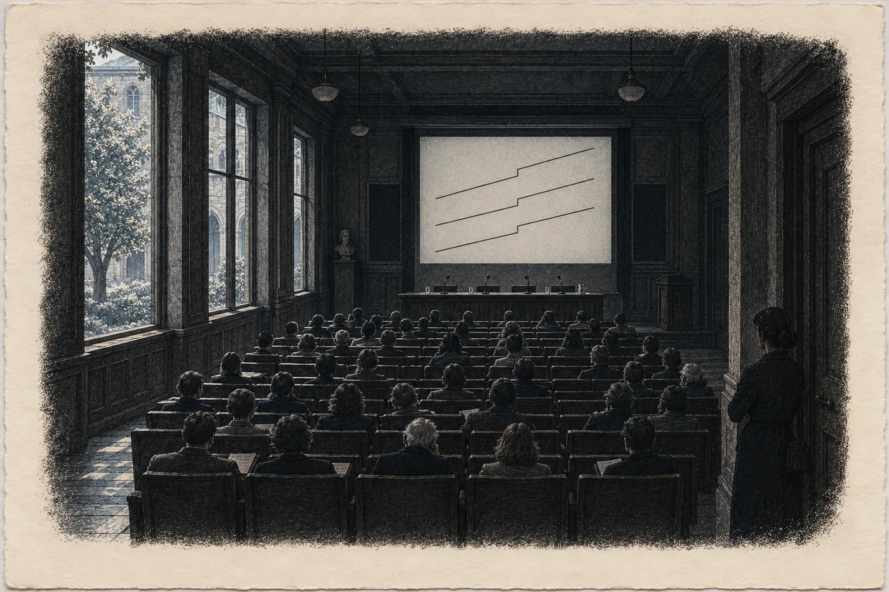

# Epilog II. Přílet

V sedm ráno má Hana v telefonu krátkou zprávu.

*Jméno doplněno. T. K.*

Otevře server, kde od desátého června leží její balík, a najde tu položku. Zpoždění čtyři celá dvě sekundy po každé skupině zdroje, změřené u skály třetího března. Pod tím, kde stálo *nezávislý radioastronom, jméno bude doplněno*, teď stojí *Tomáš Kalina* a odkaz. Odkaz vede na preprint, který byl zveřejněn o půlnoci.

Hana ho nečte. Ještě ne. Zavře telefon a jde se osprchovat, protože ví, že kdyby ho začala číst teď, nepřestala by a přijela by pozdě.

Vlak do Prahy jede v osm dvacet.

*

Sál je menší, než čekala. Dvanáct řad židlí, plátno, stůl se čtyřmi mikrofony a se sklenicemi vody, na které nikdo nesáhne. Okna do dvora s lípou. Ústav, ve kterém Kalina dvacet let počítá šum.

V jedenáct padesát je plno. Novináři, kameramani, lidé s visačkami, které Hana nezná, a několik starých pánů v sakách, kteří sedí v první řadě s rukama na kolenou a vypadají jako lidé, kteří sem přišli zjistit, jestli se jejich kolega nezbláznil.

Hana stojí vzadu, u zdi vedle dveří. Nikdo ji nepozná. Nebo pozná a nic neřekne.

Kalina přijde ve dvanáct nula nula. Ve stejné bundě jako v Brně v únoru, jako na nádraží v Chebu, jako v jídelně penzionu. Pod bundou košile, kterou zjevně koupil včera. Za ním žena z ústavu, která má na starosti tisk, a dva lidé, které Hana nezná. Muž a žena. Spoluautoři. Jeden přiletěl z jižní polokoule, druhá z observatoře v Evropě, a oba vypadají stejně nevyspale jako Kalina.

Kalina si sedne. Upraví si mikrofon. Podívá se do sálu.

Hanu najde za tři vteřiny. Nekývne. Jen se na ni podívá, krátce, a pak se dívá jinam.

„Dobrý den,“ řekne. „Budu mluvit krátce. Pak se ptejte. Na co nebudu vědět odpověď, to vám řeknu.“

*

Mluví dvanáct minut. Hana je počítá.

Zdroj, který sleduje od podzimu dvacet pět. Poloha, která se posouvá v řadě. Úzkopásmové strukturované signály od září dvacet devět. Frekvence, která klesá. Pak plátno a na něm čára, rovná jako pravítko, a v jednom místě zlom. Dvacátého devátého dubna, v nula třicet jedna světového času. A pod ní dvě další čáry, jiné barvy, z jiných přístrojů, z jiných konců světa. Zlom ve stejné minutě.

„Kámen nebrzdí ve krocích,“ řekne Kalina. „Kometa ani planetka nemění, jak zpomaluje. Přirozený jev, který by to dělal, neznám. Moji kolegové taky ne, a hledali jsme ho čtyři měsíce.“ Odmlčí se. „Proto říkáme, co říkáme. Je to technologický objekt. Pohybuje se k nám a brzdí. A to, jak brzdí, je řízené.“

Sál je tichý. Hana slyší, jak za oknem někdo zametá dvůr.

„Pokud bude brzdit dál tak jako teď,“ řekne Kalina, „dostane se do vnitřních částí naší soustavy za několik let. Kolik přesně, nevím. Nevím, jestli bude brzdit dál takhle. Nevím, kam přesně letí.“ Podívá se na papír před sebou, i když z něj nečte. „A nevím, proč.“

Řekne to stejně, jako řekl všechno ostatní. Rovně, bez důrazu. Hana si uvědomí, že takhle to říkal i jí, v Brně, nad devíti listy na dvou stolech. *Nevím, jakou chybu jsem nevyloučil.*

Teď ji vyloučil. Všechny, které znal.

*

Ptají se dlouho.

Jestli jsou to mimozemšťané. *Nevím, kdo to řídí. Vím, že se to řídí.* Jestli jsou nebezpeční. *Nevím. Nic, co jsem změřil, neříká ani ano, ani ne.* Jestli s nimi někdo mluvil. *Ne. Pokud vím, ne.* Jestli jsou signály zpráva. *Jsou strukturované. To je všechno, co o nich můžu říct. Co znamenají, neumím přečíst a nebudu předstírat, že umím.* Jak dlouho to věděl. *Že je to objekt, od dubna. Že je to řízené, od května, kdy to změřily obě observatoře. Neřekl jsem to dřív, protože jsem si nebyl jistý. Teď jsem si jistý tím, co tady stojí. Ničím víc.*

Pak se zvedne ruka uprostřed sálu. Mladý muž s mikrofonem s logem jednoho zpravodajského kanálu.

„Pane doktore. Ve vašem článku je jedna věc, která není z vesmíru. Pulzy ze země. Z Chebska. Souvisí to?“

Kalina se na něj chvíli dívá.

„Na Chebsku je zařízení, které vysílá slabé pulzy,“ řekne. „Pod zemí. Pulzy jsou časované na tento zdroj. Přicházejí čtyři celá dvě sekundy po každé skupině jeho signálu. Dvacátého devátého dubna se změnily ve stejné minutě jako zdroj. To jsem změřil. Data jsou veřejná, už od června, v jednom souboru, který zveřejnila geoarcheoložka, se kterou jsem spolupracoval.“

„Paní Vrbová,“ řekne mladý muž.

„Paní doktorka Vrbová,“ řekne Kalina.

V sále to zašumí. Několik hlav se otočí. Hana stojí u zdi a nehne se. Je to zvláštní, myslí si, jak dobře člověk slyší vlastní jméno v sále, kde ho řekl někdo jiný.

„Kdo to zařízení postavil?“ zeptá se mladý muž.

„Nevím,“ řekne Kalina.

„Je to stejná technologie?“

„Nevím. Vím, že to zařízení poslouchá stejný zdroj jako já. A že na něj reaguje rychleji, než bych to uměl já.“ Kalina se odmlčí. „Paní doktorka Vrbová měřila u toho místa teplotu pramene. Od února do června. Každý den v osm ráno. Měřila dobře. Víc vám k tomu neřeknu, protože víc nevím, a co vím o tom místě, není moje.“

Pak ukáže na jinou ruku.

*

Když konference skončí, Hana odejde první. Dveře jsou hned vedle ní.

Na chodbě ji dožene žena s visačkou a diktafonem. Středních let, unavená, slušná.

„Paní Vrbová? Jen jednu otázku. Vy jste ta… atlantoložka?“

Hana se zastaví.

Ví, co by mohla říct. Že ten válec v roce dvacet šest nebyl její podvrh. Že ho odhalila ona. Že oprava byla její. Že od února do června měřila každý den v osm ráno, že její balík zopakovali tři cizí lidé a vyšlo jim to, že o ní dnes mluvil radioastronom se dvěma observatořemi za zády.

Nic z toho nezmění, co je v titulcích.

„Ano,“ řekne. „Jsem ta, co měřila pramen.“

Žena s diktafonem se na ni podívá. Pak ho vypne.

„Moje máma bydlí v Chebu,“ řekne. „Říká, že ta pára nad Mlýncem je vidět až od přehrady.“

„Je,“ řekne Hana.

Žena kývne, jako by to stačilo, a odejde zpátky do sálu.

*

Kalina jí zavolá v pět odpoledne. Je slyšet, že je venku, na ulici, a že jde rychle.

„Utekl jsem,“ řekne. „Pozvali mě do tří televizí. Řekl jsem jim, že jsem všechno řekl ráno. Nevěřili mi.“

„Řekl jste všechno.“

„Řekl jsem všechno, co vím.“ Kalina se zastaví. Hana slyší tramvaj. „To není totéž. Ale je to jediné, co podepíšu.“

Chvíli mlčí.

„Ten pán z Mnichova,“ řekne pak. „Jeho nadace vydala ve dvě odpoledne prohlášení. Jedna věta. *Čekali jsme na tento den.* Nic víc.“

„Viděla jsem to.“

„Udělají z toho něco,“ řekne Kalina. „Ke každému číslu tři falešná. Tohle je číslo, na které budou čekat s deseti.“

„Já vím.“

„Tak dobře.“ A pak, jinak, skoro nesměle, jak Kalina nikdy nemluví: „Paní Vrbová. Děkuju vám, že jste stála vzadu.“

„Proč?“

„Protože kdybyste stála vepředu, ptali by se na vás. A takhle se ptali na data.“

Zavěsí dřív, než Hana stihne odpovědět. Kalina vždycky zavěsí dřív.

*

Večer sedí doma v Brně, v kuchyni, ze které je přes dvůr vidět na zeď domu naproti. Na zdi je ještě světlo, oranžové, poslední.

Na stole leží sešit. Ten nový, od dubna, se svislou čarou narýsovanou propiskou podle pravítka. Je skoro plný. Vedle něj na poličce stojí hnědá obálka s podpisem přes pásku, nepřerušeným. A v ní všechno od února, co Hana nikdy nikomu neukáže, pokud o to nepožádá soud.

Mezi stránkami sešitu, v levé půlce, leží kresba. Kopec, dům se sadem. Žlutý obdélník uvnitř kopce a malé postavy s rukama nahoře. *PRO PANÍ CO MĚŘÍ.* S jedním písmenem obráceně.

Hana sešit otevře na čisté dvojstraně.

Vlevo píše dlouho. Pečlivě, tiskacím písmem tam, kde jde o čísla, a psacím tam, kde jde o věty, které někdo řekl.

*22. 8. 2030, Praha. Tisková konference T. K. a dvou spoluautorů (observatoř na jižní polokouli, observatoř v Evropě). Preprint od 0:00.*

*Zdroj = technologický objekt. Pohybuje se k nám, brzdí. Brzdění se mění ve krocích – řízené (T. K.: „Kámen nebrzdí ve krocích.“). Zlom 29. 4., 0:31 UT, ve třech nezávislých záznamech.*

*Do vnitřní soustavy „za několik let“, pokud bude brzdit takto. Kam, neznámo. Úmysl neznámý.*

*Pulzy z Chebska časované na zdroj (4,2 s), změna 29. 4. ve stejné minutě. Data veřejná od 10. 6. Kalinovo jméno doplněno dnes v 7:00.*

*Nadace v Mnichově, 14:00: „Čekali jsme na tento den.“*

*Na chodbě: „Vy jste ta atlantoložka?“ – „Ano. Jsem ta, co měřila pramen.“*

Pak se zastaví.

Listuje dozadu. Přes červenec, přes červen, přes noc na dvoře s hasiči, přes Kalinova slova o krocích v jídelně penzionu. Až k první stránce, ke konci dubna. Březen je v tom druhém sešitu, zalepeném, ale Hana si pamatuje, co tam stálo vpravo. Pamatuje si všechno, co napsala. Neumí to zapomenout.

*Přivezli je. A nechali je tam.*

*vyhnanství?*

Otazník tam zůstal. Nikdo ho nevymazal. Nikdo neměl čím. Nic z toho, co dnes řekl Kalina, ho neodstranilo. Kalina mluvil o tom, co přichází. Ne o tom, co bylo.

Hana se vrátí na čistou dvojstranu.

Vpravo napíše tři otázky. Pod sebe, s mezerou mezi každou, aby bylo kam připsat, až bude co.

*Kdo jsou?*

*Proč přesně sem?*

Pak dlouho drží tužku nad papírem. Za oknem na zdi domu naproti zhasne poslední světlo a dvůr je modrý. Někde dole někdo zavře okno, dřevěný úder rámu o rám.

Hana myslí na teplou skálu. Na bledé světlo jako list papíru proti oknu, na devět padajících, z nichž deváté nepřistane. Na kraj shora s horami, které nikdo nezná. Na osm protáhlých strojů a řady lidí s prázdnýma rukama. Na mřížky, které počítají a nikomu neříkají co. A na to, co Sael viděla v lednu poprvé za svůj život a co mnich viděl roku 1172: jedno světlo, které nepadá. Které přichází. Odjinud.

Skála to ukázala před osmi sty lety a nikdo nevěděl komu. Teď to ukazuje každou noc prázdné hoře a jedné kameře, které zbývá místo do září.

Hana napíše třetí otázku.

*Co skála ukazovala, když je viděla přicházet?*

Neodpoví na ni. Nikdo na ni dnes odpovědět neumí, a ona to ví, a napíše to vlevo, malým písmem, pod čáru, aby to tam stálo taky:

*Nevím.*

Pak sešit zavře. Nechá ho ležet na stole, vedle kresby, kterou do něj zase vloží, a zhasne.

V kuchyni je tma. Hana stojí u okna a dívá se nahoru, přes dvůr, mezi střechy. Je tam kus nebe. Pár hvězd, které jsou vidět i nad městem.

Žádná se nepohne.
