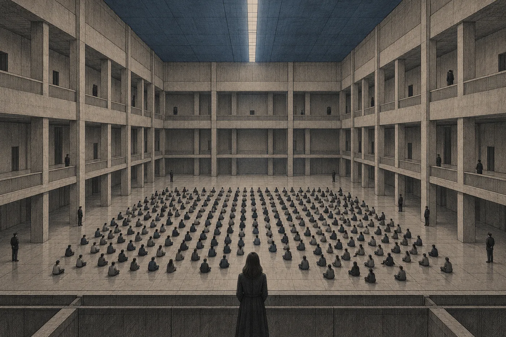

# 1. Odpojení

Jednání o vodě skončilo v jedenáct dvanáct a Nara Vess ho vyhrála jednou větou.

Celé dopoledne stála v malé síni ve třetím patře soudu a poslouchala, jak správa vodního okruhu vysvětluje, proč spodní patra Orsy dostávají o osminu méně vody než horní. Výpočty měla správa bezvadné. Tlak v rozvodech, ztráty v čerpadlech, náklady na zpětné čištění. Nara je nerozporovala. Počkala, až zástupce správy domluví, a pak se zeptala, kolikrát za posledních deset let správa navrhla, aby se o osminu méně vody dostávalo horním patrům.

„Nikdy,“ řekl zástupce správy. „Nebylo k tomu technického důvodu.“

„Děkuji,“ řekla Nara. „Víc otázek nemám.“

Soudce se na ni podíval. Byl to starý muž s úzkými rameny a poslouchal tak, že při tom zavíral oči. Teď je otevřel, krátce kývl a řekl, že rozhodnutí vyhlásí odpoledne. Oba věděli, jak dopadne. Technický důvod platil vždycky jen jedním směrem. Nara to nemusela dokazovat. Stačilo, aby to bylo slyšet v síni a zapsalo se to.

Zástupce správy si skládal věci pomalu. Byl mladý a dobře připravený a teď nevěděl, kde udělal chybu. Žádnou neudělal. Nara by mu to ráda řekla, ale to se nedělá.

Vyšla na chodbu a jednací filtr se zvedl.

*

Dvacet let si u jednání nenechávala projít nic. Ani zprávy z kanceláře, ani zprávy z domova, ani řádek o počasí v okruhu, o rotaci, o tom, že za čtyři minuty jí jede kyvadlo. Filtr držel všechno za dveřmi síně. Pak to pustil najednou, a ona byla zvyklá na ten krátký nával. V koutku vědomí, kam se člověk nedívá a přesto ví, co tam je, se pokaždé nahrnula dopolední hromádka. Většinou nic. Termíny. Dotazy. Jednou za měsíc něco, kvůli čemu se zastavila.

Tentokrát to nepřišlo najednou. Síť to seřadila, a právě to pořadí bylo první, co Naru zarazilo.

*Odpoledne: zrušeno (2 položky). Důvod: rodinná událost.*

Zastavila se uprostřed chodby. Za ní kdosi zabrzdil a obešel ji.

*Sedmá loděnice — návštěva povolena zítra, 9:00–9:40. Rezervováno.*

*Do odletu: 46 dní.*

Teprve potom, na čtvrtém místě, menším písmem, jak se v síti píše všechno, co je doručeno a nevyžaduje odpověď:

*Rozsudek v hromadném řízení ve věci hnutí Nové otevření. Doručeno. Dotčená osoba: Ilan Vess. Vztah: syn.*

Nara stála na chodbě a dívala se na zeď před sebou. Zeď byla světle šedá. V Orse byly všechny chodby soudu světle šedé, protože kdysi kdosi rozhodl, že tahle barva nikoho nerozruší. Nara četla ten řádek a věděla, co znamená každé slovo zvlášť. Hromadné řízení. Doručeno. Dotčená osoba. Celá ta věta jí přesto chvíli nedávala smysl, jako text v řeči, kterou člověk zná jen z učebnice.

Pak si všimla, že má klidné ruce.

Zvedla je a podívala se na ně. Nechvěly se. Dech měla pomalý a pravidelný. Pomyslela si, že je to praxe. Dvacet let na chodbách soudu, dvacet let zpráv, které přicházely ve chvíli, kdy se nesměla zastavit. Tělo se naučilo počkat.

Byla na to chvíli pyšná. Později si na to vzpomněla.

*

„Paní Vess.“

Byl to zástupce správy vodního okruhu. Stál kousek od ní, se složkou pod paží, a v obličeji měl výraz, který na něm v síni neviděla. Ne porážku. Rozpaky.

„Je mi to líto,“ řekl.

Nejdřív nepochopila, co myslí. Vodu? Pak pochopila. Ten mladý muž seděl tři hodiny v síni bez jednacího filtru, protože filtr mají jen ti, kdo mluví. Celé dopoledne mu v koutku vědomí běžely zprávy. Rozsudek v hromadném řízení vyšel v devět čtyřicet. Veřejně. Čtyři sta jedna jmen, a mezi nimi jedno, které síť umí spojit s její tváří, protože síť umí spojit všechno. Viděl to, zatímco ona mluvila o vodě. Celou dobu, co mu kladla tu poslední otázku, to věděl.

„Děkuji,“ řekla.

Kývl a odešel rychleji, než musel.

Nara došla na konec chodby k oknu. Okno nevedlo ven. V Orse nevedlo ven žádné okno, které stálo za řeč; ven se dívaly jen servisní průzory na plášti a ty sloužily technikům. Tohle okno vedlo dovnitř, přes osu, na druhou stranu habitatu. Orsa se za sklem zvedala do oblouku. Nejdřív střechy sousedních bloků, pak terasy, pak zahrady na opačné straně, které visely vysoko nad ní hlavou dolů, a uprostřed toho všeho světelný pás podél osy, bílý a celý den stejný. Nara se na ten oblouk dívala celý život. Když byla malá, myslela si, že lidé nahoře musí padat. Matka jí tehdy řekla, že nahoře nikdo není, protože nahoře je jen to, kam se člověk zrovna nedívá.

Otevřela rozsudek.

*

Měl dvě stě šestnáct stran. Síť jí nabídla shrnutí, tři řádky, a Nara ho odmítla tím drobným pohybem uvnitř hlavy, kterým se odmítá všechno, co člověk nechce. Shrnutí nečetla nikdy. Shrnutí napsal někdo, kdo už rozhodl, co je důležité.

Trestní soud prstence Halm. Řízení písemné, bez jednání. Návrh podal Koloniální úřad, za něj státní zástupkyně S. Ardaine. Obhájce ustanovený soudem, jeden, pro všechny obviněné. Ustanoven šest dní před rozhodnutím.

Nara si to přečetla dvakrát. Pak to nechala být a četla dál, protože kdyby se zastavila u každé vady, nedošla by nikam. Vady si poznamenávala. Bez vůle, sama od sebe, jak ji to naučili před pětadvaceti lety: v koutku vědomí se jí skládal druhý seznam, tichý a úhledný, vedle textu. *Jeden obhájce na 401 osob. Ustanoven 6 dní předem. Bez jednání. Žádný individuální skutek.*

Skutková zjištění byla krátká. Dne toho a toho se na Dolním náměstí Orsy shromáždilo čtyři sta jedna osob. Veřejně se odpojily od sítě správy. Hlásí se k odkazu hnutí Otevřená mysl. Hnutí Nové otevření je pokračovatelem hnutí odsouzeného rozsudkem Terra, jak navrhl Koloniální úřad a jak soud v usnesení ze dne toho a toho přijal. Účast na veřejném odpojení je projevem členství.

Rozsudek Terra byl citován na sto devatenácti místech. Nara je nepočítala. Řekla si o to a síť jí číslo dala.

Pak jména. Abecedně. Ke každému čtyři řádky.

*Vess, Ilan, 17 let. Člen. Účast na shromáždění, veřejné odpojení. Přiznání: odmítnuto. Trest: trvalé vyhnanství bez přístupu k technologii; výkon druhým transportem.*

A pod tím, jako pod každým jménem, stejná věta:

*Vůči osobám ve společné domácnosti se v tomto řízení nepostupuje.*

Nara se dívala na ta slova a cítila, jak se v ní něco uvolnilo. Bylo to tak rychlé a tak tělesné, že se za to začala stydět dřív, než to stačila pojmenovat.

Ilan s ní nebydlel osm měsíců. Odešel v den, kdy mu bylo šestnáct a půl, protože od té doby to zákon dovoloval. Vzal si jednu tašku. Pokoj ho ještě týden poznával: když do něj vešla ona, rozsvítil se nejdřív na jeho hodnotu, teplejší a nižší, a teprve po vteřině se opravil na ni. Pak zapomněl. Nara tehdy uvažovala, jestli by neměla nastavení pokoje zamknout, aby nezapomněl. Neudělala to. Připadalo jí to sentimentální.

Teď tam stála v šedé chodbě a věděla, že ji jeho odchod právě vyňal z rozsudku. Kdyby zůstal, byla by osobou ve společné domácnosti. A věta pod jeho jménem by mluvila o ní.

*V tomto řízení.* Nara ta slova přečetla ještě jednou. Nebylo tam *nelze*. Bylo tam *nepostupuje se*. Soud nerozhodl, že osoby ve společné domácnosti trestat nesmí. Rozhodl, že je tentokrát trestat nebude. Kdo psal rozsudky, ten věděl, že tohle není milost. Je to rezerva.

Doručení: *vyvěšením v síti správy, neboť adresát je bez spojení.*

Nara se zasmála. Krátce, nosem, a zástupkyně jiné kanceláře, která šla kolem, se po ní ohlédla.

Ilan to nevěděl. Věděla to síť, věděl to celý soud a věděl to mladý muž od vodního okruhu. Věděla to ona. Ilan seděl někde v Sedmé loděnici, bez řádku v koutku vědomí, a právně mu byl rozsudek doručen v devět čtyřicet. Ve chvíli, kdy ho síť vyvěsila na místo, kam on nedosáhne, protože se od té sítě veřejně odpojil. Fikce doručení. Učila o ní studenty. Byla elegantní a Naru nikdy nenapadlo, že je k smíchu.

*

Na Dolním náměstí to bylo před jednatřiceti dny.

Seděla tehdy v kanceláři nad podáním, které už neexistovalo, a v koutku vědomí jí svítil řádek, který tam svítil sedmnáct let. *Ilan: poloha, stav.* Rodiče nezletilých ho mají. Ilan ho nenáviděl od dvanácti a Nara se do něj už roky nedívala. Slíbila mu to. Ilan jí to nikdy nevěřil. Řádek tam prostě svítil. Jako hodiny, na které se člověk nedívá, dokud se nezastaví.

*Ilan: Dolní náměstí.*

A pak, bez přechodu:

*Ilan: spojení ztraceno.*

Myslela si, že je to porucha. Ten řádek jednou za rok vypadl, když Ilan prošel servisním úsekem s odstíněním. Počkala. Pak jí síť nabídla zprávu z veřejného kanálu, protože síť zná souvislosti dřív než člověk: *Na Dolním náměstí se odpojuje větší skupina osob. Pořádková služba je na místě.*

Šla tam. Nejdřív rychle, pak, na posledním úseku chodby, běžela. Nevzpomínala si, kdy naposledy běžela. Lidé se po ní ohlíželi a síť jí přitom dvakrát nabídla, že zpomalí tep.

Dolní náměstí bylo největší otevřený prostor na Orse. Tři patra galerií kolem dokola, podlaha ze šedých dlaždic, které se nikdy neleskly, a nahoře, vysoko, světelný pás osy. Obvykle tu bylo hlučno. Lidé přecházeli, děti se honily kolem sloupů, z galerií se volalo dolů. Teď tu bylo ticho. Nara se zastavila na hraně galerie a nechápala, co slyší, dokud nepochopila, že neslyší nic.

Seděli na zemi. V řadách, ne úplně rovných, asi čtyři sta lidí. Skoro všichni mladí. Neseděli tak, jak sedí demonstranti, kteří čekají, až je někdo odnese. Seděli, jako sedí lidé, kteří někam dorazili. Někteří měli zavřené oči. Někteří se dívali kolem sebe, na galerie, na strop, jako by je viděli poprvé. Nikdo nemluvil. Všichni měli za pravým uchem stejný šedý čtvereček, tenký, velký jako nehet palce. Nara nevěděla, co ten čtvereček dělá. Věděla jen, že je to trestné. A všichni měli na levém zápěstí bílý provázek, uvázaný na uzel.

Pořádková služba stála na okrajích a nedělala nic. Nahrávala. Nara to věděla, protože to věděla vždycky: zatýkat se bude později, podle záznamu.

Ilan seděl ve třetí řadě od kraje. Poznala ho podle ramen. Měl je po Davenovi, úzká a trochu nahrbená, a ve své šedé bundě vypadal mladší než na podzim, kdy odcházel. Když k němu došla, zvedl hlavu. Nepřekvapilo ho to. Věděl, že ten řádek existuje. A asi věděl i to, že se do něj dnes podívá.

„Ilane,“ řekla. „Vstaň.“

„Ahoj.“

„Poslouchej mě. Je to přestupek. Odpojení na veřejnosti je přestupek. Pokuta a povinné připojení, nic víc, pokud se to nezapíše jako shromáždění. Když vstaneš teď a odejdeš se mnou, je to jen tvůj přestupek a já ho vyřídím do týdne.“

Mluvila tiše a přesně. Tak mluvila s klienty, kteří se báli. Ilan ji poslouchal a nedíval se na ni. Díval se na její ústa, jako by se snažil číst, co říká.

„Já vím, co to je,“ řekl.

„Tak vstaň.“

„Sedni si.“

Řekl to klidně. Nebyla to výzva. Posunul se o kus stranou, na šedých dlaždicích, aby vedle něj vzniklo místo. Dívka vedle něj, drobná, s vlasy staženými dozadu, se taky posunula. Mezi nimi teď ležel kus podlahy, přesně tak velký, aby se na něj vešel jeden dospělý člověk.

Nara se na to místo dívala.

Pak se pořádková služba pohnula. Ne prudce. Jedna řada mužů a žen v tmavém vyšla od zdi a šla pomalu podél sedících. Nikoho se nedotýkali. Jen šli, a každý, kolem koho prošli, věděl, že teď je v záznamu podruhé. Šli i kolem Ilanovy řady. Nara stála v uličce mezi sedícími, přímo jim v cestě.

Udělala krok stranou.

Jediný krok, doleva, ke sloupu. Tak, jak se ustupuje z cesty úředníkovi na chodbě. Pustila je projít.

Ilan to viděl. Neřekl nic. Díval se na ni a pak na volné místo vedle sebe, a pak zase dopředu. Za chvíli ho dívka vedle něj vzala za ruku.

*

Ten krok měla v záznamu.

Síť zaznamenávala všechno, co Nara viděla a slyšela, a uchovávala to, dokud o to Nara stála. Bylo to užitečné. Při práci nepostradatelné. Nikdo nepamatoval doslovně, co svědek řekl před třemi měsíci; záznam ano. Naře to dávno splynulo s pamětí, tak jako každému. Když si na něco vzpomínala, většinou si to přehrávala.

Teď to udělala, stojíc u okna nad obloukem Orsy, a hned toho litovala.

Záznam byl přesný. Šedé dlaždice, galerie, ticho. Ilanova ramena. Jeho *Sedni si*. Volné místo na podlaze, které se v záznamu zdálo menší, než si ho pamatovala. Řada lidí v tmavém, jak se blíží. A pak se celý obraz posunul o kus doleva, k sloupu, plynule a bez zaváhání, a lidé v tmavém prošli tam, kde předtím stála.

Záznam neukazoval její tvář. Neukazoval nic, co by se dalo nazvat rozhodnutím. Ukazoval jen, jak se svět posunul o krok doleva.

Zavřela ho.

Odpojení byl přestupek. Řekla mu to tam na dlaždicích a měla pravdu, toho dne a ještě devatenáct dní potom. Pak Koloniální úřad navrhl trestnímu soudu prstence, aby Nové otevření prohlásil za pokračovatele hnutí odsouzeného rozsudkem Terra. Soud to přijal usnesením na dvou stranách. Od té chvíle už nikdo na náměstí nespáchal přestupek. Všichni byli členové.

Nara psala. Za jedenáct dní sedm podání, jako osoba blízká, jako matka nezletilého, jako advokátka pro ústavní věci, která má právo upozornit soud na vadu. Všechna přišla zpátky se stejnou větou. *Osoba blízká není účastníkem řízení; podání se nepřipouští.* Nara tu větu znala. Sama ji kdysi napsala do jednoho vyjádření, za správu jednoho habitatu, proti jedné rodině, která chtěla mluvit za svého otce. Vyhrála.

Ještě předevčírem si myslela, že má čas. Že písemné řízení se čtyřmi sty jednou osobami potrvá týdny. Trvalo šest dní.

*

Na jejím stole v kanceláři ležely tři věci, které tam ležely vždycky: deska s výtiskem ústavy, kterou nikdo neotvíral, šálek a kámen. Kámen byl šedý, hladký a velký jako vejce. Ilan ho přinesl ze školy, když mu bylo osm. Řekl, že je to kámen ze Země. Učitelka jim přinesla celou krabici a každé dítě si smělo jeden vzít. Nara věděla, že to není pravda. Žádný kámen ze Země na Orse nebyl, protože Zemi nikdo nikdy neviděl. Byla to drť z měsíčního lomu, obroušená v bubnu. Učitelka to dětem řekla jako pohádku, kterou si mají zapamatovat. Nara mu to tehdy nevyvrátila. Zdálo se jí to zbytečné.

Sedla si a vzala ho do ruky. Pak ho položila zpátky.

Síť jí oznámila, že volá Daven.

*Později,* odpověděla.

Pak se zeptala sítě, jak se dostane zpráva k Ilanovi.

Odpověď přišla hned, protože na tu otázku se ptal každý. *Odsouzený je bez spojení. Zprávu lze předat ústně, prostřednictvím personálu Sedmé loděnice, jednou denně. Rozsah: nejvýše dvacet slov. Zpráva bude zaznamenána.*

Dvacet slov.

Nara psala soudům podání o čtyřiceti stranách a soudci je četli celá. Teď seděla nad prázdným řádkem a měla dvacet slov a strážného, který je řekne nahlas, tím hlasem, jakým se ohlašují návštěvní hodiny.

*Ilane, rozsudek vyšel. Vyhnanství, druhý transport, odlet za 46 dní. Podám návrh. Zítra v devět přijdu. Máma.*

Spočítala to. Sedmnáct. Vešlo se to. Byla to dobrá zpráva. Měla všechno, co zpráva má mít: fakt, lhůtu, postup, termín. Kdyby ji dostala od klienta, pochválila by ho.

Smazala ji.

*Ilane. Jsem tady. Udělám všechno. Neboj se.*

Sedm slov. Žádný fakt. Ilan by je slyšel od cizího člověka v uniformě, v místnosti, kde svítí pořád stejně, a nevěděl by, co znamenají. Nevěděl by, jestli je to útěcha, nebo oznámení, že je zle. *Neboj se* se neříká člověku, kterému se nic nestalo.

Smazala i tu.

Napsala ještě třetí, a ta byla horší než obě předchozí, protože se v ní snažila být obojí. Pak zprávu zavřela a nenapsala nic. Řekne mu to zítra. Sama, nahlas, celé. Ne dvacet slov přes cizí ústa. A věděla, že to není důvod. Důvod byl, že neuměla napsat dvacet slov, která by byla pravda, a nechtěla, aby si ji Ilan pamatoval podle toho, co se vešlo.

Pak otevřela záznam o transportu. Byl veřejný a krátký, jak už takové záznamy bývají. *Druhý transport. Výkon trestu vyhnanství podle precedentu Terra. Osob: 6 012. Místo výkonu: Země. Odlet: Sedmá loděnice, 46. den od dnešního, 6:00.*

Šest tisíc dvanáct.

O těch ostatních věděla. To byla první věc, kterou si teď musela přiznat, a přiznala si ji rychle, aby to měla za sebou. Hromadná řízení probíhala od jara, po celém prstenci. Nejdřív na Ketě, pak na dvou menších habitatech u vnějšího okraje, pak v Lumě. Nara je četla. Četla je tak, jak se čtou neštěstí cizích lidí, pozorně a s odstupem, kterému říkala profesní. Psala si k nim poznámky. Jednou o nich mluvila s Askem nad večeří a řekla, že precedens Terra je právní zkamenělina a že ho soudy oprašují jen proto, že je pohodlný. Asko se usmál a řekl, že zkameněliny jsou tvrdé. Pak mluvili o něčem jiném.

Čtyři sta jedna z Orsy bylo poslední hromadné řízení. Proto teď. Proto čtyřicet šest dní. Transport čekal jen na ně.

Síť jí mezitím nabídla vzor podání.

Nabídla ho nenápadně, jak nabízí všechno, co předvídá: v koutku vědomí se objevil řádek, světlejší než ostatní, a v něm název. *Žádost o individuální výjimku z výkonu trestu — nezletilý.* Vedle drobná značka, která říkala, že vzor používají advokáti v podobných věcech a že má vysokou úspěšnost.

Nara ho otevřela. Byl dobře napsaný. Kdo ho psal, uměl to. Nezletilost, rodinné poměry, žádný individuální skutek, žádné předchozí přestupky. Žádost se podávala Koloniálnímu úřadu, ne soudu. Úřad mohl vyjmout jednotlivce z výkonu ze závažných důvodů. Nezletilost byla závažný důvod. Nara si spočítala, jak dlouho by to trvalo. Deset dní, možná dvanáct. Měla by odpověď v polovině lhůty.

Začala psát. První větu napsala bez přemýšlení, jak se píše věta, kterou člověk napsal stokrát. *Žadatelka, matka nezletilého Ilana Vess, žádá…*

U slova *žádá* se zastavila.

Viděla to celé. Viděla to tak, jak viděla jednání před jednáním, se všemi tahy. Žádost bude přijata. Ilan bude vyňat. Šest tisíc jedenáct lidí odletí 46. den ráno a Ilan zůstane. Precedens Terra zůstane, jak je. Za pět let ho nějaký soud vytáhne znovu, protože bude ležet po ruce, oprášený a vyzkoušený, a protože už ho jednou použili a nic se nestalo. Třetí transport. Ilan bude mít dvaadvacet a bude vědět, že ho matka vyňala. Bude to vědět každý den.

A nepřijme to. Viděla i tohle. Viděla ho, jak sedí na šedých dlaždicích a posouvá se, aby vedle něj vzniklo místo.

Ale to nebyl hlavní důvod. Nara si to řekla zřetelně, protože nechtěla, aby se jí to později pletlo. Hlavní důvod byl jiný a byl právní. Rozsudek, který právě četla, stál celý na jediném starém rozsudku. Sto devatenáct citací. Bez Terry by nebylo pokračovatelské hnutí, nebylo by členství, nebyl by kolektivní trest a nebyl by transport. Kdo chtěl zastavit transport, musel jít po Teře. Všechno ostatní byla jen žádost.

Rozsudek Terra ležel devět set let v učebnicích jako věc, která se stala jednou. Nikdo ho nikdy nenapadl. Nebylo proč. Do letošního jara.

Smazala první větu.

Síť se zeptala, jestli chce vzor uložit pro pozdější použití. Nara neodpověděla. Otevřela prázdné podání a napsala záhlaví. Napsala ho pomalu, slovo po slově, tak jak se píše něco, co se bude číst ještě dlouho.

*Spolkovému soudu Konfederace lidských světů.*

*Návrh na zastavení výkonu trestu vyhnanství — druhý transport.*

*Navrhovatelka: N. Vess.*

Dívala se na to. Pak dopsala ještě jeden řádek, aby věděla, s kým mluví.

*Odpůrce: Koloniální úřad.*

*

Večer šla domů pěšky. Kyvadlem by to bylo sedm minut. Pěšky čtyřicet, dvěma výtahy a dlouhou chodbou podél vodní nádrže, kde bylo vždycky o kus chladněji a kde si v dětství myslela, že voda za stěnou dýchá. Teď věděla, že to jsou čerpadla. Šla tamtudy stejně.

V bytě se rozsvítilo na její hodnotu. Prošla kolem dveří Ilanova pokoje. Byly zavřené, jako byly osm měsíců. Neotevřela je.

Daven volal ještě dvakrát. Napsala mu, že s ním promluví, až bude vědět, co říct. Odpověděl jediným slovem: *Kdy?* Nenapsala nic.

Pracovala do noci. Ne na návrhu. Na tom ještě nebyla. Pracovala na tom, co přijde před návrhem: četla rozsudek ještě jednou, celý, a pak ještě jednou jen jména. Čtyři sta jedna. U každého věk. Nejmladší patnáct. Nejstarší třiadvacet. Dívka s vlasy staženými dozadu tam nejspíš byla taky, jen nevěděla, pod kterým jménem. Nara se přistihla, že jména čte, jak se čtou svědci: hledá, kdo se dá použít. Kdo je nezletilý, kdo nemocný, kdo má matku v úřadě. Zastavila se.

V koutku vědomí stál řádek, který tam síť přidala ráno, aniž se jí kdo ptal. *Do odletu: 46 dní.* Neuměla ho schovat. Nebo uměla, ale nechtěla. Řádek byl malý a šedý, stejný jako ostatní, a stál v jedné řadě s časem, teplotou a stavem sítě. Kde dřív stálo *Ilan: poloha, stav*, teď nestálo nic. To místo síť po jednatřiceti dnech zrušila. Nara si toho všimla až teď. Řádek o odletu se posunul nahoru a zaplnil ho.

Ve dvacet tři padesát devět se na něj dívala.

Nehnul se. Nara věděla, že se hnout nemůže, že je to jen číslo, které síť přepočítá, až přijde jeho čas. Stejně se na něj dívala. Jako se člověk dívá na dveře, o kterých ví, že se otevřou.

V nula nula nula nula řádek bez hluku přeskočil.

*Do odletu: 45 dní.*

Síť to nehlásila. Jen to věděla.
