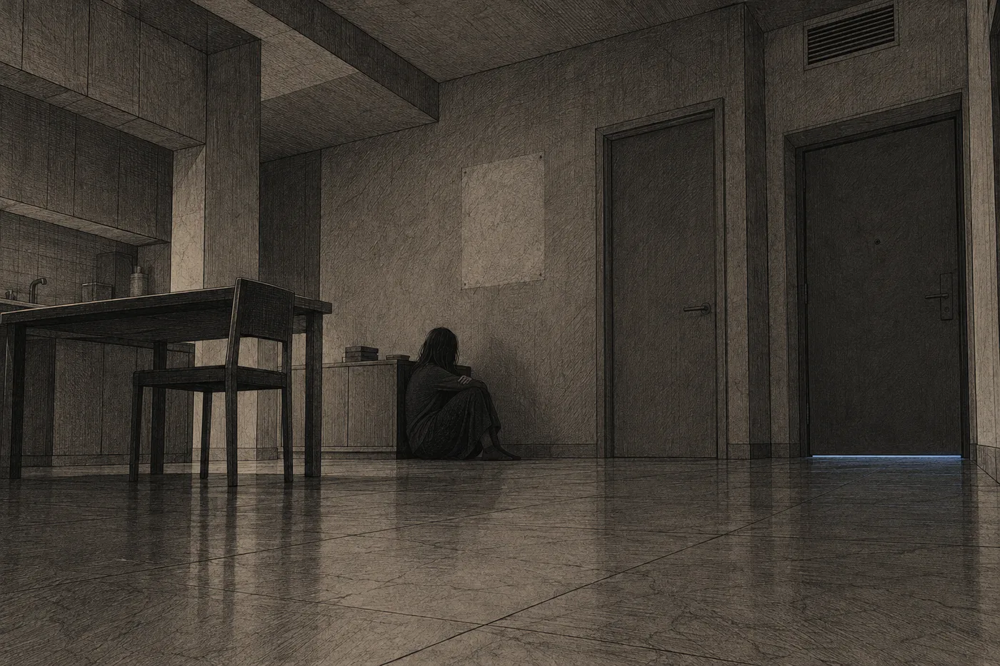

# 14. Hlas sítě

Dveře ho pustily v šest deset ráno.

Nara stála u linky a čekala, až se ohřeje voda. Uslyšela cvaknutí v předsíni a pak kroky, které znala. Neotočila se hned. Nechala si ještě vteřinu, jako se nechává vteřina před otevřením rozsudku.

Daven zůstal stát ve dveřích kuchyně. Byl oblečený do práce, ale košili měl zapnutou o knoflík vedle. Na to by ho dřív upozornila síť. Dnes ne, nebo ji neposlouchal.

„Poslal mi vzkaz,“ řekl. „Včera večer. Přes personál.“

Ukázal jí ho. Ne v ruce, v síti, tím drobným ťuknutím cizí listiny.

*Táto, máma ti musí něco říct. Ať ti to řekne celé. Já už to vím. Ilan.*

„Šestnáct slov,“ řekl Daven. „Počítal jsem je. Celou noc jsem je počítal.“ Odmlčel se. „Volal jsem ti osmkrát.“

„Já vím.“

„Tak mi to řekni celé.“

Řekla mu to celé. Stála u linky, voda za ní dosáhla teploty a síť to ohlásila tichým tónem, a Nara mluvila dál. Úřad. Jeho žádost, rozhodnutá kladně, do dvou dnů. Zúžení návrhu. Pečeť. Lhůta do konce zítřka. Souhlas odsouzeného se u nezletilého nevyžaduje. Daven poslouchal a nepohnul se ze dveří.

Když skončila, chvíli bylo ticho.

Pak si Nara všimla jeho rukou. Třásly se. Ne moc. Prsty pravé ruky se mu chvěly u boku, jako by je měl studené. Daven se podíval, kam se dívá ona, a pak sevřel ruku v pěst.

„Vypnul jsem to,“ řekl.

„Co?“

„Zklidnění. V noci, když jsem počítal ta slova. Věděl jsem, že mi něco řekneš, a chtěl jsem to slyšet celé.“ Hlas se mu zachvěl stejně jako ruce. „Sedm let jsem se na tebe nezlobil, Naro. Teď se zlobím a nevím, jak se to dělá.“

*

Nezlobil se dobře. Nara to viděla a bylo to horší, než kdyby křičel. Nevěděl, kam s rukama. Nevěděl, kdy se nadechnout. Věty se mu lámaly uprostřed a on je začínal znovu, hlasitěji, a pak se lekl vlastní hlasitosti.

„Dva dny,“ řekl. „Věděla jsi to dva dny.“

„Necelé dva.“

„Neopravuj mě.“ Udělal krok do kuchyně a zase se zastavil. „Necelé dva dny. A řeklas to jemu. Sedmnáctiletému klukovi v cele. Ne mně. Já jsem tu žádost podal. Já jsem vyplnil ten vzor. Mně to patří.“

„Patří to jemu.“

„Ne!“ Řekl to tak nahlas, že se oba zarazili. Síť se Nary opatrně zeptala, jestli je v bezpečí. Nara otázku zavřela. Daven pokračoval tišeji, ale hlas se mu třásl dál. „Ne. Jemu to nepatří. Je mu sedmnáct. Proto ho můžou vyjmout bez jeho souhlasu. Protože ze zákona ještě nerozhoduje. Za něj rozhodujeme my. Od toho jsme jeho rodiče.“

„Celý život jsem za něj rozhodovala. Vyčítal mi to.“

„O řádku. O zklidnění. O tom, s kým se smí vídat.“ Daven zavrtěl hlavou. „O věcech, na kterých nezáleželo. Rozhodovala jsi za něj o všem, na čem nezáleželo. A teď, jedinkrát, když na tom záleží, se bojíš rozhodnout. Protože by ti to vyčítal.“

Nara mlčela.

„Neřeklas to jemu, aby rozhodl on,“ řekl Daven. „Řeklas mu to, abys pak mohla říct, že to rozhodl on.“

„To není pravda.“

„Tak co řekl?“

Nara se na něj podívala. Pak se podívala na Ilanův vzkaz, který Daven pořád držel otevřený mezi nimi. *Já už to vím.*

„Řekl, že ti to řekne sám,“ řekla.

Daven zbledl. Nara to viděla. Krev mu odtekla z obličeje a on se chytil zárubně, ne proto, že by padal, ale aby měl ruku na něčem pevném.

„Takže on to chce,“ řekl. „Chce to, a ty…“

„Řekl mi obojí. Že chce žít. A že nechce, aby ho pustili za to, čí je.“

„Je mu sedmnáct.“

„Já vím.“

„Ty víš všechno.“ Daven pustil zárubeň. „Ty vždycky víš všechno. A on bude spát.“

*

Seděli pak u stolu. Daven na své židli, která byla dřív jeho a pak Ilanova. Nara mu nalila horkou vodu a on ji nepil. Prst mu jezdil po škrábanci v desce, tam a zpátky.

„Řekni ano,“ řekl. „Já vím, že to neuděláš kvůli mně. Tak to udělej kvůli němu. On nemusí nic. Úřad rozhodne a on bude doma. Ať tě nenávidí. Ať nenávidí mě. Řekl jsem ti to před třemi týdny a myslel jsem to vážně.“

„Já vím.“

„Ty víš. Ty víš.“ Zasmál se a smích se mu zlomil. „Čím to je, že ty všechno víš a nic z toho nepomáhá?“

Pak vstal. Bylo to náhlé, jako by ho něco zvedlo.

„Půjdu tam,“ řekl. „Za ní. Do úřadu.“

„Davene. Je to moje nabídka. Ne tvoje.“

„Je to moje žádost.“

„Nepřijme to od tebe.“

„Tak ať mi to řekne do očí.“ Daven se zastavil ve dveřích. Stál k ní zády. Viděla, jak se mu zvedají ramena, jak se nadechuje, jednou, dvakrát, a jak to nepomáhá. „Nemůžu tam jít takhle,“ řekl. „Budu na ni křičet. Vyvedou mě, a ona bude mít pravdu.“

Neotočil se. Nara věděla, co dělá, protože to znala. Malý pohyb vzadu za očima, jako když se otevírá nastavení.

„Já vím, že to nechápeš,“ řekl Daven, a uprostřed věty se mu změnil hlas. Byl to stejný hlas. Jen z něj něco odešlo. „Ale je to rozumné nastavení. Doporučují ho.“

Otočil se. Ruce měl klidné.

„Napíšu ti,“ řekl. A odešel.

*

V kanceláři na ni čekala Lumi s otevřeným vzkazem.

„Tohle mi přišlo v šest ráno,“ řekla. „Poslala jste to včera v deset večer.“

Byl to Nařin vzkaz. Čtyři slova. *Zítra v devět. Díky.* A nad tím řádek, který Nara nikdy neviděla:

*Doručeno se zpožděním. Komunikace odesílatelky vyhodnocena jako riziková. Obsah posouzen.*

„Posouzen kým?“ zeptala se Lumi.

„Sítí.“

„Sítí nikdo není.“ Lumi to řekla, jako by se to učila ve škole. Asi se to učila ve škole. „Takže se do toho podívala.“

„Dívá se do všeho. Jen to obvykle neříká.“

Lumi se na ni dívala.

„Od kdy?“

Nara otevřela nastavení vlastní komunikace. Nikdy tam nebyla. Neměla důvod. Všechno, co poslala, vždycky došlo.

*Hodnocení rizika: zvýšené. Zdroj: bezpečnostní posouzení podání (8. den). Důsledek: odchozí komunikace se posuzuje před doručením. Příchozí komunikace s rizikovým obsahem se filtruje.*

A pod tím číslo.

*Filtrováno (rizikový obsah): 4 207.*

*

Nara si ho prohlédla, jak se prohlíží položka v rozpočtu, o které nikdo nevěděl.

Čtyři tisíce dvě stě sedm zpráv, které jí kdosi poslal a které nikdy neviděla. Od dvacátého druhého dne, od chvíle, kdy podala Erenův odstavec a hlášení sítě do veřejné části. Síť je třídila potichu a Naře mezitím doručovala jen obyčejné zprávy: kancelář, soud, Lumi, Daven. Nara si toho nevšimla, protože obyčejných zpráv bylo dost.

*Zobrazit filtrovaný obsah? Zobrazení rizikového obsahu v době rodinné krize se nedoporučuje. Bude zaznamenáno.*

„Nedělejte to,“ řekla Lumi.

Nara to udělala.

Nejdřív nevěděla, na co se dívá. Zprávy šly jedna za druhou, krátké i dlouhé, s podpisy i bez nich, a síť je nesetřídila, protože k tomu nedostala pokyn. Seřadila je jen podle času.

*Děkuju.*

*Moje dcera je v tom transportu. Je jí devatenáct. Prosím vás.*

*Kdo vám dal právo hrát si s našimi lidmi kvůli vlastnímu synovi.*

*Přečetla jsem si toho technika. Celý odstavec. Brečela jsem v práci.*

*Dorazili, tak co chcete. Je to humánní. Lepší než smrt.*

*Který modul se ztratil? Ví se to? Prosím, jestli se to ví.*

*Můj syn je ve druhém. Nové otevření. Nepodepsal. Jmenuje se Rel. Jestli s ním budete mluvit…*

*Individuální pochybení neospravedlňuje kolektivní trest.*

Tuhle větu někdo poslal bez podpisu a bez dalšího slova. Nara ji poznala, protože ji napsala sama. Síť ji filtrovala jako rizikovou.

Četla dál. Lumi se postavila za ni a nic neříkala.

*Hledám v seznamu prvního transportu jméno. Jakékoli. Vybrala jsem si jedno. Oblast 3, modul 2, žena, 34 let, pekařka. Nevím proč. Chci, aby přistála. Je to hloupé?*

Pod touhle zprávou byl odkaz. Nara ho otevřela. Vedl do sítě, na místo, které tam čtyři dny předtím nebylo. Někdo vzal veřejnou přílohu Terry, seznam necelých dvaceti čtyř tisíc jmen podle oblastí a modulů, a dal ho do sítě. Kdo chtěl, mohl si jedno jméno vzít. Napsat k němu, že ho má. Že na něj myslí.

Vzatých jmen bylo přes devět tisíc.

Nara sjela k oblasti 6. K modulu 4. Nevěděla, proč to dělá. U řádku *Eren, technik údržby distribučních sítí* stálo jedenáct poznámek. Nejstarší byla z dvacátého druhého dne, hodinu po tom, co podala odstavec.

*Doufám, že čtvrtý přistál.*

Nara zavřela síť. Dlouho seděla a dívala se do stolu.

„Mám to zase zapnout?“ zeptala se Lumi tiše. „Ten filtr?“

„Zapnutý je pořád,“ řekla Nara. „Jen jsem se podívala, co zadržuje.“

*

Ten den přišly ještě tři listiny. Síť je doručila včas, protože byly úřední.

První poslala správa vodního okruhu. Klient, pro kterého Nara první den vyhrála jednání o přídělu vody. Krátce a zdvořile: *Z důvodu změny rizikového hodnocení advokátní kanceláře správa vodního okruhu ukončuje spolupráci. Děkujeme za dosavadní služby.* Pod tím znak správy a podpis, ke kterému patřil člověk. Nara ho znala. Kdysi spolu po jednání pili čaj na chodbě a on jí vyprávěl o dceři.

Druhá přišla ze soudu.

*Spolkový soud. Senát předsedkyně O. Tann. Jednání ve věci se nařizuje na 37. den v 9:00. Síň 1. Jednání je veřejné.*

Lumi si to přečetla dvakrát.

„Třicátý sedmý,“ řekla. „Den po…“

„Den po lhůtě pana Davena.“

„Ví to? Předsedkyně?“

„Zná zákon o výkonu trestu,“ řekla Nara. „Ví všechno, co víme my.“

Nevěděla, jestli to Tann udělala schválně. Nevěděla, jestli by si to přála. Datum bylo jen datum. Den, kdy už nebude nic k vzetí zpět.

Třetí listinu poslal Koloniální úřad. Nebyla určena Naře. Byla určena všem, a síť jí ji ukázala, protože se týkala věci, kterou vedla. Veřejné prohlášení.

*Koloniální úřad potvrzuje: souhrnné hlášení pozorovací sítě prokazuje, že první transport dorazil do místa výkonu a výsadek byl dokončen. Výkon trestu vyhnanství bez techniky se tím osvědčil jako humanitární alternativa, jak předpokládal rozsudek Terra.*

Nara si to přečetla jednou. Pak se začala smát. Nebylo to veselé a nebylo to hlasité, a Lumi se na ni podívala se strachem.

„Já jsem to tam dala,“ řekla Nara. „Já jsem jim to dala. Jako doklad, že dorazili.“

„Doklad, že dorazili.“

„A oni z toho udělali doklad, že je to humánní.“ Nara se přestala smát. „Je to dobrá práce. Udělala bych to stejně.“

*

V poledne ji v kuchyňce zastavila Pera Lind z protější kanceláře.

Znaly se dvacet let. Pera dělala dědictví a rozvody a dělala je dobře. Kdysi, když bylo Ilanovi pět a Nara neměla kam ho dát, ho nechala celé odpoledne sedět u sebe v kanceláři a kreslit. Teď stála u ohřívače se šálkem v ruce a dívala se na Naru, jako by ji viděla poprvé.

„Chtěla jsem ti napsat,“ řekla. „Včera. Že na tebe myslím.“

„Děkuju.“

„Nenapsala jsem.“ Pera položila šálek. „Moje síť se mě zeptala, jestli to opravdu chci. Že jsi vedená jako riziková. Že komunikace bude zaznamenána.“ Odmlčela se. „Naro, já jsem se lekla. Stála jsem tam se vzkazem a lekla jsem se. Dvacet let.“

Nara nevěděla, co říct. Řekla: „To nevadí.“

„Vadí.“ Pera se rozhlédla po prázdné kuchyňce. „Poslouchej. Nikdo z nás by ti to nevyčítal, kdybys to stáhla. Nikdo. Ukázala jsi, co jsi chtěla. Ten odstavec o technikovi čte celý prstenec. Lidi brečí v práci. Víc z toho nevytěžíš. Teď už jen ztratíš syna kvůli přednášce.“

„Není to přednáška.“

„Pro koho není?“ Pera vzala šálek a šla ke dveřím. U dveří se zastavila. „Já vím, že nemůžeš říct, co v tom je. Všichni to víme. Proto se ptám. Stojí to za to?“

Nara neodpověděla. Pera chvíli čekala. Pak odešla a Nara slyšela, jak za ní na chodbě cvakly dveře její kanceláře.

*

Komora volala ve dvě.

Volal Matis Arel, předseda kárné sekce. Před dvaceti lety jí gratuloval k prvnímu ústavnímu vítězství a před dvaceti dny jí poslal zdvořilý dotaz na střet zájmů. Teď mluvil pomalu, jako mluví člověk, který ví, že je nahráván.

„Komora zahajuje předběžné šetření,“ řekl. „Jedná se o střet zájmů. A o hodnocení rizika. Dostali jsme hlášení.“

„Od koho?“

„Od sítě. Automatické.“ Odmlčel se. „Naro, já ti nechci nic. Neříkám, že máš přestat. Říkám ti, jak to bude vypadat. Matka odsouzeného vede jménem osoby dotčené spor o celý transport a síť ji hodnotí jako rizikovou. Když prohraješ, budou se ptát, proč jsi to dělala. Když vyhraješ, budou se ptát ještě víc.“

„A když to stáhnu?“

Arel chvíli mlčel.

„Pak šetření pozbude předmětu,“ řekl. „To víš sama.“

„Vím.“

„Kdybys mi mohla říct aspoň, že to stojí za to. Že v té příloze je něco, co…“

„Nemůžu ti říct nic.“

„Já vím, že nemůžeš.“ Arel si povzdechl. Bylo to slyšet i přes síť. „To je na tom to nejhorší. Nemůžeš se bránit tím, co víš. Tak se nebraň. Vyjádření do sedmi dnů. Napiš mi, že jednáš podle svého svědomí. Na to se neptám.“

Zavěsil. Nara seděla nad ztichlou linkou a myslela na to, že lhůta k vyjádření skončí pět dní před jednáním. Arel to věděl. Dal jí sedm dní, protože jí víc dát nemohl. Ani on nebyl zlý.

Nikdo nebyl zlý. V tom to bylo.

*

Davenova zpráva přišla v pět. Šla rovnou, bez zpoždění. Daven nebyl rizikový.

*Byl jsem u ní. Pustila mě. Řekl jsem, že žádost je moje a že nabídku přijímám. Řekla, že to není moje nabídka, že je tvoje, a že moje žádost čeká na tebe. Řekla, že je jí to líto. Nevím, jestli to myslela vážně. Měl jsem to zapnuté, tak jsem se nezlobil. D.*

Nara si to přečetla dvakrát. Ardaine mu řekla pravdu. Celou, přesně a bez laskavosti. Ardaine nic jiného neuměla.

Neodpověděla mu. Ne proto, že by nechtěla. Nevěděla, co by mu napsala, aby to nebylo *ne* ani *ano*.

*Do odpovědi: 1 den.*

*

V deset večer seděla v kuchyni a na stole měla dvě volby.

Ne na stole. V nastavení, kam se člověk nedívá. Jedna byla známá. *Zklidnění: automatické. Vypnout.* A pod ní menším písmem, že se to zaznamená. Druhá byla hlouběji, v nastavení, do kterého Nara nikdy nesáhla, protože nebylo proč. Síť ji tam schovávala, jako se schovávají věci, které má mít každý a nemá je používat nikdo.

*Spojení. Přerušit.*

Pod tím tři řádky, delší než všechno, co jí síť za ten den řekla:

*Přerušení spojení je přestupkem podle zákona o propojení. Bude zaznamenáno a oznámeno pořádkové službě prstence Halm. U osob s hodnocením rizika bude oznámeno též příslušné profesní komoře. Opravdu přerušit?*

Nara se na ten text dívala dlouho. Pak sáhla po té první volbě.

Zklidnění se vypnulo bez přechodu.

Nečekala to tak. Myslela si, že to bude jako ventilace, která přejde z nočního režimu do denního. Pomalu. Nebylo to pomalu. Bylo to, jako když někdo otevře dveře do místnosti, kde se křičí.

Strach. Ten přišel první. Ne o sebe. O Ilana, celý a najednou. Všechno, co síť od prvního dne hladila a odkládala vedle ní na židli, teď leželo v ní. Hala. Šest set let. Ticho, který neznám. Pak hněv, horký a hloupý, na Davena, na Ardaine, na Peru Lind se šálkem v ruce, na sebe. Pak něco, co neuměla pojmenovat. Bylo to pod tím vším a bylo to největší.

Nara se chytila hrany stolu a dýchala.

Za tři týdny zapomněla, jaké to je. Tři týdny měla vedle sebe někoho, kdo ji držel, a nevěděla o něm.

Pak, ještě než stačila zaváhat, udělala druhý pohyb.

*Opravdu přerušit?*

*Ano.*

*

Ticho.

Ne tma. Řádek v koutku vědomí nezhasl, protože žádný koutek vědomí nebyl. Nebylo to místo, kde něco chybí. Bylo to, jako by tam nikdy nic nebylo, a ona si to jen celý život myslela.

Obrátila se k síti, aby zjistila čas. Udělala to dřív, než si uvědomila, že to dělá. Pohyb tak starý, že si nepamatovala, kdy se ho naučila. Nic. Udělala ho znovu, silněji. Za uchem ucítila slabý tlak, tam, kde měla implantát. Nic víc.

Ilan to říkal. Jako když v puse chybí zub a jazyk tam pořád jezdí.

Pak začala slyšet.

Ventilaci. Ilan říkal, že má dva tóny. Měl pravdu. Jeden nízký, stálý, který šel ze stropu. Druhý vyšší, který se každých pár vteřin zvedl a zase klesl, jako by se kdesi v potrubí otevíral a zavíral ventil. Celý život bydlela v tomhle bytě a nikdy ho neslyšela. Teď neslyšela nic jiného.

Pak vodu. Ve stěně za linkou jí tekla potrubím k sousedům, tiše, s drobným cuknutím pokaždé, když někdo pustil kohoutek. Pak bzučení chladicí skříně. Pak vlastní dech. Pak, ve spáncích, srdce.

Nevěděla, kolik je hodin. To bylo nejdivnější. Neměla kde se podívat. Čas byl vždycky v řádku, přesný na vteřinu, a teď byl pryč a místo něj zbylo jen to, jak dlouho sedí. Nevěděla, jestli minutu, nebo deset. Uvědomila si, že nikdy v životě neodhadovala, kolik uběhlo. Nebylo proč.

Hodina, řekla si. Rozhodla se pro hodinu. Teď nevěděla, jak dlouho hodina trvá.

Pak si vzpomněla na světla. Ve dvacet tři hodin přecházely chodby Orsy na noční režim. Celý habitat najednou, pomalu, na čtvrtinu jasu. Viděla to pod dveřmi tisíckrát a nikdy se nedívala. Teď se dívat bude.

*

Brečela. Nevěděla, kdy to začalo.

Nebyl to pláč, jaký znala ze záznamů. Neměla ho kde vidět. Nikdo jí neukázal, jak vypadá, a nikdo se nezeptal, jestli je v bezpečí. Seděla u stolu, ruce na desce, a z očí jí teklo, a ona tomu nechala volný průběh, protože nebylo nic, co by to zastavilo. Ani ona to nezkoušela.

Za tři týdny nebrečela ani jednou. Myslela si, že je silná.

Po nějaké době vstala. Nohy ji nesly, ale jinak než předtím. Udělala dva kroky ke dveřím Ilanova pokoje a zastavila se. Nešla tam. Nemusela. Pokoj byl v ní a obdélník po obrazu Země taky.

Sedla si na podlahu.

Neudělala to z rozhodnutí. Prostě si sedla, tam, kde stála, mezi stolem a dveřmi, zády ke skříňce. Podlaha byla studená a tvrdá a Nara cítila, jak ji habitat tlačí dolů, jak ji celý život tlačil a ona o tom nevěděla.

*Sedni si.*

Na náměstí. Jednatřicet dní před rozsudkem. Ilan seděl na dlažbě a udělal jí vedle sebe místo, a ona ustoupila krokem doleva.

Teď seděla. Nikdo ji neviděl. Nikdo to nezaznamenal.

*

Myslela v tichu jinak.

Bez záznamu a bez toho, co jí síť podávala dřív, než se zeptala. Bez citací. Snažila se vybavit si přesné znění nabídky Sabe Ardaine a nešlo to. Měla ho v záznamu slovo od slova a teď z něj zbylo jen pár vět. *To není laskavost. To je řemeslo.* A *jen bude větší*. Zbytek byl pryč, nebo ležel někde, kam bez sítě nedosáhla.

Jiné věty zbyly celé. Nemusela je hledat.

*Já nechci letět.*

*A ty nejsi lepší, když to nevezmeš.*

*Ztráty mezi původními populacemi neodhadnuty.*

*Doufám, že čtvrtý přistál.*

Nara seděla na podlaze a tyhle věty jí ležely v hlavě vedle sebe. Nedaly se sečíst. Na náměstí to zkoušela a nešlo to. Nešlo to ani teď. Jen tu teď nebyl nikdo, kdo by ji od toho odvedl, aby se jí ulevilo.

Ilan by žil. Byl by doma. Mohla by se ho za deset let zeptat na cokoli.

A ona by tu seděla každý rok. Na téhle podlaze nebo na jiné. Věděla by, že listy leží dvanáct set metrů pod povrchem měsíce, v zalité schránce. Že ji tam vrátila ona. Že pole na víku ukazuje jedničku a že u té jedničky už navždy zůstane. A že zalít ji nechala, aby mohla mít syna.

Nebylo to rozhodnutí. Nara ho necítila jako rozhodnutí. Bylo to spíš jako dno. Sáhla dolů a bylo tam.

*

Světlo pod dveřmi pohaslo.

Pomalu, jak to dělalo vždycky, na čtvrtinu. Nara se na to dívala z podlahy. Chodba za dveřmi zešedla. Celý habitat teď ztlumil světla, Orsa, Luma, Keta, všude stejně, a Ilan v Sedmé loděnici to nepoznal, protože tam se nesvítilo podle hodin.

Hodina. Možná trochu víc.

Nara se zvedla. Nohy měla ztuhlé. Postavila se ke stolu, kde seděla předtím, a ještě chvíli stála a poslouchala ventilaci. Dva tóny. Nízký a ten, co se zvedá.

Pak udělala ten pohyb, který dělala celý život, a síť se vrátila.

Vrátila se najednou, se vším. Čas: dvacet tři hodin dvě minuty. Teplota v bytě. Stav spojení. Zmeškané hovory: Daven, dvakrát. Lumi, jednou. A pak řádky, které Nara čekala, jeden pod druhým.

*Spojení přerušeno: 62 minut. Přestupek zaznamenán.*

*Oznámeno: pořádková služba prstence Halm. Oznámeno: profesní komora advokátů.*

*Zklidnění: vypnuto uživatelkou. Zapnout znovu? Doporučeno.*

Nara se na poslední řádek dívala. Celý život se dívala na řádky, které něco doporučovaly.

*Ne,* odpověděla.

Síť to přijala bez dotazu. Zapsala to. Vedle odpočtu v koutku vědomí ležela dvě čísla, jako ležela předevčírem, velké a malé.

*Do odletu: 22 dní.*

*Do odpovědi: 1 den.*

O půlnoci se to malé změnilo.

*Do odpovědi: dnes.*
