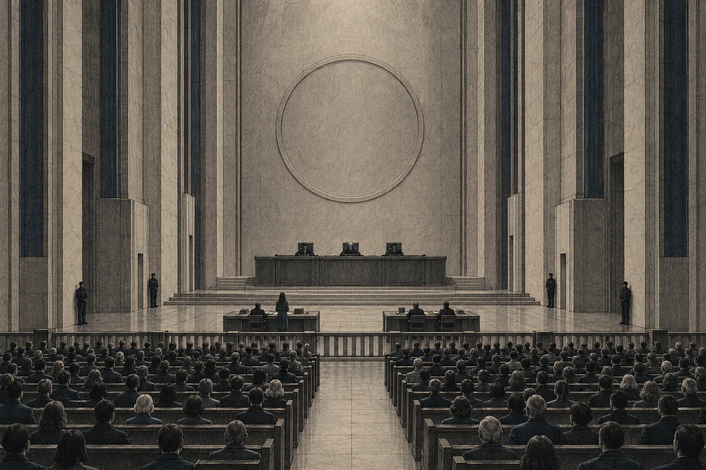

# 16. Zápis

Síň jedna měla lavice pro veřejnost a všechny byly plné.

Nara to věděla, ještě než vešla. Síť jí to řekla na chodbě, ochotně a předem, jak to dělala se vším: *Síň 1: kapacita 240 osob. Obsazeno: 240. Před budovou: odhadem 1 100 osob.* Pod tím menším písmem: *Doporučení: vstup bočním vchodem.* Nara šla hlavním.

Před budovou stáli lidé v řadách, které nikdo neurčil. Nemluvili. Stáli tak, jak stojí lidé, kteří nevědí, jestli smějí stát, a tak stojí co nejtišeji. Pořádková služba stála podél stěny a také mlčela. Když Nara vystoupila z chodby od kyvadla, otočilo se k ní tolik obličejů najednou, že se na okamžik zastavila.

Pak šla. Řady se před ní rozestupovaly.

U schodů ji někdo chytil za rukáv. Žena, menší než Nara, v pracovním oblečení správy čištění, s rukou, která svírala látku příliš pevně.

„Paní Vess,“ řekla. „Psala jsem vám. Rel. Můj syn se jmenuje Rel. Nepodepsal.“

Nara si vzpomněla. Jeden řádek ze čtyř tisíc dvou set. *Jmenuje se Rel. Jestli s ním budete mluvit…*

„Nemluvila jsem s ním,“ řekla. „Nesmím za ním.“

„Já vím. Já taky ne. Nejsem…“ Žena se zarazila. „Bojím se tam jít. Zapisuje se to.“ Pustila rukáv. „Jen jsem chtěla, abyste věděla, jak se jmenuje. Až tam budete mluvit.“

„Budu to vědět.“

Žena kývla a ustoupila do řady. Nara šla dál. Síť jí k té ženě nabídla jméno, totožnost a hodnocení rizika. Nara to zavřela, než to stihla přečíst.

Chodba byla vysoká jako všechny chodby Spolkového soudu, zbytečně vysoká, s tím okázalým plýtváním vzduchem, kterým se budova kdysi chlubila. Lidé u stěn ustupovali, když šla kolem. Nikdo nic neřekl. Někteří se dívali přímo, jak se dívají odpojení, i když odpojení nebyli. Jedna žena měla na zápěstí bílý provázek. Pořádková služba u dveří síně ho viděla a nic neudělala.

*Do odletu: 10 dní.*

Ruce se jí třásly. Nara je nechala.

*

Síň jedna byla stará. Stůl senátu stál na vyvýšení pod kruhem s váhami, tmavý, z materiálu, který se na Orse už nevyráběl. Pod ním dva stoly pro strany. Za nimi zábradlí a pak lavice, řada za řadou, až ke stěně. Strop byl tak vysoko, že světlo z něj přicházelo měkké, jako z velké dálky.

Nara si sedla ke stolu navrhovatelky. Lumi vedle ní. Lumi měla otevřenou veřejnou část přednesu a dívala se do ní, aby se nemusela dívat dozadu.

Nara se podívala dozadu.

Juno Pell seděla v první řadě, v teplé bundě, s rukama v kapsách. Vedle ní, na židli s opěradlem, kterou přinesli zvlášť a postavili na kraj, seděla Hadra Mel. Měla svůj dlouhý tmavý kabát a dívala se na stůl senátu, jako by si ho prohlížela. Hals stál u stěny. Nara ho poprvé viděla nahoře. V síni působil vyšší a hubenější než v úložišti a rukavice měl pořád na rukou, i když tu nebyla zima. Asko seděl ve druhé řadě, na kraji, s jednou rukou položenou na stěně vedle sebe.

Úplně vzadu, u dveří, seděl Daven. Díval se na ni. Nekývl. Nara taky ne.

Ardaine seděla u stolu odpůrce sama. Šedé oblečení úřadu, ruce naplocho na kolenou. Nedívala se dozadu ani jednou.

*Jednání ve věci. Veřejné. Záznam: veřejný.*

Senát vešel. Všichni vstali. Tann šla první, vysoká i v chůzi, šedé vlasy stažené dozadu. Za ní mladší soudce a starší muž, který držel ruce sepjaté, i když šel. Sedli si. Síň si sedla.

„Spolkový soud,“ řekla Tann. „Senát. Věc: návrh na zastavení výkonu trestu vyhnanství, druhý transport. Navrhovatelka Nara Vess. Odpůrce Koloniální úřad.“ Podívala se na Naru. „O aktivní legitimaci navrhovatelky rozhodne senát ve věci. Navrhovatelka má slovo.“

Nara vstala.

*

Veřejnou část řekla tak, jak ji s Lumi připravily. Krátce. Senát ji měl napsanou a nepotřeboval ji slyšet dvakrát. Potřebovali ji slyšet ti v lavicích.

Ústava. Každý odpovídá za vlastní čin, nikdo za čin jiného. Stojí to tam od začátku.

Odstavec dvě stě osmnáct rozsudku Terra. *Kdo s ním sdílí domácnost, sdílí jeho následek.* Nara ho řekla a v lavicích se nikdo nepohnul. Ten odstavec znal každý od prvního ročníku.

Domněnka v odstavci tři sta devadesát jedna. Dvě slabiky, které síť nepřekládá. *Má se za to, že Země je neobydlený svět.* Nara řekla, co to znamená: že soud to nezjistil, jen to předpokládal, a že předpoklad lze vyvrátit.

A pak Erenův odstavec. Řekla ho skoro celý, jak ho napsala s Lumi. Příčinný podíl. Zanedbání opatrnosti. Úmysl nedoložen. Přiznání podepsané za doložku, jejíž první věta byla obejita a druhá porušena.

„Auditorko,“ řekla Tann, když Nara skončila. „Potvrzujete závěry rekonstrukce, jak je navrhovatelka uvedla?“

Pell vstala. Ruce nechala v kapsách.

„Potvrzuji,“ řekla. „Nic víc v záznamech není. Nic míň taky ne.“

Sedla si.

„Individuální pochybení neospravedlňuje kolektivní trest,“ řekla Nara. „Rozsudek nad čtyřmi sty jedním členem hnutí Nové otevření se opírá o tentýž odstavec.“ Odmlčela se. „Tím končí, co navrhovatelka může říct, aniž by mluvila o příloze.“

*

V síni bylo ticho. Za zdmi se do záznamu dívaly tisíce lidí. Nara je necítila. Jen to věděla.

„Navrhovatelka má k příloze návrh,“ řekla.

„Senát poslouchá.“

„Devátého dne senát rozhodl, že navrhovatelka smí o obsahu přílohy mluvit před senátem. Zda bude zápis z takového jednání pod pečetí, si senát vyhradil.“ Nara se podívala na Tann. „Řekla jste: tehdy, ne dnes. Navrhovatelka žádá, aby senát o zápisu rozhodl teď. Než začne mluvit.“

„Odůvodnění.“

„Za prvé.“ Nara položila ruce na stůl, dlaněmi dolů. Třásly se a ona je tam nechala. „Pečeť je součástí rozsudku Terra. Chrání listiny. Navrhovatelka nežádá, aby senát pečeť zrušil. Listiny zůstanou v úložišti, zalité, kde jsou. Zápis z dnešního jednání součástí rozsudku Terra není. Je součástí tohoto řízení. O něm rozhoduje tento senát.“

Tann nic neřekla. Mladší soudce si něco zapsal.

„Za druhé. Příloha byla zapečetěna z bezpečnostních důvodů. V čem ty důvody spočívají, uvedl odpůrce při jednání o přístupu. Senát to má v zápisu.“ Nara neřekla, co tam stojí. Zápis z devátého dne byl pod pečetí. „Navrhovatelka nepřednese žádný údaj o poloze kteréhokoli místa. Ani místa výkonu, ani průzkumné oblasti. Na tom, co zbude, žádný bezpečnostní důvod, který odpůrce uvedl, nespočívá.“

„Za třetí?“

„Za třetí.“ Nara se na okamžik zastavila. Tohle si opakovala nejčastěji. „Senát o návrhu rozhodne. Ať rozhodne jakkoli, musí rozhodnutí odůvodnit. Pokud ho odůvodní přílohou a zápis zapečetí, bude to rozhodnutí, jehož důvody nikdo nesmí číst. Šest tisíc dvanáct lidí, kterých se týká, nebude vědět proč. Čtyři sta jeden člověk, jehož rozsudek se opírá o Terru, nebude vědět proč.“ Odmlčela se. „Před devíti sty lety soud přijal listinu neotevřenou a zapsal, co v ní je. Soud neviděl. Soud zapsal. Pokud senát dnes zápis zapečetí, rozhodne o téže listině podruhé tak, že ji uvidí jen on.“

V lavicích se někdo pohnul. Nara se neotočila.

„Navrhovatelka žádá, aby zápis z jednání nebyl uložen pod pečetí. S výjimkou údajů o poloze, které nepřednese.“

Sedla si.

*

Ardaine vstala, ještě než ji Tann vyzvala. Pak se zastavila, počkala na pokyn, a teprve potom promluvila.

„Odpůrce s návrhem nesouhlasí.“

Mluvila tiše, jako vždycky. V síni jedna to znělo jinak než v síni čtyři. Hlas šel nahoru ke stropu a vracel se.

„Navrhovatelka tvrdí, že nežádá zrušení pečeti. Žádá jen, aby se veřejně řeklo, co je pod ní. To je totéž. Pečeť, o jejímž obsahu se smí mluvit veřejně, chrání jen hmotu listů. Nechrání nic, kvůli čemu byla zřízena.“

„A kvůli čemu byla zřízena?“ zeptala se Tann.

„Z bezpečnostních důvodů. Jak stojí v rozsudku.“

„Odpůrce je uvedl devátého dne. Senát je má v zápisu. Týkají se údajů o místech výkonu. Navrhovatelka je nepřednese. Odpůrce uvádí jiný bezpečnostní důvod?“

Ardaine chvíli mlčela. Ruce měla opřené o desku stolu a nepohnula jimi.

„Bezpečnostní důvody, pro něž byla příloha zapečetěna, jsou uvedeny v příloze,“ řekla Ardaine. „Kdybych je uvedla, porušila bych pečeť.“

„Pak je uveďte senátu,“ řekla Tann. „Senát k příloze přístup má.“

„Senát je zná. Četl je dvanáctého a třináctého dne.“

Tann se na ni dívala.

„Senát četl jednu listinu, která se bezpečnosti týká,“ řekla. „Co v ní stojí, senát teď neuvede. Ta listina je důvod, proč byla příloha zapečetěna. Není to důvod, proč by měl být zapečetěn zápis z tohoto jednání.“ Odmlčela se. „Odpůrce uvádí jiný?“

Ardaine tentokrát odpověděla hned.

„Odpůrce nemůže uvést jiný důvod, aniž by porušil pečeť,“ řekla.

„Senát to bere na vědomí,“ řekla Tann. „Senát se přerušuje na dvacet minut.“

*

Dvacet minut.

Nara seděla u stolu a nehýbala se. Lumi vedle ní dýchala rychle a mělce. Za zábradlím se lidé zvedali, mluvili spolu tiše, někteří vycházeli na chodbu. Síť Naře do koutku vědomí sypala čísla: *Záznam jednání sleduje: 412 000.* A pak víc. Nara to zavřela.

Asko se k ní naklonil přes zábradlí. Ruku měl pořád na stěně.

„Slyšelas, co udělala?“ řekl tiše. „Neřekla, co v té listině stojí. Řekla jen, že je jedna. A Ardaine řekla, že druhou uvést nemůže.“

„Já vím.“

„Ne. Poslouchej.“ Asko se odtáhl. „Tann to teď má v zápisu. Že jiný důvod není. Nemusela se ptát. Zeptala se.“

Nara se otočila k Ardaine. Ardaine seděla u svého stolu a dívala se na prázdnou desku. Ruce měla na kolenou. Za celých dvacet minut se nepohnula.

Hadra Mel, v první řadě, zavřela oči. Nara chvíli nevěděla, jestli usnula. Pak Mel oči otevřela a podívala se přímo na ni.

„Paní Vess,“ řekla, ne hlasitě, ale tak, aby to bylo slyšet přes zábradlí. „Až budete mluvit. Vlevo.“

„Vlevo,“ řekla Nara.

*

Senát se vrátil. Síň si sedla.

Tann neměla před sebou nic. Mluvila zpaměti, jak to Nara viděla jen u ní.

„Devátého dne senát řekl: tehdy, ne dnes,“ řekla. „Tehdy je dnes.“

A pak usnesení.

*Zápis z jednání ve věci se pod pečetí neukládá. Z veřejného zápisu se vyjímají údaje o poloze míst výkonu a průzkumných oblastí. Navrhovatelka je nepřednese.*

*Obsah přílohy k rozsudku Terra se v rozsahu, v jakém bude v jednání přednesen, zapisuje do veřejného záznamu. Listiny přílohy zůstávají v hlubokém úložišti pod pečetí, jak určil rozsudek Terra.*

*Poznámka navrhovatelky k části III přílohy se k veřejnému zápisu připojuje v plném znění.*

*Podání a výpovědi, které byly v tomto řízení uloženy pod pečetí, se zpřístupňují s vyloučením údajů o poloze.*

*Odůvodnění: Senát nemůže rozhodnout o návrhu, aniž by se vypořádal s obsahem přílohy. Rozhodnutí, jehož důvody nelze číst, by bylo rozhodnutím jen podle jména. Bezpečnostní důvod, pro který byly listiny zapečetěny, se netýká toho, co lze o nich říct bez údajů o poloze. Pečeť rozsudku Terra chrání listiny. O zápisu z jednání tohoto senátu rozhoduje tento senát.*

Tann se podívala na Ardaine.

„Odpůrce?“

Ardaine vstala.

„Odpůrce bere na vědomí,“ řekla. A pak, po krátké odmlce: „A trvá na tom, že bude-li navrhovatelka přednášet údaje, které se týkají polohy, bude vznášet námitky.“

„Senát o nich rozhodne hned.“

Ardaine si sedla.

„Navrhovatelka,“ řekla Tann.

*

Nara vstala.

Neměla nic. Žádné poznámky, žádný záznam. Poznámky ležely v úložišti pod pečetí, nadiktované do zapisovače, a záznam se jí přerušoval pokaždé, když četla. Měla jen to, co si odnesla v sobě. Šest hodin před šesti dny. Prsty, které ohýbala jeden po druhém, a pak znovu od palce.

Položila ruce na stůl. Třásly se. Podívala se na ně a pak na senát.

„Příloha má čtyři části,“ řekla.

Hlas jí zněl cize. Zněl hlasitěji, než chtěla, a odrážel se od stropu. Bez zklidnění neměl nic, co by ho drželo rovně. Nara se nadechla a mluvila dál.

„Část první. Průzkumné listy. Tři sta čtyřicet. Koloniální úřad je pořídil při průzkumu Země. Průzkum je starší než první proces, o kolik, to se neví. Listy jsou psány tak, jak se psaly průzkumy. Vlevo sloupec *viděno*. Vpravo *usouzeno*. Pravému sloupci se podle pravidel úřadu nevěří. Navrhovatelka bude uvádět jen levý.“

Ohnula palec.

„Na listech jsou lidé. Skupiny po dvaceti až čtyřiceti osobách. S ohněm, s nástroji z kamene, v kůžích. Žena s dítětem na zádech. Ve všech oblastech průzkumu.“

V lavicích někdo nahlas vydechl. Nara se nezastavila.

„Na listech jsou létající plazi. Rozpětí křídel asi dvakrát výška člověka. Hnízdí jednotlivě, v převisech skal. V hnízdě jsou řady předmětů, srovnané: zlatá zrna, krystaly, valouny. Ve skále nad hnízdem jsou rýhy, po třech. Na listu z druhé návštěvy, po přeletu průzkumného člunu, je v hnízdě o jednu řadu víc. Na pohyblivém záznamu se plaz podívá nahoru k přístroji. Pak vyryje do skály tři čáry.“

Ohnula ukazovák.

„Na listech jsou malí lidé, kteří žijí pod zemí, u teplé vody. Na listech jsou vysocí, s dlouhými pažemi, kteří se vyhýbají světlu a sledují člun. Jeden z nich zvedl ruku. Na listech jsou noční. Jsou vidět jen ve tmě. A je tam skupina, u níž průzkumník zapsal *tvar neurčen*.“

Ohnula prostředník.

„U každé skupiny nakreslil průzkumník kroužek. Co si o nich myslel, stojí vpravo. Navrhovatelka to neuvádí.“

Podívala se na první řadu.

„Svědkyně je přibrána. Senát se jí může zeptat.“

Tann se otočila k Mel.

„Svědkyně. Uvedla navrhovatelka něco, co v listech není?“

Hadra Mel se nezvedla. Zvedla jen hlavu.

„Ne,“ řekla. „Uvedla jen levý sloupec. Pravý vynechala. Tak se to má dělat.“ Odmlčela se. „Vynechala i to, že jsem se na ty listy dívala čtyřicet jedna let jako na prázdné místo v katalogu. To tam taky není.“

V síni bylo ticho.

*

„Na mapě průzkumu,“ řekla Nara, „je dvacet tři oblastí. U osmi z nich kdosi později jinou rukou připsal čísla jedna až osm. V jedné z těch osmi stojí vedle místa, které úřad označil jako navržené k přistání, tři kroužky. Nejbližší skupina je od místa necelý den chůze.“

„Námitka,“ řekla Ardaine.

„Odůvodnění.“

„Navrhovatelka uvádí vzdálenost od místa výkonu. To je údaj o poloze.“

Tann se podívala na Naru.

„Navrhovatelka neuvedla, o kterou oblast jde,“ řekla Nara. „Ani kde leží. Uvedla, že v jedné z osmi oblastí výkonu žije vyznačená skupina necelý den chůze od místa přistání. Kdo by podle toho chtěl někoho najít, musel by hledat na celém světě.“

Tann chvíli mlčela.

„Bez určení oblasti to údaj o poloze není,“ řekla. „Námitka se zamítá. Navrhovatelka nebude uvádět, o kterou oblast jde.“

„Nebude.“

Nara viděla, jak Ardaine kývla a sedla si. Nevypadala poraženě. Vypadala jako někdo, kdo udělal, co musel, a ví, že to nestačilo.

„Na téže mapě,“ řekla Nara, „je mimo všechny dvacet tři oblasti přerušovanou čarou ohraničeno ještě jedno místo. Je u něj napsáno: *Nepřistávat. Podle záznamů patronů.* Kde leží, navrhovatelka neuvede. Co znamená, neví.“

Ohnula prsteníček. Na pravé ruce jí zbyl malíček.

*

„Část druhá,“ řekla. „Statut chráněného světa.“

Tady to bylo nejtěžší. Statut si opakovala nejčastěji, a přesto se jí slova v síni rozpadala. Nara začala úvodem a v půli věty se zastavila. Věděla, co tam stojí. Nevěděla, jak přesně.

„Statut je akt Shromáždění Konfederace,“ řekla. „Je starší než průzkum. V úvodu stojí, že Shromáždění přejímá ze záznamů patronů označení světa, jenž je kolébkou lidského druhu…“ Zaváhala. „Za svět chráněný. Přesné znění si navrhovatelka nepamatuje. Je v zápisu pod pečetí.“

„Senát přesné znění má,“ řekla Tann. „Bude-li třeba, přečte ho. Pokračujte.“

„Článek první: svět je chráněný. Článek druhý: nelidské populace, vedené v záznamech patronů, jsou chráněné. Následuje seznam jedenácti populací. Je psán znaky, které dnes nikdo nečte. Článek třetí zakazuje na chráněném světě zakládat sídla, přistávat a vysazovat osoby a organismy. S výjimkou průzkumu, který nezasahuje.“

Nara se odmlčela, aby to v síni dosedlo.

„Vysazovat osoby,“ řekla. „Článek čtvrtý zakazuje zásah. Článek pátý říká, že připojený opis protokolu je součástí statutu. Článek šestý: výjimku ze statutu smí udělit jen Shromáždění. Veřejným jednáním.“

„Veřejným jednáním,“ zopakovala.

„V rejstříku spolkového archivu stojí u statutu: *platný*. Nikdy nebyl zrušen. Nikdy nebyl změněn. Nikdy nebyl zveřejněn.“

Ohnula poslední prst. Pak otevřela dlaň a začala znovu od palce.

„V téže části jsou listiny o tom, jak se příloha dostala k soudu. Průvodní dopis úřadu. Návrh úřadu, aby ji soud přijal v zapečetěné podobě. A usnesení: *Soud přílohu přijímá v zapečetěné podobě a činí ji součástí rozsudku.* Schránku zalil úřad. Na víku je pole, do něhož schránka sama zapisuje, kolikrát byla otevřena.“ Nara se podívala na Halse u stěny. „Do dvanáctého dne tohoto řízení na něm stála nula.“

Hals se nepohnul. Jen sklopil hlavu.

*

„Část třetí,“ řekla Nara. „Opis protokolu. Devět listů, neúplných.“

Tady nemusela nic vážit. Tady to měla celé.

„Nahoře je opis ve znacích, které nikdo nečte. Dole překlad Koloniálního úřadu, pořízený podle slovníku úřadu. Slovník je ztracen. Překladatel označil překlad za pracovní. Klíčový pojem přeložil slovem *kontaminant*. U jednoho slovesa zapsal, že slovník uvádí *hlídá, opatruje*, a že přeložil *izoluje*, podle smyslu. Doporučil ověření podle úplného znění. Nikdy se neprovedlo.“

Pak řekla poznámku. Celou, slovo od slova, jak ji patnáctého dne nadiktovala do zapisovače dvanáct set metrů pod povrchem.

„*Klíčový pojem opisu protokolu je v překladu Koloniálního úřadu vyjádřen slovem kontaminant. Překlad pořídil úřad podle vlastního slovníku, který je dnes ztracen. Originál nikdo nečte. Překladatel sám označil překlad za pracovní a doporučil ověření podle úplného znění, které není k dispozici.*“

„*Navrhovatelka nenavrhuje jiný překlad. Upozorňuje, že překlad tohoto slova je nejistý, a že ani jeho výklad, ani výklad protokolu jako celku se proto nesmí stát podkladem rozhodnutí, dokud ho nelze ověřit.*“

„*Navrhovatelka žádá, aby tato poznámka zůstala připojena k části III v každé podobě spisu.*“

Odmlčela se.

„Teď má spis podob víc,“ řekla.

Tann se na ni podívala. Pak řekla do záznamu: „Poznámka je připojena.“

*

„Část čtvrtá.“

Nara se nadechla. Ruce na stole se jí třásly víc než předtím a ona je stáhla k sobě a sevřela. Pak je zase položila. Nebylo nic, co by je zklidnilo. Bylo jen to, co měla říct.

„Jedna listina. Interní stanovisko Koloniálního úřadu, odboru míst výkonu. Nahoře stojí: *Interní. Nezakládá se do spisu.* Pod tím jinou rukou, jiným znakem: *Založeno.* Kdo to připsal, se neví.“

Hals u stěny zvedl hlavu.

„Stanovisko uvádí, že statut chráněného světa neodpovídá bezpečnostní potřebě Konfederace. Nedoporučuje žádat Shromáždění o veřejnou výjimku. Doporučuje, aby se rozsudek o statutu nezmiňoval a aby se zjištění o místech výkonu zapečetila. Místa výkonu mají ležet v odstupu od vyznačených skupin, jejichž populace jsou chráněny statutem.“ Nara se zastavila. Tuhle větu si pamatovala přesně. Pamatovala si ji, protože ji nechtěla. „*Úplné oddělení není možné.*“

V lavicích byl slyšet zvuk, který Nara neznala. Nebyl to šum. Bylo to, jako by se dvě stě čtyřicet lidí najednou přestalo hýbat.

„A pak stanovisko říká, jak má rozsudek mluvit o místě výkonu. Doslova: *Formulace o místě výkonu bude vedena jako domněnka. Soud tím nevysloví nic, co by bylo nepravdivé.*“

Podívala se na Ardaine. Ardaine se dívala na ni.

„*Má se za to*,“ řekla Nara. „Dvě slabiky v odstavci tři sta devadesát jedna. Síť je nepřekládá. Učebnice je vynechávají. Byly objednané.“

Pak řekla poslední větu, kterou si z části čtvrté pamatovala. Nechala si ji na konec, protože nevěděla, jestli ji dokáže říct.

„Stanovisko odhaduje ztráty mezi odsouzenými. A o původních populacích stojí: *Ztráty neodhadnuty.*“

Podpis řekla až potom. „U. Sarr, správce míst výkonu.“

*

Chvíli nemluvil nikdo.

Nara stála a čekala, až se jí vrátí hlas. Vracel se pomalu. Ruce měla na stole a třásly se a ona se na ně podívala a uvědomila si, že je to poprvé od prvního dne, co mluví v síni a nic ji nedrží.

„Navrhovatelka shrnuje,“ řekla.

„Domněnka v odstavci tři sta devadesát jedna je vyvrácena. Vyvrátily ji listiny, které soud před devíti sty lety přijal neotevřené. Koloniální úřad v době rozsudku věděl, že Země obydlená je. Věděl, že je chráněná. Věděl, že výjimku může dát jen Shromáždění veřejně. Nepožádal o ni. Místo toho zařídil, aby rozsudek mlčel.“

„Výkon trestu podle rozsudku Terra se neděje před devíti sty lety. Děje se teď. Za deset dní má vysadit šest tisíc dvanáct osob na svět, na který statut, platný dodnes, zakazuje vysazovat osoby. Je to vědomé porušení ochrany chráněného světa. Bylo vědomé tehdy a dnes je vědomé znovu, protože ode dneška to ví každý.“

„Navrhovatelka žádá, aby senát výkon trestu vyhnanství, druhý transport, zastavil.“

Sedla si.

Lumi vedle ní měla oči plné slz a nehýbala se. Nara se na ni nepodívala. Kdyby se podívala, nezvládla by to.

*

Ardaine vstala.

Chvíli stála a nic neříkala. Pak promluvila, tiše a do celé síně.

„Odpůrce nepopírá, co v listinách stojí.“

Šum. Teď už to byl šum, krátký a hned utlumený. Tann se nepohnula a síň zmlkla sama.

„Navrhovatelka přednesla přílohu přesně,“ řekla Ardaine. „Svědkyně to potvrdila. Odpůrce to potvrzuje také. Odpůrce popírá, že o tom smí rozhodnout tento senát.“

Pak to řekla celé. Krátce, po bodech, jak psala. Navrhovatelka napadá místo výkonu. Místo výkonu uložil rozsudek Terra. Kdo napadá místo výkonu, napadá trest, a trest uložený pravomocným rozsudkem Spolkového soudu tento senát přezkoumat nesmí. Statut svěřuje výjimku Shromáždění. Svěřuje mu tedy i nápravu. Ne soudu.

„A protokol,“ řekla Ardaine. „Je součástí statutu, jak navrhovatelka sama uvedla. Mluví o kontaminantu a o hranici. Odpůrce trvá na tom, že jde o karanténu. Navrhovatelka jiný výklad nemá.“ Podívala se na Naru. „Odpůrce oceňuje, že ho nepředstírá.“

„Konečně,“ řekla Ardaine. „Třicátého dne podal Koloniální úřad osvědčení bezpečnostní nezbytnosti výkonu. Zákon o výkonu trestu senátu dovoluje přezkoumat jen to, zda je vydal příslušný orgán v předepsané formě. Vydal ho příslušný orgán. Forma je předepsaná.“

Odmlčela se.

„Navrhovatelka mluví o světě,“ řekla. „Tento senát rozhoduje o lodi.“

Sedla si.

*

„Navrhovatelka,“ řekla Tann. „Replika. Krátce.“

Nara vstala. Měla toho mnoho a vybrala jednu věc.

„Osvědčení se dovolává bezpečnostních důvodů uvedených v příloze,“ řekla. „V příloze je jediný bezpečnostní důvod. Je to věta stanoviska, že statut neodpovídá bezpečnostní potřebě Konfederace. Bezpečnostní důvod, který odpůrce osvědčuje, je rozhodnutí statut obejít.“ Odmlčela se. „Senát nesmí přezkoumat, zda je osvědčení důvodné. Navrhovatelka žádá jen, aby senát zapsal, o co se opírá.“

„Senát to zapsal,“ řekla Tann.

Nara si sedla.

Tann se podívala na oba stoly. Pak do síně.

„Senát vyhlásí rozsudek třicátého devátého dne v devět hodin, v této síni,“ řekla. „Jednání je skončeno.“

*

Senát odešel. Síň se nezvedla hned.

Lidé seděli. Pak se začali zvedat, pomalu, po jednom, a nikdo nemluvil nahlas. Šli kolem zábradlí a někteří se zastavovali u Nařina stolu. Nic neříkali. Jedna žena položila ruku na okraj desky, na kratičkou chvíli, jako se člověk dotýká stěny v nízké gravitaci, aby věděl, kde je. Pak šla dál.

Juno Pell prošla kolem a kývla. Hadra Mel se zvedla ze židle s opěradlem pomalu, s Halsovou rukou pod loktem. U zábradlí se zastavila.

„Vlevo jste to řekla dobře,“ řekla. „Vpravo jste neřekla nic. To bylo nejtěžší, viděla jsem to.“ Odmlčela se. „Teď si sednu na linku a budu spát až na Lumu.“

Hals ji držel dál. Podíval se na Naru přes její rameno.

„Založeno,“ řekl tiše. Víc ne.

Asko počkal, až se síň skoro vyprázdní. Pak přišel k zábradlí, s rukou na stěně, dokud stěna nedošla.

„Tady tě nechytili,“ řekl.

„Já vím, kde mě chytí.“

„Já taky,“ řekl Asko. „Napsal jsem ti to.“ Díval se na ni přes brýle. „Mluvila jsi bez toho. Bez zklidnění.“

„Ano.“

„Bylo to slyšet,“ řekl Asko. Neřekl, jestli dobře, nebo špatně. Odešel.

Vzadu u dveří už Daven nebyl. Nara se tam podívala a viděla jen prázdnou lavici.

Ardaine odcházela poslední. U Nařina stolu se nezastavila. Prošla kolem, dívala se před sebe, a teprve ve dveřích se otočila.

„Bylo to přesné,“ řekla. A odešla.

*

Na chodbě se Naře vrátila síť celá najednou.

*Záznam jednání: veřejný. Sledovalo: 1 380 000. Ohlasy: …* Číslo se měnilo tak rychle, že ho síť přestala ukazovat a místo něj napsala jen *mnoho*. Pak, menším písmem, řádek, který Nara nikdy neviděla:

*Zápis obsahuje rizikový obsah. Veřejný záznam Spolkového soudu nelze filtrovat.*

Nara se na ten řádek dívala dlouho.

Všechno ostatní síť uměla odložit, zpozdit, posoudit, vzít z dosahu. Zprávy, prosby, vzkaz Pery Lind, jméno pekařky z modulu dva. Tohle ne. Zápis soudu byl jediná věc, kterou nikdo nemohl potichu zalít.

Pod tím přišla Davenova zpráva. Šla rovnou.

*Slyšel jsem tě. Mluvila jsi nahlas. D.*

Nara se zastavila uprostřed chodby a lidé ji obcházeli.

Pak otevřela vzkaz přes personál. Dvacet slov. Pořád tam leželo to staré slovo, *Proč?*, teď už o kus níž, pod všemi zprávami, které přišly potom. Odpověděla na něj kdysi, jak jen směla. Teď směla víc.

Psala pomalu. Ruce se jí třásly i v síti, nebo si to aspoň myslela.

*Na tom obraze chyběla bílá na severu. A lidé. Už to smím říct. Řeknu ti všechno. Máma.*

Sedmnáct slov. Odeslala to.

Síť vzkaz chvíli držela. *Posuzuje se.* Pak ho pustila.
